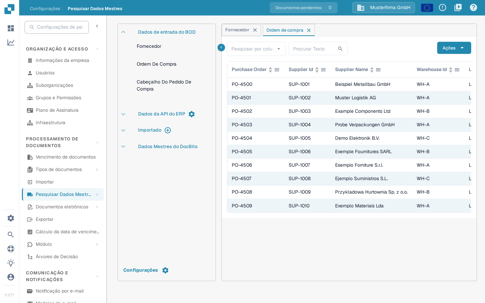

# Correspondência de pedidos de compra

Para testar a configuração de correspondência de pedidos de compra, crie uma ordem de compra no LN/M3 e verifique se está sincronizada com o DocBits.

## Criar uma ordem de compra no INFOR

* LN: https://docs.infor.com/ln/10.4/en-us/lnolh/docs/ln\_10.4\_procpoug\_\_en-us.pdf
* M3: https://docs.infor.com/m3udi/16.x/en-us/m3beud/default.html?helpcontent=ois610.html

Depois de criar a ordem de compra, abra **Configurações → PROCESSAMENTO DE DOCUMENTOS → Pesquisar Dados Mestres** e procure o número da ordem que acabou de criar. A página [Pesquisa de dados mestre](../../settings/document-processing/master-data-lookup.md) explica os separadores, a pesquisa na tabela e o menu **Ações**; a ordem de compra deve aparecer no separador **Ordem de compra**.

<figure><figcaption>
As ordens de compra aparecem em Pesquisar Dados Mestres.
</figcaption></figure>

Se vir aqui o número da sua ordem de compra, o DocBits e o INFOR estão sincronizados corretamente.

Carregue agora a fatura cujas quantidades e preços unitários correspondem à ordem de compra que criou. Valide o documento e selecione a correspondência de pedidos de compra no ecrã de validação. A [Tela de Correspondência de Ordem de Compra](../../../end-user-and-partner-section/end-user-section/purchase-order-matching/README.md) explica como pesquisar a ordem e ligar as linhas da fatura às linhas da ordem.

As linhas da ordem de compra e da fatura devem corresponder automaticamente. Selecione depois a opção de exportação e verifique se o documento é exportado sem erros. Se ocorrer um erro de exportação, crie um ticket para a equipa de suporte do DocBits: [Criar um ticket](../../../end-user-and-partner-section/end-user-section/technical-support-in-docbits/create-a-ticket.md) explica como o fazer.

\
