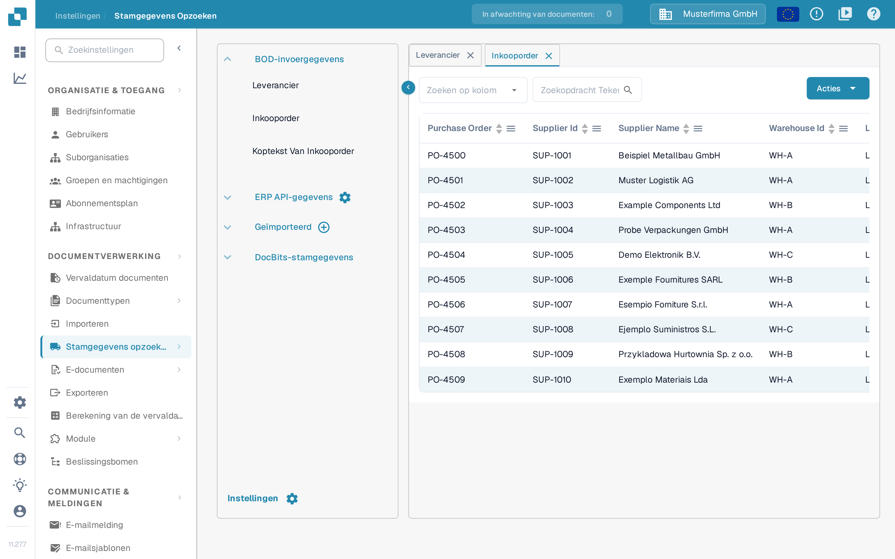

# Inkoopordermatching

Als het gaat om het testen van uw PO Matching-configuratie, moet u een inkooporder aanmaken in LN/M3 om te controleren of INFOR is gesynchroniseerd met DocBits.

## Een inkooporder maken in INFOR

* LN: https://docs.infor.com/ln/10.4/en-us/lnolh/docs/ln\_10.4\_procpoug\_\_en-us.pdf
* M3: https://docs.infor.com/m3udi/16.x/en-us/m3beud/default.html?helpcontent=ois610.html

Nadat u uw inkooporder hebt aangemaakt, gaat u naar **Instellingen → Stamgegevens opzoeken** en zoekt u naar het inkoopordernummer van de order die u zojuist hebt aangemaakt. Dat nummer moet nu bij de stamgegevens van uw inkooporders in DocBits staan. Hoe dat scherm werkt, leest u in [Stamgegevens opzoeken](../../settings/document-processing/master-data-lookup.md).

<figure><figcaption>
Inkooporders verschijnen in Stamgegevens opzoeken.
</figcaption></figure>

Ziet u hier uw unieke inkoopordernummer, dan zijn DocBits en INFOR correct gesynchroniseerd.

Upload nu uw factuur die overeenkomt met het aantal en de eenheidsprijzen van de inkooporder die u hebt aangemaakt. Valideer het document en kies **PO Matching** op het validatiescherm. Wat u op dat scherm ziet en doet, staat in [Scherm voor het matchen van inkooporders](../../../end-user-and-partner-section/end-user-section/purchase-order-matching/README.md).

De regels van de inkooporder en de factuur moeten automatisch overeenkomen. Kies daarna de exportoptie en controleer of het document zonder fouten wordt geëxporteerd. Krijgt u toch een exportfout, maak dan een ticket aan zodat het DocBits-ondersteuningsteam u kan helpen. Weet u niet hoe u een ticket aanmaakt? Lees dan [Maak een ticket aan](../../../end-user-and-partner-section/end-user-section/technical-support-in-docbits/create-a-ticket.md).

\\
