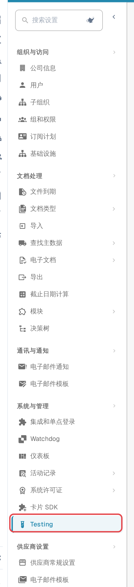
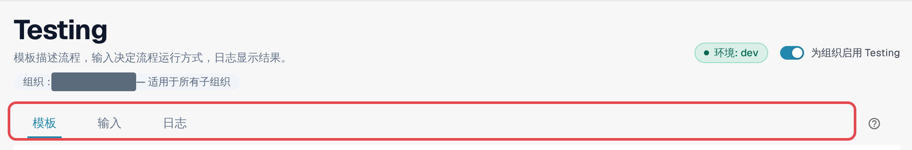
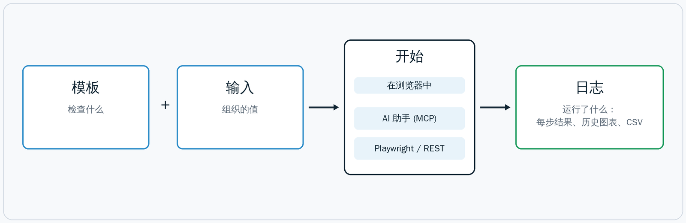
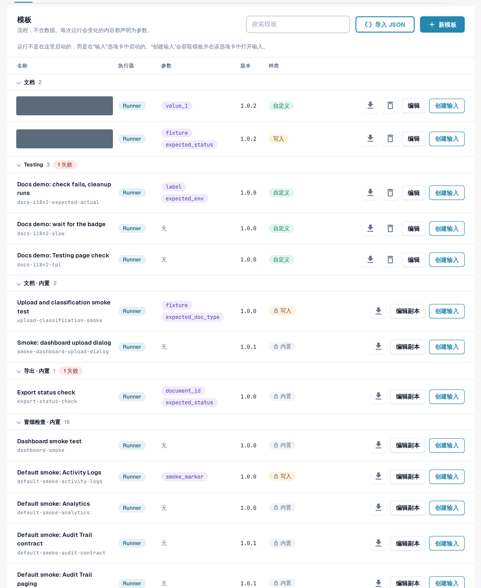

# Testing 模块

## 视频教程：运行第一次浏览器测试



[打开带中文字幕、章节和解说词的视频](https://docbits-videos.fra1.cdn.digitaloceanspaces.com/settings-assistant/testing-module-overview-preview-admin/v1/zh.html).

**时长: 2:16.** 中文界面、解说和字幕。

本教程在开发环境中使用内置的 **Live testing self-check**：查看三个步骤，创建并保存命名输入，在浏览器中启动测试，然后打开同一次运行的已保存日志。该模板不需要参数，也不会修改业务数据。自检通过仅确认这三个检查成功，并不能证明发票提取、审批或 ERP 导出正确。

**审核版本：**完整人工试听和业务内容审核尚未完成。


**核对已保存的结果。** 在版本 11.21.2 的英语和德语录制中，输入的结果标识显示被阻止，但实际运行及其已保存日志均显示通过。重新打开输入后，标识恢复一致。如果结果不一致，请查看同一次运行的已保存日志。重新打开只是观察到的临时处理办法，并不代表问题已经修复。


## Testing 模块的用途

**Testing** 模块在您自己已登录的 DocBits 会话中运行浏览器测试。测试操作的是真实界面，而不是模拟界面：它会打开仪表板、上传示例发票、检查新文档是否进入验证环节，或确认导出是否报告了预期状态。它用于检查 DocBits **在您的组织中**是否运行正确，并记录每个步骤的结果。

您可以在 **设置 → Testing** 中找到该模块。它面向负责维护组织测试套件的管理员。

在以下情况下可以使用它：

* 确认在版本发布、配置更改或导入设置之后，一切仍能正常运行；
* 在实施项目期间，对多个组织重复执行相同的验收检查；
* 为 QA 提供一份检查清单，任何人都可以启动其中的检查，也都可以查看结果；
* 让您的测试自动化或 AI 助手启动相同的检查并读取结果。

## 谁可以使用

该模块面向 **组织管理员**（请参阅[管理员权限](https://docs.docbits.com/administration-and-setup/settings/global-settings/groups-users-and-permissions/users/admin-privileges)）。
在组织管理员将其开启之前，所有组织均默认关闭该模块。

1. 打开 **设置**。在侧边栏的 **系统与管理** 下，选择 **Testing**。
2. 开启 **为组织启用 Testing**。

<figure><figcaption>
设置侧边栏，其中 Testing 条目被高亮显示。
</figcaption></figure>

<figure><figcaption>
Testing 页面标题区域，包含环境徽章、开关和三个标签页。
</figcaption></figure>

标题下方的 **组织：… — 适用于所有子组织** 显示此页面所作用的组织。您在此处所做的设置适用于该组织及其所有子组织。

开关关闭时，页面只显示 *Testing 已关闭。在组织管理员开启之前，不会运行任何测试。* 再次关闭开关，也会结束所有为外部启动而注册的浏览器标签页。

**环境** 徽章显示您当前所处的环境。在客户环境（沙盒或生产环境）中，徽章为红色，DocBits 会启用额外的保护：更改数据的测试需要明确确认；除非模板声明会写入数据，否则导出、删除或批准步骤会被阻止。

## 工作原理：模板、输入、开始、日志

该页面有三个标签页：**模板**、**输入** 和 **日志**。模板描述流程，输入决定流程以哪些值运行，日志显示结果。标签页旁的 **?** 会以您的界面语言打开本文档中的对应页面。

<figure><figcaption>
示意图：模板加输入构成一个测试；可在浏览器中、由 AI 助手或从外部启动；每次运行最终都会进入“日志”。
</figcaption></figure>

| 组成部分 | 标签页 | 说明 |
|---|---|---|
| **模板** | **模板** | 可重复使用的测试定义：逐步说明检查 *什么*。它不包含贵组织的任何数据。因组织而异的内容都是 **参数**。 |
| **输入** | **输入** | 贵组织为某个模板的参数保存的值，例如要打开的文档。**模板 + 输入 = 可以启动的测试。** |
| **开始** | **输入** | 模块负责运行并控制测试。有三种同等的启动方式：在浏览器中、通过 MCP 从 AI 助手启动，或通过 Playwright 或 REST 调用从外部启动。 |
| **日志** | **日志** | 实际运行的内容，无论以何种方式启动：结果、每个步骤、所使用的参数。历史图表按时间显示结果；您可以将日志导出为 CSV。 |

DocBits 提供 **默认模板**（其 ID 以 `default-smoke-` 开头）和少量内置模板。它们对所有组织都相同，不能更改或删除。默认模板可以在任何组织中运行；输入负责提供贵组织特有的内容。您也可以创建自己的模板，并在不需要时将其删除。

## 快速入门：运行默认测试

1. 打开 **设置 → Testing**，进入 **模板** 标签页。
2. 在 **冒烟检查** 组中，找到一个没有参数的默认模板（**参数** 列显示 *无*），例如 *Default smoke: log metrics*。
3. 选择 **创建输入**。**输入** 标签页随即打开，并为该模板显示一个新输入。
4. 输入 **输入名称**，然后选择 **保存输入**。
5. 选择 **开始**。测试会在此浏览器标签页中运行；运行期间请勿重新加载或关闭该标签页。
6. 打开 **日志** 标签页。最新的一行显示结果：**通过**、**失败** 或 **已阻止**。

<figure><figcaption>
模板标签页，其中包含冒烟检查组。
</figcaption></figure>

延伸阅读：

* [模板](templates.md)：默认模板、自有模板、导入和删除
* [步骤和现成步骤块](steps-and-blocks.md)：步骤组、高级设置、清理、记住的值
* [在应用中选取元素](pick-in-app.md)：通过指向来选择元素
* [重新加载与继续](reload-and-resume.md)：在测试进行过程中重新加载页面
* [输入](inputs.md)：保存贵组织的值
* [启动测试](start-a-test.md)：在浏览器中、通过开始链接、通过 AI 助手或通过 Playwright
* [日志和历史](logs.md)：结果、图表和 CSV 导出
* [故障排查](troubleshooting.md)
* [面向开发人员](for-developers.md)
