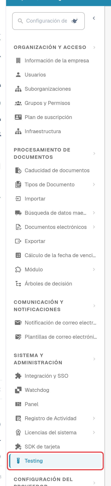
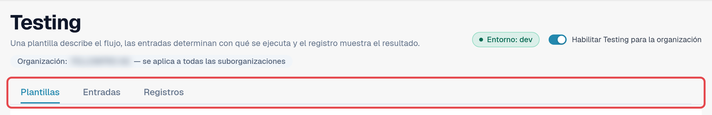
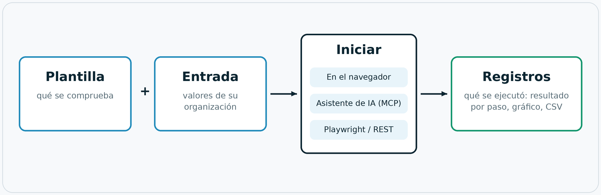

# Módulo Testing

## Vídeo: realizar la primera prueba en el navegador



[Abrir el vídeo en español con subtítulos, capítulos y transcripción](https://docbits-videos.fra1.cdn.digitaloceanspaces.com/settings-assistant/testing-module-overview-preview-admin/v1/es.html).

**Duración: 2:13.** Interfaz, narración y subtítulos en español.

La guía utiliza el **Live testing self-check** integrado en el entorno de desarrollo: revisar los tres pasos, crear y guardar una entrada con nombre, iniciar la prueba en el navegador y abrir el registro guardado de esa misma ejecución. La plantilla no necesita parámetros y no modifica datos de negocio. Un resultado aprobado confirma esas tres comprobaciones; no demuestra la extracción de facturas, su aprobación ni la exportación al ERP.

**Versión para revisión:** la escucha humana completa y la validación funcional siguen pendientes.


**Compruebe el resultado guardado.** En las grabaciones inglesa y alemana de la versión 11.21.2, el indicador de una entrada mostraba *bloqueado* aunque tanto la ejecución como su registro guardado indicaban *aprobado*. Volver a abrir la entrada restablecía el indicador correcto. Ante una discrepancia, revise el registro de esa misma ejecución. Reabrir es una solución provisional observada, no una corrección confirmada.


## Para qué sirve el módulo Testing

El módulo **Testing** ejecuta pruebas de navegador dentro de su propia sesión de DocBits iniciada. Una prueba maneja las
pantallas reales en lugar de una simulación: abre el panel, sube una factura de ejemplo, comprueba que un documento nuevo llega
a la validación o confirma que una exportación informa del estado esperado. Verifica que DocBits se comporta correctamente
**en su organización** y registra el resultado de cada paso.

El módulo se encuentra en **Configuración → Testing**. Está pensado para los administradores que se ocupan de las
suites de pruebas de una organización.

Úselo cuando desee:

* confirmar que todo sigue funcionando después de una versión, un cambio de configuración o una importación de ajustes;
* repetir la misma prueba de aceptación en varias organizaciones durante una implantación;
* ofrecer al equipo de QA una lista de comprobaciones que cualquiera pueda iniciar y cuyos resultados todos puedan leer;
* dejar que su automatización de pruebas o un asistente de IA inicie las mismas comprobaciones y lea los resultados.

## Quién puede utilizarlo

El módulo está disponible para los **administradores de la organización** (consulte [Privilegios de Administrador](../../../settings/global-settings/groups-users-and-permissions/users/admin-privileges.md)).
Está desactivado en todas las organizaciones hasta que un administrador de la organización lo activa.

1. Abra **Configuración**. En la barra lateral, dentro de **Sistema y administración**, seleccione **Testing**.
2. Active **Habilitar Testing para la organización**.

<figure><figcaption>
Barra lateral de Configuración con la entrada Testing resaltada.
</figcaption></figure>

<figure><figcaption>
Cabecera de la página Testing con el distintivo de entorno, el interruptor y las tres pestañas.
</figcaption></figure>

Bajo el título, **Organización: … — se aplica a todas las suborganizaciones** indica la organización para la que funciona esta página. Lo que configure aquí se aplica a esa organización y a todas sus suborganizaciones.

Mientras el interruptor está desactivado, la página solo muestra *Testing está desactivado. No se ejecuta nada hasta que un administrador de la organización lo active.* Al desactivarlo de nuevo también finalizan todas las pestañas del navegador que se habían registrado para inicios desde fuera.

El distintivo **Entorno** indica dónde se encuentra. En un entorno de cliente (sandbox o producción) es rojo, y
DocBits aplica una protección adicional: las pruebas que modifican datos requieren una confirmación explícita, y los pasos de exportar, eliminar o
aprobar se bloquean a menos que la plantilla declare que escribe datos.

## Cómo funciona: plantilla, entrada, inicio, registro

La página tiene tres pestañas: **Plantillas**, **Entradas** y **Registros**. Una plantilla describe el flujo, una entrada determina
con qué se ejecuta y el registro muestra el resultado. El **?** situado junto a las pestañas abre la página correspondiente de esta
documentación en el idioma de su interfaz.

<figure><figcaption>
Diagrama: plantilla más entrada da una prueba; se inicia en el navegador, mediante un asistente de IA o desde fuera; cada ejecución termina en los registros.
</figcaption></figure>

| Parte | Pestaña | Qué es |
|---|---|---|
| **Plantilla** | **Plantillas** | Una definición de prueba reutilizable: *qué* se comprueba, paso a paso. No contiene datos de su organización. Todo lo que cambia de una organización a otra es un **parámetro**. |
| **Entrada** | **Entradas** | Los valores guardados de su organización para los parámetros de una plantilla, por ejemplo el documento que se debe abrir. **Plantilla + entrada = una prueba que puede iniciar.** |
| **Iniciar** | **Entradas** | El módulo ejecuta y dirige la prueba. Hay tres formas equivalentes de iniciarla: en el navegador, desde un asistente de IA mediante MCP, o desde fuera con Playwright o una llamada REST. |
| **Registro** | **Registros** | Lo que se ejecutó realmente, sea cual sea la forma de inicio: el resultado, cada paso y los parámetros utilizados. Un gráfico de historial muestra los resultados a lo largo del tiempo; los registros se pueden exportar como CSV. |

DocBits incluye **plantillas predeterminadas** (sus ID empiezan por `default-smoke-`) y algunas integradas. Son
iguales para todas las organizaciones y no se pueden modificar ni eliminar. Una plantilla predeterminada se puede ejecutar en cualquier organización; la
entrada aporta lo que es específico de la suya. También puede crear sus propias plantillas y eliminarlas de nuevo.

## Inicio rápido: ejecutar una prueba predeterminada

1. Abra **Configuración → Testing**, pestaña **Plantillas**.
2. En el grupo **Pruebas de humo**, busque una plantilla predeterminada sin parámetros (la columna **Parámetros** muestra *ninguno*), por ejemplo *Default smoke: log metrics*.
3. Seleccione **Crear entrada**. Se abre la pestaña **Entradas** con una entrada nueva para esta plantilla.
4. Introduzca un **Nombre de entrada** y seleccione **Guardar entrada**.
5. Seleccione **Iniciar**. La prueba se ejecuta en esta pestaña del navegador; no recargue ni cierre la pestaña mientras se ejecuta.
6. Abra la pestaña **Registros**. La fila más reciente muestra el resultado: **Aprobado**, **Fallido** o **Bloqueado**.

<figure><figcaption>
Pestaña Plantillas con el grupo Pruebas de humo.
</figcaption></figure>

Continúe con:

* [Plantillas](templates.md): predeterminadas, plantillas propias, importar y eliminar
* [Pasos y bloques prefabricados](steps-and-blocks.md): grupos de pasos, ajustes avanzados, limpieza, valores memorizados
* [Seleccionar un elemento en la app](pick-in-app.md): elegir un elemento señalándolo
* [Recargar y reanudar](reload-and-resume.md): recargar la página en mitad de una prueba
* [Entradas](inputs.md): guardar los valores de su organización
* [Iniciar una prueba](start-a-test.md): en el navegador, mediante un enlace de inicio, desde un asistente de IA o desde Playwright
* [Registros e historial](logs.md): resultados, gráfico y exportación a CSV
* [Solución de problemas](troubleshooting.md)
* [Para desarrolladores](for-developers.md)
