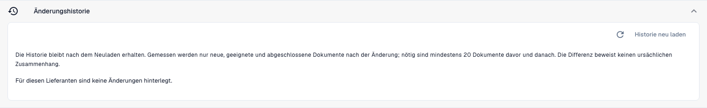

# Touchless Intelligence: Änderungsvorschläge und Berichte

Eine Empfehlung kann einen **Änderungsvorschlag** enthalten. Er beschreibt eine unterstützte Einstellungsänderung; er ersetzt keine Korrektur von Bestell- oder Stammdaten im Quellsystem. Ein Bericht oder ein Cluster allein ändert noch keine Daten. Administratoren arbeiten damit in vier Schritten:

1. **Vorschau**: zeigt die Änderung (aktueller → vorgeschlagener Wert) und was DocBits erwartet. Es wird nichts gespeichert. **Anwenden** ist erst möglich, nachdem Sie eine Vorschau angesehen haben.
2. **Anwenden**: speichert genau die in der Vorschau gezeigte Änderung. Sie wird protokolliert.
3. **Messen**: DocBits vergleicht die Touchless-Quote desselben Dokumenttyps **vorher und nachher** über gleich lange Zeiträume. In jedem Zeitraum sind mindestens **20 Dokumente** nötig, sonst heißt es *nicht messbar*.
4. **Rückgängig machen**: nimmt eine angewandte Änderung zurück, sofern der Vorschlag eine Rücknahme unterstützt. Prüfen Sie die angezeigte Rücknehmbarkeit und die aktuelle Rückmeldung.

## Vorschau, Anwendung und Nachweis unterscheiden

Die **Änderungshistorie** öffnen Sie auf der Lieferantendiagnose durch Aufklappen des gleichnamigen Abschnitts. **Historie neu laden** aktualisiert die Anzeige; es wendet keine Einstellung an.

<figure><figcaption>
Die geöffnete Änderungshistorie in der deutschen Oberfläche: Für diesen Lieferanten sind keine Änderungen hinterlegt. Der Hinweis nennt mindestens 20 geeignete Dokumente vor und nach einer Änderung. Diese Aufnahme zeigt den leeren Zustand und die Messbedingungen, keine angewandte Änderung und keine gemessene Verbesserung.
</figcaption></figure>

| Schritt | Was Sie prüfen | Wann der Schritt belegt ist |
| --- | --- | --- |
| Vorschau | Einstellung, betroffener Dokumenttyp oder Lieferant, aktueller und vorgeschlagener Wert, Risiken | Vorschau geöffnet und Inhalt geprüft; noch keine Änderung gespeichert |
| Anwenden | Genau die zuvor geprüfte Änderung | Erfolgreiche Rückmeldung und Eintrag der Änderungshistorie; ein Klick allein reicht nicht |
| Messen | Dieselbe AP-Touchless-Definition, vergleichbare Zeiträume und genügend abgeschlossene Dokumente | Vorher/Nachher-Werte vorhanden; bei zu wenig Daten bleibt die Wirkung nicht messbar |
| Rückgängig machen | Welche konkrete Änderung zurückgenommen wird | Erfolgreiche Rückmeldung und nachgeprüfter Einstellungswert; die bereits entstandene Dokumenthistorie wird nicht gelöscht |

Ein Vorschauaufruf ist kein AP-Eingriff an einer Rechnung. Wenn Sie anschließend eine Rechnung manuell korrigieren, validieren oder neu starten, zählt diese Dokumentaktion nach der [AP-Aktionsmatrix](touchless-intelligence.md).

Fehlt ein unterstützter Vorschlag oder ein Historieneintrag, können Sie daraus keine erfolgreiche Anwendung oder Rücknahme ableiten. Die Screenshots dieser Seite zeigen den leeren Historienzustand und einen Bericht; die vier Schritte der Tabelle sind damit nicht als vollständig durchgeführter Änderungsfall bebildert.

### Beispiel: Infor-Korrektur statt DocBits-Einstellung

Steht in der Rechnung korrekt 10,00 € und in der importierten Bestellung fälschlich 9,00 €, prüfen und korrigieren Sie die bestätigte Quelle sowie den Import. Erzeugen Sie keinen Toleranzvorschlag, nur um diese falschen Daten durchzulassen. Die Korrektur in Infor ist kein automatisch protokollierter DocBits-Änderungsvorschlag.

Dokumentieren Sie Zeitpunkt und Inhalt der Quellenkorrektur, die Ankunft des Imports und die Ergebnisse neuer Rechnungen. Bereits manuell neu gestartete Rechnungen bleiben nach erfolgreichem Abschluss AP mit Eingriff; sie werden durch die dauerhafte Behebung nicht rückwirkend Pure Touchless.


Ein Vorher/Nachher-Unterschied ist eine **Beobachtung**, kein Beweis für die Ursache. Gleichzeitig können sich andere Dinge ändern (ein neuer Lieferant, eine saisonale Spitze).


**Beispiel (zur Veranschaulichung).** Sie wenden *Automatischen Bestellabgleich und Export einschalten* für Rechnungen an. Zwei Wochen später zeigt die **Änderungshistorie** eine AP-Touchless-Quote von vorher 52 % (210 Dokumente) und nachher 61 % (198 Dokumente). Das sind +9 PP, mit genügend Dokumenten für eine Messung. Die gemessene Quote umfasst Pure und reine Freigaben; sie misst keine Auslesegenauigkeit. Eine Quelldatenkorrektur in Infor prüfen Sie zusätzlich anhand des Imports und späterer Rechnungen. Sie ist keine DocBits-Einstellungsänderung und wird nicht automatisch als Eintrag dieser Historie vorausgesetzt.

Administratoren sehen außerdem zwei Abschnitte zwischen den Kennzahlen und den Diagrammen:

* **Verbesserungsanfragen** (Improvement requests): Vorschläge, die Benutzer aus dem Validierungsassistenten gesendet haben, in zwei Tabs **Offen** und **Verlauf**.
* **Vorschläge für gelernte Regeln** (Learned rule proposals): Regeln, die DocBits aus den Korrekturen Ihres Teams gelernt hat, zum Beispiel „für Lieferant X den Wert in Feld Y ersetzen“. Prüfen Sie vor dem Anlegen die Dokumente, bei denen sie einen Wert ersetzen würde, den Ihr Team akzeptiert hatte. Der Abschnitt **Nach der Aktivierung** zeigt die manuellen Korrekturen des Zielfelds vor und nach dem Start einer Regel.

<figure><figcaption>
Der Consulting-Bericht: die wichtigsten Vorschläge, eine Rangliste aller Blocker mit Dokumenten und geschätzter Wirkung pro Monat sowie die Probleme nach Bereich. Beispielorganisation mit Demodaten; die Lieferantennamen sind frei erfunden.
</figcaption></figure>

**Zum Screenshot:** Er zeigt den **Consulting-Bericht**, nicht die Anwendung oder Rücknahme einer Änderung. Seine Schätzungen belegen keinen bereits gemessenen Effekt.

Administratoren finden den **Consulting-Bericht** unten im Tab. Klicken Sie auf **Bericht erstellen** (Create report), um ihn zu laden. Er fasst für Ihre Organisation zusammen:

* die **Änderungen mit der größten Wirkung**, als Rangliste, jeweils mit Bereich, Problem, empfohlener Maßnahme, Anzahl der Dokumente und der **geschätzten** Wirkung pro Monat,
* **den Bereich jedes Problems** (Extraktion, Stammdaten, Bestellabgleich, Auto Accounting, Einstellungen, Prozess),
* **Prüfungen der Tabellenkonfiguration**, zum Beispiel *strukturierte Tabellenausgabe nicht verwendet* oder *Spaltentyp der Tabelle passt nicht* je Dokumenttyp und Spalte.

Die Wirkungswerte sind **Schätzungen**. Antwortet der Bericht *forbidden*, erlaubt Ihre Rolle ihn nicht.

## Verbesserungen über MCP: erst erklären, dann gezielt ändern

> Erkläre die wichtigsten bestätigten Ursachen. Liste unterstützte Änderungsvorschläge und zeige zuerst die Vorschau. Begründe Umfang und Risiken. Wende erst die konkret ausgewählte Änderung an und prüfe danach gespeicherten Wert, Änderungshistorie und messbare Wirkung.

| Schritt | MCP-Werkzeug und wichtige Eingaben | Ergebnis und Grenze |
| --- | --- | --- |
| Vorschläge lesen | `touchless_list_change_proposals`, optional `issue_signature`, `window: "30d"`, `lang: "de"` | Liefert vorhandene Vorschläge; speichert keine Konfiguration |
| Vorschau prüfen | `touchless_preview_change` mit dem zurückgegebenen `proposal_id` und derselben `issue_signature` | Zeigt den konkreten Umfang und liefert bei einer zulässigen Vorschau einen gebundenen `preview_token` |
| Ausgewählte Änderung speichern | `touchless_apply_change` mit genau diesen IDs, dem `preview_token` und denselben `overrides` und `window` wie in der Vorschau | **Schreibender Aufruf:** ändert die unterstützte Einstellung und liefert bei Erfolg eine `change_id` |
| Wirkung lesen | `touchless_verify_change` mit dieser `change_id` und demselben `window` | Liest die Vorher/Nachher-Messung; genügend geeignete abgeschlossene Dokumente bleiben erforderlich |

Übernehmen Sie IDs und Token aus echten Rückgaben. Eine Vorschau für einen Wert darf nicht zum Anwenden eines anderen Werts verwendet werden. Ist die Vorschau abgelaufen, nicht erlaubt oder unvollständig, ist kein erfolgreicher Änderungsfall belegt. Die Tabelle beschreibt den Werkzeugablauf; sie zeigt keine im Demo-Fall ausgeführte Änderung und keinen gemessenen Zuwachs.

**Beispiel „dauerhaft besser“:** Eine bestätigte Fehlkonfiguration verursacht wiederholt manuelle Eingriffe. Sie prüfen einen vorhandenen Vorschlag, speichern genau diese Änderung und kontrollieren anschließend neue Rechnungen. Erst eine Messung mit mindestens 20 geeigneten abgeschlossenen Dokumenten je Zeitraum liefert einen Vorher/Nachher-Wert. Steigt die AP-Touchless-Quote von 52 auf 61 %, sind das 9 Prozentpunkte beobachteter Unterschied, keine bewiesene alleinige Wirkung der Änderung.

**Beispiel „richtige Quelle“:** Eine falsche Bestellung in Infor benötigt eine fachliche Quellenkorrektur und einen geprüften Import. Dafür ist `touchless_apply_change` kein allgemeines Infor-Schreibwerkzeug. Bestätigen Sie zunächst den vereinbarten Preis, korrigieren Sie die verantwortliche Quelle und prüfen Sie den Import sowie die Ergebnisse neuer Rechnungen. Vergrößern Sie keine Toleranz, nur um falsche Quelldaten durchzulassen.

## Weiterführende Seiten

* [Touchless Intelligence](touchless-intelligence.md)
* [Lieferantendiagnose und Fehlermuster](touchless-supplier-diagnosis.md)
* [Bestellabgleich-Diagnose](touchless-po-matching-diagnosis.md)

<!-- Doku-Prüfung 04.11.2026: Auslesequalität getrennt von Prozessergebnissen; Kennzahlen und Endergebnisse gegen DocBits_API c51f350c728acb8ac964098d15f7b006bce273f4, module/automation_intelligence/kpi.py und bucket.py, geprüft. Bestehende deutsche Originalaufnahmen getrennt von den Schulungsbeispielen geprüft. -->

<!-- Completion review 2026-11-04: AP actions, original-value evidence, overlapping KPI labels, sequential blockers and screenshot proof limits checked. -->
