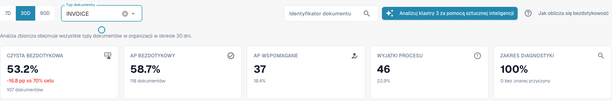
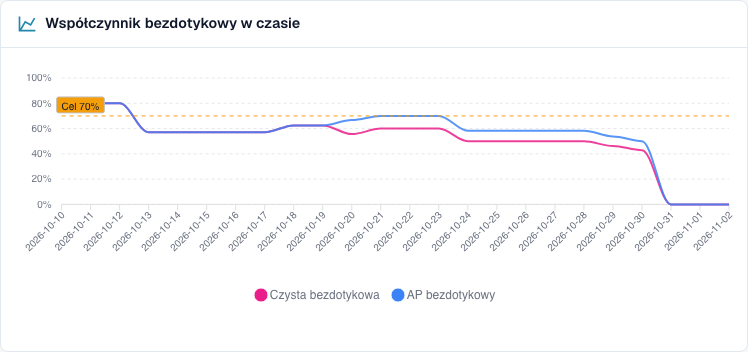
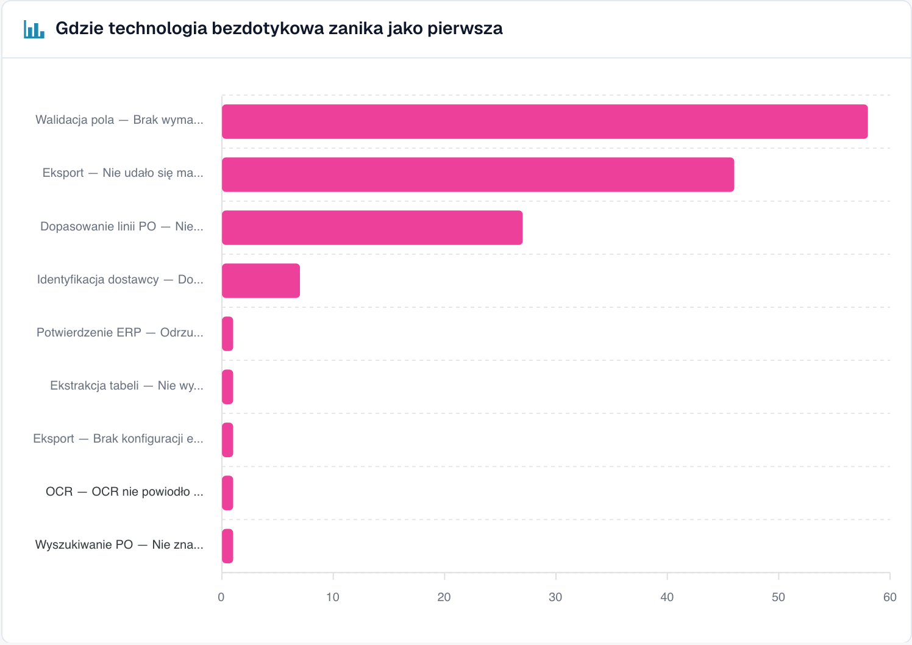

# Korzystanie z panelu

### Filtry

| Filtr | Co robi |
| --- | --- |
| **7D / 30D / 90D** | Okres dla kluczowych wskaźników i kolejki. Domyślnie 30 dni |
| **Typ dokumentu** (Document Type) | Filtruje KPI i analizę według typu. Wyuczone propozycje reguł mają obecnie własny wybór; patrz poniżej. |
| **Pole segmentu / Wartość segmentu** (Segment field / Segment value) | Tylko jeśli Twoja organizacja prowadzi kilka procesów przez jeden typ dokumentu (na przykład zamówienia bezpośrednie, pośrednie i EAM w polu `order_type`). Wybierz pole, aby zobaczyć podział, wybierz wartość, aby zawęzić do niej wszystko |
| **ID dokumentu** (Document ID) | Otwiera **Ślad dokumentu** dla jednego dokumentu |

**Podorganizacja** wybrana u góry w DocBits zawęża kluczowe wskaźniki i kolejkę dostawców. Klastry problemów i analiza AI zawsze obejmują całą organizację.

### Typ dokumentu a wyuczone propozycje reguł

Górny wybór i wybór w regułach są obecnie niezależne. Sekcja reguł ładuje własne typy i początkowo wybiera pierwszy. **ORDER_CONFIRMATION** u góry może współistnieć z **INVOICE** poniżej: te reguły dotyczą faktur. Sprawdź lokalny typ przed zastosowaniem. Brak typu nie potwierdza dla niego propozycji. Próba korekt, np. 60 dni, nie przejmuje automatycznie górnego okresu. To opis ograniczenia, nie wdrożonej synchronizacji.

### Pięć kluczowych wskaźników

<figure><figcaption>
Aktualny raport faktur za 30 dni: 107 całkowicie automatycznych oraz 11 wymagających tylko zatwierdzenia daje 118 z 201, czyli 58,7 % AP Touchless. Samo Pure to 53,2 %. Karta AP pokazuje już łączną liczbę 118. Fikcyjna historia szkoleniowa; nie potwierdza wykonania eksportu do ERP.
</figcaption></figure>

| Karta | Co obejmuje | Aktualny zrzut |
| --- | --- | --- |
| Pure Touchless | Pomyślne zakończenie bez ingerencji i zatwierdzenia | 107 · 53,2 % |
| AP Touchless | Pure i samo zatwierdzenie; łączny procent i liczba | 118 · 58,7 % |
| AP Assisted | Pomyślne zakończenie z ręczną ingerencją | 37 · 18,4 % |
| Wyjątki procesu | Wynik sklasyfikowany jako wyjątek | 46 · 22,9 % |
| Pokrycie diagnostyczne | Zablokowane przypadki ze znaną przyczyną | 100 % · 0 bez znanej przyczyny |

* Kafelek pokazuje kreskę (—) zamiast **0 %**, gdy nie ma czego mierzyć. Kreska oznacza „brak danych", nie „zero".
* **Pokrycie diagnozą** = dokumenty ze znanym powodem blokady ÷ wszystkie zablokowane dokumenty. Przykład: 50 zablokowanych dokumentów, 10 z nieznaną przyczyną → 40 ÷ 50 = **80 %**. Niska wartość oznacza „jeszcze nie rozumiemy, dlaczego dokumenty się zatrzymują". Popraw ją, zanim spróbujesz usuwać pojedyncze przyczyny.
* **Kliknij kafelek**, aby otworzyć w nowej karcie listę dokumentów stojących za liczbą („View the documents behind this number"). Kafelki z 0 dokumentów nie są klikalne.

### Wskaźnik touchless w czasie

<figure><figcaption>
Aktualny trend: różowy oznacza Pure Touchless, a niebieski wskaźnik łączny obejmujący samo zatwierdzenie. Linia przerywana pokazuje cel 70 %. Fikcyjne przypadki szkoleniowe nie dowodzą rzeczywistej poprawy procesu.
</figcaption></figure>

Aktualny wykres pokazuje Pure, łączny AP i cel. Niebieski obejmuje Pure i samo zatwierdzenie, dlatego jest na poziomie różowego lub powyżej; nie dodawaj tych procentów. Każdy punkt ma własną populację zakończonych, kwalifikujących się dokumentów: wynik dzienny nie jest automatycznie wynikiem całego okresu. Krótkie okresy pokazują punkty dzienne, długie tygodniowe. Oddzielna kategoria samego zatwierdzenia różni się od tej łącznej linii.

**Przykład.** Pure z 55 do 68 % po zmianie to związek czasowy. Porównaj typ, dostawców i inne zmiany; przed/po nie dowodzi jednej przyczyny.

### Gdzie touchless jest tracony najpierw

<figure><figcaption>
Zablokowane dokumenty według etapu i powodu, w którym zatrzymały się najpierw. Tutaj <strong>Walidacja pól: Brak wymaganego pola</strong> kosztuje najwięcej dokumentów (58), następnie <strong>Mapowanie eksportu nie powiodło się</strong> (46) i <strong>Niezgodność pozycji PO</strong> (27). Przykładowa organizacja z danymi demonstracyjnymi; nazwy dostawców są fikcyjne.
</figcaption></figure>

Wykres słupkowy **Zablokowanych dokumentów** (Blocked documents) według etapu potoku: **pierwszego** etapu, który zatrzymał dokument.

**Przykład.** Identyfikacja dostawcy 12, walidacja pól 41, dopasowanie pozycji zamówienia 7: zacznij od walidacji. Brak odczytu jest tylko możliwą przyczyną; sprawdź oryginał, reguły i źródło.

### Możliwości u dostawców

Kolejka odpowiada na pytanie **„Którego dostawcę poprawić najpierw?"**. Jest posortowana według dokumentów **Możliwych do odzyskania** (Recoverable), od największej liczby, po 25 wierszy na stronę.

| Kolumna | Znaczenie |
| --- | --- |
| **Numer dostawcy / Dostawca** (Supplier Number / Supplier) | Dostawca. Dokumenty bez rozpoznanego dostawcy pojawiają się jako **No supplier identified (n documents)** (Nie zidentyfikowano dostawcy) |
| **Wolumen** (Volume) | Kwalifikujące się dokumenty dostawcy w okresie |
| **Czysty wskaźnik** (Pure Rate) | Udział dokumentów czystego touchless. Zielony, jeśli na poziomie celu lub powyżej, czerwony, jeśli poniżej |
| **Utracone dokumenty** (Lost Documents) | Dokumenty, które zakończyły się jako AP wspomagany lub wyjątek procesu. Nie zawsze chodzi o człowieka: odrzucenie przez ERP lub dokument, który utknął na siedem dni, też się liczy |
| **Główna przyczyna** (Root Cause) | Kto odpowiada za naprawę: Konfiguracja, Integracja ERP, Eksport, Ekstrakcja, Dane podstawowe, Pomiar, Dopasowanie PO, Proces użytkownika, Walidacja lub Nieznana |
| **Możliwe do odzyskania** (Recoverable) | Utracone dokumenty, których przyczynę DocBits może naprawić: konfiguracja, dane podstawowe lub szablon dostawcy |
| **Oczekiwany wzrost** (Expected Lift) | O ile **punktów procentowych** wzrósłby wskaźnik Twojej organizacji, gdyby każdy możliwy do odzyskania dokument tego dostawcy przeszedł touchless (**+x pp**) |
| **Pewność** (Confidence) | **Wysoka**, **Średnia** lub **Niska**: jak pewna jest diagnoza |
| **Status** | Nowy, Otwarty, W badaniu, W toku, Potwierdzony, Rozwiązany, Odrzucony. Dostawca ze zbyt małą liczbą dokumentów pokazuje **NEEDS_DIAGNOSIS** |

**Przykład.** Twoja organizacja ma w okresie 1 000 kwalifikujących się dokumentów. Dostawca A ma 40 dokumentów możliwych do odzyskania, dostawca B ma 90 utraconych dokumentów, ale tylko 10 możliwych do odzyskania (jego problem leży po jego stronie).

* Dostawca A: 40 ÷ 1 000 = **+4,0 pp oczekiwanego wzrostu**
* Dostawca B: 10 ÷ 1 000 = **+1,0 pp**, chociaż B ma więcej utraconych dokumentów

Kolejka stawia A przed B, ponieważ **oczekiwany wzrost** jest mierzony względem całej Twojej organizacji, a nie względem dostawcy. Dostawca z czterema złymi dokumentami nie może wyprzedzić dostawcy z czterystoma.

Użyj pola wyszukiwania („Search supplier number or name"), aby znaleźć dostawcę. Kliknij wiersz, aby otworzyć **Diagnozę dostawcy**.

### Porównaj dostawców

Kliknij **Porównaj dostawców**, zaznacz **od dwóch do pięciu** dostawców (każdy jest wymieniony z liczbą zablokowanych dokumentów) i kliknij **Porównaj** (Compare).

Porównanie pokazuje dostawców obok siebie: **Czysty wskaźnik**, **Utracone dokumenty**, **Możliwe do odzyskania**, **Główna przyczyna**, **Oczekiwany wzrost**, wykres słupkowy wyników oraz link do **Diagnozy dostawcy** każdego z nich.

**Przykład.** A i B używają tego samego układu, lecz Pure wynosi 35 % i 80 %. Jeśli diagnoza wskazuje dane podstawowe, porównaj oryginały, odczyt i import. Sama różnica wskaźników nie dowodzi poprawności układu ani braków danych A.

### Analiza z AI

Przycisk **Analizuj n klastrów z AI** (Analyse n clusters with AI) analizuje klastry problemów o największym potencjale touchless (każdy z co najmniej minimalną liczbą dokumentów). Trwa to około 13 sekund na klaster i obejmuje **całą organizację**. Uruchomić ją mogą tylko administratorzy.

W trakcie działania przy każdym klastrze widzisz **W kolejce** (Queued), **W toku** (Running), **Gotowe** (Done), **Już przeanalizowane** (Already analysed) lub **Błąd** (Error), z linkiem **Otwórz klaster** (Open cluster). Jeśli AI jest wyłączone lub nieskonfigurowane w środowisku, przycisk jest nieaktywny i podaje powód, a **wszystko inne na stronie nadal działa**.

## Praca z Touchless Intelligence: rutyna

1. **Co tydzień**: otwórz kartę i sprawdź **wskaźnik** oraz **trend** względem celu.
2. Spójrz na **Pokrycie diagnozą**. Poniżej około 80 % najpierw dowiedz się, dlaczego dokumenty się zatrzymują.
3. Przeczytaj **Gdzie touchless jest tracony najpierw** i wybierz największy etap.
4. Otwórz **Możliwości u dostawców**. Posortuj według **Oczekiwanego wzrostu** i weź pierwszego dostawcę ze statusem **RECOVERABLE**.
5. Przeczytaj **klastry problemów**, sprawdź **Brakujące dowody** (Missing evidence), a następnie wykonaj **Co zmienić** (What to change).
6. Usuń potwierdzoną przyczynę. Dla obsługiwanej propozycji DocBits użyj podglądu i historii. Korektę Infor oraz import zapisz osobno; nie tworzy to automatycznie historii ustawień.
7. Po dwóch tygodniach sprawdź wynik **przed/po**.

## Kto może to zobaczyć

* Karta jest częścią Panelu Analitycznego. Administrator włącza ją dla organizacji. Jeśli karty brakuje, zapytaj administratora.
* **Administratorzy organizacji** widzą ją zawsze.
* Inni użytkownicy widzą ją, gdy administrator przyznał ich roli kartę **Panel analityczny** (Analytics dashboard) (**Ustawienia → Role**). Bez przyznania dostęp mają tylko administratorzy.
* Niektóre działania są tylko dla administratorów: **analiza AI**, **zastosowanie i cofnięcie zmiany**, **propozycje nauczonych reguł** oraz **raport doradczy** (Consulting report).

Jeśli nie masz uprawnień, strona wyświetla komunikat *Action not allowed, please contact the administrator* (Działanie niedozwolone, skontaktuj się z administratorem).

## Powiązane strony

* [Touchless Intelligence](touchless-intelligence.md)
* [Wskaźniki i obliczenia](touchless-metrics.md)
* [Przykłady: cena i ilość](touchless-examples.md)
* [Touchless Intelligence: Diagnoza dostawcy i klastry problemów](touchless-supplier-diagnosis.md)
* [Touchless Intelligence: Diagnoza dopasowania PO](touchless-po-matching-diagnosis.md)
* [Touchless Intelligence: Ślad dokumentu](touchless-document-trace.md)
* [Touchless Intelligence: Propozycje zmian i raporty](touchless-change-proposals.md)
* [Wyjaśnianie i poprawa Touchless przez MCP](touchless-mcp.md)

<!-- Source notes (not shown): screenshots come from the dev test organisation with synthetic demo data (seed script) and fictional supplier names; the PO matching decision flow has no screenshot yet. facts read from the doc2app code (TouchlessIntelligence pages and components) and the dev UI on 14 Oct 2026; NOVA gates the tab with its own organisation flag, VESTA with the Analytics module. Consulting report export format not verified, so no export is described.

<!-- Alignment 2026-11-04: correct extraction is distinct from process Touchless; KPI numerator and denominator verified. -->
<!-- Completion 2026-11-04: localized MCP examples, AP actions, original-value evidence and owned synthetic PO cards. -->
