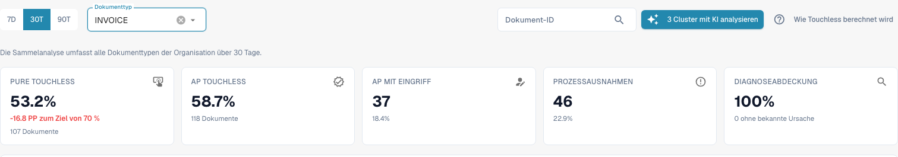
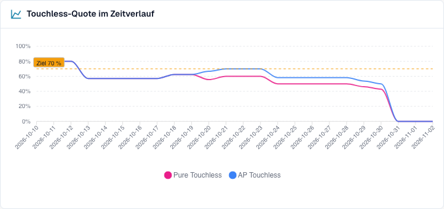
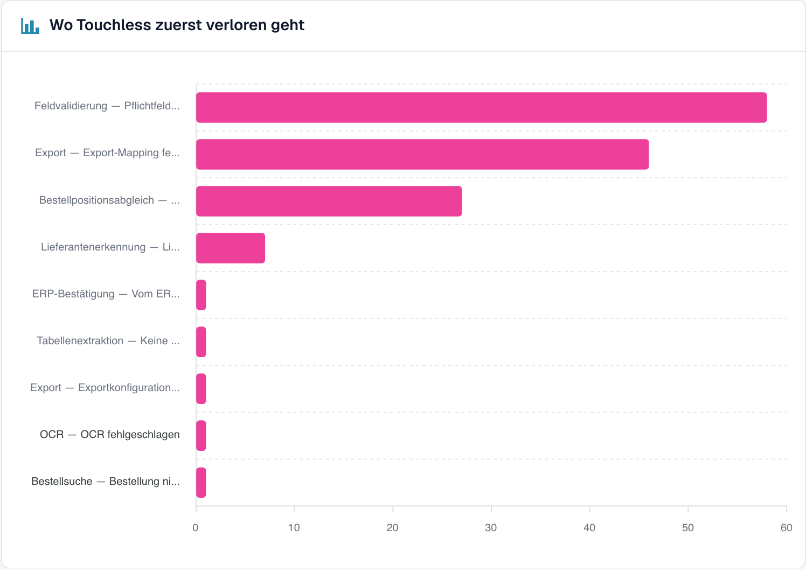

# Dashboard bedienen

<!-- touchless-admin-video-v2-20261104:start -->
**Video-Kapitel (Prüffassung):** [Auswahl und Datenstand](https://docbits-videos.fra1.cdn.digitaloceanspaces.com/settings-assistant/touchless-intelligence-preview-admin/v2/de.html#chapter=01).
<!-- touchless-admin-video-v2-20261104:end -->

### Filter

| Filter | Was er bewirkt |
| --- | --- |
| **7D / 30D / 90D** | Der Zeitraum für die Kennzahlen und die Warteschlange. Standard sind 30 Tage |
| **Dokumenttyp** (Document Type) | Filtert die Touchless-Kennzahlen und die zugehörige Auswertung auf einen Typ, zum Beispiel INVOICE. Gelernte Regelvorschläge haben derzeit eine eigene Auswahl; siehe unten |
| **Segmentfeld / Segmentwert** (Segment field / Segment value) | Nur, wenn Ihre Organisation mehrere Prozesse über einen Dokumenttyp abwickelt (zum Beispiel direkte, indirekte und EAM-Bestellungen im Feld `order_type`). Wählen Sie ein Feld, um die Aufschlüsselung zu sehen, und einen Wert, um alles darauf einzugrenzen |
| **Dokument-ID** (Document ID) | Öffnet den **Dokumentverlauf** für ein Dokument |

Die **Unterorganisation**, die Sie oben in DocBits gewählt haben, grenzt die Kennzahlen und die Lieferanten-Warteschlange ein. Fehlermuster (Cluster) und die KI-Analyse betreffen immer die gesamte Organisation.

### Dokumenttyp oben und bei gelernten Regelvorschlägen

Die obere Auswahl und der Dokumenttyp im Abschnitt **Gelernte Regelvorschläge** sind im derzeit geprüften Stand getrennt. Der Abschnitt lädt seine verfügbaren Typen selbst und wählt zunächst den ersten Eintrag. Wählen Sie oben **ORDER_CONFIRMATION**, kann unten deshalb weiterhin **INVOICE** stehen. Die dortigen Regeln betreffen dann Rechnungen, nicht die ausgewählten Auftragsbestätigungen.

Prüfen Sie vor einer Regelanwendung immer den Dokumenttyp direkt am Abschnitt. Gibt es dort keinen passenden Typ, sind damit keine Regelvorschläge für diesen Typ belegt. Der Abschnitt verwendet außerdem seine eigene Datengrundlage, etwa korrigierte Dokumente der letzten 60 Tage; das ist nicht automatisch der Zeitraum der oberen Quote. Diese Beschreibung erklärt den aktuellen getrennten Zustand und behauptet keine bereits umgesetzte Synchronisierung.

### Die fünf Kennzahlen

**Im folgenden Bild (aktueller Bericht):** Die Karte **AP Touchless** enthält Pure und die reinen Freigaben – sowohl im Prozentwert als auch in der Dokumentanzahl. Das Ergebnis „nur Freigabe“ bleibt in der Detailauswertung eine eigene Kategorie.

<figure><figcaption>
Aktueller Touchless-Bericht für Rechnungen über 30 Tage: 107 vollständig automatische und 11 nur freigegebene Rechnungen ergeben zusammen 118 von 201, also 58,7 % AP Touchless. Pure allein sind 53,2 %. Die AP-Karte nennt bereits die gemeinsame Anzahl 118. Fiktiver Schulungsbestand; kein Nachweis eines durchgeführten ERP-Exports.
</figcaption></figure>

| Karte | Zeigt | Beispiel (zur Veranschaulichung) |
| --- | --- | --- |
| **Pure Touchless** | Den Prozentwert und die Abweichung vom Ziel | **63,2 %** · „120 Dokumente“ · „−6,8 PP zum Ziel von 70 %“ (rot, unter dem Ziel) |
| **AP Touchless** | Gemeinsame Quote und gemeinsame Anzahl aus Pure und reiner Freigabe | **78,9 %** · „150 Dokumente“ im Rechenbeispiel mit 120 Pure und 30 reinen Freigaben |
| **AP mit Eingriff** | Die Anzahl der Dokumente und ihren Anteil | **30** · 15,8 % |
| **Prozessausnahmen** | Die Anzahl der Dokumente und ihren Anteil | **10** · 5,3 % |
| **Diagnoseabdeckung** (Diagnosis coverage) | Bei wie vielen blockierten Dokumenten die Ursache **bekannt** ist | **80 %** · „10 ohne bekannte Ursache“ |

* Im Screenshot ergeben 107 vollständig automatische plus 11 nur freigegebene Rechnungen **118 ÷ 201 = 58,7 % AP Touchless**. Pure allein sind **107 ÷ 201 = 53,2 %**. Die Prozentwerte überschneiden sich.
* Eine Karte zeigt einen Strich (—) statt **0 %**, wenn es nichts zu messen gibt. Ein Strich bedeutet „keine Daten“, nicht „null“.
* **Diagnoseabdeckung** = Dokumente mit bekanntem Blockadegrund ÷ alle blockierten Dokumente. Beispiel: 50 blockierte Dokumente, 10 davon mit unbekannter Ursache → 40 ÷ 50 = **80 %**. Ein niedriger Wert bedeutet „wir verstehen noch nicht, warum Dokumente stehen bleiben“. Verbessern Sie ihn, bevor Sie einzelne Ursachen beheben.
* **Klicken Sie auf eine Karte**, um die Dokumentenliste hinter der Zahl in einem neuen Tab zu öffnen („Dokumente zu dieser Zahl anzeigen“). Karten mit 0 Dokumenten sind nicht anklickbar.

### Touchless-Quote im Zeitverlauf

**Im folgenden aktuellen Bild:** Rosa zeigt Pure Touchless. Blau zeigt die gemeinsame Quote einschließlich reiner Freigaben. Die blaue Linie liegt deshalb auf oder über der rosa Linie; die beiden Werte werden nicht addiert.

<figure><figcaption>
Zeitverlauf im aktuellen Bericht: Rosa zeigt Pure Touchless, Blau die gemeinsame Touchless-Quote einschließlich reiner Freigaben. Die gestrichelte Linie markiert das Ziel von 70 %. Die Kurven stammen aus fiktiven Schulungsfällen und belegen keine tatsächlich erzielte Prozessverbesserung.
</figcaption></figure>

Das aktuelle Diagramm zeigt **Pure Touchless**, die **gemeinsame AP-Touchless-Quote** und die **Ziellinie**. Jeder Zeitpunkt hat seine eigene Anzahl geeigneter, abgeschlossener Dokumente. Ein Tageswert ist daher nicht automatisch die Quote des gesamten ausgewählten Zeitraums. Kurze Zeiträume zeigen Tagespunkte, lange Zeiträume Wochenpunkte. Die separate Ergebnis-Kategorie „nur Freigabe“ ist von dieser gemeinsamen Linie zu unterscheiden.

**Beispiel.** Nach Aktivierung des automatischen Bestellabgleichs steigt die Pure-Quote in einem vergleichbaren Zeitraum von 55 % auf 68 %. Prüfen Sie Dokumenttyp, Lieferantenmix und weitere Änderungen. Der zeitliche Zusammenhang ist eine Beobachtung; er beweist nicht allein, dass diese Einstellung den Anstieg verursacht hat.

### Wo Touchless zuerst verloren geht

<figure><figcaption>
Blockierte Dokumente nach Schritt und Grund, an dem sie zuerst stehen geblieben sind. Hier kostet <strong>Feldvalidierung: Pflichtfeld fehlt</strong> die meisten Dokumente (58), danach <strong>Export-Mapping fehlgeschlagen</strong> (46) und <strong>PO-Positionsabweichung</strong> (27). Beispielorganisation mit Demodaten; die Lieferantennamen sind frei erfunden.
</figcaption></figure>

Ein Balkendiagramm der **blockierten Dokumente** pro Pipeline-Schritt: der **erste** Schritt, der ein Dokument gestoppt hat.

**Beispiel.** Balken: Lieferantenerkennung 12, Feldvalidierung 41, Bestellpositionsabgleich 7. Der größte Balken sagt Ihnen, dass Sie zuerst die **Feldvalidierung** prüfen sollten. Ein nicht ausgelesener Wert ist eine mögliche Ursache; vergleichen Sie Originalrechnung, Feldregeln und verfügbare Quelldaten, bevor Sie die Ursache bestätigen.

### Lieferantenpotenziale

Die Warteschlange beantwortet die Frage **„Welchen Lieferanten sollten wir zuerst verbessern?“** Sie ist nach **rückgewinnbaren** Dokumenten sortiert, die höchsten zuerst, mit 25 Zeilen pro Seite.

| Spalte | Bedeutung |
| --- | --- |
| **Lieferantennummer / Lieferant** (Supplier Number / Supplier) | Der Lieferant. Dokumente ohne erkannten Lieferanten erscheinen als **Lieferant nicht erkannt (n Dokumente)** |
| **Volumen** (Volume) | Berücksichtigte Dokumente des Lieferanten im Zeitraum |
| **Pure-Quote** (Pure Rate) | Anteil der Pure-Touchless-Dokumente. Grün, wenn sie dem Ziel entspricht oder darüber liegt, rot, wenn sie darunter liegt |
| **Verlorene Dokumente** (Lost Documents) | Dokumente, die als AP mit Eingriff oder als Prozessausnahme endeten. Nicht immer war es eine Person: Auch eine ERP-Ablehnung oder ein Dokument, das sieben Tage lang hing, zählt dazu |
| **Grundursache** (Root Cause) | Wer die Behebung verantwortet: Konfiguration, ERP-Integration, Export, Extraktion, Stammdaten, Messung, Bestellabgleich, Benutzerprozess, Validierung oder Unbekannt |
| **Rückgewinnbar** (Recoverable) | Verlorene Dokumente, deren Ursache DocBits beheben kann: Konfiguration, Stammdaten oder Lieferanten-Template |
| **Erwarteter Zuwachs** (Expected Lift) | Um wie viele **Prozentpunkte** die Quote Ihrer Organisation steigen würde, wenn jedes rückgewinnbare Dokument dieses Lieferanten touchless liefe (**+x PP**) |
| **Konfidenz** (Confidence) | **Hoch**, **Mittel** oder **Niedrig**: wie sicher die Diagnose ist |
| **Status** | Neu, Offen, In Untersuchung, In Bearbeitung, Bestätigt, Behoben, Verworfen. Ein Lieferant mit zu wenigen Dokumenten zeigt **NEEDS_DIAGNOSIS** |

**Beispiel.** Ihre Organisation hat im Zeitraum 1.000 berücksichtigte Dokumente. Lieferant A hat 40 rückgewinnbare Dokumente, Lieferant B hat 90 verlorene Dokumente, aber nur 10 rückgewinnbare (sein Problem liegt auf seiner Seite).

* Lieferant A: 40 ÷ 1.000 = **+4,0 PP erwarteter Zuwachs**
* Lieferant B: 10 ÷ 1.000 = **+1,0 PP**, obwohl B mehr verlorene Dokumente hat

Die Warteschlange stuft A über B ein, weil der **erwartete Zuwachs** an Ihrer gesamten Organisation gemessen wird, nicht am Lieferanten. Ein Lieferant mit vier schlechten Dokumenten kann keinen mit vierhundert verdrängen.

Mit dem Suchfeld („Lieferantennummer oder Name suchen“) finden Sie einen Lieferanten. Ein Klick auf eine Zeile öffnet die **Lieferantendiagnose**.

### Lieferanten vergleichen

Klicken Sie auf **Lieferanten vergleichen**, wählen Sie **zwei bis fünf** Lieferanten aus (jeder wird mit seiner Anzahl blockierter Dokumente aufgeführt) und klicken Sie auf **Vergleichen**.

Je nach Oberflächenstand heißt die Schaltfläche noch **Compare suppliers**. Das ist derselbe Lieferantenvergleich; die englische Beschriftung ändert die Bedeutung der Kennzahlen nicht.

Der Vergleich zeigt die Lieferanten nebeneinander: **Pure-Quote**, **Verlorene Dokumente**, **Rückgewinnbar**, **Grundursache**, **Erwarteter Zuwachs**, ein Balkendiagramm der Ergebnisse und einen Link zur jeweiligen **Lieferantendiagnose**.

**Beispiel.** Lieferant A und B senden dasselbe Rechnungslayout. B hat eine Pure-Quote von 80 %, A nur 35 %. Bei A deutet die Diagnose auf „Stammdaten“. Vergleichen Sie Originalrechnungen, ausgelesene Werte und importierte Lieferantensätze, bevor Sie die Ursache bestätigen. Der Quotenunterschied allein beweist weder ein korrektes Layout noch unvollständige Stammdaten.

### Mit KI analysieren

Die Schaltfläche **{n} Cluster mit KI analysieren** (Analyse n clusters with AI) analysiert die Fehlermuster mit dem höchsten Touchless-Potenzial (jeweils mindestens eine Mindestanzahl Dokumente). Das dauert etwa 13 Sekunden pro Cluster und betrifft die **gesamte Organisation**. Nur Administratoren können sie starten.

Während die Analyse läuft, sehen Sie für jedes Cluster **In Warteschlange**, **Läuft**, **Fertig**, **Bereits analysiert** oder **Fehler**, mit einem Link **Cluster öffnen**. Ist die KI abgeschaltet oder in der Umgebung nicht konfiguriert, ist die Schaltfläche mit Angabe des Grundes deaktiviert, und **alles andere auf der Seite funktioniert weiter**.

## Mit Touchless Intelligence arbeiten: eine Routine

1. **Wöchentlich**: Öffnen Sie den Tab und prüfen Sie die **Quote** und den **Trend** im Vergleich zum Ziel.
2. Sehen Sie sich die **Diagnoseabdeckung** an. Liegt sie unter etwa 80 %, finden Sie zuerst heraus, warum Dokumente stehen bleiben.
3. Lesen Sie **Wo Touchless zuerst verloren geht** und wählen Sie den größten Schritt.
4. Öffnen Sie die **Lieferantenpotenziale**. Sortieren Sie nach **Erwartetem Zuwachs** und nehmen Sie den obersten Lieferanten mit dem Status **RECOVERABLE**.
5. Lesen Sie die **Fehlermuster**, prüfen Sie **Fehlende Evidenz** und folgen Sie dann **Was zu ändern ist**.
6. Beheben Sie eine bestätigte Ursache. Bei einem unterstützten DocBits-Änderungsvorschlag nutzen Sie **Vorschau** und **Änderungshistorie**. Bei einer Infor-Korrektur dokumentieren Sie Quelle und Import gesondert; sie erzeugt nicht automatisch einen DocBits-Änderungsvorschlag.
7. Prüfen Sie nach zwei Wochen das **Vorher/Nachher**-Ergebnis.

## Wer es sehen kann

* Der Tab gehört zum Analytics Dashboard. Ihr Administrator aktiviert ihn für die Organisation. Fehlt der Tab, fragen Sie Ihren Administrator.
* **Organisations-Administratoren** sehen ihn immer.
* Andere Benutzer sehen ihn, wenn ein Administrator ihrer Rolle den Tab **Analyse-Dashboard** (Analytics dashboard) freigegeben hat (**Einstellungen → Rollen**). Ohne diese Freigabe haben nur Administratoren Zugriff.
* Einige Aktionen sind nur für Administratoren: **KI-Analyse** (AI analysis), **Änderungen anwenden und rückgängig machen**, **Vorschläge für gelernte Regeln** und der **Consulting-Bericht**.

Wenn Sie keine Berechtigung haben, zeigt die Seite *Aktion nicht erlaubt, bitte kontaktieren Sie den Administrator*.

## Weiterführende Seiten

* [Touchless Intelligence](touchless-intelligence.md)
* [Kennzahlen und Berechnung](touchless-metrics.md)
* [Praxisbeispiele: Preis und Menge](touchless-examples.md)
* [Touchless Intelligence: Lieferantendiagnose und Fehlermuster](touchless-supplier-diagnosis.md)
* [Touchless Intelligence: Bestellabgleich-Diagnose](touchless-po-matching-diagnosis.md)
* [Touchless Intelligence: Dokumentverlauf](touchless-document-trace.md)
* [Touchless Intelligence: Änderungsvorschläge und Berichte](touchless-change-proposals.md)
* [Touchless mit MCP erklären und verbessern](touchless-mcp.md)

<!-- Source notes (not shown): screenshots come from the dev test organisation with synthetic demo data (seed script) and fictional supplier names; the PO matching decision flow is illustrated on the matching-diagnosis subpage. facts read from the doc2app code (TouchlessIntelligence pages and components) and the dev UI on 14 Oct 2026; NOVA gates the tab with its own organisation flag, VESTA with the Analytics module. Consulting report export format not verified, so no export is described. -->
<!-- Doku-Prüfung 04.11.2026: Auslesequalität getrennt von Prozessergebnissen; Kennzahlen und Endergebnisse gegen DocBits_API c51f350c728acb8ac964098d15f7b006bce273f4, module/automation_intelligence/kpi.py und bucket.py, geprüft. Bestehende deutsche Originalaufnahmen getrennt von den Schulungsbeispielen geprüft. -->
<!-- Completion review 2026-11-04: AP actions, original-value evidence, overlapping KPI labels, sequential blockers and screenshot proof limits checked. -->
