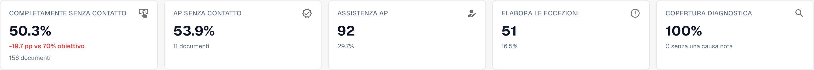
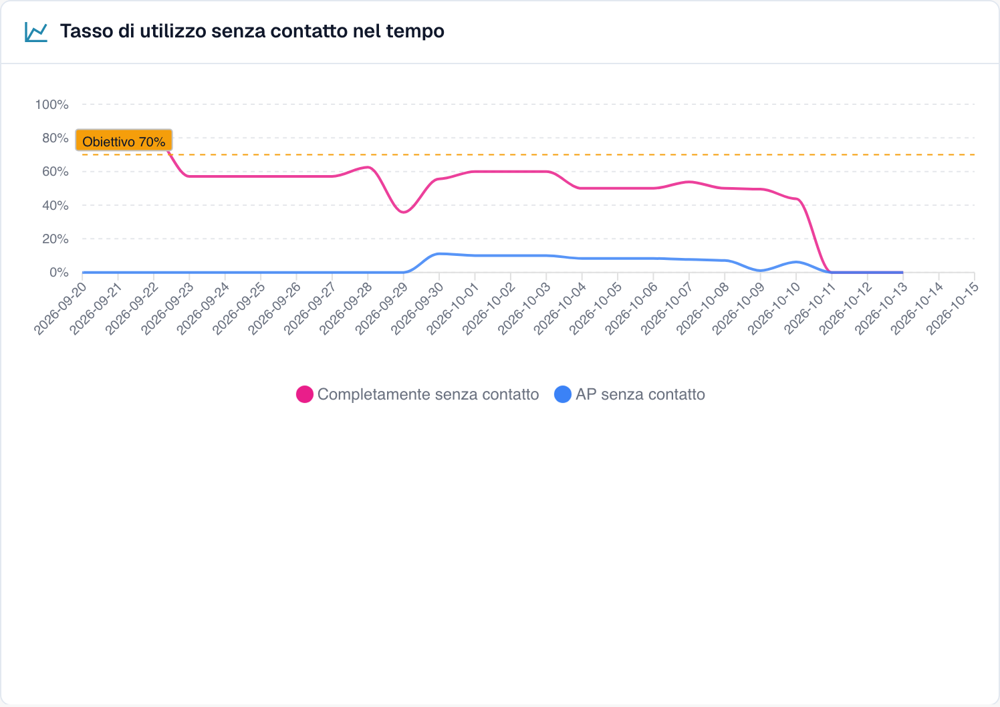
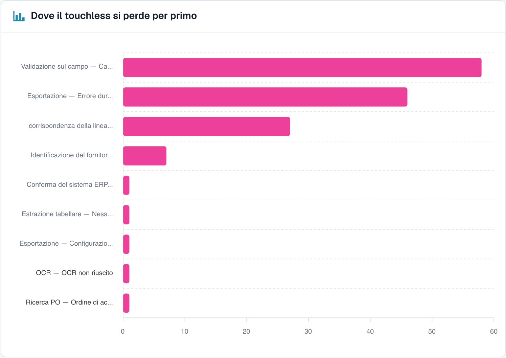

# Usare il pannello

### Filtri

| Filtro | Cosa fa |
| --- | --- |
| **7D / 30D / 90D** | Il periodo per gli indicatori chiave e la coda. Il valore predefinito è 30 giorni |
| **Tipo di documento** (Document Type) | Filtra metriche Touchless e relativa analisi per tipo. Le proposte di regole apprese hanno attualmente una propria selezione; vedete sotto. |
| **Campo di segmento / Valore di segmento** (Segment field / Segment value) | Solo se la tua organizzazione gestisce più processi con un unico tipo di documento (ad esempio ordini diretti, indiretti e EAM nel campo `order_type`). Scegli un campo per vedere la suddivisione, scegli un valore per restringere tutto a quel valore |
| **ID documento** (Document ID) | Apre il **Tracciamento del documento** per un documento |

La **sotto-organizzazione** selezionata in alto in DocBits restringe gli indicatori chiave e la coda dei fornitori. I cluster di problemi e l'analisi con l'IA riguardano sempre l'intera organizzazione.

### Tipo di documento e regole apprese

Il selettore superiore e quello delle regole apprese sono indipendenti nell’implementazione verificata. La sezione carica i propri tipi e inizialmente sceglie il primo. **ORDER_CONFIRMATION** in alto può quindi lasciare **INVOICE** in basso: tali regole riguardano fatture, non conferme d’ordine. Verificate il tipo locale prima di applicare una regola. Se manca il tipo corretto, non sono dimostrate proposte per esso. Il proprio campione di correzioni, ad esempio di 60 giorni, non eredita automaticamente il periodo del tasso superiore. Questa descrizione non afferma che sia stata implementata la sincronizzazione.

### I cinque indicatori chiave

<figure><figcaption>
Indicatori nella vera interfaccia italiana: AP percentuale comprende Pure e sola approvazione, mentre il numero sottostante conta soltanto le approvazioni. Le percentuali Pure e AP si sovrappongono. La precisione di estrazione richiede un controllo indipendente dell’originale.
</figcaption></figure>

| Scheda | Mostra | Esempio (illustrativo) |
| --- | --- | --- |
| **Touchless puro** (Pure touchless) | La percentuale e la differenza rispetto all'obiettivo | **63,2 %** · "120 documents" · "−6,8 pp vs 70 % target" (rosso, sotto l'obiettivo) |
| **AP Touchless** | Tasso combinato Pure + sola approvazione | **78,9 %** · 30 documenti con sola approvazione |
| **AP assistito** (AP assisted) | Il numero di documenti e la loro quota | **30** · 15,8 % |
| **Eccezioni di processo** (Process exceptions) | Il numero di documenti e la loro quota | **10** · 5,3 % |
| **Copertura della diagnosi** (Diagnosis coverage) | Per quanti documenti bloccati la causa è **nota** | **80 %** · "10 without a known cause" |

* Una scheda mostra un trattino (—) invece di **0 %** quando non c'è nulla da misurare. Un trattino significa "nessun dato", non "zero".
* **Copertura della diagnosi** = documenti con un motivo di blocco noto ÷ tutti i documenti bloccati. Esempio: 50 documenti bloccati, 10 con causa sconosciuta → 40 ÷ 50 = **80 %**. Un valore basso significa "non capiamo ancora perché i documenti si fermano". Miglioralo prima di provare a correggere le singole cause.
* **Fai clic su una scheda** per aprire in una nuova scheda del browser l'elenco dei documenti dietro il numero ("View the documents behind this number"). Le schede con 0 documenti non sono cliccabili.

### Tasso touchless nel tempo

<figure><figcaption>
Andamento nella vera interfaccia italiana. La linea blu AP di questa schermata rappresenta la categoria distinta sola approvazione, non la percentuale AP combinata dell’intestazione. Schermate e calcoli illustrativi possono riguardare periodi e popolazioni diversi.
</figcaption></figure>

La schermata rappresenta quote distinte: Pure e AP con sola approvazione. La linea blu non sostituisce il tasso AP combinato. Per combinarle servono lo stesso periodo e la stessa popolazione. I periodi brevi usano punti giornalieri e quelli lunghi settimanali.

**Esempio.** Pure dal 55 al 68 % dopo una modifica mostra un’associazione temporale. Confrontate tipo, fornitori e altri cambiamenti: il prima/dopo non prova da solo una causa unica.

### Dove si perde il touchless per primo

<figure><figcaption>
Documenti bloccati per fase e motivo in cui si sono fermati per primi. Qui <strong>Field validation: Required field missing</strong> costa più documenti (58), poi <strong>Export mapping failed</strong> (46) e <strong>PO item mismatch</strong> (27). Organizzazione di esempio con dati demo; i nomi dei fornitori sono fittizi.
</figcaption></figure>

Un grafico a barre dei **Documenti bloccati** per fase della pipeline: la **prima** fase che ha fermato un documento.

**Esempio.** Con identificazione fornitore 12, validazione campi 41 e abbinamento righe ordine 7, iniziate dalla validazione. Un valore non estratto è solo una possibile causa: confrontate originale, regole e dati di origine prima di confermarla.

### Opportunità fornitori

La coda risponde a **"Quale fornitore dovremmo correggere per primo?"** È ordinata per documenti **Recuperabili**, dal più alto, con 25 righe per pagina.

| Colonna | Significato |
| --- | --- |
| **Numero fornitore / Fornitore** (Supplier Number / Supplier) | Il fornitore. I documenti senza fornitore riconosciuto compaiono come **No supplier identified (n documents)** |
| **Volume** | Documenti idonei del fornitore nel periodo |
| **Tasso puro** (Pure Rate) | Quota di documenti touchless puri. Verde se pari o sopra l'obiettivo, rosso se sotto |
| **Documenti persi** (Documenti smarriti) | Documenti terminati come AP assistito o come eccezione di processo. Non sempre una persona: contano anche un rifiuto dell'ERP o un documento fermo per sette giorni |
| **Causa radice** (Root Cause) | Chi è responsabile della correzione: Configurazione, Integrazione ERP, Esportazione, Estrazione, Dati anagrafici, Misurazione, Abbinamento ordini, Processo utente, Convalida o Sconosciuta |
| **Recuperabili** (Recoverable) | Documenti persi la cui causa DocBits può correggere: configurazione, dati anagrafici o modello del fornitore |
| **Incremento atteso** (Innalzamento previsto) | Di quanti **punti percentuali** salirebbe il tasso della tua organizzazione se ogni documento recuperabile di questo fornitore fosse elaborato in modalità touchless (**+x pp**) |
| **Affidabilità** (Confidence) | **Alta**, **Media** o **Bassa**: quanto è sicura la diagnosi |
| **Stato** (Status) | Nuovo, Aperto, In analisi, In corso, Confermato, Risolto, Respinto. Un fornitore con troppi pochi documenti mostra **NEEDS_DIAGNOSIS** |

**Esempio.** La tua organizzazione ha 1.000 documenti idonei nel periodo. Il fornitore A ha 40 documenti recuperabili, il fornitore B ha 90 documenti persi ma solo 10 recuperabili (il loro problema è dalla loro parte).

* Fornitore A: 40 ÷ 1.000 = **+4,0 pp di incremento atteso**
* Fornitore B: 10 ÷ 1.000 = **+1,0 pp**, anche se B ha più documenti persi

La coda mette A sopra B perché l'**incremento atteso** è misurato rispetto a tutta la tua organizzazione, non rispetto al fornitore. Un fornitore con quattro documenti problematici non può superarne uno con quattrocento.

Usa la casella di ricerca ("Search supplier number or name") per trovare un fornitore. Fai clic su una riga per aprire la **Diagnosi del fornitore**.

### Confronta fornitori

Fai clic su **Confronta fornitori** (Compare suppliers), seleziona **da due a cinque** fornitori (ognuno è elencato con il suo numero di documenti bloccati) e fai clic su **Confronta** (Compare).

Il confronto mostra i fornitori affiancati: **Tasso puro**, **Documenti persi**, **Recuperabili**, **Causa radice**, **Incremento atteso**, un grafico a barre degli esiti e un link alla **Diagnosi del fornitore** di ciascuno.

**Esempio.** A e B usano lo stesso layout; B ha Pure all’80 % e A al 35 %. Se la diagnosi indica dati anagrafici, confrontate originali, estrazione e dati importati. Il divario dei tassi non dimostra che il layout sia corretto o che i dati di A siano incompleti.

### Analizza con l'IA

Il pulsante **Analyse n clusters with AI** (Analizza n cluster con l'IA) analizza i cluster di problemi con il maggior potenziale touchless (ciascuno con almeno un numero minimo di documenti). Richiede circa 13 secondi per cluster e riguarda l'**intera organizzazione**. Solo gli amministratori possono avviarlo.

Mentre è in corso vedi **Queued**, **Running**, **Done**, **Already analysed** o **Error** per ogni cluster, con un link **Open cluster**. Se l'IA è disattivata o non è configurata nell'ambiente, il pulsante è disabilitato con il motivo, e **tutto il resto della pagina continua a funzionare**.

## Lavorare con Touchless Intelligence: una routine

1. **Ogni settimana**: apri la scheda e controlla il **tasso** e l'**andamento** rispetto all'obiettivo.
2. Guarda la **Copertura della diagnosi**. Sotto circa l'80 %, scopri prima perché i documenti si fermano.
3. Leggi **Dove si perde il touchless per primo** e scegli la fase più grande.
4. Apri **Opportunità fornitori**. Ordina per **Incremento atteso** e prendi il primo fornitore con lo stato **RECOVERABLE**.
5. Leggi i **cluster di problemi**, controlla le **Prove mancanti** (Missing evidence), poi segui **Cosa cambiare** (What to change).
6. Correggete una causa confermata. Per una proposta DocBits supportata usate anteprima e storico. Per Infor documentate separatamente fonte e import; non crea automaticamente una modifica di configurazione in quello storico.
7. Dopo due settimane controlla il risultato **prima/dopo**.

## Chi può vederla

* La scheda fa parte della Dashboard di analisi. Il tuo amministratore la abilita per l'organizzazione. Se la scheda manca, chiedi al tuo amministratore.
* Gli **amministratori dell'organizzazione** la vedono sempre.
* Gli altri utenti la vedono quando un amministratore ha concesso al loro ruolo la scheda **Dashboard di analisi** (**Impostazioni → Ruoli**). Senza questa autorizzazione, solo gli amministratori hanno accesso.
* Alcune azioni sono riservate agli amministratori: **Analisi con l'IA** (AI analysis), **applicare e annullare una modifica**, **proposte di regole apprese** e il **Report di consulenza** (Consulting report).

Se non hai l'autorizzazione, la pagina mostra *Azione non consentita, contatta l'amministratore*.

## Pagine correlate

* [Touchless Intelligence](touchless-intelligence.md)
* [Metriche e calcolo](touchless-metrics.md)
* [Esempi: prezzo e quantità](touchless-examples.md)
* [Touchless Intelligence: Diagnosi del fornitore e cluster di problemi](touchless-supplier-diagnosis.md)
* [Touchless Intelligence: Diagnosi dell'abbinamento ordini](touchless-po-matching-diagnosis.md)
* [Touchless Intelligence: Tracciamento del documento](touchless-document-trace.md)
* [Touchless Intelligence: Proposte di modifica e report](touchless-change-proposals.md)
* [Spiegare e migliorare Touchless con MCP](touchless-mcp.md)

<!-- Source notes (not shown): screenshots come from the dev test organisation with synthetic demo data (seed script) and fictional supplier names; the PO matching decision flow has no screenshot yet. facts read from the doc2app code (TouchlessIntelligence pages and components) and the dev UI on 14 Oct 2026; NOVA gates the tab with its own organisation flag, VESTA with the Analytics module. Consulting report export format not verified, so no export is described. -->
<!-- Alignment 2026-11-04: correct extraction is distinct from process Touchless; KPI numerator and denominator verified. -->
<!-- Completion 2026-11-04: localized MCP examples, AP actions, original-value evidence and owned synthetic PO cards. -->
