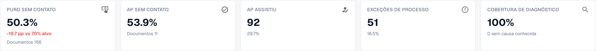
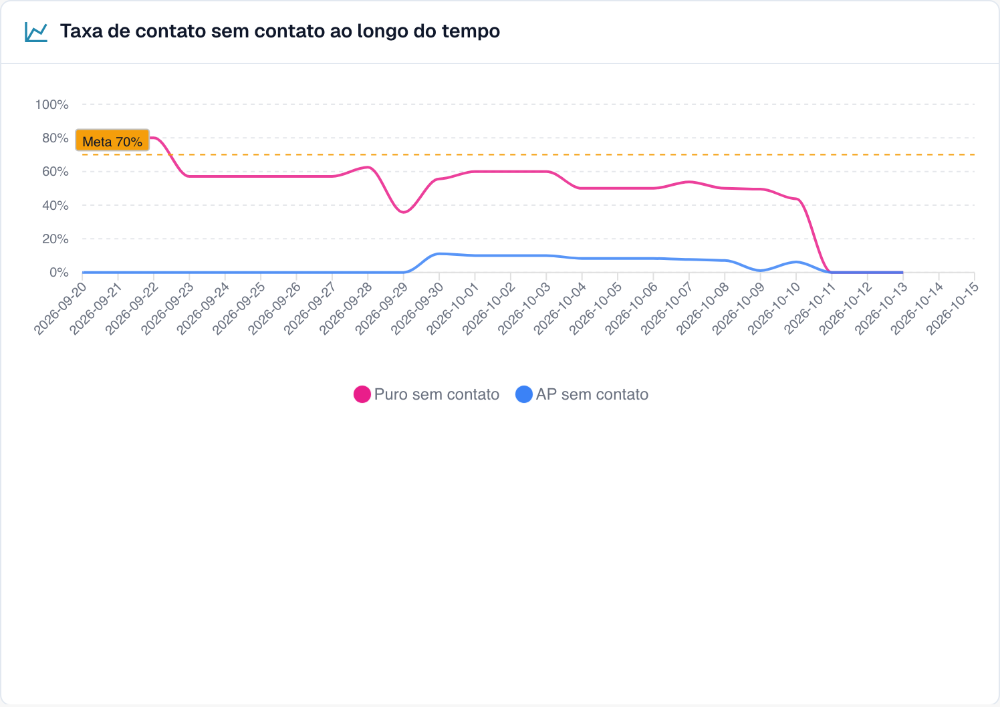

# Usar o painel

### Filtros

| Filtro | O que faz |
| --- | --- |
| **7D / 30D / 90D** | O período dos indicadores principais e da fila. O padrão é 30 dias |
| **Document Type** | Filtra métricas e análise por tipo. Propostas de regras aprendidas têm atualmente seleção própria; veja abaixo. |
| **Segment field / Segment value** | Somente se a sua organização executa vários processos por um mesmo tipo de documento (por exemplo, pedidos diretos, indiretos e EAM no campo `order_type`). Escolha um campo para ver a divisão e escolha um valor para restringir tudo a ele |
| **Document ID** | Abre o **Document Trace** de um documento |

A **suborganização** que você selecionou no topo do DocBits restringe os indicadores principais e a fila de fornecedores. Os clusters de problemas e a análise com IA sempre abrangem a organização inteira.

### Tipo de documento e propostas de regras aprendidas

A seleção superior e a das regras são independentes na implementação verificada. A secção carrega tipos próprios e escolhe inicialmente o primeiro. **ORDER_CONFIRMATION** acima pode coexistir com **INVOICE** abaixo: essas regras pertencem a faturas. Verifique o tipo local antes de aplicar. Tipo ausente não comprova propostas para ele. A amostra de correções, por exemplo 60 dias, não herda automaticamente o período superior. Isto descreve a limitação atual, não uma sincronização implementada.

### Os cinco indicadores principais

<figure><figcaption>
Indicadores portugueses reais: a percentagem AP inclui Pure e apenas aprovação; o número abaixo conta só aprovações. As percentagens Pure e AP sobrepõem-se. A precisão de extração exige revisão independente do original.
</figcaption></figure>

| Cartão | Mostra | Exemplo (ilustrativo) |
| --- | --- | --- |
| **Pure touchless** | A porcentagem e a diferença para a meta | **63,2 %** · "120 documents" · "−6.8 pp vs 70 % target" (vermelho, abaixo da meta) |
| **AP Touchless** | Taxa combinada Pure + apenas aprovação | **78,9 %** · 30 documentos apenas com aprovação |
| **AP assisted** | O número de documentos e a sua participação | **30** · 15,8 % |
| **Process exceptions** | O número de documentos e a sua participação | **10** · 5,3 % |
| **Diagnosis coverage** | Quantos documentos bloqueados têm uma causa **conhecida** | **80 %** · "10 without a known cause" |

* Um cartão mostra um traço (—) em vez de **0 %** quando não há nada a medir. Um traço significa "sem dados", não "zero".
* **Diagnosis coverage** = documentos com um motivo de bloqueio conhecido ÷ todos os documentos bloqueados. Exemplo: 50 documentos bloqueados, 10 com causa desconhecida → 40 ÷ 50 = **80 %**. Um valor baixo significa "ainda não entendemos por que os documentos param". Melhore isso antes de tentar corrigir causas individuais.
* **Clique em um cartão** para abrir, em uma nova aba, a lista de documentos por trás do número ("View the documents behind this number"). Cartões com 0 documentos não são clicáveis.

### Touchless rate over time (taxa touchless ao longo do tempo)

<figure><figcaption>
Gráfico português real. A linha azul AP representa apenas aprovação, categoria distinta da taxa AP combinada do cabeçalho. Capturas e exemplos podem usar populações diferentes.
</figcaption></figure>

O gráfico apresenta quotas separadas de Pure e AP com apenas aprovação. A linha azul não substitui a taxa AP combinada. Combiná-las exige a mesma população e período. Períodos curtos usam pontos diários; os longos, semanais.

**Exemplo.** Pure de 55 para 68 % após mudança mostra associação temporal. Compare tipo, fornecedores e outras mudanças; antes/depois não comprova causa única.

### Onde o processamento sem intervenção se perde primeiro (Where touchless is lost first)

<figure><figcaption>
Documentos bloqueados por etapa e motivo em que pararam primeiro. Aqui <strong>Field validation: Required field missing</strong> custa mais documentos (58), depois <strong>Export mapping failed</strong> (46) e <strong>PO item mismatch</strong> (27). Organização de exemplo com dados de demonstração; os nomes dos fornecedores são fictícios.
</figcaption></figure>

Um gráfico de barras de **Blocked documents** (documentos bloqueados) por etapa do pipeline: a **primeira** etapa que parou um documento.

**Exemplo.** Identificação do fornecedor 12, validação de campos 41 e correspondência de linhas da encomenda 7: comece pela validação. Falha de extração é apenas uma hipótese; compare original, regras e origem antes de a confirmar.

### Supplier opportunities (oportunidades de fornecedores)

A fila responde a **"Qual fornecedor devemos corrigir primeiro?"** Ela é ordenada por documentos **Recoverable** (recuperáveis), do maior para o menor, com 25 linhas por página.

| Coluna | Significado |
| --- | --- |
| **Supplier Number / Supplier** | O fornecedor. Documentos sem fornecedor reconhecido aparecem como **No supplier identified (n documents)** |
| **Volume** | Documentos elegíveis do fornecedor no período |
| **Pure Rate** | Participação dos documentos pure touchless. Verde se estiver na meta ou acima, vermelho se abaixo |
| **Lost Documents** | Documentos que terminaram como AP assisted ou como exceção de processo. Nem sempre uma pessoa: uma rejeição do ERP ou um documento parado por sete dias também contam |
| **Root Cause** | Quem é o responsável pela correção: Configuration, ERP integration, Export, Extraction, Master data, Measurement, PO matching, User process, Validation ou Unknown |
| **Recoverable** | Documentos perdidos cuja causa o DocBits pode corrigir: configuração, dados mestres ou modelo do fornecedor |
| **Expected Lift** | Quantos **pontos percentuais** a taxa da sua organização ganharia se todos os documentos recuperáveis deste fornecedor passassem touchless (**+x pp**) |
| **Confidence** | **High**, **Medium** ou **Low**: o quão segura é a causa diagnosticada |
| **Status** | New, Open, Investigating, In progress, Confirmed, Resolved, Dismissed. Um fornecedor com poucos documentos mostra **NEEDS_DIAGNOSIS** |

**Exemplo.** A sua organização tem 1.000 documentos elegíveis no período. O fornecedor A tem 40 documentos recuperáveis, o fornecedor B tem 90 documentos perdidos, mas apenas 10 recuperáveis (o problema deles está do lado deles).

* Fornecedor A: 40 ÷ 1.000 = **+4,0 pp de ganho esperado**
* Fornecedor B: 10 ÷ 1.000 = **+1,0 pp**, embora B tenha mais documentos perdidos

A fila classifica A acima de B porque o **ganho esperado** é medido em relação à sua organização inteira, não em relação ao fornecedor. Um fornecedor com quatro documentos ruins não pode superar um com quatrocentos.

Use a caixa de busca ("Search supplier number or name") para encontrar um fornecedor. Clique em uma linha para abrir o **Supplier Diagnosis**.

### Comparar fornecedores (Compare suppliers)

Clique em **Compare suppliers**, marque **de dois a cinco** fornecedores (cada um aparece com o seu número de documentos bloqueados) e clique em **Compare**.

A comparação mostra os fornecedores lado a lado: **Pure rate**, **Lost documents**, **Recoverable**, **Root cause**, **Expected lift**, um gráfico de barras dos resultados e um link para cada **Supplier Diagnosis**.

**Exemplo.** A e B usam o mesmo formato, mas Pure é 35 % e 80 %. Se o diagnóstico aponta dados mestre, compare originais, extração e importação. A diferença de taxas não comprova que o formato esteja correto ou que faltem dados de A.

### Analisar com IA (Analyse with AI)

O botão **Analyse n clusters with AI** analisa os clusters de problemas com o maior potencial touchless (com no mínimo um número mínimo de documentos cada). Leva cerca de 13 segundos por cluster e abrange a **organização inteira**. Somente administradores podem iniciá-lo.

Enquanto ele roda, você vê **Queued**, **Running**, **Done**, **Already analysed** ou **Error** para cada cluster, com um link **Open cluster**. Se a IA estiver desativada ou não configurada no ambiente, o botão fica desabilitado com o motivo, e **todo o resto da página continua funcionando**.

## Trabalhar com o Touchless Intelligence: uma rotina

1. **Semanalmente**: abra a aba e confira a **taxa** e a **tendência** em relação à meta.
2. Veja o **Diagnosis coverage**. Abaixo de cerca de 80 %, primeiro descubra por que os documentos param.
3. Leia **Where touchless is lost first** e escolha a maior etapa.
4. Abra **Supplier opportunities**. Ordene por **Expected lift** e pegue o primeiro fornecedor com o status **RECOVERABLE**.
5. Leia os **clusters de problemas**, confira **Missing evidence** e depois siga **What to change**.
6. Resolva uma causa confirmada. Use pré-visualização e histórico para propostas DocBits suportadas. Registe correção Infor e importação separadamente; não criam automaticamente histórico de definições.
7. Após duas semanas, confira o resultado de **antes/depois**.

## Quem pode vê-lo

* A aba faz parte do Painel de Análises. O seu administrador a habilita para a organização. Se a aba não aparecer, pergunte ao seu administrador.
* Os **administradores da organização** sempre a veem.
* Os demais usuários a veem quando um administrador concedeu à função deles a aba **Analytics dashboard** (**Configurações → Funções**). Sem essa concessão, somente os administradores têm acesso.
* Algumas ações são exclusivas de administradores: **AI analysis** (análise com IA), **aplicar e desfazer uma alteração**, **propostas de regras aprendidas** e o **Consulting report** (relatório de consultoria).

Se você não tiver permissão, a página mostra *Action not allowed, please contact the administrator*.

## Páginas relacionadas

* [Touchless Intelligence](touchless-intelligence.md)
* [Métricas e cálculo](touchless-metrics.md)
* [Exemplos: preço e quantidade](touchless-examples.md)
* [Touchless Intelligence: diagnóstico de fornecedores e clusters de problemas](touchless-supplier-diagnosis.md)
* [Touchless Intelligence: diagnóstico de PO Matching](touchless-po-matching-diagnosis.md)
* [Touchless Intelligence: Rastreamento do documento](touchless-document-trace.md)
* [Touchless Intelligence: propostas de alteração e relatórios](touchless-change-proposals.md)
* [Explicar e melhorar Touchless com MCP](touchless-mcp.md)

<!-- Source notes (not shown): screenshots come from the dev test organisation with synthetic demo data (seed script) and fictional supplier names; the PO matching decision flow has no screenshot yet. facts read from the doc2app code (TouchlessIntelligence pages and components) and the dev UI on 14 Oct 2026; NOVA gates the tab with its own organisation flag, VESTA with the Analytics module. Consulting report export format not verified, so no export is described.

<!-- Alignment 2026-11-04: correct extraction is distinct from process Touchless; KPI numerator and denominator verified. -->
<!-- Completion 2026-11-04: localized MCP examples, AP actions, original-value evidence and owned synthetic PO cards. -->
