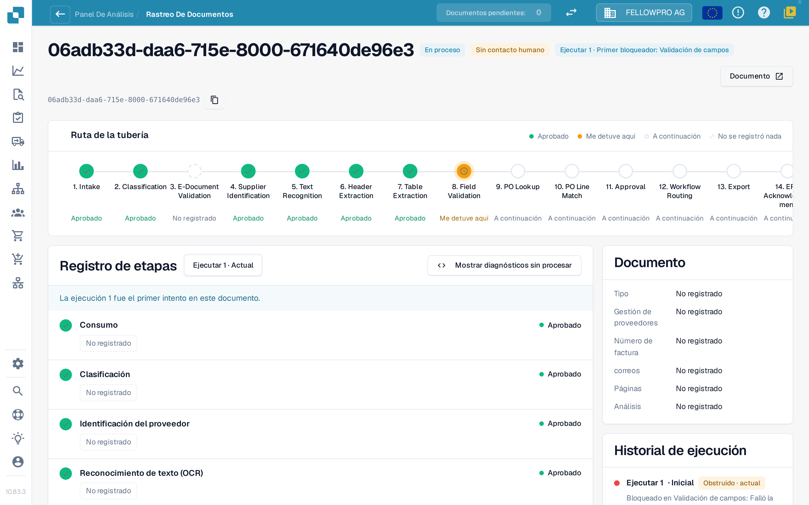
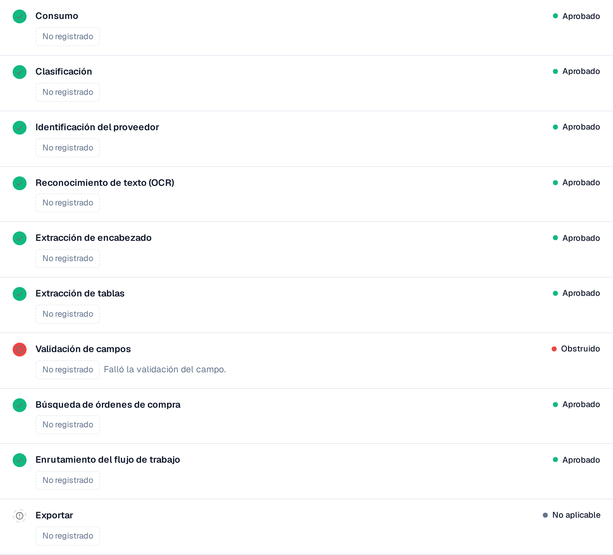

# Touchless Intelligence: Seguimiento del documento

Introduzca un ID de documento en **Document ID**, o abra un documento de muestra de un clúster, para ver **qué le ocurrió a este documento**.

La cabecera muestra el archivo, su estado (por ejemplo **En proceso**), la ejecución que está consultando y su primer bloqueador, además de un botón **Documento** con el ID del documento.

<figure><figcaption>
El seguimiento del documento: la ruta de la tubería con todas las etapas y el registro de etapas con lo que cada una registró.
</figcaption></figure>

La **Ruta de la tubería** muestra 14 etapas: Intake, Classification, E-Document Validation, Supplier Identification, Text Recognition, Header Extraction, Table Extraction, Field Validation, PO Lookup, PO Line Match, Approval, Workflow Routing, Export, ERP Acknowledgement. Cada etapa lleva un solo estado:

| Estado | Significado |
| --- | --- |
| **Aprobado** (verde) | La etapa se ejecutó sin problemas |
| **Me detuve aquí** (naranja) | La etapa bloqueó el documento |
| **A continuación** | El documento nunca llegó tan lejos |
| **No se registró nada** (discontinuo) | No se registraron datos para esta etapa |
| **No aplicable** | La etapa no se aplica a este documento |

### Registro de etapas

El **registro de etapas** bajo la ruta enumera las mismas etapas con lo que cada una registró. Un punto de estado y la palabra de estado aparecen a izquierda y derecha de cada fila.

* Cada valor es una **etiqueta de valor**: un número con su unidad, por ejemplo **Confianza 100 %**, **Umbral 60 %**, **Reglas fallidas 0**, **8 campos faltantes** o **0 brechas de asignación**. Los porcentajes se muestran como `97 %`, nunca como `0.97`.
* **Detalles** abre la lista completa de valores que registró una etapa, incluidas las alternativas que consideró.
* La etapa que bloqueó el documento indica el motivo, por ejemplo **Validación de campos fallida**.
* Un valor que ninguna etapa registró se muestra como **No registrado**, nunca como un valor inventado. Los valores son números y términos fijos, nunca texto del documento.
* **Mostrar diagnósticos sin procesar** activa los datos en bruto cuando el soporte los solicita.

<figure><figcaption>
Registro de etapas en español con validación de campos bloqueada. Los valores no registrados permanecen como tales: el bloqueo no demuestra por sí solo un error de extracción ni datos incorrectos de Infor.
</figcaption></figure>

### Ejecuciones y cambios

El selector de ejecución en la parte superior del registro de etapas (**Ejecutar 1 · Actual**) cambia entre las ejecuciones del documento. El **historial de ejecuciones** a la derecha enumera cada ejecución con su resultado y el punto en el que se detuvo. Cuando un documento se ha ejecutado más de una vez, elija una ejecución en el selector para compararla con la actual: los valores modificados llevan entonces una insignia con la diferencia y su unidad, por ejemplo **−2 campos** o **+3 %**.

La tarjeta **Documento** junto al registro de etapas indica el tipo de documento, el proveedor, el número de factura, la orden de compra, el número de páginas y si el análisis se basa en **reglas** o lo escribió una IA.

## Separar extracción y datos de origen

1. Compare la factura original con los campos y posiciones extraídos **antes de la corrección manual**. Un valor corregido actual no prueba la extracción original.
2. Lea el primer bloqueo. Un paso de extracción aprobado confirma la ejecución del paso, no la exactitud de cada valor.
3. Compare pedido importado e Infor actual, incluidas unidades, unidades de precio y fecha de importación.
4. Distinga factura frente a extracción, extracción correcta frente a datos importados, e Infor frente a su copia. Si falta evidencia, deje abierta la causa.
5. Revise intervenciones, aprobaciones, reinicios y resultado final.

**Ejemplo:** factura y extracción indican 10,00 €; el pedido importado, 9,00 €. Hay una discrepancia de pedido, no un error de extracción demostrado. Confirme el precio acordado y corrija el origen o la importación. Un reinicio manual seguido de éxito da AP Assisted. Consulte [los ejemplos y el cálculo](touchless-metrics.md).

Varios documentos con los mismos campos faltantes demuestran un bloqueo repetido, pero no necesariamente un valor predeterminado ausente: revise extracción, contenido del original, validación y configuración.

## Acreditar la extracción original y los bloqueos sucesivos

1. Abra el documento desde su traza y compruebe ID y ejecución. Compare número de pedido, moneda, cantidades, unidades, unidades de precio, precios, importes de línea y totales relevantes.
2. Separe los valores actuales de los anteriores a una corrección. Utilice evidencia histórica de esa ejecución. Cambiar de ejecución no garantiza reconstruir todas las celdas antiguas.
3. Si falta el valor inicial, anótelo como **no evaluable**, no como correcto. Defina campos, líneas, selección y tamaño de muestra antes de informar de precisión de extracción.
4. Compare copia importada, fecha de importación e Infor actual para separar una fuente incorrecta de una copia antigua.

Una ejecución puede detenerse porque falta el pedido; tras importarlo, otra puede revelar una diferencia de precio. La primera no demuestra que llegara a esa comprobación posterior. Un reinicio humano persiste tras el éxito como AP Assisted; un rechazo ERP definitivo tiene prioridad como excepción. **No registrado** significa falta de evidencia.

Las herramientas y la clasificación de las acciones humanas se explican en [Touchless con MCP](touchless-mcp.md).

## Páginas relacionadas

* [Touchless Intelligence](touchless-intelligence.md)
* [Diagnóstico de proveedores y clústeres de problemas](touchless-supplier-diagnosis.md)
* [Diagnóstico de la coincidencia con la OC](touchless-po-matching-diagnosis.md)

Las capturas de pantalla de esta página muestran la interfaz en español.

<!-- Touchless documentation alignment 2026-11-04: extraction quality is distinct from process automation. KPI definition checked against DocBits_API c51f350c728acb8ac964098d15f7b006bce273f4; existing native screenshots and video sources preserved except unsafe historical list images. -->

<!-- Completion 2026-11-04: localized MCP examples, AP actions, original-value evidence and owned synthetic PO cards. -->
