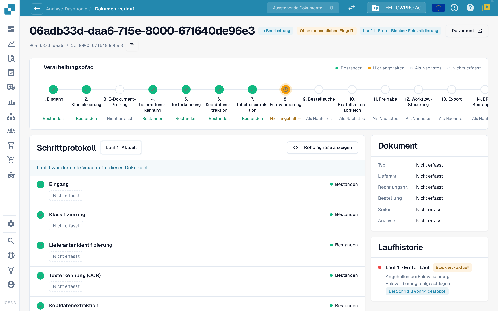
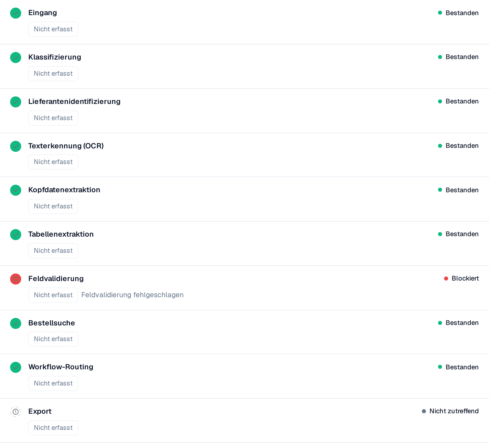
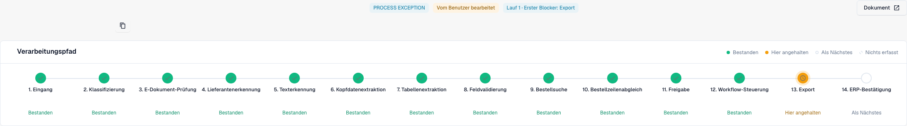

# Touchless Intelligence: Dokumentverlauf

Geben Sie eine Dokument-ID in **Dokument-ID** ein oder öffnen Sie ein Beispieldokument aus einem Cluster, um zu sehen, **was mit genau diesem Dokument passiert ist**.

Die Kopfzeile zeigt die Datei, ihren Status (zum Beispiel **In Bearbeitung**), den Lauf, den Sie gerade ansehen, und dessen ersten Blocker sowie eine Schaltfläche **Dokument** mit der Dokument-ID.

<figure><figcaption>
Der Dokumentverlauf: der Verarbeitungspfad mit allen Schritten und das Schrittprotokoll mit den Angaben, die jeder Schritt aufgezeichnet hat.
</figcaption></figure>

Der **Verarbeitungspfad** zeigt 14 Schritte: Eingang, Klassifizierung, E-Dokument-Prüfung, Lieferantenerkennung, Texterkennung, Kopfdatenextraktion, Tabellenextraktion, Feldvalidierung, Bestellsuche, Bestellzeilenabgleich, Freigabe, Workflow-Steuerung, Export, ERP-Bestätigung. Jeder Schritt trägt genau einen Zustand:

| Zustand | Bedeutung |
| --- | --- |
| **Bestanden** (grün) | Der Schritt ist fehlerfrei gelaufen |
| **Hier angehalten** (orange) | Der Schritt hat das Dokument blockiert |
| **Als Nächstes** | Das Dokument ist nie so weit gekommen |
| **Nichts erfasst** (gestrichelt) | Für diesen Schritt wurden keine Daten aufgezeichnet |
| **Nicht zutreffend** | Der Schritt gilt für dieses Dokument nicht |

### Schrittprotokoll

Das **Schrittprotokoll** unter dem Pfad listet dieselben Schritte mit dem auf, was jeder von ihnen aufgezeichnet hat. Ein Statuspunkt und das Statuswort stehen links und rechts in jeder Zeile.

* Jeder Wert ist ein **Wert-Chip**: eine Zahl mit ihrer Einheit, zum Beispiel **Konfidenz 100 %**, **Schwellenwert 60 %**, **Fehlgeschlagene Regeln 0**, **8 fehlende Felder** oder **0 Zuordnungslücken**. Prozentwerte erscheinen als `97 %`, nie als `0.97`.
* **Details** öffnet die vollständige Liste der Werte, die ein Schritt aufgezeichnet hat, einschließlich der geprüften Alternativen.
* Der Schritt, der das Dokument blockiert hat, nennt den Grund, zum Beispiel **Feldvalidierung fehlgeschlagen**.
* Ein Wert, den kein Schritt aufgezeichnet hat, erscheint als **Nicht erfasst**, nie als erfundener Wert. Werte sind Zahlen und feste Begriffe, nie Dokumenttext.
* **Rohdiagnose anzeigen** blendet die Rohdaten ein, wenn der Support danach fragt.

<figure><figcaption>
Dieses Beispiel stoppt bei der Feldvalidierung. Die Einträge zeigen <strong>Nicht erfasst</strong>: Der Screenshot benennt einen Blocker, beweist aber weder einen Auslesefehler noch falsche Quelldaten.
</figcaption></figure>

### Läufe und Änderungen

Die Laufauswahl oben im Schrittprotokoll (**Lauf 1 · Aktuell**) wechselt zwischen den Läufen des Dokuments. Die **Laufhistorie** rechts listet jeden Lauf mit seinem Ergebnis und der Stelle auf, an der er stehen geblieben ist. Wenn ein Dokument mehrfach gelaufen ist, wählen Sie in der Auswahl einen Lauf, um ihn mit dem aktuellen zu vergleichen: Die geänderten Werte tragen dann ein Abzeichen mit der Differenz und ihrer Einheit, zum Beispiel **−2 Felder** oder **+3 %**.

Die Karte **Dokument** neben dem Schrittprotokoll nennt Dokumenttyp, Lieferant, Rechnungsnummer, Bestellung, Seitenzahl und ob die Analyse **regelbasiert** ist oder von einer KI geschrieben wurde.

## Original und ursprüngliche Auslesung nachweisen

<figure><figcaption>
Original und aktuelles Feld nebeneinander: Die Nummer DB20261042 ist rechts im synthetischen Beleg markiert und links dem Rechnungsnummernfeld zugeordnet. Die Aufnahme erklärt den Wertevergleich, belegt aber weder den ursprünglichen Extraktionswert vor einer Bearbeitung noch einen Infor-Abgleich oder den erfolgreichen Abschluss des Dokuments. Der rote Feldhinweis muss zusätzlich geprüft werden.
</figcaption></figure>

1. Öffnen Sie den Verlauf desselben Dokuments und notieren Sie den betrachteten Lauf. Über **Dokument** öffnen Sie die zugehörige Rechnung; vergleichen Sie die Dokument-ID, bevor Sie Werte übernehmen.
2. Prüfen Sie im Original mindestens Bestellnummer, Währung, Menge, Einheit, Preiseinheit, Stückpreis und Positionsbetrag sowie die relevanten Kopfsummen. Vergleichen Sie dazu die Felder und Positionen der Validierungsansicht.
3. Unterscheiden Sie den **aktuell angezeigten Wert** von der **ursprünglichen Auslesung vor einer Korrektur**. Bei bereits bearbeiteten Rechnungen benötigen Sie einen passenden historischen Nachweis, etwa eine vorhandene Feldhistorie oder einen vom Support bereitgestellten Extraktionsnachweis dieses Laufs.
4. Der Wechsel zwischen Läufen zeigt aufgezeichnete Schritte und Kennzahlen. Er ist keine Zusicherung, dass jedes alte Feld und jede Tabellenzelle als vollständiger Wertestand wiederhergestellt wird. Fehlt der ursprüngliche Wert, notieren Sie „Auslesequalität für diesen Wert nicht nachgewiesen“.
5. Halten Sie für die Quellseite zusätzlich die tatsächlich importierten Bestellwerte, den Importzeitpunkt und den aktuellen Infor-Stand fest. Nur so lässt sich eine falsche Quelle von einer veralteten Kopie unterscheiden.

| Prüfpunkt des Schulungsfalls | Original | Auslesung vor Korrektur | Importierte Bestellung | Befund |
| --- | --- | --- | --- | --- |
| Menge | 10 Stück | 10 Stück | 10 Stück | Übereinstimmung |
| Stückpreis | 10,00 € | 10,00 € | 9,00 € | Auslesung korrekt; Abweichung zu den Bestelldaten |
| Positionsbetrag | 100,00 € | 100,00 € | 90,00 € | Gleiche Abweichung, kein zusätzlicher Beweis für ihre Ursache |

Die Tabelle ist ein Lesebeispiel. Die Verlaufsscreenshots zeigen native Bedienelemente und aufgezeichnete Schritte; sie belegen diese Preiswerte nicht. Eine Konfidenz von 100 % oder ein grüner Extraktionsschritt ersetzt den Vergleich nicht. Siehe auch die [Validierungsansicht](../end-user-and-partner-section/end-user-section/validation-screen/README.md).

### Auslesequalität einer Stichprobe festhalten

Legen Sie vor der Prüfung fest, welche Felder und Positionen beurteilt werden. Eine Rechnung gilt in einer Prüfung nur dann als vollständig korrekt, wenn alle vorgesehenen, nachweisbaren Werte stimmen. Fehlende historische Nachweise separat als nicht beurteilbar ausweisen; sie sind kein bestätigter Erfolg. Dokumentieren Sie Stichprobengröße, Auswahl, betrachteten Lauf und Prüfumfang. Das Ergebnis dieser Prüfung bleibt getrennt von der Touchless-Quote.

## Auslesung und Quelldaten unterscheiden

1. Öffnen Sie die **Originalrechnung** und vergleichen Sie Kopffelder und Positionen mit der DocBits-Auslesung. Verwenden Sie für einen früheren Lauf die Werte vor einer manuellen Korrektur. Ein heute korrigierter Wert beweist nicht, was ursprünglich ausgelesen wurde.
2. Lesen Sie den ersten Blocker im Dokumentverlauf. Ein bestandener Extraktionsschritt bedeutet, dass der Schritt abgeschlossen wurde; er bestätigt nicht die Richtigkeit jedes Rechnungswertes.
3. Vergleichen Sie bei einer Bestellabweichung die Rechnungswerte mit den **tatsächlich in DocBits verfügbaren Bestelldaten** und dem zugehörigen Infor-Datensatz. Berücksichtigen Sie Einheiten, Preiseinheiten, Mengen und den Importzeitpunkt.
4. Halten Sie den bestätigten Unterschied fest: **Rechnung gegen Auslesung**, **korrekte Auslesung gegen importierte Quelldaten** oder **Infor gegen importierte Kopie**. Fehlen die nötigen Nachweise, bleibt die Ursache offen.
5. Prüfen Sie Laufhistorie und Endergebnis auf manuelle Korrektur, Freigabe oder Neustart. Ergebnis und Ursache beantworten unterschiedliche Fragen.

**Beispiel.** Originalrechnung und ausgelesener Wert enthalten beide 10,00 €, die importierte Bestellung enthält 9,00 €. Damit ist eine Abweichung zu den Bestelldaten nachgewiesen, kein Auslesefehler. Klären Sie den vereinbarten Preis und ob Infor selbst oder die importierte Kopie korrigiert werden muss. Startet AP die Rechnung manuell neu und wird sie anschließend erfolgreich abgeschlossen, zählt sie trotz korrekter Auslesung als „AP mit Eingriff“. Siehe [Beispiele und Berechnung](touchless-intelligence.md).

**Wiederholt fehlende Felder.** Mehrere Stopps bei der Feldvalidierung belegen einen wiederkehrenden Blocker. Mögliche Ursachen sind Extraktion, ein tatsächlich fehlender Rechnungswert, eine Validierungsregel oder ein fehlender konfigurierter Standardwert. Vergleichen Sie die Nachweise vor einer Änderung; die Wiederholung allein beweist keine dieser Ursachen.

## Mehrere Blocker bei derselben Rechnung

<figure><figcaption>
Eine Prozessausnahme kann gleichzeitig einen menschlichen Eingriff im Verlauf haben. Die Kopfzeile zeigt hier noch die englische Ergebnisbeschriftung PROCESS EXCEPTION neben Vom Benutzer bearbeitet; der Pfad stoppt beim Export, die ERP-Bestätigung ist noch nicht erreicht. Diese Aufnahme belegt keine falsche Auslesung und zeigt keine erfolgreiche Verarbeitung. Dateiname und Dokument-ID sind aus Datenschutzgründen ausgeblendet.
</figcaption></figure>

Das folgende Beispiel beschreibt einen möglichen Verlauf, nicht die einzelnen Läufe der Screenshots:

| Zeitpunkt / Lauf | Was sichtbar wird | Was daraus folgt |
| --- | --- | --- |
| Lauf 1 | Bestellnummer richtig ausgelesen, Bestellung noch nicht importiert | Erster Blocker dieses Laufs: Bestellsuche. Noch kein Beweis für einen Auslesefehler |
| Nach dem Import, Lauf 2 | Die Bestellung ist vorhanden; jetzt fällt die Preisabweichung 10,00 € gegen 9,00 € auf | Der spätere Blocker wird erst nach Behebung des früheren sichtbar. Er beweist nicht, dass Lauf 1 dieselbe Prüfung erreicht hat |
| AP klärt und startet nach korrigiertem Import manuell neu | Der nächste Lauf kann Abgleich und Export erfolgreich beenden | Bei erfolgreichem Endergebnis: AP mit Eingriff. Der manuelle Neustart bleibt dokumentiert |
| Alternative: ERP weist den Export endgültig zurück | Die Übermittlung allein war noch kein bestätigter Erfolg | Prozessausnahme, auch wenn AP vorher eingegriffen hat |

Wählen Sie die Läufe nacheinander und vergleichen Sie **ersten Blocker**, aufgezeichnete Details und Laufresultat. Prüfen Sie danach das **Dokumentergebnis**. Ein später bestandener Schritt löscht weder den früheren Blocker noch die menschliche Bearbeitung. **Nicht erfasst** bedeutet fehlender Nachweis, nicht bestanden.

## Weiterführende Seiten

* [Touchless Intelligence](touchless-intelligence.md)
* [Lieferantendiagnose und Fehlermuster](touchless-supplier-diagnosis.md)
* [Bestellabgleich-Diagnose](touchless-po-matching-diagnosis.md)

Die Screenshots auf dieser Seite zeigen die deutsche Benutzeroberfläche.

<!-- Doku-Prüfung 04.11.2026: Auslesequalität getrennt von Prozessergebnissen; Kennzahlen und Endergebnisse gegen DocBits_API c51f350c728acb8ac964098d15f7b006bce273f4, module/automation_intelligence/kpi.py und bucket.py, geprüft. Bestehende deutsche Originalaufnahmen getrennt von den Schulungsbeispielen geprüft. -->

<!-- Completion review 2026-11-04: AP actions, original-value evidence, overlapping KPI labels, sequential blockers and screenshot proof limits checked. -->
