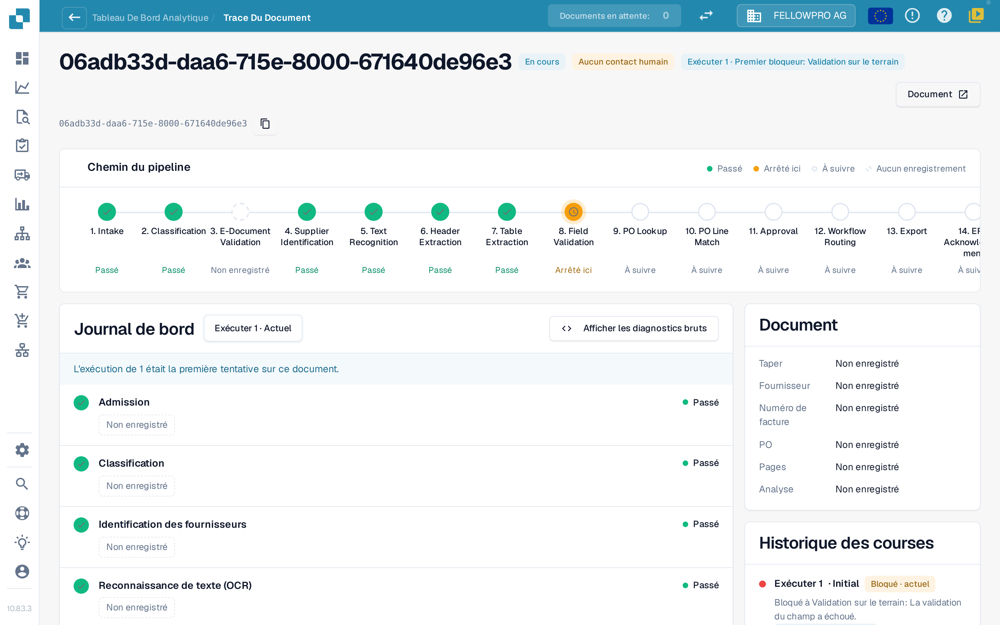
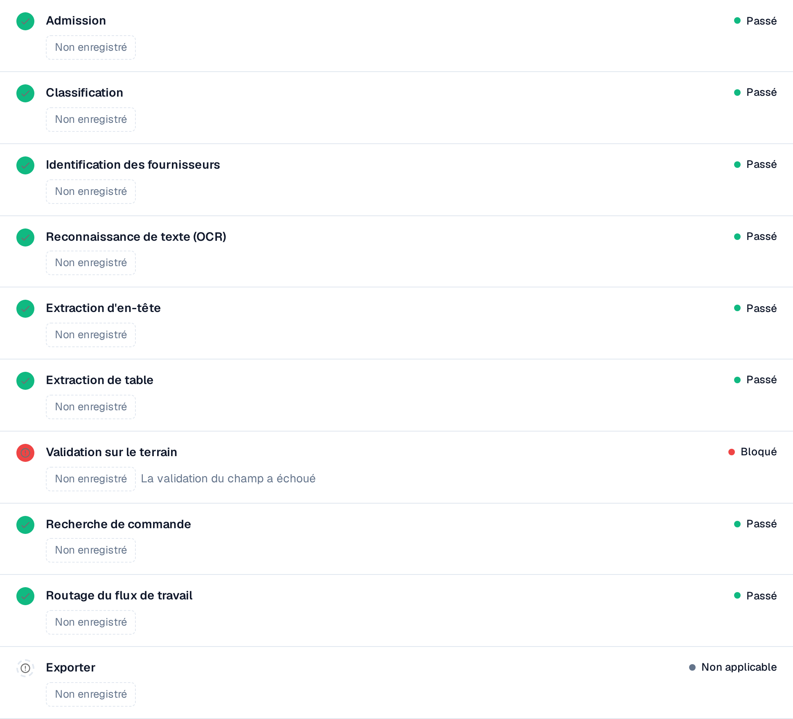

# Touchless Intelligence : Trace du document

Saisissez un ID de document dans **ID du document** (Document ID), ou ouvrez un document d'exemple depuis un cluster, pour voir **ce qui est arrivé à ce document**.

L'en-tête affiche le fichier, son statut (par exemple **En cours**), l'exécution que vous consultez et son premier bloqueur, ainsi qu'un bouton **Document** avec l'ID du document.

<figure><figcaption>
La trace du document : le chemin du pipeline avec toutes les étapes, et le journal des étapes avec ce que chacune a enregistré.
</figcaption></figure>

Le **Chemin du pipeline** affiche 14 étapes : Réception, Classification, Validation du document électronique, Identification du fournisseur, Reconnaissance de texte, Extraction de l'en-tête, Extraction du tableau, Validation des champs, Recherche du BC, Rapprochement des lignes de BC, Approbation, Routage du workflow, Exportation, Accusé de réception de l'ERP. Chaque étape porte un seul état :

| État | Signification |
| --- | --- |
| **Passé** (vert) | L'étape s'est bien déroulée |
| **Arrêté ici** (orange) | L'étape a bloqué le document |
| **À suivre** | Le document n'est jamais allé aussi loin |
| **Aucun enregistrement** (en pointillés) | Aucune donnée n'a été enregistrée pour cette étape |
| **Sans objet** | L'étape ne s'applique pas à ce document |

### Journal des étapes

Le **journal des étapes** sous le chemin liste les mêmes étapes avec ce que chacune a enregistré. Un point de statut et le mot de statut se trouvent à gauche et à droite de chaque ligne.

* Chaque valeur est une **puce de valeur** : un nombre avec son unité, par exemple **Confiance 100 %**, **Seuil 60 %**, **Règles en échec 0**, **8 champs manquants** ou **0 écart de correspondance**. Les pourcentages sont affichés en `97 %`, jamais en `0.97`.
* **Détails** ouvre la liste complète des valeurs enregistrées par une étape, y compris les alternatives qu'elle a envisagées.
* L'étape qui a bloqué le document en indique la raison, par exemple **Échec de la validation des champs**.
* Une valeur qu'aucune étape n'a enregistrée s'affiche comme **Non enregistré**, jamais comme une valeur inventée. Les valeurs sont des nombres et des termes fixes, jamais du texte du document.
* **Afficher les diagnostics bruts** active les données brutes lorsque le support les demande.

<figure><figcaption>
Journal des étapes en français avec validation des champs bloquée. Les valeurs non enregistrées restent signalées comme telles : ce blocage ne prouve à lui seul ni une erreur d’extraction ni des données Infor incorrectes.
</figcaption></figure>

### Exécutions et changements

Le sélecteur d'exécution en haut du journal des étapes (**Exécuter 1 · Actuel**) permet de passer d'une exécution du document à l'autre. L'**historique des exécutions** à droite liste chaque exécution avec son résultat et l'endroit où elle s'est arrêtée. Lorsqu'un document a été exécuté plusieurs fois, choisissez une exécution dans le sélecteur pour la comparer à l'exécution actuelle : les valeurs modifiées portent alors un badge indiquant l'écart et son unité, par exemple **−2 champs** ou **+3 %**.

La carte **Document** à côté du journal des étapes indique le type de document, le fournisseur, le numéro de facture, le bon de commande, le nombre de pages et si l'analyse est **basée sur des règles** ou rédigée par l'IA.

## Distinguer extraction et données source

1. Comparez original et champs ou lignes extraits **avant correction manuelle**. Une valeur corrigée aujourd’hui ne prouve pas l’extraction initiale.
2. Lisez le premier blocage. Une étape réussie confirme son exécution, pas l’exactitude de chaque valeur.
3. Comparez commande importée et Infor actuel : unités, unités de prix et date d’import.
4. Distinguez original contre extraction, extraction correcte contre données importées, et Infor contre sa copie. Laissez la cause ouverte si les preuves manquent.
5. Vérifiez interventions, approbations, relances et résultat final.

**Exemple :** original et extraction indiquent 10,00 €, commande importée 9,00 €. C’est un écart avec la commande, pas une erreur d’extraction démontrée. Confirmez le prix convenu et corrigez la source ou l’import. Une relance manuelle suivie de réussite donne AP Assisted. Voir [les exemples et le calcul](touchless-intelligence.md).

Des champs manquants répétés prouvent un blocage récurrent, pas nécessairement une valeur par défaut absente. Examinez extraction, original, validation et configuration.

## Prouver l’extraction initiale et suivre les blocages successifs

1. Ouvrez le document depuis sa trace ; vérifiez son ID et l’exécution. Comparez numéro de commande, devise, quantités, unités, unités de prix, prix, montants des lignes et totaux pertinents.
2. Distinguez valeurs actuelles et valeurs avant correction. Utilisez une preuve historique de cette exécution. Changer d’exécution ne garantit pas la restitution de chaque ancienne cellule.
3. Si la valeur initiale manque, indiquez **non évaluable**, pas correcte. Définissez champs, lignes, sélection et taille de l’échantillon avant de communiquer sa qualité d’extraction.
4. Comparez copie importée, date d’import et Infor actuel pour distinguer source erronée et copie périmée.

Une exécution peut attendre une commande ; après l’import, une autre peut révéler un écart de prix. La première ne prouve pas qu’elle ait atteint ce contrôle ultérieur. Une relance humaine persiste après réussite comme AP Assisted ; un refus ERP définitif devient une exception prioritaire. **Non enregistré** signifie preuve manquante.

Les outils et la classification des actions humaines sont expliqués dans [Touchless avec MCP](touchless-mcp.md).

## Pages connexes

* [Touchless Intelligence](touchless-intelligence.md)
* [Diagnostic fournisseur et clusters de problèmes](touchless-supplier-diagnosis.md)
* [Diagnostic du rapprochement avec le BC](touchless-po-matching-diagnosis.md)

Les captures d'écran de cette page montrent l'interface en français.

<!-- Touchless documentation alignment 2026-11-04: extraction quality is distinct from process automation. KPI definition checked against DocBits_API c51f350c728acb8ac964098d15f7b006bce273f4; existing native screenshots and video sources preserved except unsafe historical list images. -->

<!-- Completion 2026-11-04: localized MCP examples, AP actions, original-value evidence and owned synthetic PO cards. -->
