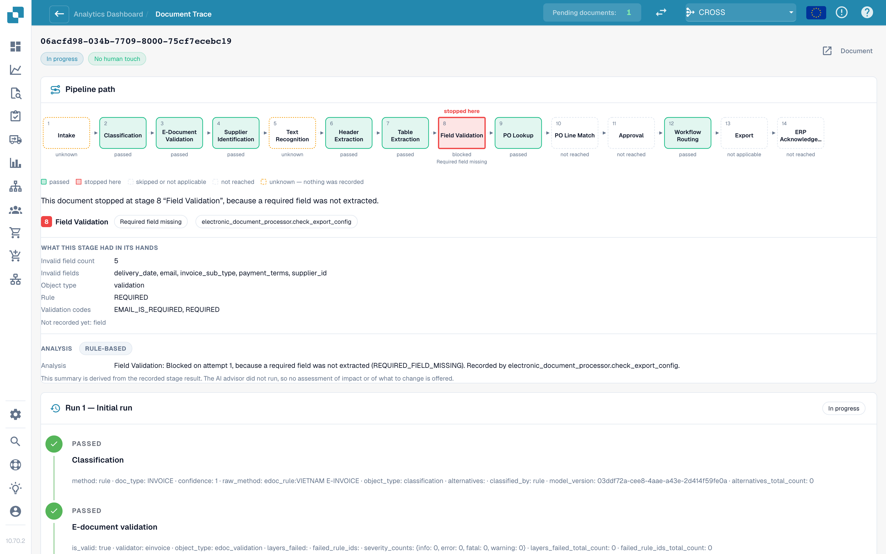

# Touchless Intelligence: Document Trace

Enter a document ID in **Document ID**, or open a sample document from a cluster, to see **what happened to this one document**.

<figure><figcaption>
The Document Trace: the pipeline path with the stage where the document stopped, what that stage had in its hands, and the run history below.
</figcaption></figure>

The top shows the **pipeline path** with 14 stages: Intake, Classification, E-Document Validation, Supplier Identification, Text Recognition, Header Extraction, Table Extraction, Field Validation, PO Lookup, PO Line Match, Approval, Workflow Routing, Export, ERP Acknowledgement. Each box has a state:

| State | Meaning |
| --- | --- |
| **passed** (green) | The stage ran fine |
| **stopped here** (red) | The stage blocked the document |
| **skipped or not applicable** | The stage does not apply to this document |
| **not reached** | The document never got this far |
| **unknown** (dashed) | Nothing was recorded for this stage |

Below the path, a sentence names the cause. In the screenshot: *This document stopped at stage 8 "Field Validation", because a required field was not extracted.* The block **What this stage had in its hands** lists the facts: **Invalid field count 5** and the fields (`delivery_date`, `email`, `invoice_sub_type`, `payment_terms`, `supplier_id`), the rule (**REQUIRED**) and the validation codes. The block **Analysis** says whether it is **Rule-based** or AI-written.

The **run history** below lists every run (**Run 1 · Initial run**, then each restart) with every stage and its recorded facts. If the document was corrected and restarted, a note reminds you that it **stays counted as touched**.

**Example.** The documents of one supplier all stop at stage 8. In the trace you see the same five invalid fields every time. That is not an extraction problem of single documents, it is a missing default in your field configuration: fix it once and the whole cluster is recoverable.

## Pre-processing decisions

For the latest run the trace adds the block **Pre-processing** below the pipeline path. It lists the decisions that run before the document reaches the pipeline, in the order they ran, each with a state:

| State | Meaning |
| --- | --- |
| **Recorded** | The module is on the record of this document. A record proves the attempt, not the success. |
| **Skipped** | The decision did not apply to this document |
| **Not recorded** | Nothing was stored for this decision |

Where a decision depends on a configuration, the entry also shows the current organization setting and its value. The block describes the document as it stands now, so it is shown for the latest run only and not in the run history.

## Related pages

* [Touchless Intelligence](touchless-intelligence.md)
* [Supplier Diagnosis and Issue Clusters](touchless-supplier-diagnosis.md)
* [PO Matching Diagnosis](touchless-po-matching-diagnosis.md)
