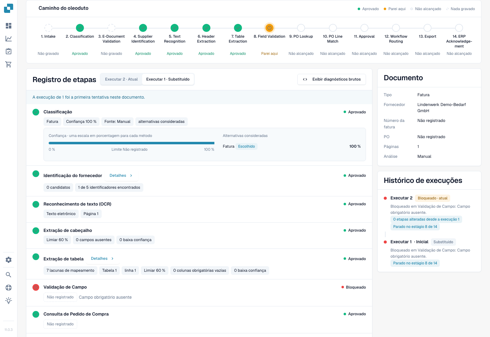
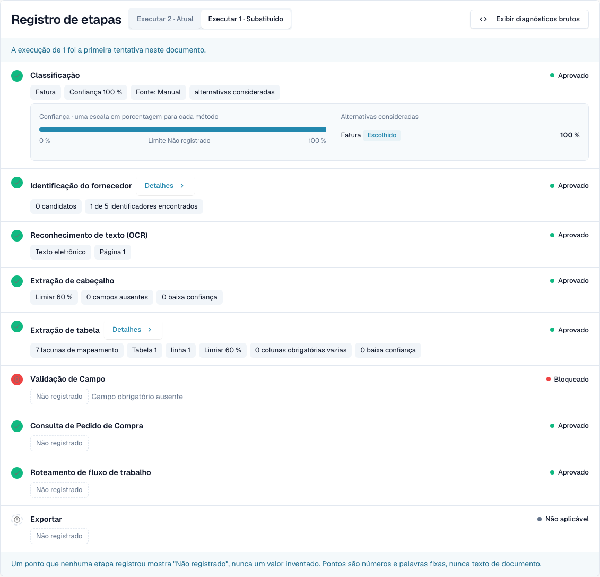
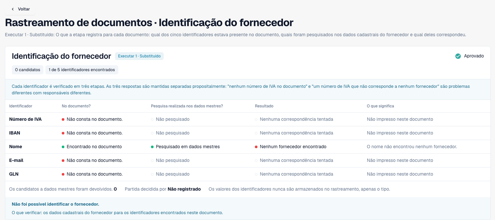
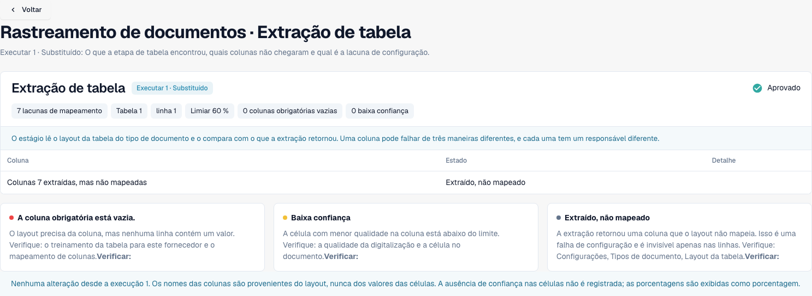
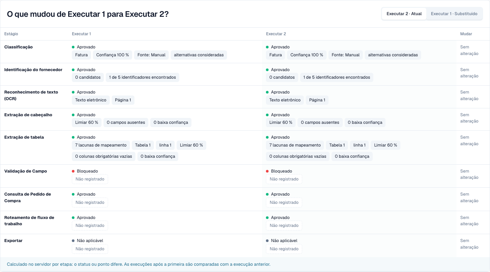

# Touchless Intelligence: Rastreamento do documento

<!-- touchless-admin-video-v2-20261104:start -->
**Capítulo do vídeo (versão de revisão):** [Comparar execuções](https://docbits-videos.fra1.cdn.digitaloceanspaces.com/settings-assistant/touchless-intelligence-preview-admin/v2/pt.html#chapter=08).
<!-- touchless-admin-video-v2-20261104:end -->

Introduza um ID de documento em **Document ID**, ou abra um documento de exemplo a partir de um cluster, para ver **o que aconteceu a este documento**.

O cabeçalho mostra o ficheiro, o seu estado (por exemplo **Em andamento**), a execução que está a consultar e o seu primeiro bloqueador, além de um botão **Documento** com o ID do documento.

<figure><figcaption>
Nova captura de Dev NOVA 11.0.3, de 4 de novembro de 2026. A fatura fictícia para na validação de campos. Classificação, pesquisa do fornecedor e extração de cabeçalho e tabela contêm valores realmente registados. Os cartões mostram o documento e o histórico. É a interface do produto em funcionamento. Nesta versão, os nomes das etapas do percurso permanecem em inglês. Caminho do oleoduto designa aqui o percurso de processamento, sem relação com um oleoduto.
</figcaption></figure>

O **Caminho do oleoduto** mostra 14 etapas: Intake, Classification, E-Document Validation, Supplier Identification, Text Recognition, Header Extraction, Table Extraction, Field Validation, PO Lookup, PO Line Match, Approval, Workflow Routing, Export, ERP Acknowledgement. Cada etapa tem um único estado:

| Estado | Significado |
| --- | --- |
| **Aprovado** (verde) | A etapa decorreu sem problemas |
| **Parei aqui** (laranja) | A etapa bloqueou o documento |
| **Não alcançado** | Etapa posterior ao primeiro bloqueio no percurso; verifique no registo eventuais execuções adicionais registadas |
| **Nada gravado** (tracejado) | Não foram registados dados para esta etapa |
| **Não aplicável** | A etapa não se aplica a este documento |

### Registo de etapas

O **registo de etapas** sob o caminho lista as mesmas etapas com o que cada uma registou. Um ponto de estado e a palavra de estado ficam à esquerda e à direita de cada linha.

* Cada valor é uma **etiqueta de valor**: um número com a sua unidade, por exemplo **Confiança 100 %**, **Limiar 60 %**, **Regras falhadas 0**, **8 campos em falta** ou **0 lacunas de correspondência**. As percentagens são mostradas como `97 %`, nunca como `0.97`.
* **Detalhes** abre a lista completa dos valores que uma etapa registou, incluindo as alternativas que considerou.
* A etapa que bloqueou o documento indica o motivo, por exemplo **Validação de campo falhou**.
* Um valor que nenhuma etapa registou aparece como **Não registado**, nunca como um valor inventado. Os valores são números e termos fixos, nunca texto do documento.
* **Mostrar diagnósticos em bruto** ativa os dados em bruto quando o suporte os pede.

<figure><figcaption>
Primeira execução real: confiança de classificação de 100 %, 0 fornecedores candidatos, 1 linha e 7 lacunas de correspondência. Uma etapa aprovada confirma a execução, não a identificação do fornecedor nem a exatidão de todos os valores. A validação indica um campo obrigatório em falta.
</figcaption></figure>

### Execuções e alterações

Escolha uma tentativa no seletor; o histórico mostra o resultado e o primeiro bloqueio. As diferenças registadas comparam a execução selecionada com a anterior, não automaticamente com a atual. Cada diferença inclui a unidade; valores idênticos permanecem inalterados.

O cartão Documento mostra tipo, fornecedor, número de fatura, encomenda, páginas e método de análise registado. Aqui, Manual corresponde ao tipo fornecido durante a importação de teste. Os 100 % não demonstram, de forma independente, a precisão de uma classificação automática.

### Ler os detalhes do fornecedor e da tabela

<figure><figcaption>
O nome consta da fatura e é pesquisado nos dados de referência, mas não é atribuído nenhum fornecedor. Esta fatura de teste não contém número de IVA, IBAN, e-mail nem GLN. Uma correspondência em falta nos dados de referência é diferente de um valor não encontrado na fatura.
</figcaption></figure>

Verifique separadamente se o identificador estava no documento, se foi pesquisado e se foi atribuído um fornecedor. Uma etapa verde não responde por si só a estas três perguntas.

<figure><figcaption>
Os detalhes indicam 7 lacunas de correspondência para 1 tabela e 1 linha. Verifique o mapeamento das colunas antes de concluir que houve um erro de extração. O rodapé de comparação não é uma base válida para a primeira execução selecionada, que não tem antecessora. O texto nativo do rodapé não comprova que todas as células tenham valores de confiança registados.
</figcaption></figure>

### Reconhecer um reinício real

<figure><figcaption>
A mesma fatura após um reinício manual real, sem corrigir campos. Uma nova execução comprova outra tentativa, não uma melhoria. Os valores idênticos permanecem sem alterações; não foram inventadas diferenças.
</figcaption></figure>

Um reinício manual é uma intervenção humana. Este caso só contará como AP Assisted após uma eventual conclusão posterior com sucesso. Enquanto estiver em processamento, fica fora do denominador dos documentos finalizados.

Limites da evidência. Este caso não demonstra aprovação de negócio, exportação bem-sucedida nem confirmação ERP. O comparador de encomendas antigo não fornece aqui um percurso de decisão registado; não comprova uma comparação com Infor. Em NOVA 11.0.3, o registo pode mostrar uma pesquisa de encomenda aprovada após a validação bloqueada, enquanto o percurso a apresenta como etapa seguinte. Verifique ambas as vistas. O resumo também indica que o número de fatura não está registado, embora conste da extração; compare o original e os campos extraídos.

## Separar extração e dados de origem

Compare original e campos/linhas anteriores às correções. Depois compare a encomenda importada com o Infor atual, incluindo unidades, unidades de preço e data de importação. Sem prova, mantenha a causa em aberto.

**Exemplo:** original e extração indicam 10 €, encomenda importada 9 €. É uma divergência com a encomenda, não um erro de extração comprovado. Confirme o preço acordado. Reinício humano seguido de sucesso dá AP Assisted. Veja [métricas](touchless-metrics.md). Campos ausentes recorrentes não comprovam um valor predefinido em falta: examine original, extração, validação e configuração.

## Provar a extração inicial e os bloqueios sucessivos

Compare original e execução corretos: encomenda, moeda, quantidades, unidades, unidades de preço, preços e totais. Separe valores atuais dos anteriores às correções. Mudar de execução não garante recuperar cada célula antiga. Sem valor inicial, indique **não avaliável**; defina âmbito e tamanho da amostra. Compare cópia importada, data e Infor atual.

Uma execução pode aguardar a encomenda; outra revelar um preço divergente depois da importação. A primeira não prova que chegou à verificação seguinte. Reinício humano permanece AP Assisted após sucesso; erro ERP definitivo prevalece. Ausência de registo significa ausência de prova.

Ferramentas e classificação de ações em [Touchless com MCP](touchless-mcp.md).

## Páginas relacionadas

* [Touchless Intelligence](touchless-intelligence.md)
* [Diagnóstico de fornecedores e clusters de problemas](touchless-supplier-diagnosis.md)
* [Diagnóstico de PO Matching](touchless-po-matching-diagnosis.md)

As capturas de ecrã desta página mostram a interface em português.

<!-- Alignment 2026-11-04: correct extraction is distinct from process Touchless; KPI numerator and denominator verified. -->

<!-- Completion 2026-11-04: localized MCP examples, AP actions, original-value evidence and owned synthetic PO cards. -->

As cinco novas imagens mostram a interface localizada de Dev NOVA 11.0.3 e a mesma fatura criada para a documentação. Qualquer imagem separada do original e dos campos ilustra apenas essa comparação.
