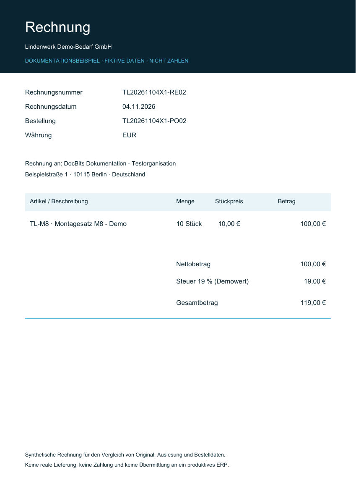

# Praxisbeispiele: Preis und Menge

<!-- touchless-admin-video-20261104:start -->
**Video-Kapitel (Prüffassung):** [Auslesung und Infor trennen](https://docbits-videos.fra1.cdn.digitaloceanspaces.com/settings-assistant/touchless-intelligence-preview-admin/v1/de.html#chapter=04).
<!-- touchless-admin-video-20261104:end -->

## Durchgängiges Beispiel: richtig ausgelesen, andere Infor-Daten

Der folgende Schulungsfall verbindet Original, Auslesung, Quelldaten und Endergebnis. Die Screenshots zeigen die zugehörigen Ansichten der Anwendung; sie sind kein aufgezeichneter Infor-Durchlauf dieser Beispielrechnung. Die Rechnung enthält **10 Stück zu je 10,00 €**, insgesamt **100,00 €**. DocBits liest alle drei Werte korrekt aus. Die importierte Infor-Bestellung enthält **10 Stück zu je 9,00 €**, insgesamt **90,00 €**. Angenommen, die konfigurierten Abgleichprüfungen blockieren diese Preisabweichung.

1. **Auslesung prüfen:** Vergleichen Sie Originalrechnung und ausgelesene Menge, Stückpreis und Positionsbetrag. Sie stimmen überein; für diese Werte ist kein Auslesefehler nachgewiesen.
2. **Quelle prüfen:** Vergleichen Sie die importierte Bestellung mit der aktuellen Infor-Bestellung, einschließlich Preiseinheit und Importzeitpunkt. Ein veralteter Import und eine falsche Infor-Bestellung brauchen unterschiedliche Behebungen.
3. **Fachlich richtigen Wert klären:** In diesem Beispiel bestätigt der Einkauf den vereinbarten Preis von 10,00 € und korrigiert die Infor-Bestellung. Wären 9,00 € vereinbart, müsste stattdessen die Lieferantenrechnung geklärt werden.
4. **Korrigierten Import nachweisen:** Prüfen Sie vor der erneuten Verarbeitung, ob die richtigen Bestellwerte tatsächlich in DocBits angekommen sind.
5. **AP-Aktion festhalten:** AP startet diese Rechnung manuell in DocBits neu; nach erfolgreichem Abschluss zählt sie als **AP mit Eingriff**. Korrekte Auslesung und ein Prozess mit Eingriff können gleichzeitig zutreffen.
6. **Folgerechnungen prüfen:** Kontrollieren Sie, ob Abgleich und Export jetzt ohne weitere Korrektur oder Neustart abschließen. Die bereits bearbeitete Rechnung bleibt bearbeitet; spätere Rechnungen liefern den Verbesserungsnachweis.


Ändern Sie korrekt ausgelesene 10,00 € nicht auf 9,00 €, nur damit eine falsche Bestellung passt. Erweitern Sie auch keine Toleranz allein zum Verdecken der Abweichung. Klären Sie den vereinbarten Wert und korrigieren Sie die verantwortlichen Daten oder die Konfiguration. Der Abgleichblocker zeigt, wo der Prozess stoppt, nicht wer die Ursache gesetzt hat.


Die getrennte Betrachtung der Auslesequalität und die AP-Touchless-Berechnung finden Sie unter [Touchless Intelligence](touchless-intelligence.md), die zu vergleichenden Nachweise unter [Dokumentverlauf](touchless-document-trace.md).

### Welche Nachweise zu diesem Fall gehören

| Station | Was Sie ansehen | Was Sie festhalten |
| --- | --- | --- |
| Original und Auslesung | Rechnung über **Dokument** im Dokumentverlauf öffnen, Felder und Positionen vergleichen | 10 × 10,00 € = 100,00 €, vor manueller Korrektur; [Prüfanleitung](touchless-document-trace.md) |
| Bestellabgleich | Entscheidungsablauf in der [Bestellabgleich-Diagnose](touchless-po-matching-diagnosis.md) und dokumentbezogene Blocker lesen | Tatsächlich angewandter Regelsatz, Preiseinheit und relevante Toleranz; der Organisationsablauf allein belegt noch keine Dokumentwerte |
| Quelle und Import | Importierte Bestellung mit dem aktuellen Infor-Datensatz vergleichen | 10 × 9,00 € = 90,00 €, Importzeitpunkt und fachlich vereinbarter Preis |
| AP-Aktion | Laufhistorie nach der Quellenkorrektur prüfen | Wer manuell neu gestartet hat und welcher Lauf daraus entstand |
| Ergebnis und Messung | Nach Abschluss und aktualisiertem Datenstand das Dokumentergebnis prüfen | AP mit Eingriff; [Berechnung und Aktionsmatrix](touchless-intelligence.md) |

Fehlt ein Nachweis, bleibt genau dieser Teil offen. Insbesondere beweisen weder das Ablaufdiagramm noch ein grüner Verarbeitungsschritt die korrekte Auslesung sämtlicher Rechnungswerte.

## Drei eigene Demo-Bestellungen: passend, Preis und Menge

Die folgenden Bestellungen wurden eigens für die Dokumentation in **Dev** angelegt. Lieferant, Artikel und Belege sind fiktiv. Alle drei PDF-Rechnungen enthalten **10 Stück × 10,00 € = 100,00 € netto**. Die Bilder zeigen echte Bestellansichten und vergrößerte Ausschnitte daraus. Sie zeigen **keinen Live-Zugriff auf ein Infor-Kundensystem** und **keinen erfolgreich abgeschlossenen automatischen Rechnungslauf**.

<figure><figcaption>
Die selbst erstellte Originalrechnung für das Preisbeispiel: 10 Stück zu 10,00 €, netto 100,00 €. Dies ist das Rechnungsoriginal, kein Screenshot ausgelesener Werte. Die beiden anderen Demo-Rechnungen haben dieselben Positionswerte und verweisen jeweils auf PO01 beziehungsweise PO03.
</figcaption></figure>

| Fall | Rechnung | Importierte Bestellung | Was Sie daraus ableiten dürfen |
| --- | --- | --- | --- |
| PO01 / RE01: Werte stimmen überein | 10 × 10,00 € = 100,00 € | 10 × 10,00 € = 100,00 € | Die gezeigten Quellwerte passen; Pure Touchless ist erst nach belegter Auslesung und erfolgreichem Abschluss ohne Eingriff oder Freigabe nachgewiesen |
| PO02 / RE02: Preisabweichung | 10 × 10,00 € = 100,00 € | 10 × 9,00 € = 90,00 € | 10,00 € Unterschied im Positionsbetrag; bezogen auf den Bestellpreis beträgt die Preisabweichung rund 11,11 %. Ob sie blockiert, entscheidet das tatsächlich aktive Regelwerk |
| PO03 / RE03: Mengenabweichung | 10 × 10,00 € = 100,00 € | 8 × 10,00 € = 80,00 € | Rechnung enthält 2 Stück mehr, bezogen auf die bestellte Menge 25 %. Prüfen Sie außerdem offene oder gelieferte Menge und die gewählte Vergleichsmenge |

<figure><figcaption>
Passende Werte in der fiktiven Bestellung PO01. Der vergrößerte native Ausschnitt zeigt Menge, Einzelpreis und Betrag. Ein passender Bestellwert allein beweist weder korrekte Auslesung noch Pure Touchless.
</figcaption></figure>

<figure><figcaption>
Preisbeispiel PO02: Die importierte Bestellung zeigt tatsächlich 10 × 9 = 90, die Originalrechnung 10 × 10 = 100. Vereinbarten Preis, Preiseinheit und Import prüfen; anschließend die bestätigte Ursache beheben. Eine manuell bearbeitete Rechnung zählt nach erfolgreichem Abschluss als AP mit Eingriff.
</figcaption></figure>

<figure><figcaption>
Mengenbeispiel PO03: Die importierte Bestellung enthält 8 Stück, die Rechnung 10 Stück. Die Spalte Empfangene Menge ist im Test leer; aus ihr ist keine tatsächliche Lieferung belegt. Die Karten erklären den Vergleich und zeigen keinen nachgewiesenen erfolgreichen Abgleich.
</figcaption></figure>

## Weiterführende Seiten

* [Touchless Intelligence](touchless-intelligence.md)
* [Kennzahlen und Berechnung](touchless-metrics.md)
* [Dashboard bedienen](touchless-dashboard.md)
* [Touchless Intelligence: Lieferantendiagnose und Fehlermuster](touchless-supplier-diagnosis.md)
* [Touchless Intelligence: Bestellabgleich-Diagnose](touchless-po-matching-diagnosis.md)
* [Touchless Intelligence: Dokumentverlauf](touchless-document-trace.md)
* [Touchless Intelligence: Änderungsvorschläge und Berichte](touchless-change-proposals.md)
* [Touchless mit MCP erklären und verbessern](touchless-mcp.md)

<!-- Source notes (not shown): screenshots come from the dev test organisation with synthetic demo data (seed script) and fictional supplier names; the PO matching decision flow is illustrated on the matching-diagnosis subpage. facts read from the doc2app code (TouchlessIntelligence pages and components) and the dev UI on 14 Oct 2026; NOVA gates the tab with its own organisation flag, VESTA with the Analytics module. Consulting report export format not verified, so no export is described. -->
<!-- Doku-Prüfung 04.11.2026: Auslesequalität getrennt von Prozessergebnissen; Kennzahlen und Endergebnisse gegen DocBits_API c51f350c728acb8ac964098d15f7b006bce273f4, module/automation_intelligence/kpi.py und bucket.py, geprüft. Bestehende deutsche Originalaufnahmen getrennt von den Schulungsbeispielen geprüft. -->
<!-- Completion review 2026-11-04: AP actions, original-value evidence, overlapping KPI labels, sequential blockers and screenshot proof limits checked. -->
