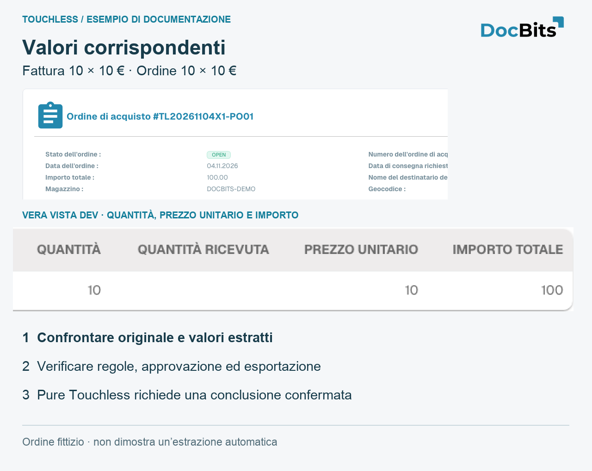
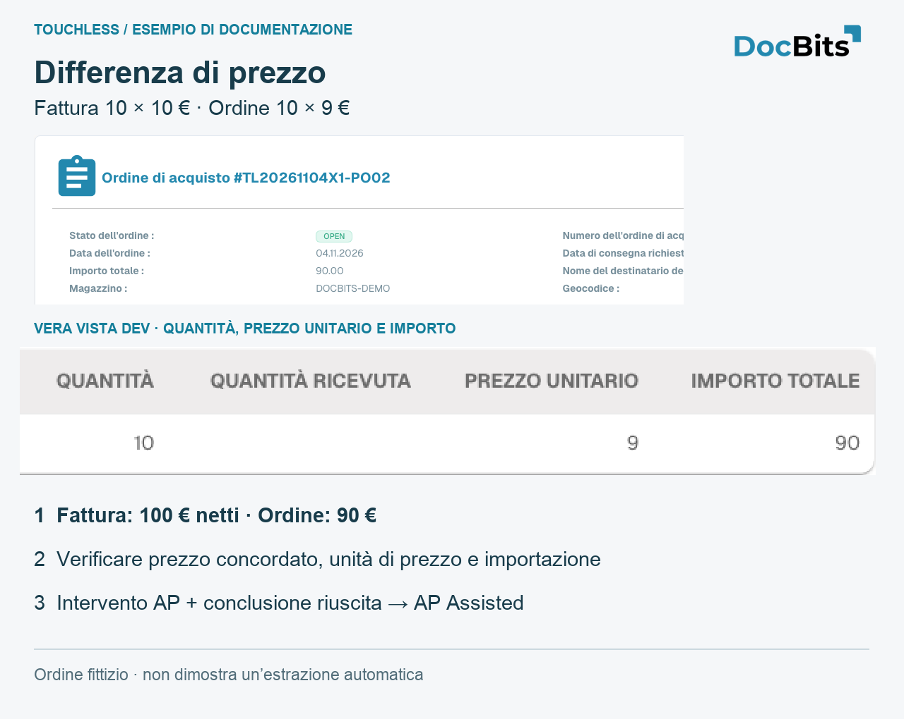
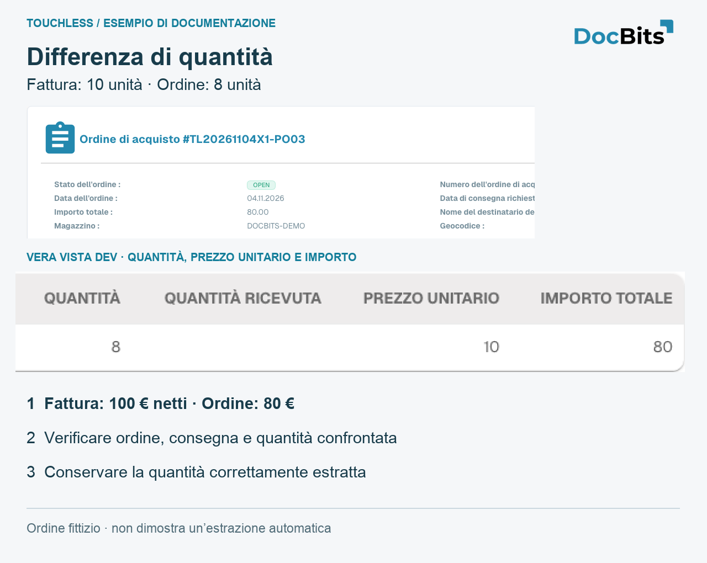

# Esempi: prezzo e quantità

<!-- touchless-admin-video-v2-20261104:start -->
**Capitolo video (versione di verifica):** [Seguire un documento](https://docbits-videos.fra1.cdn.digitaloceanspaces.com/settings-assistant/touchless-intelligence-preview-admin/v2/it.html#chapter=07).
<!-- touchless-admin-video-v2-20261104:end -->

## Esempio completo: estrazione corretta, dati Infor diversi

Caso illustrativo: fattura **10 unità × 10 € = 100 €**, estratta correttamente. Ordine importato **10 × 9 € = 90 €**. Supponiamo che le regole attive blocchino la differenza.

1. Confrontate originale ed estrazione: i valori coincidono.
2. Confrontate ordine importato, Infor attuale, unità di prezzo e data. Fonte errata e copia obsoleta non sono lo stesso problema.
3. Gli acquisti confermano 10 € e correggono l’ordine. Se fossero concordati 9 €, occorrerebbe chiarire la fattura del fornitore.
4. Verificate l’arrivo dei valori corretti in DocBits.
5. AP riavvia manualmente; dopo successo la fattura è **AP Assisted**, nonostante l’estrazione corretta.
6. Verificate che le fatture successive terminino senza altri interventi; quelle già toccate conservano la loro storia.

Non alterate un valore estratto correttamente e non ampliate una tolleranza per nascondere dati errati. Correggete la causa confermata. Le immagini dimostrative non provano questo percorso completo.

## Tre ordini dimostrativi: corrispondenza, prezzo e quantità

Creati appositamente su **Dev**, usano fornitore, articolo e fatture fittizi. Ogni fattura contiene **10 unità × 10 € = 100 € netti**. Le schede conservano le vere viste italiane e ne ingrandiscono le cifre. Non mostrano una connessione Infor cliente, un’estrazione provata o un processo automatico concluso con successo.

| Caso | Fattura | Ordine importato | Che cosa dimostra |
| --- | --- | --- | --- |
| PO01 / RE01 | 10 × 10 € = 100 € | 10 × 10 € = 100 € | Valori di origine uguali; Pure richiede ancora estrazione corretta e conclusione senza interventi né approvazioni |
| PO02 / RE02 | 10 × 10 € = 100 € | 10 × 9 € = 90 € | Divario di riga 10 €, circa 11,11 % del prezzo unitario dell’ordine; decidono le regole attive |
| PO03 / RE03 | 10 × 10 € = 100 € | 8 × 10 € = 80 € | Due unità in più, 25 % della quantità ordinata; controllate quantità aperta/ricevuta e base di confronto |

<figure><figcaption>
Valori corrispondenti nell’ordine fittizio PO01. Il dettaglio nativo ingrandito mostra quantità, prezzo e importo. La corrispondenza non prova da sola estrazione corretta o Pure Touchless.
</figcaption></figure>

<figure><figcaption>
Caso prezzo PO02: l’ordine importato mostra davvero 10 × 9 = 90, contro 10 × 10 = 100 della fattura fittizia. Verificate prezzo concordato, unità di prezzo e import. Intervento umano registrato seguito da successo: AP Assisted.
</figcaption></figure>

<figure><figcaption>
Caso quantità PO03: 8 unità ordinate, 10 fatturate. Quantità ricevuta è vuota e non prova una consegna. Le schede spiegano il confronto, non un abbinamento riuscito.
</figcaption></figure>

## Pagine correlate

* [Touchless Intelligence](touchless-intelligence.md)
* [Metriche e calcolo](touchless-metrics.md)
* [Usare il pannello](touchless-dashboard.md)
* [Touchless Intelligence: Diagnosi del fornitore e cluster di problemi](touchless-supplier-diagnosis.md)
* [Touchless Intelligence: Diagnosi dell'abbinamento ordini](touchless-po-matching-diagnosis.md)
* [Touchless Intelligence: Tracciamento del documento](touchless-document-trace.md)
* [Touchless Intelligence: Proposte di modifica e report](touchless-change-proposals.md)
* [Spiegare e migliorare Touchless con MCP](touchless-mcp.md)

<!-- Source notes (not shown): screenshots come from the dev test organisation with synthetic demo data (seed script) and fictional supplier names; the PO matching decision flow has no screenshot yet. facts read from the doc2app code (TouchlessIntelligence pages and components) and the dev UI on 14 Oct 2026; NOVA gates the tab with its own organisation flag, VESTA with the Analytics module. Consulting report export format not verified, so no export is described. -->
<!-- Alignment 2026-11-04: correct extraction is distinct from process Touchless; KPI numerator and denominator verified. -->
<!-- Completion 2026-11-04: localized MCP examples, AP actions, original-value evidence and owned synthetic PO cards. -->
