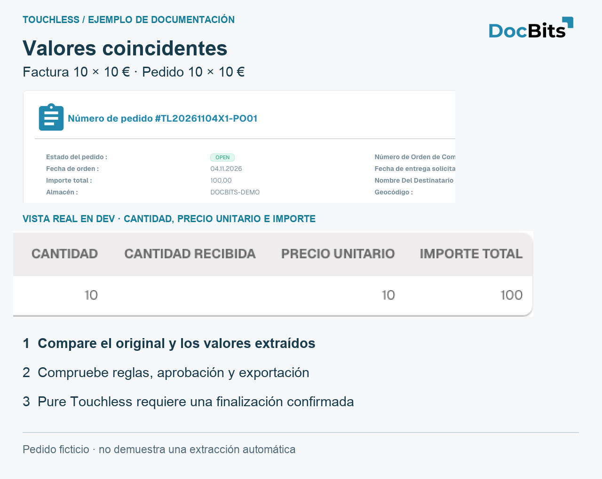
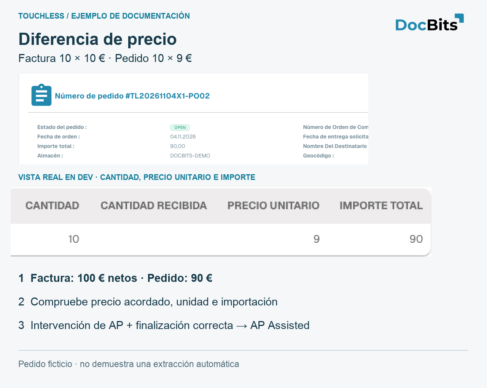
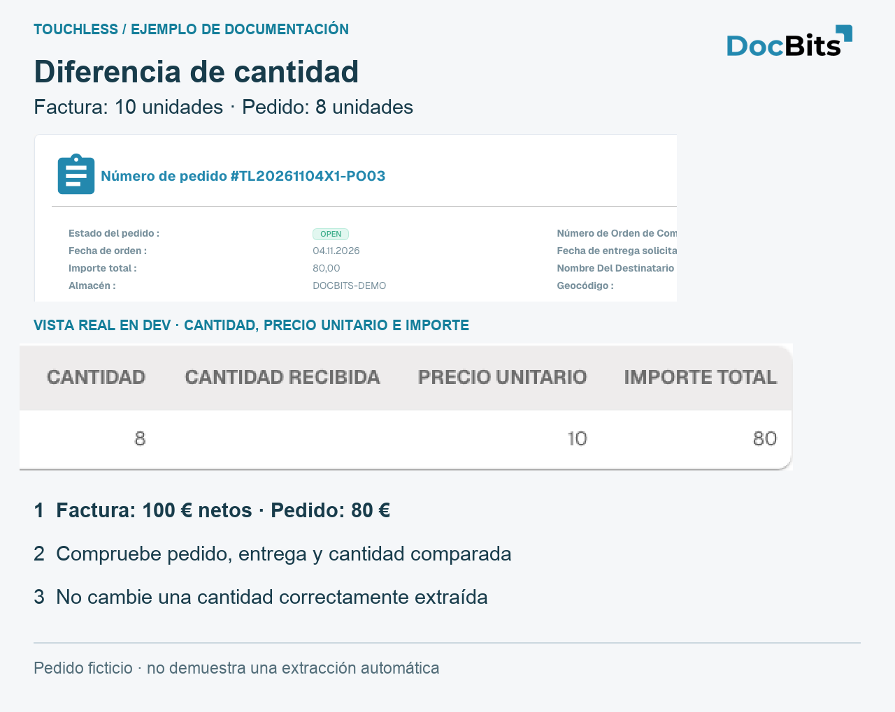

# Ejemplos: precio y cantidad

## Ejemplo completo: extracción correcta, datos de Infor diferentes

Caso ilustrativo: la factura contiene **10 unidades a 10,00 € = 100,00 €**. DocBits extrae los tres valores correctamente. El pedido importado contiene **10 unidades a 9,00 € = 90,00 €**. Supongamos que las reglas bloquean esta diferencia.

1. Compare factura y extracción: los valores coinciden.
2. Compare el pedido importado con Infor, las unidades de precio y la fecha de importación. Un pedido incorrecto y una copia desactualizada requieren soluciones distintas.
3. Compras confirma que se acordaron 10,00 € y corrige el pedido. Si se hubieran acordado 9,00 €, habría que aclarar la factura del proveedor.
4. Compruebe que los valores corregidos llegaron a DocBits.
5. AP reinicia manualmente la factura; tras finalizar con éxito cuenta como **AP Assisted**, aunque la extracción fuera correcta.
6. Compruebe que las facturas posteriores terminan sin otra corrección. La factura ya intervenida conserva ese historial.

No cambie un valor correctamente extraído ni amplíe una tolerancia solo para ocultar datos de origen incorrectos. Corrija la causa confirmada. Véase [la diferencia entre extracción y tasa de proceso](touchless-metrics.md).

## Tres pedidos de demostración: coincidencia, precio y cantidad

Se crearon específicamente en **Dev**. Proveedor, artículo y facturas son ficticios. Cada factura contiene **10 unidades × 10 € = 100 € netos**. Las tarjetas conservan capturas reales de la interfaz española y amplían sus cifras. No muestran una conexión Infor de un cliente, extracción acreditada ni un proceso automático finalizado correctamente.

| Caso | Factura | Pedido importado | Qué demuestra |
| --- | --- | --- | --- |
| PO01 / RE01 | 10 × 10 € = 100 € | 10 × 10 € = 100 € | Los valores de origen coinciden; Pure Touchless aún necesita extracción correcta y finalización sin intervención ni aprobación |
| PO02 / RE02 | 10 × 10 € = 100 € | 10 × 9 € = 90 € | Diferencia de 10 € por línea, aproximadamente 11,11 % del precio unitario del pedido; las reglas activas deciden si bloquea |
| PO03 / RE03 | 10 × 10 € = 100 € | 8 × 10 € = 80 € | Dos unidades más, 25 % respecto a la cantidad pedida; revise cantidad abierta/recibida y la comparación configurada |

<figure><figcaption>
Valores coincidentes en el pedido ficticio PO01. El detalle nativo ampliado muestra cantidad, precio e importe. La coincidencia no demuestra por sí sola extracción correcta ni Pure Touchless.
</figcaption></figure>

<figure><figcaption>
Ejemplo de precio PO02: el pedido importado muestra realmente 10 × 9 = 90, frente a 10 × 10 = 100 de la factura ficticia. Compruebe precio acordado, unidad e importación. Una intervención humana registrada seguida de éxito es AP Assisted.
</figcaption></figure>

<figure><figcaption>
Ejemplo de cantidad PO03: 8 unidades en el pedido, 10 en la factura. Cantidad recibida está vacía y no acredita entrega. Las tarjetas explican el contraste; no demuestran una coincidencia procesada correctamente.
</figcaption></figure>

## Páginas relacionadas

* [Touchless Intelligence](touchless-intelligence.md)
* [Métricas y cálculo](touchless-metrics.md)
* [Usar el panel](touchless-dashboard.md)
* [Touchless Intelligence: Diagnóstico de proveedores y clústeres de problemas](touchless-supplier-diagnosis.md)
* [Touchless Intelligence: Diagnóstico de la coincidencia con la OC](touchless-po-matching-diagnosis.md)
* [Touchless Intelligence: Seguimiento del documento](touchless-document-trace.md)
* [Touchless Intelligence: Propuestas de cambio e informes](touchless-change-proposals.md)
* [Explicar y mejorar Touchless con MCP](touchless-mcp.md)

<!-- Source notes (not shown): screenshots come from the dev test organisation with synthetic demo data (seed script) and fictional supplier names; the PO matching decision flow has no screenshot yet. facts read from the doc2app code (TouchlessIntelligence pages and components) and the dev UI on 14 Oct 2026; NOVA gates the tab with its own organisation flag, VESTA with the Analytics module. Consulting report export format not verified, so no export is described.
-->
<!-- Touchless documentation alignment 2026-11-04: extraction quality is distinct from process automation. KPI definition checked against DocBits_API c51f350c728acb8ac964098d15f7b006bce273f4; existing native screenshots and video sources preserved except unsafe historical list images. -->
<!-- Completion 2026-11-04: localized MCP examples, AP actions, original-value evidence and owned synthetic PO cards. -->
