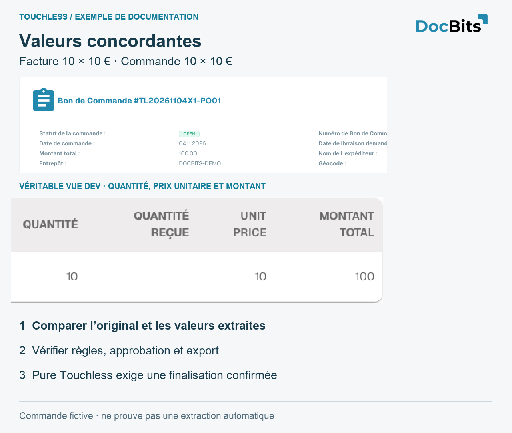
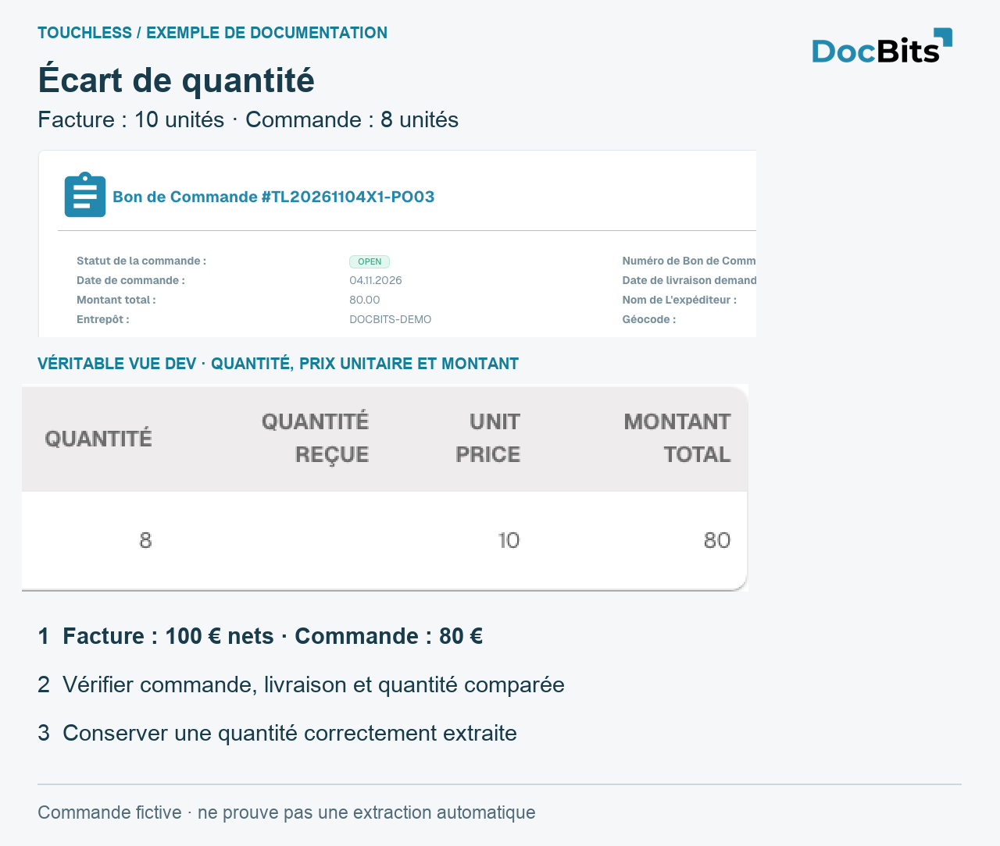

# Exemples : prix et quantité

<!-- touchless-admin-video-v2-20261104:start -->
**Chapitre vidéo (version de contrôle):** [Suivre un document](https://docbits-videos.fra1.cdn.digitaloceanspaces.com/settings-assistant/touchless-intelligence-preview-admin/v2/fr.html#chapter=07).
<!-- touchless-admin-video-v2-20261104:end -->

## Exemple complet : extraction correcte, données Infor différentes

Cas illustratif : facture de **10 unités à 10,00 € = 100,00 €**, extraite correctement. La commande importée indique **10 unités à 9,00 € = 90,00 €**. Supposons que les règles bloquent cet écart.

1. Vérifiez l’accord entre facture et extraction.
2. Comparez commande importée et Infor actuel, unités de prix et date d’import. Une commande erronée et une copie périmée nécessitent des corrections distinctes.
3. Les achats confirment 10,00 € et corrigent la commande. Si 9,00 € avaient été convenus, il faudrait clarifier la facture fournisseur.
4. Vérifiez l’arrivée des bonnes valeurs dans DocBits.
5. AP relance manuellement ; après réussite, le document est **AP Assisted**, malgré une extraction correcte.
6. Vérifiez que les factures suivantes aboutissent sans nouvelle intervention. La facture déjà traitée conserve son historique.

Ne modifiez pas une valeur correctement extraite et n’élargissez pas une tolérance pour masquer des données erronées. Corrigez la cause confirmée. Voir [extraction et taux de processus](touchless-intelligence.md).

## Trois commandes de démonstration : concordance, prix et quantité

Créées uniquement sur **Dev**, elles concernent un fournisseur, un article et des factures fictifs. Chaque facture porte **10 unités × 10 € = 100 € nets**. Les cartes conservent les véritables vues françaises et agrandissent leurs chiffres. Elles ne montrent ni connexion Infor client, ni extraction prouvée, ni processus automatique terminé avec succès. La colonne **UNIT PRICE** reste en anglais dans le produit ; elle signifie **prix unitaire**. Le texte explicatif est français ; l’interface n’a pas été retouchée pour masquer cette lacune.

| Cas | Facture | Commande importée | Ce que cela établit |
| --- | --- | --- | --- |
| PO01 / RE01 | 10 × 10 € = 100 € | 10 × 10 € = 100 € | Valeurs source concordantes ; Pure Touchless exige encore extraction correcte et finalisation sans intervention ni approbation |
| PO02 / RE02 | 10 × 10 € = 100 € | 10 × 9 € = 90 € | Écart de ligne de 10 €, environ 11,11 % du prix unitaire de commande ; les règles actives déterminent le blocage |
| PO03 / RE03 | 10 × 10 € = 100 € | 8 × 10 € = 80 € | Deux unités supplémentaires, 25 % de la quantité commandée ; vérifier quantité ouverte/reçue et base de comparaison |

<figure><figcaption>
Valeurs concordantes dans la commande fictive PO01. Le détail natif agrandi montre quantité, prix et montant. La concordance seule ne prouve ni extraction correcte ni Pure Touchless ; UNIT PRICE signifie prix unitaire.
</figcaption></figure>

<figure><figcaption>
Cas de prix PO02 : la commande importée affiche réellement 10 × 9 = 90, contre 10 × 10 = 100 sur la facture fictive. Vérifiez prix convenu, unité de prix et import. Intervention humaine enregistrée puis réussite : AP Assisted. Le libellé produit UNIT PRICE reste anglais.
</figcaption></figure>

<figure><figcaption>
Cas de quantité PO03 : 8 unités commandées, 10 facturées. Quantité reçue est vide et ne prouve aucune livraison. Les cartes expliquent la comparaison, pas un rapprochement réussi ; UNIT PRICE signifie prix unitaire.
</figcaption></figure>

## Pages associées

* [Touchless Intelligence](touchless-intelligence.md)
* [Indicateurs et calcul](touchless-metrics.md)
* [Utiliser le tableau de bord](touchless-dashboard.md)
* [Touchless Intelligence : Diagnostic fournisseur et clusters de problèmes](touchless-supplier-diagnosis.md)
* [Touchless Intelligence : Diagnostic du rapprochement avec le BC](touchless-po-matching-diagnosis.md)
* [Touchless Intelligence : Trace du document](touchless-document-trace.md)
* [Touchless Intelligence : Propositions de modification et rapports](touchless-change-proposals.md)
* [Expliquer et améliorer Touchless avec MCP](touchless-mcp.md)

<!-- Source notes (not shown): screenshots come from the dev test organisation with synthetic demo data (seed script) and fictional supplier names; the PO matching decision flow has no screenshot yet. facts read from the doc2app code (TouchlessIntelligence pages and components) and the dev UI on 14 Oct 2026; NOVA gates the tab with its own organisation flag, VESTA with the Analytics module. Consulting report export format not verified, so no export is described.

<!-- Touchless documentation alignment 2026-11-04: extraction quality is distinct from process automation. KPI definition checked against DocBits_API c51f350c728acb8ac964098d15f7b006bce273f4; existing native screenshots and video sources preserved except unsafe historical list images. -->
<!-- Completion 2026-11-04: localized MCP examples, AP actions, original-value evidence and owned synthetic PO cards. -->
