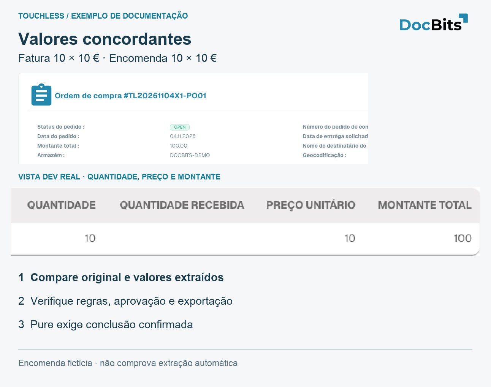
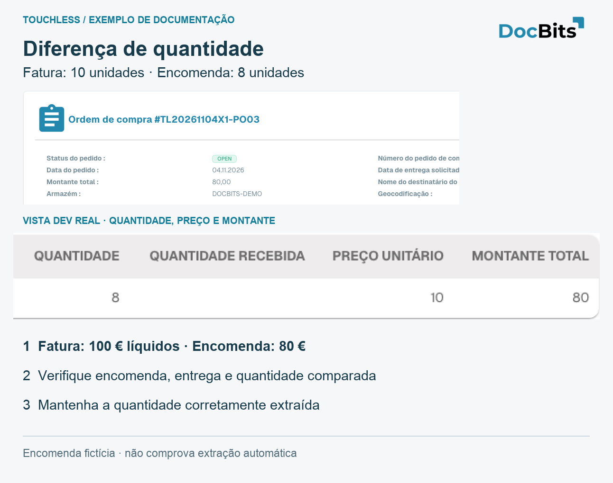

# Exemplos: preço e quantidade

## Exemplo completo: extração correta, dados Infor diferentes

Caso ilustrativo: fatura **10 unidades × 10 € = 100 €**, extraída corretamente. Encomenda importada **10 × 9 € = 90 €**. Suponha que as regras ativas bloqueiam a diferença.

1. Compare original e extração: os valores coincidem.
2. Verifique importação, Infor atual, unidade de preço e data. Origem errada e cópia antiga são problemas diferentes.
3. Compras confirma 10 € e corrige a encomenda. Se o preço acordado fosse 9 €, seria necessário esclarecer a fatura.
4. Confirme os valores corrigidos importados no DocBits.
5. AP reinicia manualmente; após sucesso, é **AP Assisted**, apesar da extração correta.
6. Verifique novas faturas sem intervenção; o histórico das anteriores mantém-se.

Não altere valores corretamente extraídos nem alargue tolerâncias para esconder dados errados. Corrija a causa confirmada. As capturas não comprovam esta sequência completa.

## Três encomendas de demonstração: concordância, preço e quantidade

Fornecedor, artigo e faturas fictícios, criados apenas em **Dev**. Cada fatura indica **10 unidades × 10 € = 100 € líquidos**. Os cartões preservam a interface portuguesa real e ampliam os números. Não comprovam ligação de cliente ao Infor, extração correta ou processo automático bem-sucedido.

| Caso | Fatura | Encomenda importada | Prova |
| --- | --- | --- | --- |
| PO01 / RE01 | 10 × 10 € = 100 € | 10 × 10 € = 100 € | Origem concordante; Pure exige ainda extração e conclusão sem intervenção/aprovação |
| PO02 / RE02 | 10 × 10 € = 100 € | 10 × 9 € = 90 € | Diferença 10 €, cerca de 11,11 % do preço unitário da encomenda; regras ativas determinam bloqueio |
| PO03 / RE03 | 10 × 10 € = 100 € | 8 × 10 € = 80 € | Mais duas unidades, 25 % da quantidade encomendada; verifique aberta/recebida e base de comparação |

<figure><figcaption>
PO01 fictícia: valores concordantes. O detalhe real ampliado mostra quantidade, preço e total; não comprova extração correta ou Pure Touchless.
</figcaption></figure>

<figure><figcaption>
PO02: importação 10 × 9 = 90, fatura fictícia 10 × 10 = 100. Verifique preço acordado, unidade de preço e importação. Intervenção humana registada e sucesso: AP Assisted.
</figcaption></figure>

<figure><figcaption>
PO03: 8 unidades encomendadas, 10 faturadas. Quantidade recebida vazia não comprova entrega. O cartão mostra comparação, não correspondência bem-sucedida.
</figcaption></figure>

## Páginas relacionadas

* [Touchless Intelligence](touchless-intelligence.md)
* [Métricas e cálculo](touchless-metrics.md)
* [Usar o painel](touchless-dashboard.md)
* [Touchless Intelligence: diagnóstico de fornecedores e clusters de problemas](touchless-supplier-diagnosis.md)
* [Touchless Intelligence: diagnóstico de PO Matching](touchless-po-matching-diagnosis.md)
* [Touchless Intelligence: Rastreamento do documento](touchless-document-trace.md)
* [Touchless Intelligence: propostas de alteração e relatórios](touchless-change-proposals.md)
* [Explicar e melhorar Touchless com MCP](touchless-mcp.md)

<!-- Source notes (not shown): screenshots come from the dev test organisation with synthetic demo data (seed script) and fictional supplier names; the PO matching decision flow has no screenshot yet. facts read from the doc2app code (TouchlessIntelligence pages and components) and the dev UI on 14 Oct 2026; NOVA gates the tab with its own organisation flag, VESTA with the Analytics module. Consulting report export format not verified, so no export is described.

<!-- Alignment 2026-11-04: correct extraction is distinct from process Touchless; KPI numerator and denominator verified. -->
<!-- Completion 2026-11-04: localized MCP examples, AP actions, original-value evidence and owned synthetic PO cards. -->
