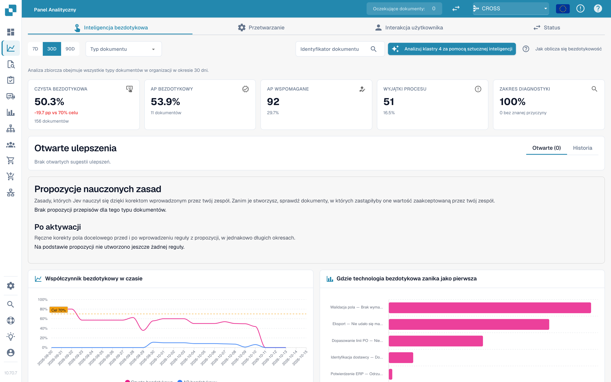

# Touchless Intelligence



Touchless Intelligence rozdziela dwie kwestie: **czy DocBits poprawnie odczytał fakturę?** oraz **czy cały proces zakończył się bez ręcznej ingerencji?** Poprawny odczyt nie wyklucza pracy nad rozbieżnymi danymi Infor. AP oznacza pracowników zobowiązań.

## Wybierz właściwy przewodnik

| Przewodnik | Zawartość |
| --- | --- |
| [Wskaźniki i obliczenia](touchless-metrics.md) | Kategorie, licznik/mianownik, działania i obliczenia |
| [Korzystanie z panelu](touchless-dashboard.md) | Filtry, wskaźniki, trendy i pierwsze blokady |
| [Przykłady: cena i ilość](touchless-examples.md) | Fikcyjne faktury i prawdziwe widoki Dev różnic ceny i ilości |
| [Touchless Intelligence: Diagnoza dostawcy i klastry problemów](touchless-supplier-diagnosis.md) | Priorytety dostawców i powtarzających się przyczyn |
| [Touchless Intelligence: Diagnoza dopasowania PO](touchless-po-matching-diagnosis.md) | Aktywne reguły, tolerancje i decyzje |
| [Touchless Intelligence: Ślad dokumentu](touchless-document-trace.md) | Oryginały, wykonania, blokady i ingerencje |
| [Touchless Intelligence: Propozycje zmian i raporty](touchless-change-proposals.md) | Podgląd, zastosowanie, pomiar i cofnięcie |
| [Wyjaśnianie i poprawa Touchless przez MCP](touchless-mcp.md) | Wyjaśnianie, diagnoza i kontrolowana poprawa przez MCP |

<figure><figcaption>
Karta Touchless Intelligence: kluczowe wskaźniki, usprawnienia, wskaźnik w czasie i wykres pierwszej utraty. Przykładowa organizacja z danymi demonstracyjnymi; nazwy dostawców są fikcyjne.
</figcaption></figure>

## Dostęp

Część [panelu analitycznego](analytics-dashboard.md). Administratorzy mają dostęp; pozostali potrzebują odpowiedniego uprawnienia roli. Analiza AI, zmiany i raporty mogą wymagać administratora.

<!-- Source notes (not shown): screenshots come from the dev test organisation with synthetic demo data (seed script) and fictional supplier names; the PO matching decision flow has no screenshot yet. facts read from the doc2app code (TouchlessIntelligence pages and components) and the dev UI on 14 Oct 2026; NOVA gates the tab with its own organisation flag, VESTA with the Analytics module. Consulting report export format not verified, so no export is described.

<!-- Alignment 2026-11-04: correct extraction is distinct from process Touchless; KPI numerator and denominator verified. -->
<!-- Completion 2026-11-04: localized MCP examples, AP actions, original-value evidence and owned synthetic PO cards. -->
