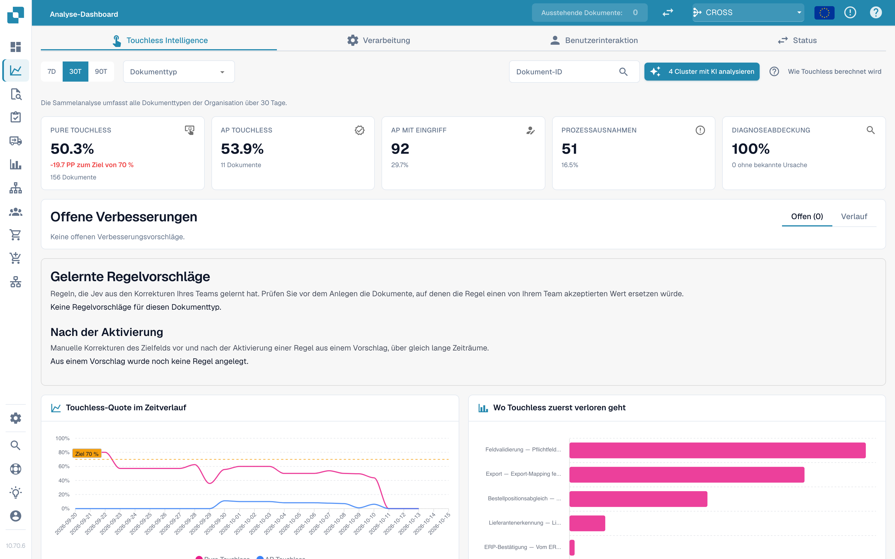
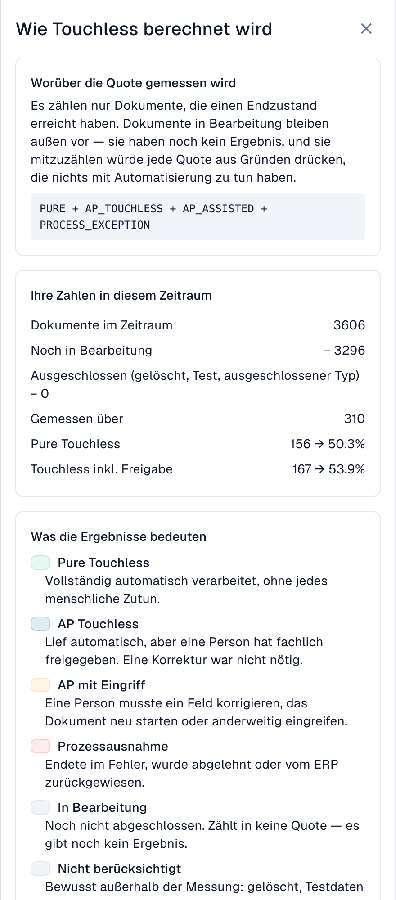
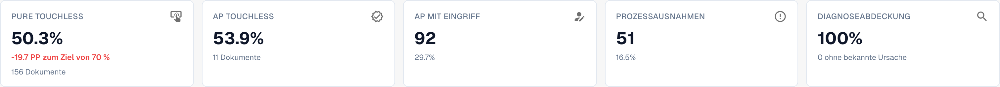
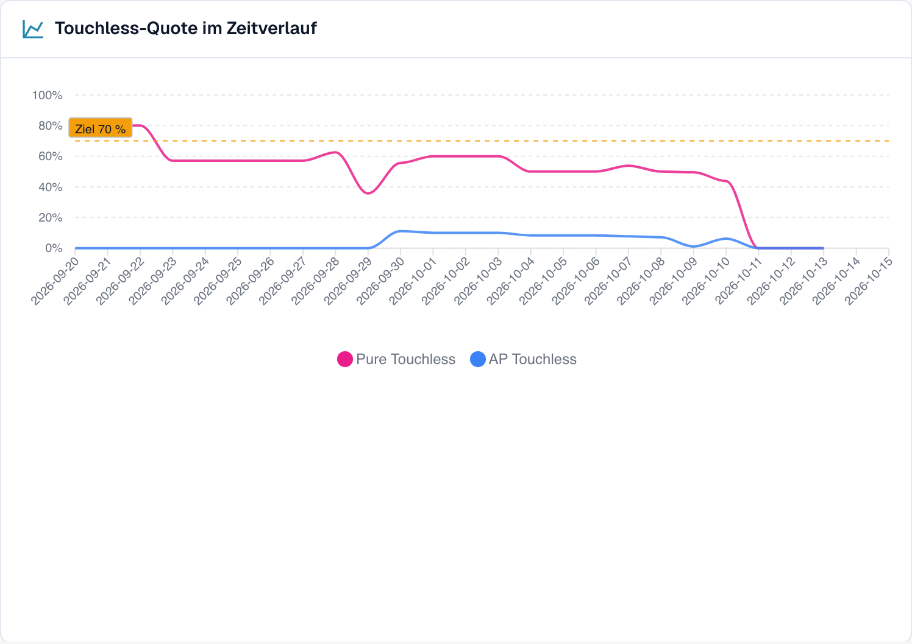
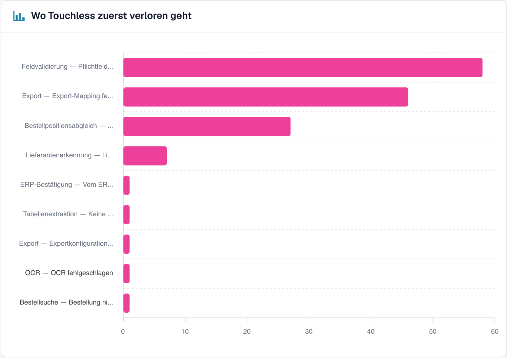

# Touchless Intelligence



## Übersicht

**Touchless Intelligence** beantwortet zwei Fragen zu Ihrer Dokumentenverarbeitung:

1. **Wie viele Dokumente werden ohne manuelle Korrektur oder sonstigen Bearbeitungseingriff abgeschlossen?** Das ist Ihre *AP-Touchless-Quote*; eine reine fachliche Freigabe ist erlaubt. *Pure Touchless* schließt auch diese Freigabe aus.
2. **Warum bleiben die anderen stehen, und was sollten wir ändern, damit weniger stehen bleiben?** Das ist die *Diagnose*.

Touchless Intelligence ist ein Tab des [Analytics Dashboards](analytics-dashboard.md). Es verursacht keinen zusätzlichen Aufwand für Ihr Team: DocBits zeichnet auf, was in der Verarbeitungs-Pipeline mit jedem Dokument passiert, und wertet das Ergebnis alle 15 Minuten aus.

<figure><figcaption><p>Der Tab Touchless Intelligence: Kennzahlen, Verbesserungen, die Quote im Zeitverlauf und das Diagramm „Wo Touchless zuerst verloren geht“. Beispielorganisation mit Demodaten; die Lieferantennamen sind frei erfunden.</p></figcaption></figure>

### Korrekte Auslesung und ein Touchless-Prozess sind zwei verschiedene Fragen

**DocBits kann alle Rechnungswerte richtig auslesen, und trotzdem braucht die Rechnung einen AP-Eingriff, weil die Daten aus dem Quellsystem abweichen.** AP steht für Accounts Payable, also die Kreditorenbuchhaltung. Prüfen Sie diese beiden Fragen getrennt:

| Frage | Was Sie vergleichen | Was das Ergebnis aussagt |
| --- | --- | --- |
| **Hat DocBits den Beleg richtig ausgelesen?** | Originalrechnung mit den ausgelesenen Kopffeldern und Tabellenpositionen, vor einer manuellen Korrektur | Auslesequalität: Entspricht der ausgelesene Wert dem tatsächlichen Inhalt der Rechnung? |
| **Konnte der Prozess ohne Bearbeitungseingriff abgeschlossen werden?** | Korrekt ausgelesene Rechnung mit den Bestell- und Stammdaten aus Infor ERP sowie dem aufgezeichneten Bearbeitungsverlauf | Prozessautomatisierung: Konnten die konfigurierten Prüfungen, der Abgleich und der Export ohne Korrektur oder Neustart abgeschlossen werden? |

Ein anderer Wert in Infor sagt allein noch nicht, welche Seite falsch ist. Prüfen Sie Rechnung, vereinbarte Bestellung und die tatsächlich nach DocBits importierten Daten. Die Quelldaten können falsch sein, der Import kann veraltet sein oder der Lieferant kann einen anderen Wert berechnet haben.


**Die Touchless-Quote misst den Prozess, nicht die Auslesegenauigkeit.** „AP mit Eingriff“ beweist keinen Auslesefehler von DocBits. Umgekehrt beweisen ein bestandener Extraktionsschritt oder ein hoher Konfidenzwert nicht, dass jeder Wert richtig ist. Dafür müssen Sie den Originalbeleg mit den ausgelesenen Werten vergleichen.


Die Screenshots zeigen die deutsch eingestellte DocBits-Oberfläche. Produktbegriffe wie **Pure Touchless** und **AP Touchless** bleiben wie in der Oberfläche erhalten; technische Kennungen und unveränderte englische Produktbeschriftungen sind keine übersetzten Beispieldaten.

Die Bilder zeigen unterschiedliche Beispielsituationen und Datenstände. Rechnen Sie ihre Dokumentzahlen nicht zu einer gemeinsamen Stichprobe zusammen. Der Schulungsfall mit 10,00 € gegen 9,00 € erklärt den Zusammenhang; er ist kein vollständig aufgezeichneter Infor-Durchlauf der abgebildeten Rechnungen.

### Was Sie damit tun können

| Sie möchten … | Verwenden Sie | Beispiel |
| --- | --- | --- |
| sehen, wie stark Sie automatisiert sind | Die fünf **Kennzahlen** (Key Figures) oben | „63,2 % unserer Dokumente liefen im letzten Monat ohne Eingreifen einer Person“ |
| den Trend sehen | **Touchless-Quote im Zeitverlauf** (Touchless rate over time) | „Die Quote ist von 55 % auf 68 % gestiegen, seit wir die Lieferantenstammdaten korrigiert haben“ |
| herausfinden, wo Dokumente hängen bleiben | **Wo Touchless zuerst verloren geht** (Where touchless is lost first) | „Die meisten Dokumente bleiben bei der Feldvalidierung stehen“ |
| entscheiden, welchen Lieferanten Sie zuerst verbessern | **Lieferantenpotenziale** (Supplier opportunities) | „Lieferant A würde uns +4,0 Prozentpunkte bringen“ |
| einen Lieferanten verstehen | Seite **Lieferantendiagnose** (Supplier Diagnosis) | „Seine Rechnungen haben keine Bestellnummer, deshalb scheitert der Bestellabgleich“ |
| ein Dokument verstehen | **Dokumentverlauf** (Document Trace) | „Diese Rechnung ist bei Schritt 8, der Feldvalidierung, stehen geblieben“ |
| Lieferanten vergleichen | **Lieferanten vergleichen** (Compare suppliers) | „Lieferant A und B nutzen dasselbe Template, aber nur bei B gibt es Fehler“ |
| eine hilfreiche Einstellung ändern | **Änderungsvorschläge** (Change proposals) | „Automatischen Bestellabgleich einschalten: Vorschau, anwenden, messen, rückgängig machen“ |

## Wer es sehen kann

* Der Tab gehört zum Analytics Dashboard. Ihr Administrator aktiviert ihn für die Organisation. Fehlt der Tab, fragen Sie Ihren Administrator.
* **Organisations-Administratoren** sehen ihn immer.
* Andere Benutzer sehen ihn, wenn ein Administrator ihrer Rolle den Tab **Analyse-Dashboard** (Analytics dashboard) freigegeben hat (**Einstellungen → Rollen**). Ohne diese Freigabe haben nur Administratoren Zugriff.
* Einige Aktionen sind nur für Administratoren: **KI-Analyse** (AI analysis), **Änderungen anwenden und rückgängig machen**, **Vorschläge für gelernte Regeln** und der **Consulting-Bericht**.

Wenn Sie keine Berechtigung haben, zeigt die Seite *Aktion nicht erlaubt, bitte kontaktieren Sie den Administrator*.

## Was „Touchless“ bedeutet

Jedes abgeschlossene, berücksichtigte Dokument wird genau **einer** dieser Kategorien zugeordnet:

| Kategorie | Bedeutung | Zählt als touchless? |
| --- | --- | --- |
| **Pure Touchless** | Erfolgreich verarbeitet, ohne menschlichen Eingriff oder Freigabe | Ja |
| **AP Touchless** | Erfolgreich verarbeitet; nur eine fachliche Freigabe war nötig | Ja |
| **AP Assisted** – „AP mit Eingriff“ | Erfolgreich verarbeitet, aber jemand musste korrigieren, manuell validieren oder neu starten | Nein |
| **Prozessausnahme** | Beispielsweise abgelehnt, endgültiger Fehler, ERP-Zurückweisung oder ein als Ausnahme eingestufter Stillstand | Nein |

„Manuell validieren“ meint hier einen aufgezeichneten Bearbeitungseingriff. Eine reine fachliche Freigabe zählt weiterhin als **AP Touchless**. **AP Assisted beschreibt den Eingriff, nicht dessen Ursache:** DocBits kann vollständig richtig ausgelesen haben, während abweichende Infor-Daten den Eingriff erfordern.

Dokumente **in Bearbeitung** (In progress) und **nicht berücksichtigte** Dokumente (Not eligible, beispielsweise gelöschte oder ausgeschlossene Testdokumente) bleiben außerhalb dieser vier Kategorien für die Quotenberechnung.

Die **AP-Touchless-Quote**, einschließlich Dokumenten mit reiner Freigabe, lautet:

```
rate = (Pure touchless + AP touchless)
       ÷ (Pure touchless + AP touchless + AP assisted + Process exception)
```

**AP touchless** im Zähler bezeichnet hier das Dokumentergebnis „nur Freigabe“. Der **Prozentwert der Karte AP Touchless** ist dagegen die gemeinsame Quote: vollständig automatische Dokumente plus Dokumente mit reiner Freigabe. **Addieren Sie die beiden angezeigten Prozentwerte nicht.** Bei der Pure-Quote stehen nur die vollständig automatischen Dokumente im Zähler; der Nenner bleibt gleich.

Dokumente, die noch **in Bearbeitung** oder **nicht berücksichtigt** sind, gehen nie in die Berechnung ein. Das schützt die Quote: Ein Dokument, das vor fünf Minuten eingegangen ist, kann sie nicht senken.


**Eine Berührung zählt dauerhaft.** Sobald eine Person ein Dokument bearbeitet hat, bleibt es als bearbeitet gezählt, auch wenn ein späterer automatischer Lauf niemanden gebraucht hätte. **Ein Neustart macht ein Dokument nicht wieder zu einem Touchless-Dokument.** Die Quote spiegelt die Arbeit wider, die tatsächlich stattgefunden hat.


### Beispielrechnung (Zahlen zur Veranschaulichung)

In 30 Tagen sind 200 Dokumente eingegangen:

| Ergebnis | Dokumente |
| --- | --- |
| Pure Touchless | 120 |
| AP Touchless | 30 |
| AP mit Eingriff | 30 |
| Prozessausnahme | 10 |
| In Bearbeitung | 8 |
| Nicht berücksichtigt (Testdokumente) | 2 |

* Nenner: 120 + 30 + 30 + 10 = **190**. Die 8 Dokumente in Bearbeitung und die 2 nicht berücksichtigten Dokumente bleiben außen vor.
* **Pure Touchless**: 120 ÷ 190 = **63,2 %**
* Anteil mit **reiner Freigabe**: 30 ÷ 190 = **15,8 %**. Das ist der Anteil dieses Dokumentergebnisses, nicht die gemeinsame AP-Touchless-Quote.
* **AP-Touchless-Quote**: (120 + 30) ÷ 190 = **78,9 %**

Der Tab zeigt ein **Ziel** (70 %, sofern Ihre Organisation kein anderes verwendet). In diesem Beispiel liegt die gemeinsame AP-Quote über 70 %, die Pure-Quote mit 63,2 % darunter. Vergleichen Sie das Ziel mit der jeweils auf der Karte oder im Diagramm benannten Quote.

Klicken Sie oben rechts auf **Wie Touchless berechnet wird** (How touchless is calculated), um diese Erklärung direkt in DocBits zu öffnen, mit den Zahlen Ihres eigenen Zeitraums (Dokumente im Zeitraum, noch in Bearbeitung, ausgeschlossen, gemessen).

<figure><figcaption><p>Die Seitenleiste <strong>Wie Touchless berechnet wird</strong>: hier 3.606 Dokumente, davon 3.296 noch in Bearbeitung und 310 gemessen. 156 vollständig automatische Dokumente ergeben 50,3 % Pure Touchless; zusammen mit 11 Dokumenten mit reiner Freigabe sind es 167 und damit 53,9 % AP Touchless. Diese Zahlen beschreiben den Prozess, nicht die Auslesegenauigkeit. Beispielorganisation mit Demodaten.</p></figcaption></figure>

### Beispiel: 100 % richtig ausgelesen, 80 % AP Touchless

Angenommen, ein Vergleich von Originalrechnungen und ausgelesenen Werten bestätigt: **Alle 100 abgeschlossenen, berücksichtigten Rechnungen wurden vollständig richtig ausgelesen.** Ihre Verarbeitung endet so:

| Was passiert ist | Dokumente | Ergebnis |
| --- | --- | --- |
| Rechnung und Quelldaten stimmen überein; der gesamte Prozess läuft automatisch durch | 70 | Pure Touchless |
| Rechnung und Quelldaten stimmen überein; nur eine fachliche Freigabe ist nötig | 10 | AP Touchless (Dokumentergebnis „nur Freigabe“) |
| Die Rechnung ist richtig ausgelesen, die importierten Infor-Daten weichen jedoch ab. AP klärt die Abweichung und startet die Dokumente nach Korrektur der Quelldaten manuell in DocBits neu; anschließend werden sie erfolgreich abgeschlossen | 20 | AP mit Eingriff |

* **Richtig ausgelesene Dokumente in dieser geprüften Stichprobe:** 100 ÷ 100 = **100 %**.
* **Pure-Touchless-Quote:** 70 ÷ 100 = **70 %**.
* **AP-Touchless-Quote:** (70 + 10) ÷ 100 = **80 %**.

Das ist kein Widerspruch: Alle Rechnungen waren richtig ausgelesen, 20 brauchten wegen der Quelldaten trotzdem einen Bearbeitungseingriff. Die **100 % Auslesequalität sind hier das beispielhafte Ergebnis einer gesonderten Belegprüfung**, keine zusätzliche Kennzahl dieses Dashboards. Sie lassen sich nicht allein aus den Touchless-Ergebnissen berechnen.

### Beispiele: Was musste AP tatsächlich tun?

Die folgenden Fälle sind Schulungsbeispiele, keine Einzeldokumente aus den Screenshots. Die erfolgreichen Ergebnisse setzen den Abschluss der Verarbeitung voraus, einschließlich einer ERP-Bestätigung, sofern diese erforderlich ist.

| Fall | Originalrechnung / DocBits-Auslesung / Quelldaten | AP-Aktion und Ergebnis | Wo Sie die Ursache prüfen |
| --- | --- | --- | --- |
| **Auslesefehler** | Bestellnummer `45001234` / falsch als `45001284` ausgelesen / richtige Bestellung `45001234` ist in Infor vorhanden | AP korrigiert die ausgelesene Nummer; die Rechnung endet erfolgreich als **AP mit Eingriff** | Extraktion für diesen Lieferanten |
| **Abweichung im Quellsystem** | Stückpreis 10,00 € / korrekt 10,00 € ausgelesen / importierte Infor-Bestellung enthält 9,00 €, außerhalb der konfigurierten Toleranz | AP bestätigt den vereinbarten Preis von 10,00 €, veranlasst die Bestellkorrektur und startet die Rechnung manuell in DocBits neu; sie endet erfolgreich als **AP mit Eingriff** | Infor-Bestelldaten und deren Import |
| **Verzögerter Import** | Bestellnummer auf Rechnung und in DocBits korrekt / Bestellung existiert in Infor, ist aber noch nicht in DocBits angekommen | Erfolgen späterer Import und erneute Verarbeitung automatisch ohne aufgezeichneten menschlichen Eingriff oder Freigabe, kann das Ergebnis **Pure Touchless** bleiben. Ein manueller Neustart mit anschließendem Erfolg ergibt **AP mit Eingriff** | Importzeitpunkt und tatsächliche Laufhistorie |
| **ERP-Ablehnung** | Auslesung korrekt, das ERP weist das exportierte Dokument jedoch zurück | **Prozessausnahme**, solange der Fall als abschließende ERP-Ablehnung eingeordnet ist, auch nach einem vorherigen Eingriff | ERP-Ablehnung und Exportnachweise |

**Auch eine kleine aufgezeichnete Korrektur oder ein manueller Neustart zählt als Eingriff.** „AP assisted“ bedeutet „mit Unterstützung durch AP“; es ist keine Bezeichnung für einen eigenen KI-Assistenten. Ein Quelldatenproblem und ein Auslesefehler können deshalb zum gleichen Ergebnis führen, brauchen aber unterschiedliche Behebungen.

Die Einordnung beruht auf den Ereignissen, die DocBits aufzeichnet. Setzen Sie nicht voraus, dass ausschließlich in Infor erledigte Arbeit ohne entsprechendes DocBits-Ereignis automatisch als AP-Eingriff gezählt wird. Halten Sie diese Arbeit zusätzlich in der Diagnose fest.

### Welche AP-Aktion zählt als Eingriff?

Die Tabelle setzt eine erfolgreiche Verarbeitung voraus, einschließlich der erforderlichen ERP-Bestätigung. Entscheidend ist das aufgezeichnete Ereignis und wer es ausgelöst hat, nicht die Dauer der Arbeit.

| Aktion | Bedeutung für das Dokumentergebnis |
| --- | --- |
| Rechnung, Verlauf oder Vorschau nur öffnen; filtern oder vergleichen | Allein dadurch entsteht kein Bearbeitungseingriff. Ohne weitere Eingriffe oder Freigaben bleibt Pure Touchless möglich |
| Nur fachlich freigeben, auch in einer zweiten Freigabestufe | AP Touchless, sofern es keinen zusätzlichen Bearbeitungseingriff gab |
| Einen Kopfwert oder eine Tabellenposition ändern und speichern | AP mit Eingriff; auch eine einzige gespeicherte Korrektur zählt |
| Ein Dokument manuell aus der Validierung weitergeben, auch ohne Wertkorrektur | AP mit Eingriff. Manuelle Validierung ist eine andere Aktion als eine reine fachliche Freigabe |
| Verarbeitung oder Export als Person manuell neu starten | AP mit Eingriff; ein späterer automatischer Lauf hebt den Eingriff nicht auf |
| Das System verarbeitet automatisch erneut oder schreibt Werte durch einen automatischen Workflow | Allein dadurch entsteht kein menschlicher Eingriff. Vorherige menschliche Eingriffe bleiben bestehen |
| Daten ausschließlich in Infor korrigieren | Externe Arbeit ist nicht automatisch ein aufgezeichnetes DocBits-Ereignis. Die nachfolgende DocBits-Aktion und den Verlauf prüfen; externe Arbeit zusätzlich dokumentieren |
| Nach einer Korrektur weist das ERP das Dokument endgültig zurück | Prozessausnahme. Die Zurückweisung hat Vorrang vor einer erfolgreichen Touchless-Einordnung; der frühere Eingriff bleibt Teil des Verlaufs |

**Grenzfall „Speichern“:** Eine gespeicherte Feldänderung zählt als Korrektur. Aus einem geöffneten Fenster oder einem Klick ohne nachgewiesene Änderung lässt sich dagegen kein Bearbeitungseingriff ableiten. Prüfen Sie zusätzlich, ob die Aktion eine manuelle Validierung oder einen Neustart ausgelöst hat.

### Dieselbe Beschriftung, zwei unterschiedliche Aussagen

| Wo Sie AP Touchless lesen | Gemeint ist | Lesebeispiel |
| --- | --- | --- |
| Prozentwert der AP-Karte auf der Übersicht | Gemeinsame Quote aus Pure und reiner Freigabe | (120 + 30) ÷ 190 = 78,9 % |
| Dokumentanzahl unter diesem Prozentwert | Nur Dokumente mit reiner Freigabe | 30, nicht 150 |
| Ergebniskachel oder Segment der Lieferantendiagnose | Eigenständige Kategorie „nur Freigabe“ | 30 ÷ 190 = 15,8 % |
| Blaue AP-Linie der unten abgebildeten Trendaufnahme | Anteil der Kategorie „nur Freigabe“ | Nicht mit der gemeinsamen AP-Karte gleichsetzen |

Die Kategorien ergeben zusammen 100 % der abgeschlossenen, berücksichtigten Dokumente. Die Prozentwerte der Pure-Karte und der gemeinsamen AP-Karte überlappen sich und dürfen nicht addiert werden.

### Wie aktuell sind die Zahlen

Die Ergebnisse werden **alle 15 Minuten neu berechnet**. Warten Sie nach einer Aktion auf den nächsten Datenstand, bevor Sie deren Einordnung prüfen. Das Ergebnis eines Dokuments kann sich auch nach seinem ersten Erscheinen noch ändern: Das ERP bestätigt einen Export unter Umständen erst Stunden später. Die Zeile **Datenstand …** (Data as of …) unten im Tab zeigt, wann die Zahlen zuletzt berechnet wurden.

## Der Übersichts-Tab

### Filter

| Filter | Was er bewirkt |
| --- | --- |
| **7D / 30D / 90D** | Der Zeitraum für die Kennzahlen und die Warteschlange. Standard sind 30 Tage |
| **Dokumenttyp** (Document Type) | Beschränkt jede Zahl auf einen Typ, zum Beispiel INVOICE |
| **Segmentfeld / Segmentwert** (Segment field / Segment value) | Nur, wenn Ihre Organisation mehrere Prozesse über einen Dokumenttyp abwickelt (zum Beispiel direkte, indirekte und EAM-Bestellungen im Feld `order_type`). Wählen Sie ein Feld, um die Aufschlüsselung zu sehen, und einen Wert, um alles darauf einzugrenzen |
| **Dokument-ID** (Document ID) | Öffnet den **Dokumentverlauf** für ein Dokument |

Die **Unterorganisation**, die Sie oben in DocBits gewählt haben, grenzt die Kennzahlen und die Lieferanten-Warteschlange ein. Fehlermuster (Cluster) und die KI-Analyse betreffen immer die gesamte Organisation.

### Die fünf Kennzahlen

**Im folgenden Bild:** Pure ist vollständig automatisch. Der Prozentwert von AP Touchless enthält Pure zusätzlich zu den reinen Freigaben; die Dokumentanzahl darunter enthält nur die reinen Freigaben.

<figure><figcaption><p>Die fünf Kennzahlen: 156 Pure-Dokumente und 11 reine Freigaben ergeben zusammen 167 von 310, also 53,9 % AP Touchless. Die 11 Dokumente unter dem AP-Prozentwert bezeichnen nur Freigaben. Pure allein sind 50,3 %; die beiden Quoten überschneiden sich. Beispielorganisation mit Demodaten.</p></figcaption></figure>

| Karte | Zeigt | Beispiel (zur Veranschaulichung) |
| --- | --- | --- |
| **Pure Touchless** | Den Prozentwert und die Abweichung vom Ziel | **63,2 %** · „120 Dokumente“ · „−6,8 PP zum Ziel von 70 %“ (rot, unter dem Ziel) |
| **AP Touchless** | Gemeinsame Quote aus Pure und reiner Freigabe; die Dokumentanzahl darunter bezeichnet die Fälle mit reiner Freigabe | **78,9 %** · „30 Dokumente“ (nur Freigabe) |
| **AP mit Eingriff** | Die Anzahl der Dokumente und ihren Anteil | **30** · 15,8 % |
| **Prozessausnahmen** | Die Anzahl der Dokumente und ihren Anteil | **10** · 5,3 % |
| **Diagnoseabdeckung** (Diagnosis coverage) | Bei wie vielen blockierten Dokumenten die Ursache **bekannt** ist | **80 %** · „10 ohne bekannte Ursache“ |

* Im Screenshot ergeben 156 vollständig automatische plus 11 nur freigegebene Dokumente **167 ÷ 310 = 53,9 % AP Touchless**. Pure allein sind **156 ÷ 310 = 50,3 %**. Die Prozentwerte überschneiden sich.
* Eine Karte zeigt einen Strich (—) statt **0 %**, wenn es nichts zu messen gibt. Ein Strich bedeutet „keine Daten“, nicht „null“.
* **Diagnoseabdeckung** = Dokumente mit bekanntem Blockadegrund ÷ alle blockierten Dokumente. Beispiel: 50 blockierte Dokumente, 10 davon mit unbekannter Ursache → 40 ÷ 50 = **80 %**. Ein niedriger Wert bedeutet „wir verstehen noch nicht, warum Dokumente stehen bleiben“. Verbessern Sie ihn, bevor Sie einzelne Ursachen beheben.
* **Klicken Sie auf eine Karte**, um die Dokumentenliste hinter der Zahl in einem neuen Tab zu öffnen („Dokumente zu dieser Zahl anzeigen“). Karten mit 0 Dokumenten sind nicht anklickbar.

### Touchless-Quote im Zeitverlauf

**Im folgenden Bild:** Die blaue AP-Linie ist der getrennte Ergebnisanteil mit reiner Freigabe. Verwenden Sie sie nicht als Ersatz für den gemeinsamen AP-Prozentwert der Übersicht.

<figure><figcaption><p>Getrennte Ergebnisanteile pro Tag: Rosa zeigt Pure Touchless, Blau nur die Kategorie mit reiner Freigabe. Die blaue Linie ist nicht die gemeinsame AP-Quote der Übersicht. Die gestrichelte Linie zeigt das Ziel von 70 %. Beispielorganisation mit Demodaten.</p></figcaption></figure>

Der Screenshot zeigt getrennte Ergebnisanteile: **Pure Touchless** und **AP Touchless** (nur Freigabe) sowie die **Ziellinie**. Die blaue Linie dieser Aufnahme ist der Anteil mit reiner Freigabe, nicht die gemeinsame AP-Kennzahl im Kopfbereich. Für die gemeinsame Quote werden Pure und reine Freigaben über dieselbe Grundgesamtheit addiert. Unterscheiden Sie beim Lesen der Diagramme Ergebnisanteile und gemeinsame Kennzahl. Kurze Zeiträume zeigen Tagespunkte, lange Zeiträume Wochenpunkte.

**Beispiel.** Nach Aktivierung des automatischen Bestellabgleichs steigt die Pure-Quote in einem vergleichbaren Zeitraum von 55 % auf 68 %. Prüfen Sie Dokumenttyp, Lieferantenmix und weitere Änderungen. Der zeitliche Zusammenhang ist eine Beobachtung; er beweist nicht allein, dass diese Einstellung den Anstieg verursacht hat.

### Wo Touchless zuerst verloren geht

<figure><figcaption><p>Blockierte Dokumente nach Schritt und Grund, an dem sie zuerst stehen geblieben sind. Hier kostet <strong>Feldvalidierung: Pflichtfeld fehlt</strong> die meisten Dokumente (58), danach <strong>Export-Mapping fehlgeschlagen</strong> (46) und <strong>PO-Positionsabweichung</strong> (27). Beispielorganisation mit Demodaten; die Lieferantennamen sind frei erfunden.</p></figcaption></figure>

Ein Balkendiagramm der **blockierten Dokumente** pro Pipeline-Schritt: der **erste** Schritt, der ein Dokument gestoppt hat.

**Beispiel.** Balken: Lieferantenerkennung 12, Feldvalidierung 41, Bestellpositionsabgleich 7. Der größte Balken sagt Ihnen, dass Sie zuerst die **Feldvalidierung** prüfen sollten. Ein nicht ausgelesener Wert ist eine mögliche Ursache; vergleichen Sie Originalrechnung, Feldregeln und verfügbare Quelldaten, bevor Sie die Ursache bestätigen.

### Lieferantenpotenziale

Die Warteschlange beantwortet die Frage **„Welchen Lieferanten sollten wir zuerst verbessern?“** Sie ist nach **rückgewinnbaren** Dokumenten sortiert, die höchsten zuerst, mit 25 Zeilen pro Seite.

| Spalte | Bedeutung |
| --- | --- |
| **Lieferantennummer / Lieferant** (Supplier Number / Supplier) | Der Lieferant. Dokumente ohne erkannten Lieferanten erscheinen als **Lieferant nicht erkannt (n Dokumente)** |
| **Volumen** (Volume) | Berücksichtigte Dokumente des Lieferanten im Zeitraum |
| **Pure-Quote** (Pure Rate) | Anteil der Pure-Touchless-Dokumente. Grün, wenn sie dem Ziel entspricht oder darüber liegt, rot, wenn sie darunter liegt |
| **Verlorene Dokumente** (Lost Documents) | Dokumente, die als AP mit Eingriff oder als Prozessausnahme endeten. Nicht immer war es eine Person: Auch eine ERP-Ablehnung oder ein Dokument, das sieben Tage lang hing, zählt dazu |
| **Grundursache** (Root Cause) | Wer die Behebung verantwortet: Konfiguration, ERP-Integration, Export, Extraktion, Stammdaten, Messung, Bestellabgleich, Benutzerprozess, Validierung oder Unbekannt |
| **Rückgewinnbar** (Recoverable) | Verlorene Dokumente, deren Ursache DocBits beheben kann: Konfiguration, Stammdaten oder Lieferanten-Template |
| **Erwarteter Zuwachs** (Expected Lift) | Um wie viele **Prozentpunkte** die Quote Ihrer Organisation steigen würde, wenn jedes rückgewinnbare Dokument dieses Lieferanten touchless liefe (**+x PP**) |
| **Konfidenz** (Confidence) | **Hoch**, **Mittel** oder **Niedrig**: wie sicher die Diagnose ist |
| **Status** | Neu, Offen, In Untersuchung, In Bearbeitung, Bestätigt, Behoben, Verworfen. Ein Lieferant mit zu wenigen Dokumenten zeigt **NEEDS_DIAGNOSIS** |

**Beispiel.** Ihre Organisation hat im Zeitraum 1.000 berücksichtigte Dokumente. Lieferant A hat 40 rückgewinnbare Dokumente, Lieferant B hat 90 verlorene Dokumente, aber nur 10 rückgewinnbare (sein Problem liegt auf seiner Seite).

* Lieferant A: 40 ÷ 1.000 = **+4,0 PP erwarteter Zuwachs**
* Lieferant B: 10 ÷ 1.000 = **+1,0 PP**, obwohl B mehr verlorene Dokumente hat

Die Warteschlange stuft A über B ein, weil der **erwartete Zuwachs** an Ihrer gesamten Organisation gemessen wird, nicht am Lieferanten. Ein Lieferant mit vier schlechten Dokumenten kann keinen mit vierhundert verdrängen.

Mit dem Suchfeld („Lieferantennummer oder Name suchen“) finden Sie einen Lieferanten. Ein Klick auf eine Zeile öffnet die **Lieferantendiagnose**.

### Lieferanten vergleichen

Klicken Sie auf **Lieferanten vergleichen**, wählen Sie **zwei bis fünf** Lieferanten aus (jeder wird mit seiner Anzahl blockierter Dokumente aufgeführt) und klicken Sie auf **Vergleichen**.

Je nach Oberflächenstand heißt die Schaltfläche noch **Compare suppliers**. Das ist derselbe Lieferantenvergleich; die englische Beschriftung ändert die Bedeutung der Kennzahlen nicht.

Der Vergleich zeigt die Lieferanten nebeneinander: **Pure-Quote**, **Verlorene Dokumente**, **Rückgewinnbar**, **Grundursache**, **Erwarteter Zuwachs**, ein Balkendiagramm der Ergebnisse und einen Link zur jeweiligen **Lieferantendiagnose**.

**Beispiel.** Lieferant A und B senden dasselbe Rechnungslayout. B hat eine Pure-Quote von 80 %, A nur 35 %. Bei A deutet die Diagnose auf „Stammdaten“. Vergleichen Sie Originalrechnungen, ausgelesene Werte und importierte Lieferantensätze, bevor Sie die Ursache bestätigen. Der Quotenunterschied allein beweist weder ein korrektes Layout noch unvollständige Stammdaten.

### Mit KI analysieren

Die Schaltfläche **{n} Cluster mit KI analysieren** (Analyse n clusters with AI) analysiert die Fehlermuster mit dem höchsten Touchless-Potenzial (jeweils mindestens eine Mindestanzahl Dokumente). Das dauert etwa 13 Sekunden pro Cluster und betrifft die **gesamte Organisation**. Nur Administratoren können sie starten.

Während die Analyse läuft, sehen Sie für jedes Cluster **In Warteschlange**, **Läuft**, **Fertig**, **Bereits analysiert** oder **Fehler**, mit einem Link **Cluster öffnen**. Ist die KI abgeschaltet oder in der Umgebung nicht konfiguriert, ist die Schaltfläche mit Angabe des Grundes deaktiviert, und **alles andere auf der Seite funktioniert weiter**.

## Weiter in die Tiefe

| Seite | Was sie behandelt |
| --- | --- |
| [Lieferantendiagnose und Fehlermuster](touchless-supplier-diagnosis.md) | Ein Lieferant im Detail: Ergebniskacheln, Trend, Fehlermuster, woher eine Empfehlung kommt |
| [Bestellabgleich-Diagnose](touchless-po-matching-diagnosis.md) | Warum Dokumente bei der Bestellsuche oder beim Bestellpositionsabgleich stehen bleiben, und der Entscheidungsablauf, der zeigt, wie DocBits Rechnungspositionen mit Bestellpositionen abgleicht |
| [Dokumentverlauf](touchless-document-trace.md) | Was mit einem Dokument passiert ist, Schritt für Schritt |
| [Änderungsvorschläge und Berichte](touchless-change-proposals.md) | Eine Änderung in der Vorschau prüfen, anwenden, messen und rückgängig machen; Vorschläge für gelernte Regeln; der Consulting-Bericht |

## Mit Touchless Intelligence arbeiten: eine Routine

1. **Wöchentlich**: Öffnen Sie den Tab und prüfen Sie die **Quote** und den **Trend** im Vergleich zum Ziel.
2. Sehen Sie sich die **Diagnoseabdeckung** an. Liegt sie unter etwa 80 %, finden Sie zuerst heraus, warum Dokumente stehen bleiben.
3. Lesen Sie **Wo Touchless zuerst verloren geht** und wählen Sie den größten Schritt.
4. Öffnen Sie die **Lieferantenpotenziale**. Sortieren Sie nach **Erwartetem Zuwachs** und nehmen Sie den obersten Lieferanten mit dem Status **RECOVERABLE**.
5. Lesen Sie die **Fehlermuster**, prüfen Sie **Fehlende Evidenz** und folgen Sie dann **Was zu ändern ist**.
6. Beheben Sie eine bestätigte Ursache. Bei einem unterstützten DocBits-Änderungsvorschlag nutzen Sie **Vorschau** und **Änderungshistorie**. Bei einer Infor-Korrektur dokumentieren Sie Quelle und Import gesondert; sie erzeugt nicht automatisch einen DocBits-Änderungsvorschlag.
7. Prüfen Sie nach zwei Wochen das **Vorher/Nachher**-Ergebnis.

## In einfacher Sprache fragen: DocBits MCP

All das steht auch Ihrem KI-Assistenten über den [DocBits MCP](../advanced-functions-and-tools/docbits-mcp/README.md) zur Verfügung. Beispiele, die Sie fragen können:

* „Wie hoch ist unsere Touchless-Quote in den letzten 30 Tagen?“
* „Welche drei Lieferanten kosten uns die meisten Touchless-Dokumente?“
* „Warum bleiben Dokumente dieses Lieferanten für einen Menschen stehen?“
* „Warum ist der Bestellabgleich für dieses Dokument gescheitert?“

## FAQ

**DocBits hat alles richtig ausgelesen. Warum ist die Rechnung „AP mit Eingriff“?**
Touchless misst den gesamten Prozess. Falsche oder veraltete Infor-Daten können auch bei korrekter Auslesung eine aufgezeichnete Korrektur oder einen manuellen Neustart erfordern. Prüfen Sie Originalrechnung, DocBits-Auslesung und importierte Quelldaten getrennt.

**Sagt „AP mit Eingriff“, ob DocBits oder Infor die Arbeit verursacht hat?**
Nein. Es beschreibt den Eingriff, nicht die Verantwortlichkeit. Bestätigen Sie die Ursache anhand des Dokumentverlaufs sowie der zugrunde liegenden Beleg- und Quelldaten.

**Die Quoten zeigen einen Strich (—).**
Im Zeitraum hat kein Dokument ein Endergebnis erreicht, oder es wurden weniger Dokumente als das Minimum gemessen. Dokumente, die noch in Bearbeitung sind, werden nicht gezählt.

**Der Tab fehlt.**
Bitten Sie Ihren Administrator, das Modul zu aktivieren und Ihrer Rolle den Tab **Analyse-Dashboard** freizugeben.

**Ein Dokument wird als bearbeitet gezählt, ist diesmal aber ohne jemanden durchgelaufen.**
Es wurde in einem früheren Lauf bearbeitet (eine Korrektur oder ein Neustart). Die Quote zählt die Arbeit, die stattgefunden hat.

**Warum ändert sich die Zahl nach ein paar Stunden?**
Das ERP bestätigt einen Export unter Umständen erst Stunden nach dem Versand. Das Ergebnis wird alle 15 Minuten neu berechnet.

**Ändert die KI etwas von selbst?**
Nein. Die KI schreibt nur Erklärungen. Eine Einstellung ändert sich erst, wenn ein Administrator sie in der Vorschau geprüft und angewendet hat.

## Touchless über MCP erklären

Mit einem verbundenen DocBits-MCP-Zugang können Sie dieselben fachlichen Fragen stellen wie im Dashboard. Beginnen Sie mit einer Auswertung ohne Änderungen:

> Erkläre mir für Rechnungen der letzten 30 Tage Pure Touchless, reine AP-Freigaben und die kombinierte AP-Touchless-Quote. Nenne Zähler, Nenner, ausgeschlossene und laufende Dokumente sowie den Datenstand. Trenne die Quote von der Auslesegenauigkeit.

Dazu dient `touchless_get_summary` mit `period: "30d"` und `doc_type: "INVOICE"`. Für einen Teilprozess verwenden Sie zusätzlich die von `touchless_list_segments` tatsächlich angebotenen Segmentfelder und Werte. Vergleichen Sie Dashboard und MCP nur mit derselben Organisation, demselben Dokumenttyp, Zeitraum und Segment; prüfen Sie jeweils `data_as_of`.

**Geprüftes Dev-Beispiel mit eigenen Testdaten:** Drei neu hochgeladene Rechnungen waren noch `IN_PROGRESS`. Die Rückgabe enthielt `population.total: 3`, `population.in_progress: 3`, `population.eligible: 0` und `official_touchless_rate.ap_pct: null`. Daraus folgt **noch keine berechenbare Quote**. Melden Sie weder „0 % Auslesegenauigkeit“ noch „100 % Touchless“, nur weil drei Uploads angekommen sind. Das `eligible` der Zusammenfassung bezeichnet hier die abgeschlossene KPI-Grundgesamtheit; ein einzelner Dokumentverlauf kann zugleich `eligible: true` und `bucket_final: false` ausweisen.

Die folgenden Seiten zeigen die nächsten Fragen: [Lieferanten priorisieren](touchless-supplier-diagnosis.md), [ein Dokument erklären](touchless-document-trace.md), [Bestellabweichungen prüfen](touchless-po-matching-diagnosis.md) und [Verbesserungen kontrolliert umsetzen](touchless-change-proposals.md).

MCP-Aufrufe laufen mit den Rechten des verbundenen Kontos. Organisationskontext und Rolle müssen passen. Die hier beschriebenen direkten MCP-Leseaufrufe wurden auf Dev geprüft; die Verfügbarkeit in einer anderen Oberfläche oder einer zusätzlichen Tool-Freigabeliste ist damit nicht zugesichert.

## Weiterführende Seiten

* [Lieferantendiagnose und Fehlermuster](touchless-supplier-diagnosis.md)
* [Bestellabgleich-Diagnose](touchless-po-matching-diagnosis.md)
* [Dokumentverlauf](touchless-document-trace.md)
* [Änderungsvorschläge und Berichte](touchless-change-proposals.md)
* [Analyse-Dashboard](analytics-dashboard.md)
* [Einstellungs-Assistent](settings/global-settings/company-information/settings-assistant.md)
* [DocBits MCP](../advanced-functions-and-tools/docbits-mcp/README.md)

<!-- Source notes (not shown): screenshots come from the dev test organisation with synthetic demo data (seed script) and fictional supplier names; the PO matching decision flow is illustrated on the matching-diagnosis subpage. facts read from the doc2app code (TouchlessIntelligence pages and components) and the dev UI on 14 Oct 2026; NOVA gates the tab with its own organisation flag, VESTA with the Analytics module. Consulting report export format not verified, so no export is described. -->

<!-- Doku-Prüfung 04.11.2026: Auslesequalität getrennt von Prozessergebnissen; Kennzahlen und Endergebnisse gegen DocBits_API c51f350c728acb8ac964098d15f7b006bce273f4, module/automation_intelligence/kpi.py und bucket.py, geprüft. Bestehende deutsche Originalaufnahmen getrennt von den Schulungsbeispielen geprüft. -->

<!-- Completion review 2026-11-04: AP actions, original-value evidence, overlapping KPI labels, sequential blockers and screenshot proof limits checked. -->
