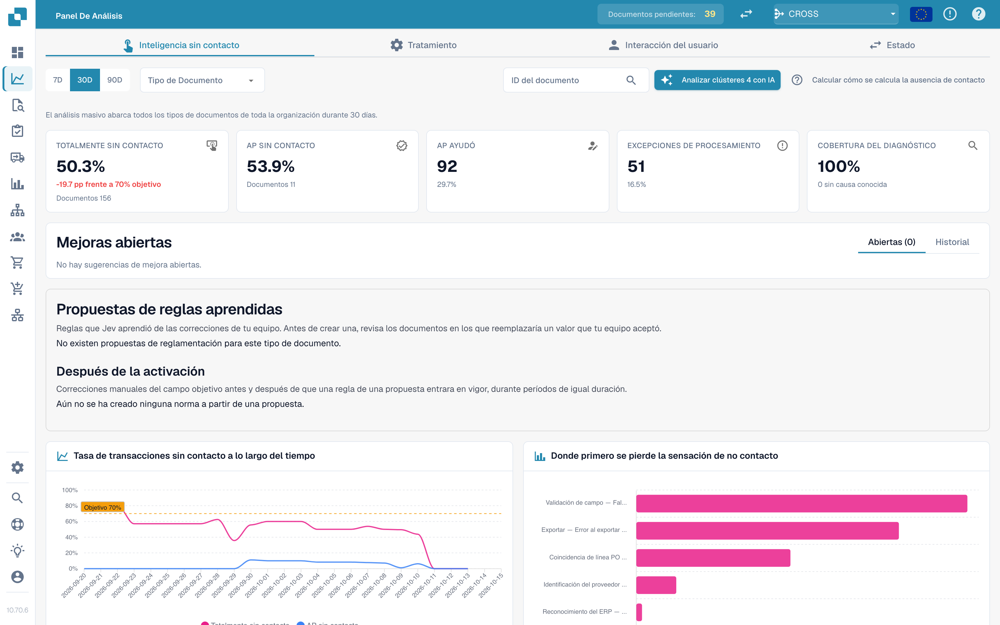

# Touchless Intelligence



Touchless Intelligence responde a dos preguntas distintas: **¿DocBits extrajo correctamente la factura?** y **¿Terminó todo el proceso sin intervención de procesamiento?** Una extracción correcta todavía puede requerir trabajo cuando los datos de Infor difieren. AP es el equipo humano de cuentas por pagar.

## Encontrar la guía adecuada

| Guía | Contenido |
| --- | --- |
| [Métricas y cálculo](touchless-metrics.md) | Categorías, numerador y denominador, intervenciones y cálculos |
| [Usar el panel](touchless-dashboard.md) | Filtros, indicadores, tendencias y primeros bloqueos |
| [Ejemplos: precio y cantidad](touchless-examples.md) | Facturas ficticias y capturas reales en Dev con diferencias de precio y cantidad |
| [Touchless Intelligence: Diagnóstico de proveedores y clústeres de problemas](touchless-supplier-diagnosis.md) | Priorizar proveedores y causas recurrentes |
| [Touchless Intelligence: Diagnóstico de la coincidencia con la OC](touchless-po-matching-diagnosis.md) | Entender reglas activas, tolerancias y decisiones |
| [Touchless Intelligence: Seguimiento del documento](touchless-document-trace.md) | Comprobar originales, ejecuciones, bloqueos e intervenciones |
| [Touchless Intelligence: Propuestas de cambio e informes](touchless-change-proposals.md) | Separar vista previa, aplicación, medición y reversión |
| [Explicar y mejorar Touchless con MCP](touchless-mcp.md) | Explicar, diagnosticar y mejorar de forma controlada con MCP |

<figure><figcaption>
La pestaña Touchless Intelligence: cifras clave, mejoras, la tasa a lo largo del tiempo y el gráfico de dónde se pierde primero el touchless. Organización de ejemplo con datos de demostración; los nombres de proveedores son ficticios.
</figcaption></figure>

## Acceso

Este apartado pertenece al [Panel de Análisis](analytics-dashboard.md). Los administradores tienen acceso; otros usuarios necesitan el permiso de rol correspondiente. El análisis con IA, los cambios compatibles y los informes pueden requerir derechos de administrador.

<!-- Source notes (not shown): screenshots come from the dev test organisation with synthetic demo data (seed script) and fictional supplier names; the PO matching decision flow has no screenshot yet. facts read from the doc2app code (TouchlessIntelligence pages and components) and the dev UI on 14 Oct 2026; NOVA gates the tab with its own organisation flag, VESTA with the Analytics module. Consulting report export format not verified, so no export is described.
-->
<!-- Touchless documentation alignment 2026-11-04: extraction quality is distinct from process automation. KPI definition checked against DocBits_API c51f350c728acb8ac964098d15f7b006bce273f4; existing native screenshots and video sources preserved except unsafe historical list images. -->
<!-- Completion 2026-11-04: localized MCP examples, AP actions, original-value evidence and owned synthetic PO cards. -->
