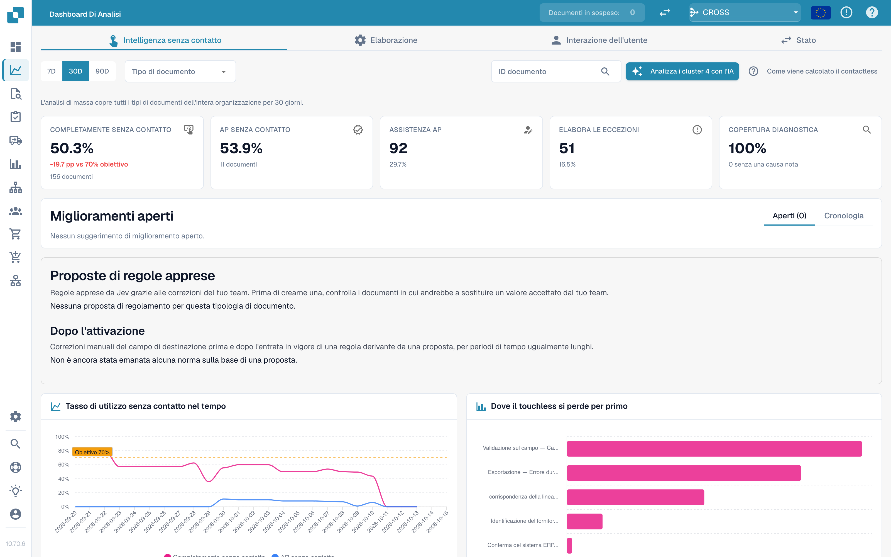

# Touchless Intelligence

Touchless Intelligence risponde a due domande distinte: **DocBits ha estratto correttamente la fattura?** e **L’intero processo è terminato senza interventi di elaborazione?** Un’estrazione corretta può comunque richiedere lavoro se i dati Infor differiscono. AP indica il reparto umano di contabilità fornitori.

## Video: funzioni del rapporto Touchless



Questa versione di verifica di 5:57 mostra un rapporto con dati: filtri, indicatori e calcolo, andamento, primi blocchi, prove registrate, cronologia del documento, esecuzioni, regole apprese, migliorie e cronologia, consulenza e risultati MCP reali.

[Aprire il video con sottotitoli italiani e 16 capitoli](https://docbits-videos.fra1.cdn.digitaloceanspaces.com/settings-assistant/touchless-intelligence-preview-admin/v2/it.html). La valutazione d'ascolto di questa nuova versione è ancora da completare.

Questi casi didattici spiegano le funzioni del rapporto. Una raccomandazione o anteprima non dimostra una modifica applicata né un miglioramento misurato. La proposta MCP mostrata richiede ancora una configurazione di destinazione precisa; anteprima e applicazione non sono disponibili. Alcuni testi nativi del prodotto possono mantenere la lingua originale. Nelle regole apprese, «20 su 21» indica i casi a cui si applica la regola. Il controesempio mostra un valore già accettato che verrebbe sostituito; alcune etichette native traducono questo significato in modo impreciso.

<figure><figcaption>
Touchless come linea di smistamento, con i numeri illustrativi dell&#x27;esempio di calcolo: i 14 varchi sono le fasi del percorso della pipeline, i fogli ancora sul nastro sono in corso e non vengono conteggiati, un documento che si ferma a un varco viene spinto nel vassoio di revisione insieme ai documenti AP Assisted (30) ed Eccezione di processo (10), e i documenti Pure Touchless (120) e AP Touchless, cioè solo approvazione (30), nel contenitore di esportazione danno i 150 su 190 del quadrante, ovvero il 78,9 %, oltre il contrassegno obiettivo del 70 %.
</figcaption></figure>

## Trovare la guida giusta

| Guida | Contenuto |
| --- | --- |
| [Metriche e calcolo](touchless-metrics.md) | Categorie, numeratore/denominatore, interventi e calcoli |
| [Usare il pannello](touchless-dashboard.md) | Filtri, indicatori, tendenze e primi blocchi |
| [Esempi: prezzo e quantità](touchless-examples.md) | Fatture fittizie e vere viste Dev con differenze di prezzo e quantità |
| [Touchless Intelligence: Diagnosi del fornitore e cluster di problemi](touchless-supplier-diagnosis.md) | Dare priorità ai fornitori e alle cause ricorrenti |
| [Touchless Intelligence: Diagnosi dell'abbinamento ordini](touchless-po-matching-diagnosis.md) | Capire regole attive, tolleranze e decisioni |
| [Touchless Intelligence: Tracciamento del documento](touchless-document-trace.md) | Controllare originali, esecuzioni, blocchi e interventi |
| [Touchless Intelligence: Proposte di modifica e report](touchless-change-proposals.md) | Distinguere anteprima, applicazione, misurazione e annullamento |
| [Spiegare e migliorare Touchless con MCP](touchless-mcp.md) | Spiegare, diagnosticare e migliorare in modo controllato con MCP |

<figure><figcaption>
La scheda Touchless Intelligence: indicatori chiave, miglioramenti, il tasso nel tempo e il grafico del primo punto di perdita. Organizzazione di esempio con dati demo; i nomi dei fornitori sono fittizi.
</figcaption></figure>

## Accesso

La sezione appartiene al [pannello di analisi](analytics-dashboard.md). Gli amministratori hanno accesso; agli altri utenti serve il permesso del ruolo corrispondente. Analisi IA, modifiche supportate e report possono richiedere diritti di amministratore.

<!-- Source notes (not shown): screenshots come from the dev test organisation with synthetic demo data (seed script) and fictional supplier names; the PO matching decision flow has no screenshot yet. facts read from the doc2app code (TouchlessIntelligence pages and components) and the dev UI on 14 Oct 2026; NOVA gates the tab with its own organisation flag, VESTA with the Analytics module. Consulting report export format not verified, so no export is described. -->
<!-- Alignment 2026-11-04: correct extraction is distinct from process Touchless; KPI numerator and denominator verified. -->
<!-- Completion 2026-11-04: localized MCP examples, AP actions, original-value evidence and owned synthetic PO cards. -->
