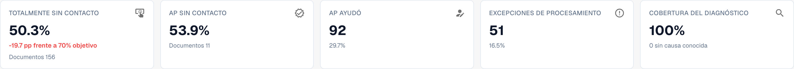
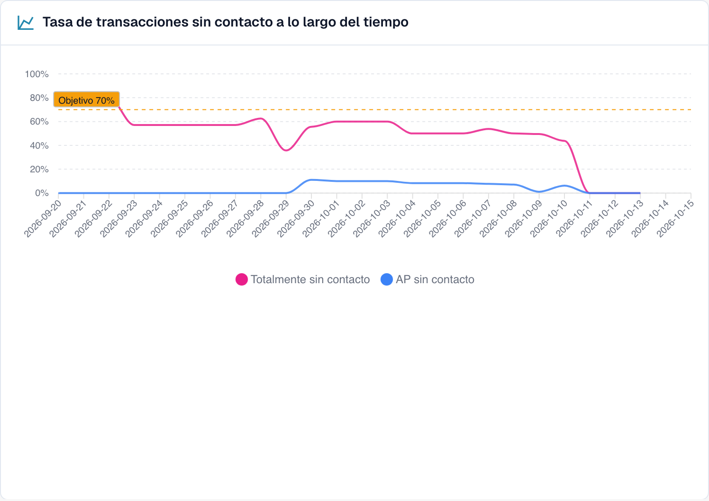
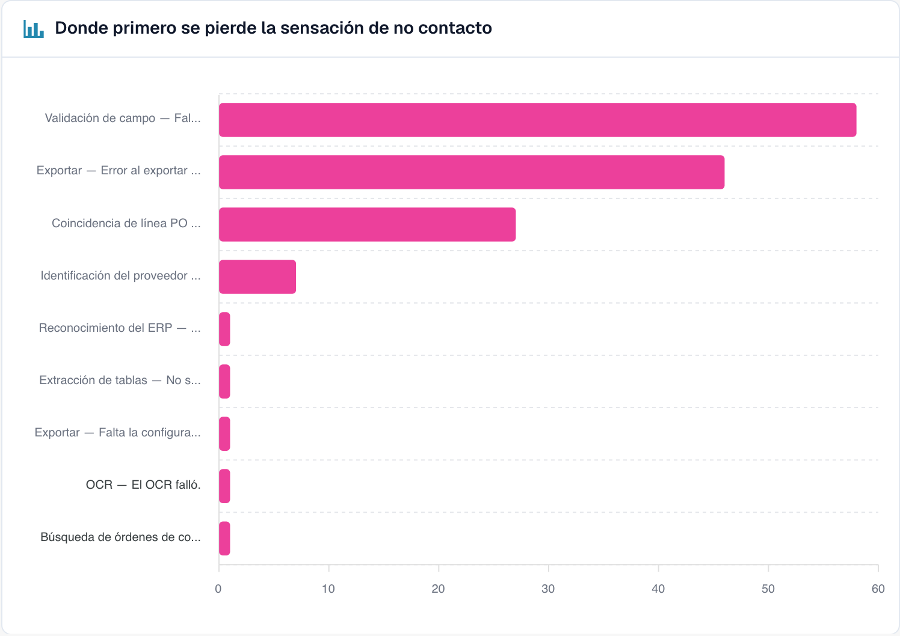

# Touchless Intelligence



## Descripción general

**Touchless Intelligence** responde a dos preguntas sobre el procesamiento de sus documentos:

1. **¿Cuántos documentos terminan sin correcciones ni intervenciones manuales de procesamiento?** Esta es la *tasa AP Touchless*; permite una aprobación de negocio. *Pure Touchless* también excluye esa aprobación.
2. **¿Por qué se detienen los demás y qué debemos cambiar para que se detengan menos?** Este es el *diagnóstico*.

Es una pestaña del [Panel de Análisis](analytics-dashboard.md). No añade trabajo para su equipo: DocBits registra lo que ocurre con cada documento en el pipeline de procesamiento y evalúa el resultado cada 15 minutos.

<figure><figcaption><p>La pestaña Touchless Intelligence: cifras clave, mejoras, la tasa a lo largo del tiempo y el gráfico de dónde se pierde primero el touchless. Organización de ejemplo con datos de demostración; los nombres de proveedores son ficticios.</p></figcaption></figure>

### Extracción correcta y proceso sin intervención

**DocBits puede extraer correctamente todos los valores y, aun así, la factura puede necesitar una intervención porque los datos del sistema de origen difieren.** AP significa Accounts Payable, el equipo de cuentas por pagar.

| Pregunta | Qué comparar | Qué demuestra |
| --- | --- | --- |
| ¿DocBits leyó correctamente la factura? | Factura original frente a campos y posiciones extraídos, antes de cualquier corrección manual | Calidad de extracción |
| ¿El proceso terminó sin intervención? | Factura correctamente extraída frente a pedido y datos maestros importados de Infor ERP, junto con el historial | Automatización del proceso |

Una diferencia no demuestra por sí sola qué dato es incorrecto. Compruebe la factura, el precio acordado y la copia realmente importada. El pedido puede ser incorrecto, la importación estar desactualizada o la factura del proveedor diferir de lo acordado. Un paso de extracción aprobado o una confianza alta tampoco certifican que todos los valores sean correctos.

Las capturas conservan la interfaz española real. La etiqueta «AP ayudó» corresponde a AP Assisted; algunos nombres de etapas de coincidencia siguen en inglés. Las explicaciones de esta página distinguen esos textos del producto de los términos de negocio.

### Qué puede hacer con ella

| Usted quiere… | Utilice | Ejemplo |
| --- | --- | --- |
| Ver cuán automatizado está | Las cinco **cifras clave** de la parte superior | "El 63.2 % de nuestros documentos se procesó sin intervención de una persona el mes pasado" |
| Ver la tendencia | **Tasa sin contacto a lo largo del tiempo** | "La tasa subió del 55 % al 68 % desde que corregimos los datos maestros de proveedores" |
| Saber dónde se atascan los documentos | **Donde se pierde primero la tecnología sin contacto** | "La mayoría de los documentos se detiene en Field Validation" |
| Decidir qué proveedor corregir primero | **Supplier opportunities** | "El proveedor A nos daría +4.0 puntos porcentuales" |
| Entender a un proveedor | Página **Supplier Diagnosis** | "Sus facturas no tienen número de OC, por eso falla la coincidencia con la OC" |
| Entender un documento | **Document Trace** | "Esta factura se detuvo en la etapa 8, Field Validation" |
| Comparar proveedores | **Compare suppliers** | "Los proveedores A y B usan la misma plantilla, pero solo B falla" |
| Cambiar un ajuste que ayuda | **Change proposals** | "Active la coincidencia automática con la OC: previsualizar, aplicar, medir, deshacer" |

## Quién puede verla

* La pestaña forma parte del Panel de Análisis. Su administrador la habilita para la organización. Si falta la pestaña, consulte a su administrador.
* Los **administradores de la organización** siempre la ven.
* Los demás usuarios la ven cuando un administrador ha concedido a su rol la pestaña **Analytics dashboard** (**Settings → Roles**). Sin esa concesión, solo los administradores tienen acceso.
* Algunas acciones son solo para administradores: **AI analysis**, **aplicar y deshacer un cambio**, **learned rule proposals** y el **Consulting report**.

Si no tiene permiso, la página muestra *Action not allowed, please contact the administrator* (acción no permitida, póngase en contacto con el administrador).

## Qué significa "touchless"

Cada documento finalizado y elegible pertenece a una sola categoría:

| Categoría | Significado | ¿Cuenta como touchless? |
| --- | --- | --- |
| **Pure Touchless** | Procesado con éxito, sin intervención humana ni aprobación | Sí |
| **AP Touchless** | Procesado con éxito; solo necesitó aprobación de negocio | Sí |
| **AP Assisted**, con intervención de AP | Procesado con éxito, pero alguien corrigió, validó manualmente o reinició | No |
| **Excepción de proceso** | Por ejemplo, rechazo, error definitivo, rechazo del ERP o estancamiento clasificado como excepción | No |

La validación manual aquí significa una intervención registrada; una mera aprobación sigue siendo AP Touchless. **AP Assisted describe la intervención, no su causa:** la extracción puede ser correcta y los datos de Infor diferentes. Los documentos aún en proceso o no elegibles quedan fuera del denominador.

La **tasa touchless** es:

```
rate = (Pure touchless + AP touchless)
       ÷ (Pure touchless + AP touchless + AP assisted + Process exception)
```

En esta fórmula, **AP touchless** es la categoría «solo aprobación». El porcentaje **AP Touchless** de la cabecera combina **Pure + solo aprobación**. No sume los dos porcentajes de la cabecera: se solapan. Las tarjetas de resultados del proveedor cuentan categorías separadas. La tasa mide el proceso, no la precisión de extracción.

Los documentos que siguen **in progress** o que son **not eligible** nunca entran en el cálculo. Esto protege la tasa: un documento que llegó hace cinco minutos no puede bajarla.


**Un toque cuenta para siempre.** Cuando una persona ha tocado un documento, este sigue contando como tocado, aunque una ejecución automática posterior no hubiera necesitado a nadie. **Reiniciar un documento no lo vuelve touchless.** La tasa refleja el trabajo que se realizó.


### Ejemplo de cálculo (cifras ilustrativas)

En 30 días llegaron 200 documentos:

| Resultado | Documentos |
| --- | --- |
| Pure touchless | 120 |
| AP touchless | 30 |
| AP assisted | 30 |
| Process exception | 10 |
| In progress | 8 |
| Not eligible (documentos de prueba) | 2 |

* Denominador: 120 + 30 + 30 + 10 = **190**; se excluyen 8 documentos en proceso y 2 no elegibles.
* **Pure Touchless:** 120 ÷ 190 = **63,2 %**.
* **Solo aprobación:** 30 ÷ 190 = **15,8 %**, el peso de esa categoría.
* **Tasa AP Touchless:** (120 + 30) ÷ 190 = **78,9 %**.

Con un objetivo del 70 %, la tasa AP combinada está por encima y la tasa Pure por debajo. Compare siempre el objetivo con la tasa indicada.

Haga clic en **How touchless is calculated**, arriba a la derecha, para abrir esta explicación dentro de DocBits, con las cifras de su propio período (documentos en el período, aún in progress, excluidos, medidos).

<figure><figcaption><p>Método de cálculo en la interfaz española: solo entran documentos con resultado final. La tasa AP combina los documentos completamente automáticos y los que solo necesitaron aprobación. Estos números describen el proceso, no la exactitud de extracción; son datos del entorno de demostración.</p></figcaption></figure>

### Ejemplo: 100 % de extracción correcta, 80 % de AP Touchless

Supongamos que la revisión de originales y valores previos a las correcciones confirma que las **100 facturas finalizadas y elegibles se extrajeron correctamente**.

| Qué ocurrió | Facturas | Categoría |
| --- | --- | --- |
| Factura y datos de origen coinciden; todo termina automáticamente | 70 | Pure Touchless |
| Los datos coinciden; solo se necesita aprobación de negocio | 10 | AP Touchless, solo aprobación |
| La extracción es correcta, pero los datos importados de Infor difieren; AP aclara el caso y reinicia manualmente en DocBits tras corregir el origen; la factura termina con éxito | 20 | AP Assisted |

* **Extracción correcta en la muestra revisada:** 100 ÷ 100 = **100 %**.
* **Pure Touchless:** 70 ÷ 100 = **70 %**.
* **AP Touchless:** (70 + 10) ÷ 100 = **80 %**.

El 100 % corresponde a una **revisión independiente de los documentos**, no a otro indicador de este panel. No puede deducirse de las categorías touchless.

### Ejemplos de intervenciones y causas

Estos casos son ilustrativos y no son los documentos de las capturas. El éxito incluye la confirmación del ERP cuando sea necesaria.

| Caso | Factura / extracción / origen | Acción y resultado |
| --- | --- | --- |
| Error de extracción | OC `45001234` / DocBits lee `45001284` / Infor contiene la OC correcta | AP corrige el número; tras finalizar con éxito: **AP Assisted** |
| Datos de origen diferentes | Precio 10,00 € / extracción correcta de 10,00 € / pedido importado de 9,00 €, fuera de tolerancia | Se confirma el precio acordado, se corrige el pedido, se verifica la importación y AP reinicia manualmente: **AP Assisted** |
| Importación tardía | La OC existe en Infor, pero todavía no ha llegado a DocBits | Si importación y reintento posteriores terminan sin intervención ni aprobación, puede resultar **Pure Touchless**; un reinicio manual seguido de éxito da **AP Assisted** |
| Rechazo del ERP | Extracción correcta, pero el ERP rechaza la exportación | **Excepción de proceso** mientras se clasifique como rechazo definitivo del ERP |

Incluso una pequeña corrección o un reinicio registrado cuenta. AP Assisted significa asistencia humana de cuentas por pagar, no un asistente de IA. El trabajo realizado solo en Infor, sin un evento correspondiente en DocBits, no debe suponerse incluido automáticamente en la medición; documéntelo también en el diagnóstico.

### Cuán actuales son las cifras

Los resultados se **recalculan cada 15 minutos**. El resultado de un documento aún puede cambiar después de aparecer por primera vez: el ERP puede confirmar una exportación horas más tarde. La línea **Data as of …** de la parte inferior de la pestaña muestra cuándo se calcularon las cifras por última vez.

## La pestaña de resumen

### Filtros

| Filtro | Qué hace |
| --- | --- |
| **7D / 30D / 90D** | El período para las cifras clave y la cola. El valor predeterminado es 30 días |
| **Document Type** | Limita todas las cifras a un tipo, por ejemplo INVOICE |
| **Segment field / Segment value** | Solo si su organización ejecuta varios procesos con un mismo tipo de documento (por ejemplo, pedidos directos, indirectos y EAM en el campo `order_type`). Elija un campo para ver el desglose y un valor para limitar todo a ese valor |
| **Document ID** | Abre el **Document Trace** de un documento |

La **suborganización** que seleccionó en la parte superior de DocBits limita las cifras clave y la cola de proveedores. Los clústeres de problemas y el análisis con IA siempre abarcan toda la organización.

### Las cinco cifras clave

<figure><figcaption><p>Indicadores en español: 156 documentos Pure más 11 con solo aprobación son 167 de 310, es decir, 53,9 % AP Touchless. Pure por separado es 50,3 %. La precisión de extracción requiere una revisión independiente del original.</p></figcaption></figure>

| Tarjeta | Muestra | Ejemplo (ilustrativo) |
| --- | --- | --- |
| **Pure touchless** | El porcentaje y la diferencia con el objetivo | **63.2 %** · "120 documents" · "−6.8 pp vs 70 % target" (rojo, por debajo del objetivo) |
| **AP Touchless** | Porcentaje combinado de Pure y solo aprobación; el número inferior corresponde a solo aprobación | **78,9 %** · 30 documentos con solo aprobación |
| **AP assisted** | El número de documentos y su proporción | **30** · 15.8 % |
| **Process exceptions** | El número de documentos y su proporción | **10** · 5.3 % |
| **Diagnosis coverage** | Cuántos documentos bloqueados tienen una causa **conocida** | **80 %** · "10 without a known cause" |

* Una tarjeta muestra un guion (—) en lugar de **0 %** cuando no hay nada que medir. Un guion significa "sin datos", no "cero".
* **Diagnosis coverage** = documentos con un motivo de bloqueo conocido ÷ todos los documentos bloqueados. Ejemplo: 50 documentos bloqueados, 10 con una causa desconocida → 40 ÷ 50 = **80 %**. Un valor bajo significa "todavía no entendemos por qué se detienen los documentos". Mejórelo antes de intentar corregir causas individuales.
* **Haga clic en una tarjeta** para abrir en una pestaña nueva la lista de documentos que hay detrás de la cifra ("View the documents behind this number"). Las tarjetas con 0 documentos no se pueden pulsar.

### Evolución de la tasa de procesamiento sin intervención

<figure><figcaption><p>La tasa por día con la línea del objetivo. Aquí la tasa se mantiene entre el 40 y el 60 % y cae bruscamente a partir del 10 de octubre. Organización de ejemplo con datos de demostración; los nombres de proveedores son ficticios.</p></figcaption></figure>

La captura muestra proporciones separadas de resultados: Pure Touchless y AP Touchless, solo aprobación. La línea azul de esta vista no es la tasa AP combinada de la cabecera. Combine Pure y solo aprobación sobre la misma población para obtener esa tasa. Los períodos cortos usan puntos diarios y los largos, semanales.

**Ejemplo.** Después de activar la coincidencia automática con la OC el 1 de octubre, la tasa pura sube del 55 % al 68 % en dos semanas. El gráfico muestra el día en que la curva cambia, de modo que puede relacionarlo con su cambio.

### Dónde se interrumpe primero el procesamiento sin intervención

<figure><figcaption><p>Documentos bloqueados según la etapa y el motivo en los que se detuvieron primero. Aquí <strong>Field validation: Required field missing</strong> cuesta más documentos (58), seguido de <strong>Export mapping failed</strong> (46) y <strong>PO item mismatch</strong> (27). Organización de ejemplo con datos de demostración; los nombres de proveedores son ficticios.</p></figcaption></figure>

Un gráfico de barras de **Blocked documents** por etapa del pipeline: la **primera** etapa que detuvo un documento.

**Ejemplo.** Si las barras muestran identificación del proveedor 12, validación de campos 41 y coincidencia de posiciones 7, investigue primero la validación. Un valor no extraído es una causa posible; compare original, reglas y datos de origen antes de confirmarla.

### Oportunidades por proveedor


La cola responde a **"¿Qué proveedor deberíamos corregir primero?"**. Está ordenada por documentos **Recoverable**, de mayor a menor, con 25 filas por página.

| Columna | Significado |
| --- | --- |
| **Supplier Number / Supplier** | El proveedor. Los documentos sin un proveedor reconocido aparecen como **No supplier identified (n documents)** |
| **Volume** | Documentos elegibles del proveedor en el período |
| **Pure Rate** | Proporción de documentos pure touchless. Verde si está en el objetivo o por encima, rojo si está por debajo |
| **Lost Documents** | Documentos que terminaron como AP assisted o como process exception. No siempre interviene una persona: un rechazo del ERP o un documento estancado durante siete días también cuentan |
| **Root Cause** | Quién es responsable de la corrección: Configuration, ERP integration, Export, Extraction, Master data, Measurement, PO matching, User process, Validation o Unknown |
| **Recoverable** | Documentos perdidos cuya causa DocBits puede corregir: configuración, datos maestros o plantilla del proveedor |
| **Expected Lift** | Cuántos **puntos porcentuales** ganaría la tasa de su organización si cada documento recuperable de este proveedor se procesara touchless (**+x pp**) |
| **Confidence** | **High**, **Medium** o **Low**: cuán seguro es el diagnóstico |
| **Status** | New, Open, Investigating, In progress, Confirmed, Resolved, Dismissed. Un proveedor con muy pocos documentos muestra **NEEDS_DIAGNOSIS** |

**Ejemplo.** Su organización tiene 1,000 documentos elegibles en el período. El proveedor A tiene 40 documentos recuperables; el proveedor B tiene 90 documentos perdidos, pero solo 10 recuperables (su problema está de su lado).

* Proveedor A: 40 ÷ 1,000 = **+4.0 pp de mejora esperada**
* Proveedor B: 10 ÷ 1,000 = **+1.0 pp**, aunque B tiene más documentos perdidos

La cola clasifica a A por encima de B porque la **mejora esperada** se mide con respecto a toda su organización, no con respecto al proveedor. Un proveedor con cuatro documentos malos no puede superar a uno con cuatrocientos.

Utilice el cuadro de búsqueda ("Search supplier number or name") para encontrar un proveedor. Haga clic en una fila para abrir el **Supplier Diagnosis**.

### Comparar proveedores


Haga clic en **Compare suppliers**, marque **de dos a cinco** proveedores (cada uno aparece con su número de documentos bloqueados) y haga clic en **Compare**.

La comparación muestra los proveedores lado a lado: **Pure rate**, **Lost documents**, **Recoverable**, **Root cause**, **Expected lift**, un gráfico de barras de los resultados y un enlace al **Supplier Diagnosis** de cada uno.

**Ejemplo.** A y B usan el mismo diseño; B tiene 80 % Pure y A 35 %. Si el diagnóstico sugiere datos maestros, compare originales, extracción y registros importados. La diferencia de tasas no demuestra por sí sola que el diseño sea correcto ni que los datos de A estén incompletos.

### Analizar con IA

El botón **Analyse n clusters with AI** analiza los clústeres de problemas con mayor potencial touchless (como mínimo un número mínimo de documentos cada uno). Tarda unos 13 segundos por clúster y abarca **toda la organización**. Solo los administradores pueden iniciarlo.

Mientras se ejecuta, verá **Queued**, **Running**, **Done**, **Already analysed** o **Error** para cada clúster, con un enlace **Open cluster**. Si la IA está desactivada o no está configurada en el entorno, el botón aparece desactivado con el motivo, y **todo lo demás en la página sigue funcionando**.

## Profundizar

| Página | Qué cubre |
| --- | --- |
| [Diagnóstico de proveedores y clústeres de problemas](touchless-supplier-diagnosis.md) | Un proveedor en detalle: bloques de resultados, tendencia, clústeres de problemas, de dónde viene una recomendación |
| [Diagnóstico de la coincidencia con la OC](touchless-po-matching-diagnosis.md) | Por qué los documentos se detienen en la búsqueda de la OC o en la coincidencia de líneas de la OC, y el flujo de decisión que muestra cómo DocBits hace coincidir las líneas de factura con las líneas de la OC |
| [Seguimiento del documento](touchless-document-trace.md) | Qué ocurrió con un documento, etapa por etapa |
| [Propuestas de cambio e informes](touchless-change-proposals.md) | Previsualizar, aplicar, medir y deshacer un cambio; propuestas de reglas aprendidas; el Consulting report |

## Trabajar con Touchless Intelligence: una rutina

1. **Cada semana**: abra la pestaña y compare la **tasa** y la **tendencia** con el objetivo.
2. Revise **Diagnosis coverage**. Si está por debajo de aproximadamente el 80 %, averigüe primero por qué se detienen los documentos.
3. Lea **Where touchless is lost first** y elija la etapa más grande.
4. Abra **Supplier opportunities**. Ordene por **Expected lift** y tome el primer proveedor con el estado **RECOVERABLE**.
5. Lea los **issue clusters**, revise **Missing evidence** y siga después **What to change**.
6. Aplique un cambio cada vez con una **vista previa**, para que el **Change history** pueda medirlo.
7. Transcurridas dos semanas, revise el resultado de **antes/después**.

## Pregunte en lenguaje natural: DocBits MCP

Todo esto también está disponible para su asistente de IA a través del [DocBits MCP](../advanced-functions-and-tools/docbits-mcp/README.md). Ejemplos de preguntas:

* "¿Cuál es nuestra tasa touchless de los últimos 30 días?"
* "¿Qué tres proveedores nos cuestan más documentos touchless?"
* "¿Por qué los documentos de este proveedor se detienen para una persona?"
* "¿Por qué falló la coincidencia con la OC en este documento?"

## Preguntas frecuentes

**Las tasas muestran un guion (—).**
Ningún documento ha alcanzado un resultado final en el período, o se midieron menos documentos que el mínimo. Los documentos que siguen in progress no se cuentan.

**Falta la pestaña.**
Pida a su administrador que habilite el módulo y que conceda a su rol la pestaña **Analytics dashboard**.

**Un documento cuenta como tocado, pero esta vez se procesó sin nadie.**
Fue tocado en una ejecución anterior (una corrección o un reinicio). La tasa cuenta el trabajo que se realizó.

**¿Por qué cambia la cifra después de unas horas?**
El ERP puede confirmar una exportación horas después de enviarla. El resultado se recalcula cada 15 minutos.

**¿Cambia la IA algo por sí sola?**
No. La IA solo escribe explicaciones. Un ajuste solo cambia después de que un administrador lo previsualice y lo aplique.

## Páginas relacionadas

* [Diagnóstico de proveedores y clústeres de problemas](touchless-supplier-diagnosis.md)
* [Diagnóstico de la coincidencia con la OC](touchless-po-matching-diagnosis.md)
* [Seguimiento del documento](touchless-document-trace.md)
* [Propuestas de cambio e informes](touchless-change-proposals.md)
* [Panel de Análisis](analytics-dashboard.md)
* [Settings Assistant](settings/global-settings/company-information/settings-assistant.md)
* [DocBits MCP](../advanced-functions-and-tools/docbits-mcp/README.md)

<!-- Source notes (not shown): screenshots come from the dev test organisation with synthetic demo data (seed script) and fictional supplier names; the PO matching decision flow has no screenshot yet. facts read from the doc2app code (TouchlessIntelligence pages and components) and the dev UI on 14 Oct 2026; NOVA gates the tab with its own organisation flag, VESTA with the Analytics module. Consulting report export format not verified, so no export is described.
-->

<!-- Touchless documentation alignment 2026-11-04: extraction quality is distinct from process automation. KPI definition checked against DocBits_API c51f350c728acb8ac964098d15f7b006bce273f4; existing native screenshots and video sources preserved except unsafe historical list images. -->
