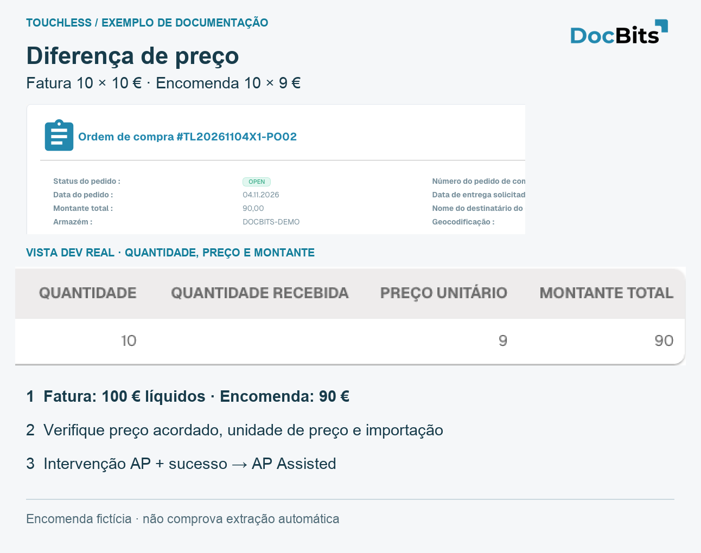

# Explicar e melhorar Touchless com MCP

Use ferramentas DocBits MCP realmente oferecidas. Separe leitura de escrita. Verifique organização, função, tipo, período e data; não invente provas.

<figure><figcaption>
Vista portuguesa real de encomenda fictícia em Dev: 10 × 9 = 90. Comparação de origem para diagnóstico MCP, não captura de cliente MCP nem prova de extração/processamento bem-sucedido.
</figcaption></figure>

## Explicar Touchless com MCP

> Explica Pure, apenas aprovação e AP combinado das faturas de 30 dias. Mostra numerador, denominador, documentos em curso, exclusões, filtros e data dos dados. Separa extração e automação.

Use `touchless_get_summary` com `period: "30d"`, `doc_type: "INVOICE"`. Escolha segmentos apenas a partir de `touchless_list_segments`. Compare organização, tipo, período e segmento iguais; leia `data_as_of`.

**Contraexemplo real Dev:** três faturas estavam `IN_PROGRESS`: `population.total: 3`, `population.in_progress: 3`, `population.eligible: 0`, `official_touchless_rate.ap_pct: null`. Ainda não havia taxa calculável; isso não significa precisão de extração de 0 % ou Touchless de 100 %. `eligible` no resumo é aqui a população KPI concluída; uma trace individual pode ter `eligible: true`, `bucket_final: false`.

São ferramentas MCP realmente oferecidas e verificadas em Dev. Organização e permissões continuam a aplicar-se. Isso não comprova disponibilidade noutra interface ou lista adicional de ferramentas permitidas.

## Examinar divergências com MCP

> Verifica encomenda, importação e regras ativas. Separa extração, cópia antiga, origem errada e configuração ausente. Não alteres nada.

1. Compare original, `get_extracted_fields`, `get_extracted_tables` antes de afirmar extração correta.
2. `get_po_sync_status`: `po_number: "TL20261104X1-PO02"`, `language: "en"`. Aceita só `de` e `en`; explique em português. Importação processada não prova correção de negócio nem estado atual do Infor.
3. `touchless_get_document_trace`, `touchless_explain_po_match` com o mesmo `doc_id`: verifique motor real, versão, colunas e tolerâncias. Use um `issue_signature` recebido em `touchless_get_po_match_evidence`.
4. O tipo de teste devolveu `state: "none_published"`, `parse_error: "no published rule set"` e campos vazios. Não estavam comprovados bloqueio de preço/quantidade nem correspondência bem-sucedida.
5. Corrija a causa confirmada e verifique novas faturas. Correções/reinícios humanos permanecem após sucesso; erro ERP definitivo prevalece. Documentos em curso ficam fora do denominador.

Um caso completo exige original, extração antes da correção, origem/importação com data, regras efetivas, ação AP e resultado final. Provas ausentes continuam em aberto.

## Ler provas com MCP

> Examina a fatura sem alterações. Compara original, campos e tabelas atuais. Explica as execuções e os dados históricos em falta.

| Ferramenta com o mesmo `doc_id` | Limite |
| --- | --- |
| `get_extracted_fields` | Valores atuais e confiança, não cópia histórica |
| `get_extracted_tables` | Tabelas presentes, não prova de concordância com original |
| `touchless_get_document_trace` | Resultados, intervenções e execuções registados |
| `touchless_explain_pipeline` | Explica percurso comprovado, não preenche lacunas |

**Teste negativo:** `header_extraction: passed`, mas `extracted_field_count: 0`, oito campos obrigatórios vazios e nenhuma tabela. Bloqueio: `REQUIRED_FIELD_MISSING`. Verifique extração/configuração; etapa verde não prova extração correta nem bloqueio de preço.

### MCP significa intervenção humana?

Ler não altera a fatura; outras ferramentas podem escrever, validar ou reiniciar. Uma chave API pode representar um sistema. “Via MCP” não prova intervenção humana nem Pure. Não oculte trabalho humano com contas de sistema. Verifique `human_touched`, `human_touch_source`, `human_restart_count`, `business_approval_touched`, estado final e execuções. Apenas aprovação difere de correção, validação ou reinício.

## Priorizar fornecedores e verificar melhorias com MCP

> Ordena fornecedores por documentos Touchless perdidos. Separa extração, dados de origem e configuração. Sugere ação e controlo para causas confirmadas, sem alterações.

1. `touchless_rank_supplier_opportunities`: `period: "30d"`, `doc_type: "INVOICE"`, `order_by_field: "lost_docs"`, `order_by_direction: "desc"`. `search` procura nome/número; `limit`, `offset` paginam.
2. Passe o `supplier_key` recebido a `touchless_diagnose_supplier`; `window: 30` para estado atual, 90 para recorrência.
3. Passe um verdadeiro `issue_signature` a `touchless_get_issue_cluster`; verifique documentos e provas em falta.
4. `touchless_get_recommendations` descreve medidas suportadas. Ganhos são estimados; não some clusters sobrepostos.
5. Verifique novas faturas comparáveis e a medição após mudança. Faturas já tratadas manualmente não passam a Pure retroativamente.

Extração correta com encomendas antigas exige corrigir origem/importação. Divergência com o original exige examinar extração. Ranking vazio não prova ausência de problemas: as três faturas em curso não geravam resultados de fornecedor concluídos. Verifique filtros, data, identificação e volume concluído.

## Pré-visualizar, aplicar e medir com MCP

> Explica a causa confirmada, lista propostas suportadas e pré-visualiza a escolhida. Aplica só essa mudança e verifica valor, histórico e efeito.

| Passo | Ferramenta | Resultado |
| --- | --- | --- |
| Listar | `touchless_list_change_proposals`, opcionalmente `issue_signature`, `window: "30d"`, `lang: "pt"` | Propostas existentes, sem escrita |
| Pré-visualizar | `touchless_preview_change` com `proposal_id`, `issue_signature` recebidos | Âmbito e `preview_token` associado, se permitido |
| Aplicar | `touchless_apply_change` com os mesmos IDs, token, `overrides`, `window` | **Escreve** a definição; sucesso devolve `change_id` |
| Medir | `touchless_verify_change` com esse `change_id` e `window` | Antes/depois, mínimo de 20 documentos concluídos elegíveis por período |

Não invente IDs/tokens. Outra configuração exige nova pré-visualização; uma pré-visualização expirada ou proibida não comprova aplicação. A demonstração não comprova proposta aplicada nem ganho medido.

52 para 61 % são 9 pontos observados, não prova de causa única. `touchless_apply_change` não escreve arbitrariamente no Infor; encomenda errada exige correção de negócio e importação verificada. Não alargue tolerâncias para esconder erros.

O relatório estima, não aplica nem desfaz. Exija sucesso e histórico. Desfazer só existe para propostas que o suportam; verifique o valor restaurado. Atualizar histórico não aplica nada; desfazer não apaga intervenções anteriores.

## Páginas relacionadas

* [Touchless Intelligence](touchless-intelligence.md)
* [Métricas e cálculo](touchless-metrics.md)
* [Usar o painel](touchless-dashboard.md)
* [Exemplos: preço e quantidade](touchless-examples.md)
* [Touchless Intelligence: diagnóstico de fornecedores e clusters de problemas](touchless-supplier-diagnosis.md)
* [Touchless Intelligence: diagnóstico de PO Matching](touchless-po-matching-diagnosis.md)
* [Touchless Intelligence: Rastreamento do documento](touchless-document-trace.md)
* [Touchless Intelligence: propostas de alteração e relatórios](touchless-change-proposals.md)

<!-- Source notes (not shown): screenshots come from the dev test organisation with synthetic demo data (seed script) and fictional supplier names; the PO matching decision flow has no screenshot yet. facts read from the doc2app code (TouchlessIntelligence pages and components) and the dev UI on 14 Oct 2026; NOVA gates the tab with its own organisation flag, VESTA with the Analytics module. Consulting report export format not verified, so no export is described.

<!-- Alignment 2026-11-04: correct extraction is distinct from process Touchless; KPI numerator and denominator verified. -->
<!-- Completion 2026-11-04: localized MCP examples, AP actions, original-value evidence and owned synthetic PO cards. -->
