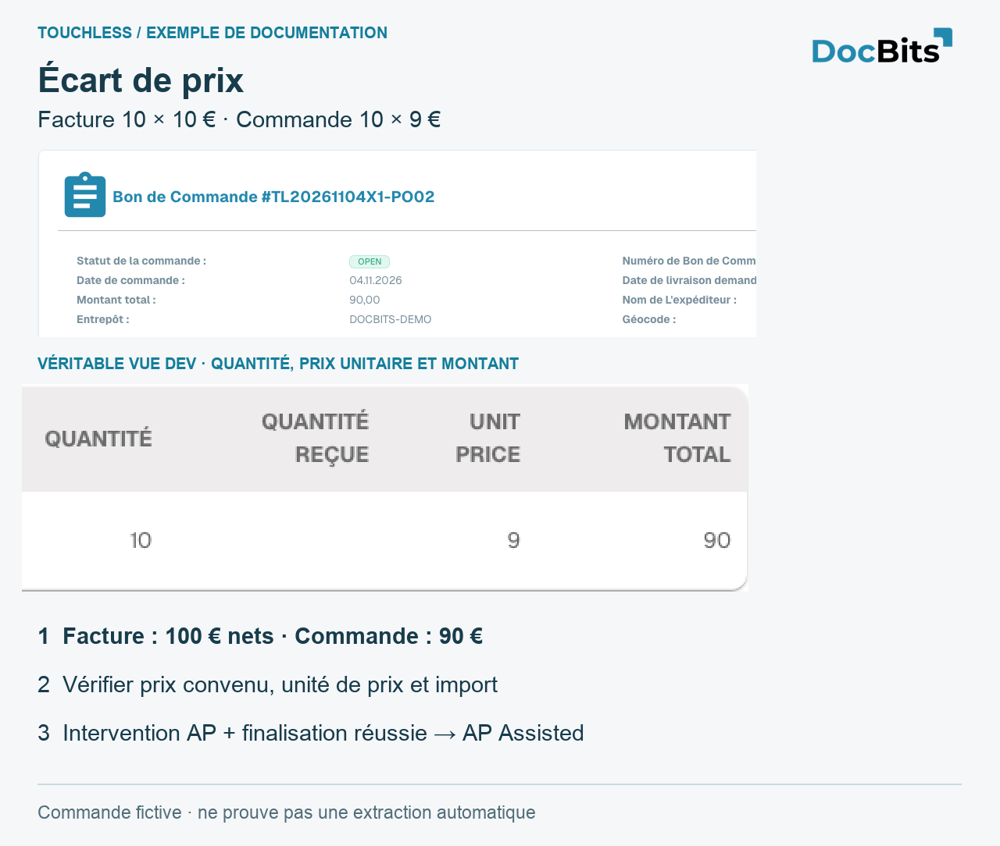

# Expliquer et améliorer Touchless avec MCP

Ces parcours utilisent des outils réellement proposés par DocBits MCP. Distinguez lecture et explication des écritures. Vérifiez organisation, rôle, type, période et date ; n’inventez pas de preuves absentes.

<figure><figcaption>
Véritable vue française d’une commande fictive créée sur Dev : 10 × 9 = 90. C’est une comparaison source pour le diagnostic MCP, pas une capture d’un client MCP ni une preuve d’extraction ou de traitement réussi. UNIT PRICE est un libellé produit encore anglais et signifie prix unitaire.
</figcaption></figure>

## Expliquer Touchless avec MCP

> Explique les résultats Pure Touchless, approbation seule et le taux AP combiné pour les factures des 30 derniers jours. Donne numérateur, dénominateur, documents en cours, exclusions, filtres et date des données. Sépare précision d’extraction et automatisation.

Utilisez `touchless_get_summary` avec `period: "30d"` et `doc_type: "INVOICE"`. Pour un sous-processus, reprenez uniquement les dimensions et valeurs réellement fournies par `touchless_list_segments`. Comparez la même organisation, le même type, la même période et le même segment ; lisez `data_as_of`.

**Contre-exemple vérifié sur Dev :** trois nouvelles factures étaient encore `IN_PROGRESS` : `population.total: 3`, `population.in_progress: 3`, `population.eligible: 0`, `official_touchless_rate.ap_pct: null`. Aucun taux n’était encore calculable. Cela ne signifie ni extraction correcte à 0 %, ni Touchless à 100 %. Le `eligible` du résumé correspond ici à la population KPI terminée ; une trace individuelle peut simultanément indiquer `eligible: true` et `bucket_final: false`.

Ces exemples utilisent des outils MCP réellement proposés et vérifiés sur Dev. L’organisation et les droits du compte connecté s’appliquent. Ils ne prouvent pas la disponibilité dans une autre interface ou une liste supplémentaire d’outils autorisés. Les identifiants techniques restent inchangés.

## Examiner les écarts avec MCP

> Vérifie commande, import et règles actives. Sépare extraction, copie ancienne, source erronée et configuration manquante. Ne modifie encore rien.

1. Comparez original, `get_extracted_fields` et `get_extracted_tables` avant d’affirmer une extraction correcte.
2. Utilisez `get_po_sync_status`, par exemple `po_number: "TL20261104X1-PO02"`, `language: "en"`. Le résumé accepte `de` ou `en` ; expliquez sa réponse en français. Le test confirme import traité et commande présente, pas exactitude métier ou état actuel d’Infor.
3. Utilisez `touchless_get_document_trace` et `touchless_explain_po_match` avec le même `doc_id`. Lisez moteur réel, version active, colonnes et tolérances effectives. Pour un cluster réellement retourné, passez son `issue_signature` à `touchless_get_po_match_evidence`.
4. Conservez les limites : le type de test retournait `state: "none_published"`, `parse_error: "no published rule set"` et des champs vides. Ni blocage prix/quantité ni rapprochement réussi n’étaient prouvés. Un schéma général ne remplace pas ces contrôles.
5. Corrigez la cause confirmée et contrôlez de nouvelles factures. Correction ou relance humaine persistent après réussite ; une erreur ERP définitive prévaut comme exception. Un document en cours est hors dénominateur.

Un cas complet exige original, extraction avant correction, valeurs importées/actuelles et date, règles réellement appliquées, action AP et résultat final. Les preuves absentes restent ouvertes.

## Lire les preuves avec MCP

> Examine cette facture sans la modifier. Compare original, champs et tableaux actuels. Explique les exécutions enregistrées et indique les preuves historiques manquantes.

| Outil avec le même `doc_id` | Preuve et limite |
| --- | --- |
| `get_extracted_fields` | Valeurs actuelles et confiance ; pas un instantané historique |
| `get_extracted_tables` | Tableaux et lignes présents ; pas leur concordance avec l’original |
| `touchless_get_document_trace` | Résultats, interventions, étapes et exécutions enregistrés |
| `touchless_explain_pipeline` | Explication du parcours prouvé ; ne complète pas les preuves absentes |

**Vérification négative réelle :** la facture de test avait `header_extraction: passed`, mais `extracted_field_count: 0`, huit champs obligatoires vides et aucun tableau. La validation bloquait avec `REQUIRED_FIELD_MISSING`. Il faut vérifier extraction/configuration ; une étape verte ne prouve ni extraction correcte ni blocage dû au prix de commande.

### Une action MCP est-elle une intervention humaine ?

Lire ne modifie pas la facture. D’autres outils peuvent écrire, valider ou relancer. La classification dépend de l’événement et de son auteur : une clé API peut représenter un compte système. « Exécuté via MCP » ne prouve ni intervention humaine ni Pure Touchless. N’utilisez pas un compte système pour masquer du travail humain.

Vérifiez `human_touched`, `human_touch_source`, `human_restart_count`, `business_approval_touched`, le statut final et les exécutions. Une approbation seule diffère d’une correction enregistrée, d’une validation manuelle ou d’une relance humaine.

## Prioriser les fournisseurs et vérifier les améliorations avec MCP

> Classe les fournisseurs qui perdent le plus de documents Touchless. Sépare erreurs d’extraction, écarts de données importées et paramètres du processus. Propose une action et une vérification par cause confirmée, sans encore modifier quoi que ce soit.

1. Utilisez `touchless_rank_supplier_opportunities` avec `period: "30d"`, `doc_type: "INVOICE"`, `order_by_field: "lost_docs"`, `order_by_direction: "desc"`. `search` cherche nom ou numéro ; `limit` et `offset` paginent.
2. Passez le `supplier_key` retourné à `touchless_diagnose_supplier`. `window: 30` décrit la situation actuelle ; 90 aide à examiner une récurrence.
3. Passez un véritable `issue_signature` à `touchless_get_issue_cluster`. Examinez documents et preuves manquantes avant de confirmer la cause. N’inventez pas les identifiants.
4. `touchless_get_recommendations` explique les mesures compatibles. Le gain attendu est estimé ; n’additionnez pas des clusters qui se chevauchent.
5. Contrôlez de nouvelles factures comparables et la mesure après changement. Une facture déjà traitée manuellement ne devient pas Pure rétroactivement.

Si l’extraction est correcte mais les commandes anciennes, corrigez source/import. Si l’original diffère de l’extraction, examinez sa configuration. Une simple approbation métier reste AP Touchless après réussite. Un classement vide ne prouve pas l’absence de problème : les trois factures de test en cours ne donnaient pas encore de résultats fournisseur terminés. Vérifiez filtres, date, identification fournisseur et volume terminé.

## Prévisualiser, appliquer et mesurer avec MCP

> Explique la cause confirmée et liste les propositions compatibles. Prévisualise le changement choisi et ses risques. Applique uniquement ce changement, puis vérifie valeur enregistrée, historique et effet mesurable.

| Étape | Outil et véritables identifiants retournés | Résultat |
| --- | --- | --- |
| Lister | `touchless_list_change_proposals`, facultativement `issue_signature`, `window: "30d"`, `lang: "fr"` | Propositions présentes ; aucun paramètre enregistré |
| Prévisualiser | `touchless_preview_change` avec `proposal_id` et `issue_signature` retournés | Portée concrète et, si autorisé, `preview_token` lié |
| Appliquer le changement choisi | `touchless_apply_change` avec les mêmes IDs, jeton, `overrides` et `window` | **Écrit** le paramètre compatible ; une réussite retourne `change_id` |
| Lire l’effet | `touchless_verify_change` avec ce `change_id` et le même `window` | Avant/après ; au moins 20 documents terminés et éligibles par période restent nécessaires |

Reprenez IDs et jeton dans des réponses réelles. Une prévisualisation d’une valeur n’autorise pas l’application d’une autre. Une prévisualisation expirée, interdite ou incomplète ne prouve aucune application. Le tableau explique le parcours ; il n’affirme pas que le cas de démonstration ait appliqué une proposition ou mesuré un gain.

Après une correction de configuration confirmée, vérifiez le paramètre et de nouvelles factures. Passer de 52 à 61 % représente 9 points observés, pas la preuve d’une cause unique. Une commande Infor erronée nécessite une correction métier et un import vérifié : `touchless_apply_change` n’est pas un outil général d’écriture Infor. N’élargissez pas les tolérances pour cacher des données fausses.

Le rapport montre des estimations, pas l’application ou l’annulation. Une application exige une réponse de réussite et une entrée d’historique. L’annulation dépend de la proposition ; vérifiez la valeur restaurée. Recharger l’historique n’applique rien ; annuler ne supprime pas les interventions passées.

## Pages associées

* [Touchless Intelligence](touchless-intelligence.md)
* [Indicateurs et calcul](touchless-metrics.md)
* [Utiliser le tableau de bord](touchless-dashboard.md)
* [Exemples : prix et quantité](touchless-examples.md)
* [Touchless Intelligence : Diagnostic fournisseur et clusters de problèmes](touchless-supplier-diagnosis.md)
* [Touchless Intelligence : Diagnostic du rapprochement avec le BC](touchless-po-matching-diagnosis.md)
* [Touchless Intelligence : Trace du document](touchless-document-trace.md)
* [Touchless Intelligence : Propositions de modification et rapports](touchless-change-proposals.md)

<!-- Source notes (not shown): screenshots come from the dev test organisation with synthetic demo data (seed script) and fictional supplier names; the PO matching decision flow has no screenshot yet. facts read from the doc2app code (TouchlessIntelligence pages and components) and the dev UI on 14 Oct 2026; NOVA gates the tab with its own organisation flag, VESTA with the Analytics module. Consulting report export format not verified, so no export is described.

<!-- Touchless documentation alignment 2026-11-04: extraction quality is distinct from process automation. KPI definition checked against DocBits_API c51f350c728acb8ac964098d15f7b006bce273f4; existing native screenshots and video sources preserved except unsafe historical list images. -->
<!-- Completion 2026-11-04: localized MCP examples, AP actions, original-value evidence and owned synthetic PO cards. -->
