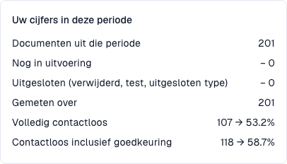

# Metrieken en berekening

<!-- touchless-admin-video-v2-20261104:start -->
**Videohoofdstuk (controleversie):** [De percentages berekenen](https://docbits-videos.fra1.cdn.digitaloceanspaces.com/settings-assistant/touchless-intelligence-preview-admin/v2/nl.html#chapter=03).
<!-- touchless-admin-video-v2-20261104:end -->

### Correct uitlezen en verwerking zonder ingreep zijn verschillende zaken

**DocBits kan de factuur correct uitlezen terwijl afwijkende Infor-gegevens toch werk veroorzaken.** AP is de menselijke crediteurenadministratie, geen AI-assistent.

| Vraag | Vergelijking | Wat wordt gemeten? |
| --- | --- | --- |
| Heeft DocBits correct uitgelezen? | Origineel en uitgelezen waarden vóór correcties | Extractiekwaliteit |
| Is het hele proces zonder ingreep afgerond? | Factuur, geïmporteerde gegevens en geregistreerde acties tot afronding | Procesautomatisering |

Controleer afgesproken prijs, eenheden en importtijd. Een foutieve factuur, onjuiste inkooporder en verouderde kopie vragen verschillende oplossingen. Een groene stap of hoge betrouwbaarheid bewijst niet elke waarde. Een gecorrigeerde waarde bewijst niet wat oorspronkelijk is uitgelezen.

## Wat ‘touchless’ betekent

Elk afgerond, meetellend document heeft precies één einduitkomst:

| Categorie | Betekenis | Telt als touchless? |
| --- | --- | --- |
| **Pure Touchless** | Succesvol verwerkt zonder menselijke ingreep of goedkeuring | Ja |
| **AP Touchless** | Succesvol verwerkt; alleen inhoudelijke goedkeuring nodig | Ja |
| **AP Assisted**, met AP-ingreep | Succesvol na correctie, handmatige validatie of menselijke herstart | Nee |
| **Procesuitzondering** | Definitieve fout, afwijzing of ERP-weigering die als uitzondering is ingedeeld | Nee |

Nog lopende en uitgesloten documenten staan niet in de noemer. Een definitieve uitzondering gaat voor op een succesindeling, ook na menselijk werk. AP Assisted beschrijft de ingreep, niet de oorzaak: de extractie kan correct zijn.

```
rate = (Pure touchless + AP touchless)
       ÷ (Pure touchless + AP touchless + AP assisted + Process exception)
```

AP touchless in de formule is de categorie **alleen goedkeuring**. Het **gecombineerde AP-percentage** omvat Pure plus alleen goedkeuring. De Pure- en AP-koppercentages overlappen: tel ze niet op. Leverancierstegels tonen afzonderlijke uitkomsten.

### Rekenvoorbeeld met 200 documenten

| Uitkomst | Documenten |
| --- | --- |
| Pure Touchless | 120 |
| Alleen goedkeuring | 30 |
| AP Assisted | 30 |
| Uitzonderingen | 10 |
| Nog in verwerking | 8 |
| Uitgesloten | 2 |

* Noemer: 120 + 30 + 30 + 10 = **190**.
* Pure: 120 / 190 = **63,2 %**.
* Alleen goedkeuring: 30 / 190 = **15,8 %**.
* Gecombineerd AP: (120 + 30) / 190 = **78,9 %**.

Bij een doel van 70 % ligt gecombineerd AP erboven en Pure eronder. Vergelijk het doel met het benoemde percentage.

### 100 % correct uitgelezen, 80 % AP Touchless

Stel dat een onafhankelijke controle van originelen en waarden vóór correcties **100 afgeronde, meetellende facturen met volledig correcte extractie binnen de controle** bevestigt.

| Wat gebeurde er? | Facturen | Uitkomst |
| --- | --- | --- |
| Alles klopt en eindigt automatisch | 70 | Pure Touchless |
| Alleen inhoudelijke goedkeuring nodig | 10 | AP Touchless |
| Extractie correct, Infor wijkt af; bron gecorrigeerd, import gecontroleerd, handmatige herstart in DocBits en daarna succes | 20 | AP Assisted |

Extractiekwaliteit in de steekproef: **100 %**; Pure: **70 %**; gecombineerd AP: **80 %**. De 100 % komt uit een onafhankelijke, afgebakende controle en is geen extra dashboard-KPI. Zonder oorspronkelijke waarden is een geval niet beoordeelbaar. Alleen in Infor uitgevoerd werk is niet automatisch een geregistreerde DocBits-ingreep.

**Een menselijke ingreep blijft tellen.** Een latere automatische uitvoering of herstart wist eerdere correcties niet. Lezen en voorvertonen zijn op zichzelf geen ingrepen; handmatige validatie en menselijke herstart wel. Alleen goedkeuring blijft afzonderlijk.

<figure><figcaption><p>Huidige trainingspopulatie: 201 afgeronde, meetellende facturen; geen gevallen in verwerking of uitgesloten. De 107 volledig automatische facturen geven 53,2 %; met 11 alleen goedkeuring zijn dat 118 en 58,7 %. Deze procespercentages meten geen extractienauwkeurigheid.</p></figcaption></figure>

### Welke AP-acties tellen als ingreep?

Deze indeling veronderstelt een succesvolle afronding met de vereiste ERP-bevestiging. De vastgelegde actie en uitvoerder tellen, niet de duur.

| Actie | Gevolg |
| --- | --- |
| Openen, lezen, filteren, vergelijken of een voorbeeld bekijken | Op zichzelf geen ingreep; Pure blijft mogelijk |
| Alleen inhoudelijk goedkeuren, ook een tweede goedkeuring | AP Touchless als er verder geen ingreep is |
| Een veld of tabelcel corrigeren en opslaan | AP Assisted; één correctie telt al |
| Handmatig valideren of verwerking/export opnieuw starten | Na succesvolle afronding AP Assisted; een latere automatische uitvoering wist dit niet |
| Automatische systeemherhaling of workflow | Op zichzelf geen menselijke ingreep; eerdere ingrepen blijven bestaan |
| Alleen gegevens in Infor corrigeren | Niet automatisch een DocBits-gebeurtenis; leg dit werk apart vast en controleer de vervolgstap |
| Definitieve ERP-afwijzing na een ingreep | Procesuitzondering heeft voorrang op succesvolle categorieën |

Opslaan zonder aangetoonde wijziging bewijst geen correctie. Controleer of ook handmatige validatie of een herstart plaatsvond.

### Eén AP-label, twee betekenissen

Het percentage en aantal op de huidige AP-kaart combineren Pure en alleen goedkeuring. In het rekenvoorbeeld zijn dat 150 = 120 + 30 documenten en 78,9 %. In de huidige opname zijn dat 118 = 107 + 11 facturen en 58,7 %. De afzonderlijke uitkomstcategorie, zoals de MCP-groep `AP_TOUCHLESS`, telt alleen de 11 goedkeuringen. De huidige blauwe lijn toont het gecombineerde percentage met de populatie van elk punt. Pure en gecombineerd AP overlappen: tel ze niet op.

### Actualiteit van de gegevens

Uitkomsten worden elke 15 minuten herberekend. Lees **Gegevens bijgewerkt tot** en wacht na een actie op de nieuwe berekening. ERP-bevestiging kan later volgen; versturen alleen bewijst nog geen afronding.

## Veelgestelde vragen

**De percentages tonen een streepje (—).**
Geen enkel document heeft in de periode een definitieve uitkomst bereikt, of er zijn minder documenten gemeten dan het minimum. Documenten die nog in behandeling zijn, worden niet meegeteld.

**Het tabblad ontbreekt.**
Vraag uw beheerder om de module in te schakelen en uw rol het tabblad **Analytics dashboard** (Analyse-dashboard) toe te kennen.

**Een document telt als aangeraakt, maar het liep deze keer zonder iemand door.**
Het is in een eerdere run aangeraakt (een correctie of een herstart). Het percentage telt het werk dat is gedaan.

**Waarom verandert het cijfer na een paar uur?**
Het ERP kan een export uren nadat die is verzonden bevestigen. De uitkomst wordt elke 15 minuten opnieuw berekend.

**Verandert de AI zelf iets?**
Nee. AI schrijft alleen uitleg. Een instelling verandert pas nadat een beheerder het voorbeeld heeft bekeken en de wijziging heeft toegepast.

## Gerelateerde pagina’s

* [Touchless Intelligence](touchless-intelligence.md)
* [Het dashboard gebruiken](touchless-dashboard.md)
* [Voorbeelden: prijs en aantal](touchless-examples.md)
* [Touchless Intelligence: Leveranciersdiagnose en probleemclusters](touchless-supplier-diagnosis.md)
* [Touchless Intelligence: PO-matchingdiagnose](touchless-po-matching-diagnosis.md)
* [Touchless Intelligence: Documentspoor](touchless-document-trace.md)
* [Touchless Intelligence: Wijzigingsvoorstellen en rapporten](touchless-change-proposals.md)
* [Touchless uitleggen en verbeteren met MCP](touchless-mcp.md)

<!-- Source notes (not shown): screenshots come from the dev test organisation with synthetic demo data (seed script) and fictional supplier names; the PO matching decision flow has no screenshot yet. facts read from the doc2app code (TouchlessIntelligence pages and components) and the dev UI on 14 Oct 2026; NOVA gates the tab with its own organisation flag, VESTA with the Analytics module. Consulting report export format not verified, so no export is described.

<!-- Alignment 2026-11-04: correct extraction is distinct from process Touchless; KPI numerator and denominator verified. -->
<!-- Completion 2026-11-04: localized MCP examples, AP actions, original-value evidence and owned synthetic PO cards. -->
