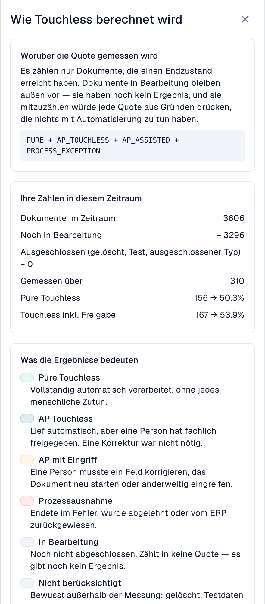

# Kennzahlen und Berechnung

<!-- touchless-admin-video-v2-20261104:start -->
**Video-Kapitel (Prüffassung):** [Die Quote verständlich berechnen](https://docbits-videos.fra1.cdn.digitaloceanspaces.com/settings-assistant/touchless-intelligence-preview-admin/v2/de.html#chapter=03).
<!-- touchless-admin-video-v2-20261104:end -->

### Korrekte Auslesung und ein Touchless-Prozess sind zwei verschiedene Fragen

**DocBits kann alle Rechnungswerte richtig auslesen, und trotzdem braucht die Rechnung einen AP-Eingriff, weil die Daten aus dem Quellsystem abweichen.** AP steht für Accounts Payable, also die Kreditorenbuchhaltung. Prüfen Sie diese beiden Fragen getrennt:

| Frage | Was Sie vergleichen | Was das Ergebnis aussagt |
| --- | --- | --- |
| **Hat DocBits den Beleg richtig ausgelesen?** | Originalrechnung mit den ausgelesenen Kopffeldern und Tabellenpositionen, vor einer manuellen Korrektur | Auslesequalität: Entspricht der ausgelesene Wert dem tatsächlichen Inhalt der Rechnung? |
| **Konnte der Prozess ohne Bearbeitungseingriff abgeschlossen werden?** | Korrekt ausgelesene Rechnung mit den Bestell- und Stammdaten aus Infor ERP sowie dem aufgezeichneten Bearbeitungsverlauf | Prozessautomatisierung: Konnten die konfigurierten Prüfungen, der Abgleich und der Export ohne Korrektur oder Neustart abgeschlossen werden? |

Ein anderer Wert in Infor sagt allein noch nicht, welche Seite falsch ist. Prüfen Sie Rechnung, vereinbarte Bestellung und die tatsächlich nach DocBits importierten Daten. Die Quelldaten können falsch sein, der Import kann veraltet sein oder der Lieferant kann einen anderen Wert berechnet haben.


**Die Touchless-Quote misst den Prozess, nicht die Auslesegenauigkeit.** „AP mit Eingriff“ beweist keinen Auslesefehler von DocBits. Umgekehrt beweisen ein bestandener Extraktionsschritt oder ein hoher Konfidenzwert nicht, dass jeder Wert richtig ist. Dafür müssen Sie den Originalbeleg mit den ausgelesenen Werten vergleichen.


Die Screenshots zeigen die deutsch eingestellte DocBits-Oberfläche. Produktbegriffe wie **Pure Touchless** und **AP Touchless** bleiben wie in der Oberfläche erhalten; technische Kennungen und unveränderte englische Produktbeschriftungen sind keine übersetzten Beispieldaten.

Die Bilder zeigen unterschiedliche Beispielsituationen und Datenstände. Rechnen Sie ihre Dokumentzahlen nicht zu einer gemeinsamen Stichprobe zusammen. Der Schulungsfall mit 10,00 € gegen 9,00 € erklärt den Zusammenhang; er ist kein vollständig aufgezeichneter Infor-Durchlauf der abgebildeten Rechnungen.

Jedes abgeschlossene, berücksichtigte Dokument wird genau **einer** dieser Kategorien zugeordnet:

| Kategorie | Bedeutung | Zählt als touchless? |
| --- | --- | --- |
| **Pure Touchless** | Erfolgreich verarbeitet, ohne menschlichen Eingriff oder Freigabe | Ja |
| **AP Touchless** | Erfolgreich verarbeitet; nur eine fachliche Freigabe war nötig | Ja |
| **AP Assisted** – „AP mit Eingriff“ | Erfolgreich verarbeitet, aber jemand musste korrigieren, manuell validieren oder neu starten | Nein |
| **Prozessausnahme** | Beispielsweise abgelehnt, endgültiger Fehler, ERP-Zurückweisung oder ein als Ausnahme eingestufter Stillstand | Nein |

„Manuell validieren“ meint hier einen aufgezeichneten Bearbeitungseingriff. Eine reine fachliche Freigabe zählt weiterhin als **AP Touchless**. **AP Assisted beschreibt den Eingriff, nicht dessen Ursache:** DocBits kann vollständig richtig ausgelesen haben, während abweichende Infor-Daten den Eingriff erfordern.

Dokumente **in Bearbeitung** (In progress) und **nicht berücksichtigte** Dokumente (Not eligible, beispielsweise gelöschte oder ausgeschlossene Testdokumente) bleiben außerhalb dieser vier Kategorien für die Quotenberechnung.

Die **AP-Touchless-Quote**, einschließlich Dokumenten mit reiner Freigabe, lautet:

```
rate = (Pure touchless + AP touchless)
       ÷ (Pure touchless + AP touchless + AP assisted + Process exception)
```

**AP touchless** im Zähler bezeichnet hier das Dokumentergebnis „nur Freigabe“. Der **Prozentwert der Karte AP Touchless** ist dagegen die gemeinsame Quote: vollständig automatische Dokumente plus Dokumente mit reiner Freigabe. **Addieren Sie die beiden angezeigten Prozentwerte nicht.** Bei der Pure-Quote stehen nur die vollständig automatischen Dokumente im Zähler; der Nenner bleibt gleich.

Dokumente, die noch **in Bearbeitung** oder **nicht berücksichtigt** sind, gehen nie in die Berechnung ein. Das schützt die Quote: Ein Dokument, das vor fünf Minuten eingegangen ist, kann sie nicht senken.


**Eine Berührung zählt dauerhaft.** Sobald eine Person ein Dokument bearbeitet hat, bleibt es als bearbeitet gezählt, auch wenn ein späterer automatischer Lauf niemanden gebraucht hätte. **Ein Neustart macht ein Dokument nicht wieder zu einem Touchless-Dokument.** Die Quote spiegelt die Arbeit wider, die tatsächlich stattgefunden hat.


### Beispielrechnung (Zahlen zur Veranschaulichung)

In 30 Tagen sind 200 Dokumente eingegangen:

| Ergebnis | Dokumente |
| --- | --- |
| Pure Touchless | 120 |
| AP Touchless | 30 |
| AP mit Eingriff | 30 |
| Prozessausnahme | 10 |
| In Bearbeitung | 8 |
| Nicht berücksichtigt (Testdokumente) | 2 |

* Nenner: 120 + 30 + 30 + 10 = **190**. Die 8 Dokumente in Bearbeitung und die 2 nicht berücksichtigten Dokumente bleiben außen vor.
* **Pure Touchless**: 120 ÷ 190 = **63,2 %**
* Anteil mit **reiner Freigabe**: 30 ÷ 190 = **15,8 %**. Das ist der Anteil dieses Dokumentergebnisses, nicht die gemeinsame AP-Touchless-Quote.
* **AP-Touchless-Quote**: (120 + 30) ÷ 190 = **78,9 %**

Der Tab zeigt ein **Ziel** (70 %, sofern Ihre Organisation kein anderes verwendet). In diesem Beispiel liegt die gemeinsame AP-Quote über 70 %, die Pure-Quote mit 63,2 % darunter. Vergleichen Sie das Ziel mit der jeweils auf der Karte oder im Diagramm benannten Quote.

Klicken Sie oben rechts auf **Wie Touchless berechnet wird** (How touchless is calculated), um diese Erklärung direkt in DocBits zu öffnen, mit den Zahlen Ihres eigenen Zeitraums (Dokumente im Zeitraum, noch in Bearbeitung, ausgeschlossen, gemessen).

<figure><figcaption><p>Die Seitenleiste <strong>Wie Touchless berechnet wird</strong>: hier 3.606 Dokumente, davon 3.296 noch in Bearbeitung und 310 gemessen. 156 vollständig automatische Dokumente ergeben 50,3 % Pure Touchless; zusammen mit 11 Dokumenten mit reiner Freigabe sind es 167 und damit 53,9 % AP Touchless. Diese Zahlen beschreiben den Prozess, nicht die Auslesegenauigkeit. Beispielorganisation mit Demodaten.</p></figcaption></figure>

### Beispiel: 100 % richtig ausgelesen, 80 % AP Touchless

Angenommen, ein Vergleich von Originalrechnungen und ausgelesenen Werten bestätigt: **Alle 100 abgeschlossenen, berücksichtigten Rechnungen wurden vollständig richtig ausgelesen.** Ihre Verarbeitung endet so:

| Was passiert ist | Dokumente | Ergebnis |
| --- | --- | --- |
| Rechnung und Quelldaten stimmen überein; der gesamte Prozess läuft automatisch durch | 70 | Pure Touchless |
| Rechnung und Quelldaten stimmen überein; nur eine fachliche Freigabe ist nötig | 10 | AP Touchless (Dokumentergebnis „nur Freigabe“) |
| Die Rechnung ist richtig ausgelesen, die importierten Infor-Daten weichen jedoch ab. AP klärt die Abweichung und startet die Dokumente nach Korrektur der Quelldaten manuell in DocBits neu; anschließend werden sie erfolgreich abgeschlossen | 20 | AP mit Eingriff |

* **Richtig ausgelesene Dokumente in dieser geprüften Stichprobe:** 100 ÷ 100 = **100 %**.
* **Pure-Touchless-Quote:** 70 ÷ 100 = **70 %**.
* **AP-Touchless-Quote:** (70 + 10) ÷ 100 = **80 %**.

Das ist kein Widerspruch: Alle Rechnungen waren richtig ausgelesen, 20 brauchten wegen der Quelldaten trotzdem einen Bearbeitungseingriff. Die **100 % Auslesequalität sind hier das beispielhafte Ergebnis einer gesonderten Belegprüfung**, keine zusätzliche Kennzahl dieses Dashboards. Sie lassen sich nicht allein aus den Touchless-Ergebnissen berechnen.

### Beispiele: Was musste AP tatsächlich tun?

Die folgenden Fälle sind Schulungsbeispiele, keine Einzeldokumente aus den Screenshots. Die erfolgreichen Ergebnisse setzen den Abschluss der Verarbeitung voraus, einschließlich einer ERP-Bestätigung, sofern diese erforderlich ist.

| Fall | Originalrechnung / DocBits-Auslesung / Quelldaten | AP-Aktion und Ergebnis | Wo Sie die Ursache prüfen |
| --- | --- | --- | --- |
| **Auslesefehler** | Bestellnummer `45001234` / falsch als `45001284` ausgelesen / richtige Bestellung `45001234` ist in Infor vorhanden | AP korrigiert die ausgelesene Nummer; die Rechnung endet erfolgreich als **AP mit Eingriff** | Extraktion für diesen Lieferanten |
| **Abweichung im Quellsystem** | Stückpreis 10,00 € / korrekt 10,00 € ausgelesen / importierte Infor-Bestellung enthält 9,00 €, außerhalb der konfigurierten Toleranz | AP bestätigt den vereinbarten Preis von 10,00 €, veranlasst die Bestellkorrektur und startet die Rechnung manuell in DocBits neu; sie endet erfolgreich als **AP mit Eingriff** | Infor-Bestelldaten und deren Import |
| **Verzögerter Import** | Bestellnummer auf Rechnung und in DocBits korrekt / Bestellung existiert in Infor, ist aber noch nicht in DocBits angekommen | Erfolgen späterer Import und erneute Verarbeitung automatisch ohne aufgezeichneten menschlichen Eingriff oder Freigabe, kann das Ergebnis **Pure Touchless** bleiben. Ein manueller Neustart mit anschließendem Erfolg ergibt **AP mit Eingriff** | Importzeitpunkt und tatsächliche Laufhistorie |
| **ERP-Ablehnung** | Auslesung korrekt, das ERP weist das exportierte Dokument jedoch zurück | **Prozessausnahme**, solange der Fall als abschließende ERP-Ablehnung eingeordnet ist, auch nach einem vorherigen Eingriff | ERP-Ablehnung und Exportnachweise |

**Auch eine kleine aufgezeichnete Korrektur oder ein manueller Neustart zählt als Eingriff.** „AP assisted“ bedeutet „mit Unterstützung durch AP“; es ist keine Bezeichnung für einen eigenen KI-Assistenten. Ein Quelldatenproblem und ein Auslesefehler können deshalb zum gleichen Ergebnis führen, brauchen aber unterschiedliche Behebungen.

Die Einordnung beruht auf den Ereignissen, die DocBits aufzeichnet. Setzen Sie nicht voraus, dass ausschließlich in Infor erledigte Arbeit ohne entsprechendes DocBits-Ereignis automatisch als AP-Eingriff gezählt wird. Halten Sie diese Arbeit zusätzlich in der Diagnose fest.

### Welche AP-Aktion zählt als Eingriff?

Die Tabelle setzt eine erfolgreiche Verarbeitung voraus, einschließlich der erforderlichen ERP-Bestätigung. Entscheidend ist das aufgezeichnete Ereignis und wer es ausgelöst hat, nicht die Dauer der Arbeit.

| Aktion | Bedeutung für das Dokumentergebnis |
| --- | --- |
| Rechnung, Verlauf oder Vorschau nur öffnen; filtern oder vergleichen | Allein dadurch entsteht kein Bearbeitungseingriff. Ohne weitere Eingriffe oder Freigaben bleibt Pure Touchless möglich |
| Nur fachlich freigeben, auch in einer zweiten Freigabestufe | AP Touchless, sofern es keinen zusätzlichen Bearbeitungseingriff gab |
| Einen Kopfwert oder eine Tabellenposition ändern und speichern | AP mit Eingriff; auch eine einzige gespeicherte Korrektur zählt |
| Ein Dokument manuell aus der Validierung weitergeben, auch ohne Wertkorrektur | AP mit Eingriff. Manuelle Validierung ist eine andere Aktion als eine reine fachliche Freigabe |
| Verarbeitung oder Export als Person manuell neu starten | AP mit Eingriff; ein späterer automatischer Lauf hebt den Eingriff nicht auf |
| Das System verarbeitet automatisch erneut oder schreibt Werte durch einen automatischen Workflow | Allein dadurch entsteht kein menschlicher Eingriff. Vorherige menschliche Eingriffe bleiben bestehen |
| Daten ausschließlich in Infor korrigieren | Externe Arbeit ist nicht automatisch ein aufgezeichnetes DocBits-Ereignis. Die nachfolgende DocBits-Aktion und den Verlauf prüfen; externe Arbeit zusätzlich dokumentieren |
| Nach einer Korrektur weist das ERP das Dokument endgültig zurück | Prozessausnahme. Die Zurückweisung hat Vorrang vor einer erfolgreichen Touchless-Einordnung; der frühere Eingriff bleibt Teil des Verlaufs |

**Grenzfall „Speichern“:** Eine gespeicherte Feldänderung zählt als Korrektur. Aus einem geöffneten Fenster oder einem Klick ohne nachgewiesene Änderung lässt sich dagegen kein Bearbeitungseingriff ableiten. Prüfen Sie zusätzlich, ob die Aktion eine manuelle Validierung oder einen Neustart ausgelöst hat.

### Dieselbe Beschriftung, zwei unterschiedliche Aussagen

| Wo Sie AP Touchless lesen | Gemeint ist | Lesebeispiel |
| --- | --- | --- |
| Prozentwert der AP-Karte auf der Übersicht | Gemeinsame Quote aus Pure und reiner Freigabe | (120 + 30) ÷ 190 = 78,9 % |
| Dokumentanzahl unter diesem Prozentwert | Nur Dokumente mit reiner Freigabe | 30, nicht 150 |
| Ergebniskachel oder Segment der Lieferantendiagnose | Eigenständige Kategorie „nur Freigabe“ | 30 ÷ 190 = 15,8 % |
| Blaue AP-Linie der [Trendaufnahme](touchless-dashboard.md) | Anteil der Kategorie „nur Freigabe“ | Nicht mit der gemeinsamen AP-Karte gleichsetzen |

Die Kategorien ergeben zusammen 100 % der abgeschlossenen, berücksichtigten Dokumente. Die Prozentwerte der Pure-Karte und der gemeinsamen AP-Karte überlappen sich und dürfen nicht addiert werden.

### Wie aktuell sind die Zahlen

Die Ergebnisse werden **alle 15 Minuten neu berechnet**. Warten Sie nach einer Aktion auf den nächsten Datenstand, bevor Sie deren Einordnung prüfen. Das Ergebnis eines Dokuments kann sich auch nach seinem ersten Erscheinen noch ändern: Das ERP bestätigt einen Export unter Umständen erst Stunden später. Die Zeile **Datenstand …** (Data as of …) unten im Tab zeigt, wann die Zahlen zuletzt berechnet wurden.


## FAQ

**DocBits hat alles richtig ausgelesen. Warum ist die Rechnung „AP mit Eingriff“?**
Touchless misst den gesamten Prozess. Falsche oder veraltete Infor-Daten können auch bei korrekter Auslesung eine aufgezeichnete Korrektur oder einen manuellen Neustart erfordern. Prüfen Sie Originalrechnung, DocBits-Auslesung und importierte Quelldaten getrennt.

**Sagt „AP mit Eingriff“, ob DocBits oder Infor die Arbeit verursacht hat?**
Nein. Es beschreibt den Eingriff, nicht die Verantwortlichkeit. Bestätigen Sie die Ursache anhand des Dokumentverlaufs sowie der zugrunde liegenden Beleg- und Quelldaten.

**Die Quoten zeigen einen Strich (—).**
Im Zeitraum hat kein Dokument ein Endergebnis erreicht, oder es wurden weniger Dokumente als das Minimum gemessen. Dokumente, die noch in Bearbeitung sind, werden nicht gezählt.

**Der Tab fehlt.**
Bitten Sie Ihren Administrator, das Modul zu aktivieren und Ihrer Rolle den Tab **Analyse-Dashboard** freizugeben.

**Ein Dokument wird als bearbeitet gezählt, ist diesmal aber ohne jemanden durchgelaufen.**
Es wurde in einem früheren Lauf bearbeitet (eine Korrektur oder ein Neustart). Die Quote zählt die Arbeit, die stattgefunden hat.

**Warum ändert sich die Zahl nach ein paar Stunden?**
Das ERP bestätigt einen Export unter Umständen erst Stunden nach dem Versand. Das Ergebnis wird alle 15 Minuten neu berechnet.

**Ändert die KI etwas von selbst?**
Nein. Die KI schreibt nur Erklärungen. Eine Einstellung ändert sich erst, wenn ein Administrator sie in der Vorschau geprüft und angewendet hat.

## Weiterführende Seiten

* [Touchless Intelligence](touchless-intelligence.md)
* [Dashboard bedienen](touchless-dashboard.md)
* [Praxisbeispiele: Preis und Menge](touchless-examples.md)
* [Touchless Intelligence: Lieferantendiagnose und Fehlermuster](touchless-supplier-diagnosis.md)
* [Touchless Intelligence: Bestellabgleich-Diagnose](touchless-po-matching-diagnosis.md)
* [Touchless Intelligence: Dokumentverlauf](touchless-document-trace.md)
* [Touchless Intelligence: Änderungsvorschläge und Berichte](touchless-change-proposals.md)
* [Touchless mit MCP erklären und verbessern](touchless-mcp.md)

<!-- Source notes (not shown): screenshots come from the dev test organisation with synthetic demo data (seed script) and fictional supplier names; the PO matching decision flow is illustrated on the matching-diagnosis subpage. facts read from the doc2app code (TouchlessIntelligence pages and components) and the dev UI on 14 Oct 2026; NOVA gates the tab with its own organisation flag, VESTA with the Analytics module. Consulting report export format not verified, so no export is described. -->
<!-- Doku-Prüfung 04.11.2026: Auslesequalität getrennt von Prozessergebnissen; Kennzahlen und Endergebnisse gegen DocBits_API c51f350c728acb8ac964098d15f7b006bce273f4, module/automation_intelligence/kpi.py und bucket.py, geprüft. Bestehende deutsche Originalaufnahmen getrennt von den Schulungsbeispielen geprüft. -->
<!-- Completion review 2026-11-04: AP actions, original-value evidence, overlapping KPI labels, sequential blockers and screenshot proof limits checked. -->
