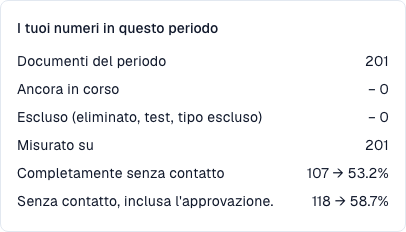

# Metriche e calcolo

### Estrazione corretta e processo senza interventi

**DocBits può estrarre correttamente la fattura mentre i dati di Infor richiedono comunque un intervento.** AP indica il reparto umano di contabilità fornitori, non un assistente IA.

| Domanda | Confronto | Che cosa misura |
| --- | --- | --- |
| DocBits ha letto correttamente? | Originale e valori estratti prima delle correzioni | Qualità dell’estrazione |
| Il processo è terminato senza interventi? | Fattura, dati importati e azioni registrate fino alla conclusione | Automazione del processo |

Verificate prezzo concordato, unità e data di importazione: fattura errata, ordine errato e copia obsoleta richiedono rimedi diversi. Una fase verde o un’elevata confidenza non certificano ogni valore. Un valore già corretto non dimostra l’estrazione iniziale.

## Cosa significa “touchless”

Ogni documento concluso e idoneo appartiene a un solo esito:

| Categoria | Significato | Conta come touchless? |
| --- | --- | --- |
| **Pure Touchless** | Elaborazione riuscita senza interventi umani né approvazione | Sì |
| **AP Touchless** | Elaborazione riuscita; serviva solo l’approvazione aziendale | Sì |
| **AP Assisted**, con intervento AP | Elaborazione riuscita dopo correzione, validazione manuale o riavvio umano | No |
| **Eccezione di processo** | Errore definitivo, rifiuto o rifiuto ERP classificato come eccezione | No |

Documenti in corso o non idonei sono esclusi dal denominatore. Un’eccezione finale prevale sulla classificazione di successo anche dopo un intervento. AP Assisted descrive il lavoro svolto, non la sua causa: l’estrazione può essere corretta.

```
rate = (Pure touchless + AP touchless)
       ÷ (Pure touchless + AP touchless + AP assisted + Process exception)
```

Nella formula AP touchless è la categoria **solo approvazione**; il **tasso AP combinato** comprende Pure e approvazioni. Pure e AP di intestazione si sovrappongono: non sommateli. Gli esiti del fornitore sono invece categorie distinte.

### Calcolo su 200 documenti: esempio illustrativo

| Esito | Documenti |
| --- | --- |
| Pure Touchless | 120 |
| Solo approvazione | 30 |
| AP Assisted | 30 |
| Eccezioni | 10 |
| In corso | 8 |
| Non idonei | 2 |

* Denominatore: 120 + 30 + 30 + 10 = **190**.
* Pure: 120 / 190 = **63,2 %**.
* Solo approvazione: 30 / 190 = **15,8 %**.
* AP combinato: (120 + 30) / 190 = **78,9 %**.

Con un obiettivo del 70 %, AP combinato è sopra l’obiettivo e Pure sotto. Confrontate sempre il tasso specificato.

### Estrazione corretta al 100 %, AP Touchless all’80 %

Supponiamo che un controllo indipendente degli originali e dei valori prima delle correzioni confermi **100 fatture concluse, idonee e correttamente estratte**.

| Che cosa è successo | Fatture | Esito |
| --- | --- | --- |
| Tutto coincide e termina automaticamente | 70 | Pure Touchless |
| Serve solo l’approvazione aziendale | 10 | AP Touchless |
| Estrazione corretta, dati Infor diversi; fonte corretta, import verificato e riavvio manuale in DocBits, poi successo | 20 | AP Assisted |

Qualità di estrazione nel campione: **100 %**; Pure: **70 %**; AP combinato: **80 %**. Il 100 % deriva da una revisione indipendente con ambito definito, non da un ulteriore KPI del pannello. Se mancano i valori iniziali, il caso è non valutabile. Una correzione in Infor senza evento DocBits non è automaticamente un intervento registrato.

**Un intervento resta registrato.** Un riavvio successivo o un’elaborazione automatica non cancellano le correzioni precedenti. Leggere e previsualizzare non costituisce di per sé un intervento; validazione manuale e riavvio umano sì. Una pura approvazione resta distinta.

<figure><figcaption><p>Popolazione attuale di formazione: 201 fatture concluse e idonee, nessuna ancora in corso o esclusa. Le 107 interamente automatiche danno 53,2 %; con 11 sole approvazioni sono 118 e 58,7 %. Questi tassi misurano il processo, non la precisione di estrazione.</p></figcaption></figure>

### Quali azioni AP contano come intervento?

Si presume una conclusione riuscita, compresa la conferma ERP necessaria. Contano azione registrata e autore, non la durata.

| Azione | Effetto |
| --- | --- |
| Aprire, leggere, filtrare, confrontare o previsualizzare | Non costituisce da sola un intervento; Pure Touchless resta possibile |
| Dare solo approvazione aziendale, anche una seconda | AP Touchless se non vi sono altri interventi |
| Correggere e salvare un campo o una cella | AP Assisted; basta una sola correzione |
| Validare manualmente o riavviare elaborazione/esportazione | AP Assisted dopo successo; un’esecuzione automatica successiva non cancella l’intervento |
| Ripresa del sistema o scrittura di un workflow automatico | Non crea da sola un intervento umano; quelli precedenti persistono |
| Correggere soltanto Infor | Non è automaticamente un evento DocBits; documentate il lavoro e l’azione successiva |
| Rifiuto ERP definitivo dopo un intervento | Eccezione di processo, prioritaria rispetto a un esito positivo |

Salvare senza una modifica dimostrata non prova una correzione. Verificate se l’azione ha anche causato validazione manuale o riavvio.

### Un’etichetta AP, due significati

Percentuale e numero della scheda AP attuale combinano Pure e sola approvazione. Nell’esempio di calcolo sono 150 = 120 + 30 documenti e 78,9 %. Nella schermata attuale sono 118 = 107 + 11 fatture e 58,7 %. La categoria di esito distinta, come il gruppo MCP `AP_TOUCHLESS`, conta soltanto le 11 approvazioni. La curva blu attuale mostra il tasso combinato, con la popolazione di ciascun punto. Pure e AP combinato si sovrappongono: non sommateli.

### Aggiornamento dei dati

Gli esiti sono ricalcolati ogni 15 minuti. Leggete **Dati aggiornati al** e attendete il nuovo calcolo dopo un’azione. L’eventuale conferma ERP può arrivare più tardi; un invio non prova da solo la conclusione.

## FAQ

**I tassi mostrano un trattino (—).**
Nessun documento ha raggiunto un esito finale nel periodo, oppure sono stati misurati meno documenti del minimo. I documenti ancora in corso non vengono contati.

**La scheda manca.**
Chiedi al tuo amministratore di abilitare il modulo e di concedere al tuo ruolo la scheda **Dashboard di analisi**.

**Un documento è contato come toccato, ma questa volta è passato senza nessuno.**
È stato toccato in un'elaborazione precedente (una correzione o un riavvio). Il tasso conta il lavoro che è stato svolto.

**Perché il numero cambia dopo qualche ora?**
L'ERP può confermare un'esportazione ore dopo il suo invio. L'esito viene ricalcolato ogni 15 minuti.

**L'IA cambia qualcosa da sola?**
No. L'IA scrive solo spiegazioni. Un'impostazione cambia solo dopo che un amministratore ne ha visto l'anteprima e l'ha applicata.

## Pagine correlate

* [Touchless Intelligence](touchless-intelligence.md)
* [Usare il pannello](touchless-dashboard.md)
* [Esempi: prezzo e quantità](touchless-examples.md)
* [Touchless Intelligence: Diagnosi del fornitore e cluster di problemi](touchless-supplier-diagnosis.md)
* [Touchless Intelligence: Diagnosi dell'abbinamento ordini](touchless-po-matching-diagnosis.md)
* [Touchless Intelligence: Tracciamento del documento](touchless-document-trace.md)
* [Touchless Intelligence: Proposte di modifica e report](touchless-change-proposals.md)
* [Spiegare e migliorare Touchless con MCP](touchless-mcp.md)

<!-- Source notes (not shown): screenshots come from the dev test organisation with synthetic demo data (seed script) and fictional supplier names; the PO matching decision flow has no screenshot yet. facts read from the doc2app code (TouchlessIntelligence pages and components) and the dev UI on 14 Oct 2026; NOVA gates the tab with its own organisation flag, VESTA with the Analytics module. Consulting report export format not verified, so no export is described. -->
<!-- Alignment 2026-11-04: correct extraction is distinct from process Touchless; KPI numerator and denominator verified. -->
<!-- Completion 2026-11-04: localized MCP examples, AP actions, original-value evidence and owned synthetic PO cards. -->
