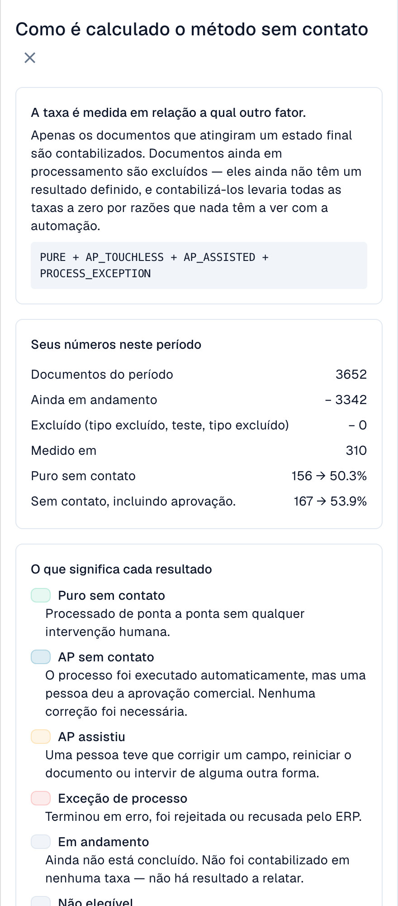

# Métricas e cálculo

### Extração correta e automação são medidas diferentes

**O DocBits pode extrair corretamente a fatura e ainda assim haver trabalho devido a dados divergentes no Infor.** AP é a equipa humana de contas a pagar, não um assistente de IA. Compare o original com os valores anteriores às correções e depois com a cópia importada. Uma etapa verde ou confiança elevada não comprova todos os valores. Valores já corrigidos não comprovam a extração inicial.

## O que significa “touchless”

Cada documento concluído e elegível tem um único resultado:

| Categoria | Significado | Conta como touchless? |
| --- | --- | --- |
| **Pure Touchless** | Sucesso sem intervenção humana nem aprovação | Sim |
| **AP Touchless** | Sucesso; foi necessária apenas aprovação de negócio | Sim |
| **AP Assisted**, com intervenção AP | Sucesso após correção, validação manual ou reinício humano | Não |
| **Exceção de processo** | Erro definitivo, rejeição ou recusa do ERP classificada como exceção | Não |

Documentos em curso e excluídos ficam fora do denominador. Uma exceção final prevalece sobre categorias de sucesso. AP Assisted descreve o trabalho realizado, não a sua causa: a extração pode estar correta.

```
rate = (Pure touchless + AP touchless)
       ÷ (Pure touchless + AP touchless + AP assisted + Process exception)
```

AP touchless na fórmula é **apenas aprovação**. A **taxa AP combinada** inclui Pure e aprovação. Pure e a taxa AP do cabeçalho sobrepõem-se; não some as percentagens. Os resultados do fornecedor são categorias distintas.

### Cálculo ilustrativo com 200 documentos

| Resultado | Documentos |
| --- | --- |
| Pure | 120 |
| Apenas aprovação | 30 |
| AP Assisted | 30 |
| Exceções | 10 |
| Em curso | 8 |
| Excluídos | 2 |

Denominador: **190**. Pure: 120 / 190 = **63,2 %**. Apenas aprovação: 30 / 190 = **15,8 %**. AP combinado: (120 + 30) / 190 = **78,9 %**. Com meta de 70 %, AP está acima e Pure abaixo. Compare sempre a taxa indicada.

### Extração 100 % correta, AP Touchless 80 %

Suponha uma revisão independente dos originais e valores antes de correções: **100 faturas concluídas, elegíveis e corretamente extraídas**. 70 terminam automaticamente (Pure), 10 exigem apenas aprovação (AP Touchless), 20 têm dados Infor diferentes. Após confirmação corrigem-se a origem, verifica-se a importação e reinicia-se manualmente o DocBits; terminam com sucesso (AP Assisted).

Qualidade de extração na amostra: **100 %**; Pure: **70 %**; AP combinado: **80 %**. Os 100 % vêm de revisão independente com âmbito definido, não de outro KPI do painel. Sem valores iniciais, o caso não é avaliável. Uma correção apenas no Infor não é automaticamente um evento DocBits.

**A intervenção permanece registada.** Uma execução automática posterior não apaga correções ou reinícios humanos. Ler e pré-visualizar não são, por si só, intervenções; validação manual e reinício humano são. A aprovação permanece distinta.

<figure><figcaption><p>Cálculo na interface portuguesa real. A taxa AP combina Pure e apenas aprovação entre documentos concluídos elegíveis. Mede o processo, não a precisão de extração; os dados da captura não são a população ilustrativa de 200 documentos.</p></figcaption></figure>

### Que ações AP contam como intervenção?

A classificação pressupõe conclusão bem-sucedida e confirmação ERP exigida. Contam o evento e o autor, não a duração.

| Ação | Efeito |
| --- | --- |
| Ler, filtrar, comparar ou pré-visualizar | Por si só não exclui Pure |
| Apenas aprovação de negócio, mesmo uma segunda | AP Touchless sem outras intervenções |
| Corrigir e guardar campo ou célula | AP Assisted; uma correção basta |
| Validar manualmente ou reiniciar processamento/exportação | AP Assisted após sucesso; execução automática posterior não apaga a ação |
| Repetição automática ou workflow | Não cria por si só intervenção humana; anteriores permanecem |
| Corrigir apenas no Infor | Não é automaticamente evento DocBits; registe o trabalho e verifique o passo seguinte |
| Recusa definitiva do ERP | Exceção prevalece sobre sucesso |

Guardar sem alteração demonstrada não comprova correção; verifique também validação manual e reinício.

### Dois significados de AP

A **percentagem AP no cabeçalho** combina Pure e apenas aprovação: 150 / 190 = 78,9 %. O **número abaixo** conta só as 30 aprovações. A categoria do fornecedor e a linha azul AP do gráfico documentado mostram apenas aprovação: 15,8 %. Não some Pure e AP combinado, que se sobrepõem.

### Atualidade dos dados

Os resultados são recalculados a cada 15 minutos. Consulte a data dos dados e aguarde o novo cálculo. A confirmação ERP pode chegar depois; o envio, por si só, não comprova conclusão.

## FAQ

**As taxas mostram um traço (—).**
Nenhum documento chegou a um resultado final no período, ou foram medidos menos documentos do que o mínimo. Documentos que ainda estão em andamento não são contados.

**A aba não aparece.**
Peça ao seu administrador para habilitar o módulo e conceder à sua função a aba **Analytics dashboard**.

**Um documento é contado como tocado, mas desta vez ele passou sem ninguém.**
Ele foi tocado em uma execução anterior (uma correção ou uma reinicialização). A taxa conta o trabalho que aconteceu.

**Por que o número muda depois de algumas horas?**
O ERP pode confirmar uma exportação horas depois de ela ser enviada. O resultado é recalculado a cada 15 minutos.

**A IA altera algo por conta própria?**
Não. A IA escreve apenas explicações. Uma configuração só muda depois que um administrador a pré-visualiza e a aplica.

## Páginas relacionadas

* [Touchless Intelligence](touchless-intelligence.md)
* [Usar o painel](touchless-dashboard.md)
* [Exemplos: preço e quantidade](touchless-examples.md)
* [Touchless Intelligence: diagnóstico de fornecedores e clusters de problemas](touchless-supplier-diagnosis.md)
* [Touchless Intelligence: diagnóstico de PO Matching](touchless-po-matching-diagnosis.md)
* [Touchless Intelligence: Rastreamento do documento](touchless-document-trace.md)
* [Touchless Intelligence: propostas de alteração e relatórios](touchless-change-proposals.md)
* [Explicar e melhorar Touchless com MCP](touchless-mcp.md)

<!-- Source notes (not shown): screenshots come from the dev test organisation with synthetic demo data (seed script) and fictional supplier names; the PO matching decision flow has no screenshot yet. facts read from the doc2app code (TouchlessIntelligence pages and components) and the dev UI on 14 Oct 2026; NOVA gates the tab with its own organisation flag, VESTA with the Analytics module. Consulting report export format not verified, so no export is described.

<!-- Alignment 2026-11-04: correct extraction is distinct from process Touchless; KPI numerator and denominator verified. -->
<!-- Completion 2026-11-04: localized MCP examples, AP actions, original-value evidence and owned synthetic PO cards. -->
