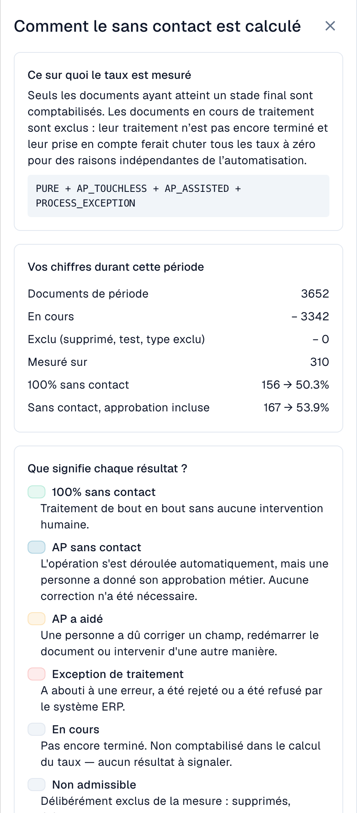

# Indicateurs et calcul

### Extraction correcte et traitement sans intervention

**DocBits peut extraire correctement toutes les valeurs alors qu’une intervention reste nécessaire parce que les données du système source diffèrent.** AP désigne Accounts Payable, la comptabilité fournisseurs.

| Question | Comparaison | Ce que l’on mesure |
| --- | --- | --- |
| DocBits a-t-il correctement lu la facture ? | Original et champs ou lignes extraits, avant toute correction manuelle | Qualité d’extraction |
| Le processus a-t-il abouti sans intervention ? | Facture correctement extraite, commande et données de référence importées d’Infor ERP, historique du traitement | Automatisation du processus |

Un écart ne prouve pas quelle donnée est erronée. Vérifiez l’original, les conditions convenues et la copie effectivement importée : commande incorrecte, import périmé et facture différente nécessitent des actions distinctes. Une étape d’extraction réussie ou une confiance élevée ne certifie pas l’exactitude de chaque valeur.

## Ce que « touchless » signifie

Chaque document se termine par exactement **un** résultat :

| Résultat | Signification | Compte dans le taux |
| --- | --- | --- |
| **Touchless pur** (Pure touchless) | Traité de l'importation à l'exportation **sans aucune intervention humaine** | Oui, comme un succès |
| **Touchless AP** (AP touchless) | Traité automatiquement, et une personne a seulement donné l'**approbation métier**. Aucune correction n'a été nécessaire | Oui, comme un succès |
| **AP assisté** (AP assisted) | Une personne a dû **corriger un champ, redémarrer le document** ou intervenir d'une autre manière | Oui, comme un échec. Ce n'est pas une défaillance, seulement une automatisation qui n'a pas mené le document jusqu'au bout |
| **Exception de processus** | S'est terminé par une **erreur**, a été **rejeté**, a été **refusé par l'ERP** ou s'est **bloqué** dans le pipeline | Oui, comme un échec |
| **En cours** (In progress) | Pas encore terminé | **Non**. Il n'a pas encore de résultat |
| **Non éligible** (Not eligible) | Supprimé, archivé, document de test ou type de document exclu | **Non** |

Le **taux touchless** est :

```
rate = (Pure touchless + AP touchless)
       ÷ (Pure touchless + AP touchless + AP assisted + Process exception)
```

Dans cette formule, **AP touchless** est la catégorie « approbation seule ». Le pourcentage **AP Touchless** en tête de page combine **Pure + approbation seule**. N’additionnez pas les deux pourcentages affichés : ils se recouvrent. Les tuiles de résultats du fournisseur comptent des catégories distinctes. Le taux mesure le processus, pas la précision d’extraction.

Les documents encore **en cours** ou **non éligibles** n'entrent jamais dans le calcul. Cela protège le taux : un document arrivé il y a cinq minutes ne peut pas le faire baisser.


**Une intervention compte définitivement.** Dès qu'une personne a touché un document, il reste compté comme traité manuellement, même si un traitement automatique ultérieur n'aurait eu besoin de personne. **Redémarrer un document ne le rend pas à nouveau touchless.** Le taux reflète le travail qui a eu lieu.


### Exemple de calcul (chiffres à titre d'illustration)

En 30 jours, 200 documents sont arrivés :

| Résultat | Documents |
| --- | --- |
| Touchless pur | 120 |
| Touchless AP | 30 |
| AP assisté | 30 |
| Exception de processus | 10 |
| En cours | 8 |
| Non éligible (documents de test) | 2 |

* Dénominateur : 120 + 30 + 30 + 10 = **190** ; les 8 documents en cours et les 2 non éligibles sont exclus.
* **Pure Touchless :** 120 ÷ 190 = **63,2 %**.
* **Approbation seule :** 30 ÷ 190 = **15,8 %**, la part de cette catégorie.
* **Taux AP Touchless :** (120 + 30) ÷ 190 = **78,9 %**.

Avec un objectif de 70 %, le taux AP combiné est au-dessus et le taux Pure en dessous. Comparez l’objectif au taux nommé par la carte ou le graphique.

Cliquez sur **Comment le touchless est calculé** (How touchless is calculated) en haut à droite pour ouvrir cette explication dans DocBits, avec les chiffres de votre propre période (documents de la période, encore en cours, exclus, mesurés).

<figure><figcaption><p>Méthode de calcul dans l’interface française : seuls les documents avec résultat final sont comptés. Le taux AP regroupe les documents entièrement automatiques et ceux nécessitant seulement une approbation. Il décrit le processus, pas la précision d’extraction ; données de démonstration.</p></figcaption></figure>

### Exemple : extraction correcte à 100 %, taux AP Touchless de 80 %

Supposons que la comparaison des originaux et des valeurs avant correction confirme que les **100 factures terminées et éligibles ont été correctement extraites**.

| Ce qui s’est passé | Factures | Catégorie |
| --- | --- | --- |
| Facture et données source concordent ; tout aboutit automatiquement | 70 | Pure Touchless |
| Les données concordent ; seule une approbation métier est nécessaire | 10 | AP Touchless, approbation seule |
| Extraction correcte, mais données importées d’Infor différentes ; AP clarifie, fait corriger la source et relance manuellement dans DocBits ; le traitement aboutit | 20 | AP Assisted |

* **Extraction correcte dans cet échantillon contrôlé :** 100 ÷ 100 = **100 %**.
* **Pure Touchless :** 70 ÷ 100 = **70 %**.
* **AP Touchless :** (70 + 10) ÷ 100 = **80 %**.

Le chiffre d’extraction provient d’un **contrôle indépendant des pièces**, pas d’un indicateur supplémentaire du tableau de bord. Il ne se déduit pas des seules catégories touchless.

### Exemples d’interventions et de causes

Ces cas sont illustratifs et ne sont pas les documents des captures. Un traitement réussi inclut la confirmation ERP lorsqu’elle est requise.

| Cas | Facture / extraction / source | Action et résultat |
| --- | --- | --- |
| Erreur d’extraction | Commande `45001234` / lecture `45001284` / commande correcte dans Infor | AP corrige ; après réussite : **AP Assisted** |
| Écart de données source | Prix 10,00 € / extraction correcte 10,00 € / commande importée 9,00 €, hors tolérance | Confirmer le prix convenu, corriger la commande, vérifier l’import puis relancer manuellement : **AP Assisted** |
| Import tardif | Commande présente dans Infor, pas encore dans DocBits | Si l’import et la reprise automatiques aboutissent sans intervention ni approbation, **Pure Touchless** reste possible ; une relance manuelle suivie de réussite donne **AP Assisted** |
| Refus ERP | Extraction correcte, export refusé par l’ERP | **Exception de processus** tant que le cas est classé comme refus ERP définitif |

Même une petite correction ou relance enregistrée compte. AP Assisted désigne une aide humaine de la comptabilité fournisseurs, pas un assistant IA. Le travail effectué seulement dans Infor, sans événement correspondant dans DocBits, ne doit pas être supposé automatiquement comptabilisé ; consignez-le aussi dans le diagnostic.

### Quelles actions AP constituent une intervention ?

Le tableau suppose un traitement réussi, avec la confirmation ERP requise. L’action enregistrée et son auteur comptent, pas sa durée.

| Action | Effet |
| --- | --- |
| Ouvrir, lire, filtrer, comparer ou prévisualiser | Ne constitue pas à elle seule une intervention ; Pure Touchless reste possible |
| Donner uniquement une approbation métier, même une seconde | AP Touchless en l’absence d’autre intervention |
| Corriger et enregistrer un champ ou une cellule | AP Assisted ; une seule correction compte |
| Valider manuellement ou relancer le traitement/l’export | AP Assisted après réussite ; une exécution automatique ultérieure n’efface pas l’intervention |
| Reprise système ou écriture par un workflow automatique | Ne crée pas à elle seule une intervention humaine ; les interventions précédentes restent enregistrées |
| Corriger uniquement dans Infor | N’est pas automatiquement un événement DocBits ; consigner ce travail et vérifier l’action suivante |
| Refus définitif de l’ERP après intervention | Exception de processus, prioritaire sur une classification de réussite |

Un clic sur Enregistrer sans changement démontré ne prouve pas une correction. Vérifiez s’il a également déclenché une validation manuelle ou une relance.

### Une étiquette AP, deux significations

Le **pourcentage AP en tête** combine Pure et approbation seule : (120 + 30) / 190 = 78,9 %. Le **nombre dessous** compte seulement les 30 approbations. Les tuiles fournisseur et la ligne bleue AP du graphique documenté représentent la catégorie distincte « approbation seule », soit 15,8 %. Les pourcentages Pure et AP combiné se recouvrent : ne les additionnez pas.

### Quelle est l'actualité des chiffres

Les résultats sont **recalculés toutes les 15 minutes**. Le résultat d'un document peut encore changer après son apparition : l'ERP peut confirmer une exportation plusieurs heures plus tard. La ligne **Données au …** (Data as of …) en bas de l'onglet indique quand les chiffres ont été calculés pour la dernière fois.

## FAQ

**Les taux affichent un tiret (—).**
Aucun document n'a atteint un résultat final sur la période, ou moins de documents que le minimum ont été mesurés. Les documents encore en cours ne sont pas comptés.

**L'onglet est absent.**
Demandez à votre administrateur d'activer le module et d'accorder à votre rôle l'onglet **Tableau de bord analytique**.

**Un document est compté comme traité manuellement, mais cette fois il est passé sans personne.**
Il a été touché lors d'un traitement précédent (une correction ou un redémarrage). Le taux compte le travail qui a eu lieu.

**Pourquoi le chiffre change-t-il après quelques heures ?**
L'ERP peut confirmer une exportation plusieurs heures après son envoi. Le résultat est recalculé toutes les 15 minutes.

**L'IA modifie-t-elle quelque chose toute seule ?**
Non. L'IA rédige uniquement des explications. Un paramètre ne change qu'après qu'un administrateur l'a prévisualisé et appliqué.

## Pages associées

* [Touchless Intelligence](touchless-intelligence.md)
* [Utiliser le tableau de bord](touchless-dashboard.md)
* [Exemples : prix et quantité](touchless-examples.md)
* [Touchless Intelligence : Diagnostic fournisseur et clusters de problèmes](touchless-supplier-diagnosis.md)
* [Touchless Intelligence : Diagnostic du rapprochement avec le BC](touchless-po-matching-diagnosis.md)
* [Touchless Intelligence : Trace du document](touchless-document-trace.md)
* [Touchless Intelligence : Propositions de modification et rapports](touchless-change-proposals.md)
* [Expliquer et améliorer Touchless avec MCP](touchless-mcp.md)

<!-- Source notes (not shown): screenshots come from the dev test organisation with synthetic demo data (seed script) and fictional supplier names; the PO matching decision flow has no screenshot yet. facts read from the doc2app code (TouchlessIntelligence pages and components) and the dev UI on 14 Oct 2026; NOVA gates the tab with its own organisation flag, VESTA with the Analytics module. Consulting report export format not verified, so no export is described.

<!-- Touchless documentation alignment 2026-11-04: extraction quality is distinct from process automation. KPI definition checked against DocBits_API c51f350c728acb8ac964098d15f7b006bce273f4; existing native screenshots and video sources preserved except unsafe historical list images. -->
<!-- Completion 2026-11-04: localized MCP examples, AP actions, original-value evidence and owned synthetic PO cards. -->
