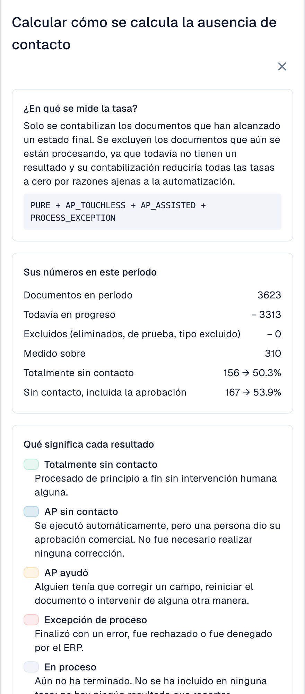

# Métricas y cálculo

### Extracción correcta y proceso sin intervención

**DocBits puede extraer correctamente todos los valores y, aun así, la factura puede necesitar una intervención porque los datos del sistema de origen difieren.** AP significa Accounts Payable, el equipo de cuentas por pagar.

| Pregunta | Qué comparar | Qué demuestra |
| --- | --- | --- |
| ¿DocBits leyó correctamente la factura? | Factura original frente a campos y posiciones extraídos, antes de cualquier corrección manual | Calidad de extracción |
| ¿El proceso terminó sin intervención? | Factura correctamente extraída frente a pedido y datos maestros importados de Infor ERP, junto con el historial | Automatización del proceso |

Una diferencia no demuestra por sí sola qué dato es incorrecto. Compruebe la factura, el precio acordado y la copia realmente importada. El pedido puede ser incorrecto, la importación estar desactualizada o la factura del proveedor diferir de lo acordado. Un paso de extracción aprobado o una confianza alta tampoco certifican que todos los valores sean correctos.

Las capturas conservan la interfaz española real. La etiqueta «AP ayudó» corresponde a AP Assisted; algunos nombres de etapas de coincidencia siguen en inglés. Las explicaciones de esta página distinguen esos textos del producto de los términos de negocio.

## Qué significa "touchless"

Cada documento finalizado y elegible pertenece a una sola categoría:

| Categoría | Significado | ¿Cuenta como touchless? |
| --- | --- | --- |
| **Pure Touchless** | Procesado con éxito, sin intervención humana ni aprobación | Sí |
| **AP Touchless** | Procesado con éxito; solo necesitó aprobación de negocio | Sí |
| **AP Assisted**, con intervención de AP | Procesado con éxito, pero alguien corrigió, validó manualmente o reinició | No |
| **Excepción de proceso** | Por ejemplo, rechazo, error definitivo, rechazo del ERP o estancamiento clasificado como excepción | No |

La validación manual aquí significa una intervención registrada; una mera aprobación sigue siendo AP Touchless. **AP Assisted describe la intervención, no su causa:** la extracción puede ser correcta y los datos de Infor diferentes. Los documentos aún en proceso o no elegibles quedan fuera del denominador.

La **tasa touchless** es:

```
rate = (Pure touchless + AP touchless)
       ÷ (Pure touchless + AP touchless + AP assisted + Process exception)
```

En esta fórmula, **AP touchless** es la categoría «solo aprobación». El porcentaje **AP Touchless** de la cabecera combina **Pure + solo aprobación**. No sume los dos porcentajes de la cabecera: se solapan. Las tarjetas de resultados del proveedor cuentan categorías separadas. La tasa mide el proceso, no la precisión de extracción.

Los documentos que siguen **in progress** o que son **not eligible** nunca entran en el cálculo. Esto protege la tasa: un documento que llegó hace cinco minutos no puede bajarla.


**Un toque cuenta para siempre.** Cuando una persona ha tocado un documento, este sigue contando como tocado, aunque una ejecución automática posterior no hubiera necesitado a nadie. **Reiniciar un documento no lo vuelve touchless.** La tasa refleja el trabajo que se realizó.


### Ejemplo de cálculo (cifras ilustrativas)

En 30 días llegaron 200 documentos:

| Resultado | Documentos |
| --- | --- |
| Pure touchless | 120 |
| AP touchless | 30 |
| AP assisted | 30 |
| Process exception | 10 |
| In progress | 8 |
| Not eligible (documentos de prueba) | 2 |

* Denominador: 120 + 30 + 30 + 10 = **190**; se excluyen 8 documentos en proceso y 2 no elegibles.
* **Pure Touchless:** 120 ÷ 190 = **63,2 %**.
* **Solo aprobación:** 30 ÷ 190 = **15,8 %**, el peso de esa categoría.
* **Tasa AP Touchless:** (120 + 30) ÷ 190 = **78,9 %**.

Con un objetivo del 70 %, la tasa AP combinada está por encima y la tasa Pure por debajo. Compare siempre el objetivo con la tasa indicada.

Haga clic en **How touchless is calculated**, arriba a la derecha, para abrir esta explicación dentro de DocBits, con las cifras de su propio período (documentos en el período, aún in progress, excluidos, medidos).

<figure><figcaption><p>Método de cálculo en la interfaz española: solo entran documentos con resultado final. La tasa AP combina los documentos completamente automáticos y los que solo necesitaron aprobación. Estos números describen el proceso, no la exactitud de extracción; son datos del entorno de demostración.</p></figcaption></figure>

### Ejemplo: 100 % de extracción correcta, 80 % de AP Touchless

Supongamos que la revisión de originales y valores previos a las correcciones confirma que las **100 facturas finalizadas y elegibles se extrajeron correctamente**.

| Qué ocurrió | Facturas | Categoría |
| --- | --- | --- |
| Factura y datos de origen coinciden; todo termina automáticamente | 70 | Pure Touchless |
| Los datos coinciden; solo se necesita aprobación de negocio | 10 | AP Touchless, solo aprobación |
| La extracción es correcta, pero los datos importados de Infor difieren; AP aclara el caso y reinicia manualmente en DocBits tras corregir el origen; la factura termina con éxito | 20 | AP Assisted |

* **Extracción correcta en la muestra revisada:** 100 ÷ 100 = **100 %**.
* **Pure Touchless:** 70 ÷ 100 = **70 %**.
* **AP Touchless:** (70 + 10) ÷ 100 = **80 %**.

El 100 % corresponde a una **revisión independiente de los documentos**, no a otro indicador de este panel. No puede deducirse de las categorías touchless.

### Ejemplos de intervenciones y causas

Estos casos son ilustrativos y no son los documentos de las capturas. El éxito incluye la confirmación del ERP cuando sea necesaria.

| Caso | Factura / extracción / origen | Acción y resultado |
| --- | --- | --- |
| Error de extracción | OC `45001234` / DocBits lee `45001284` / Infor contiene la OC correcta | AP corrige el número; tras finalizar con éxito: **AP Assisted** |
| Datos de origen diferentes | Precio 10,00 € / extracción correcta de 10,00 € / pedido importado de 9,00 €, fuera de tolerancia | Se confirma el precio acordado, se corrige el pedido, se verifica la importación y AP reinicia manualmente: **AP Assisted** |
| Importación tardía | La OC existe en Infor, pero todavía no ha llegado a DocBits | Si importación y reintento posteriores terminan sin intervención ni aprobación, puede resultar **Pure Touchless**; un reinicio manual seguido de éxito da **AP Assisted** |
| Rechazo del ERP | Extracción correcta, pero el ERP rechaza la exportación | **Excepción de proceso** mientras se clasifique como rechazo definitivo del ERP |

Incluso una pequeña corrección o un reinicio registrado cuenta. AP Assisted significa asistencia humana de cuentas por pagar, no un asistente de IA. El trabajo realizado solo en Infor, sin un evento correspondiente en DocBits, no debe suponerse incluido automáticamente en la medición; documéntelo también en el diagnóstico.

### Qué acciones de AP cuentan como intervención

Se presupone una finalización correcta, incluida la confirmación ERP necesaria. Importan la acción registrada y su autor, no su duración.

| Acción | Efecto |
| --- | --- |
| Abrir, leer, filtrar, comparar o previsualizar | No constituye por sí sola una intervención; Pure Touchless sigue siendo posible |
| Solo aprobar, incluso en una segunda aprobación | AP Touchless si no hubo otra intervención |
| Corregir y guardar un campo o una celda | AP Assisted; una sola corrección cuenta |
| Validar manualmente o reiniciar procesamiento/exportación | AP Assisted tras finalizar correctamente; un proceso automático posterior no borra la intervención |
| Reintento del sistema o escritura de un flujo automático | No crea por sí solo una intervención humana; las anteriores se conservan |
| Corregir únicamente en Infor | No se registra automáticamente como acción DocBits; documente esa tarea y compruebe la acción posterior |
| Rechazo definitivo del ERP tras una intervención | Excepción de proceso; tiene prioridad sobre una clasificación de éxito |

Un clic en Guardar sin cambio demostrado no acredita una corrección. Compruebe si también causó validación manual o reinicio.

### Una etiqueta AP, dos lecturas

El **porcentaje AP de cabecera** combina Pure y solo aprobación: (120 + 30) / 190 = 78,9 %. El **número debajo** cuenta únicamente las 30 aprobaciones. Las tarjetas de proveedor y la línea azul AP del gráfico documentado muestran la categoría separada de solo aprobación: 15,8 %. No sume los porcentajes Pure y AP de cabecera: se solapan.

### Cuán actuales son las cifras

Los resultados se **recalculan cada 15 minutos**. El resultado de un documento aún puede cambiar después de aparecer por primera vez: el ERP puede confirmar una exportación horas más tarde. La línea **Data as of …** de la parte inferior de la pestaña muestra cuándo se calcularon las cifras por última vez.

## Preguntas frecuentes

**Las tasas muestran un guion (—).**
Ningún documento ha alcanzado un resultado final en el período, o se midieron menos documentos que el mínimo. Los documentos que siguen in progress no se cuentan.

**Falta la pestaña.**
Pida a su administrador que habilite el módulo y que conceda a su rol la pestaña **Analytics dashboard**.

**Un documento cuenta como tocado, pero esta vez se procesó sin nadie.**
Fue tocado en una ejecución anterior (una corrección o un reinicio). La tasa cuenta el trabajo que se realizó.

**¿Por qué cambia la cifra después de unas horas?**
El ERP puede confirmar una exportación horas después de enviarla. El resultado se recalcula cada 15 minutos.

**¿Cambia la IA algo por sí sola?**
No. La IA solo escribe explicaciones. Un ajuste solo cambia después de que un administrador lo previsualice y lo aplique.

## Páginas relacionadas

* [Touchless Intelligence](touchless-intelligence.md)
* [Usar el panel](touchless-dashboard.md)
* [Ejemplos: precio y cantidad](touchless-examples.md)
* [Touchless Intelligence: Diagnóstico de proveedores y clústeres de problemas](touchless-supplier-diagnosis.md)
* [Touchless Intelligence: Diagnóstico de la coincidencia con la OC](touchless-po-matching-diagnosis.md)
* [Touchless Intelligence: Seguimiento del documento](touchless-document-trace.md)
* [Touchless Intelligence: Propuestas de cambio e informes](touchless-change-proposals.md)
* [Explicar y mejorar Touchless con MCP](touchless-mcp.md)

<!-- Source notes (not shown): screenshots come from the dev test organisation with synthetic demo data (seed script) and fictional supplier names; the PO matching decision flow has no screenshot yet. facts read from the doc2app code (TouchlessIntelligence pages and components) and the dev UI on 14 Oct 2026; NOVA gates the tab with its own organisation flag, VESTA with the Analytics module. Consulting report export format not verified, so no export is described.
-->
<!-- Touchless documentation alignment 2026-11-04: extraction quality is distinct from process automation. KPI definition checked against DocBits_API c51f350c728acb8ac964098d15f7b006bce273f4; existing native screenshots and video sources preserved except unsafe historical list images. -->
<!-- Completion 2026-11-04: localized MCP examples, AP actions, original-value evidence and owned synthetic PO cards. -->
