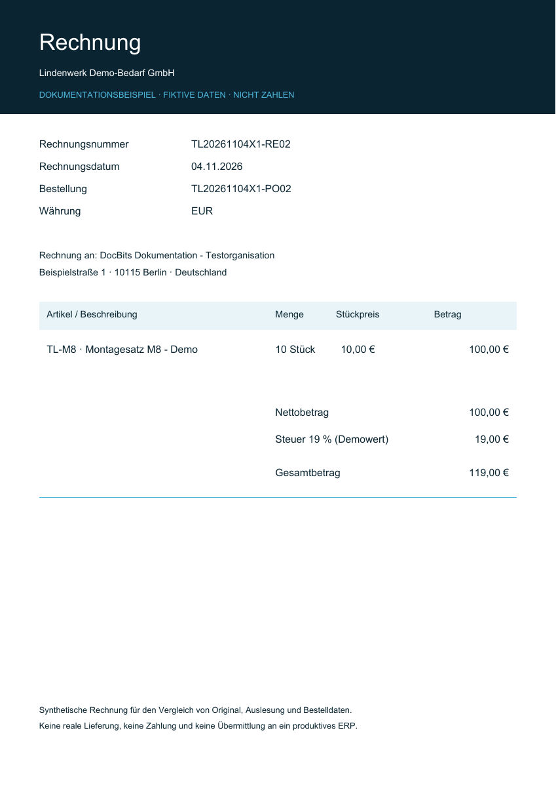
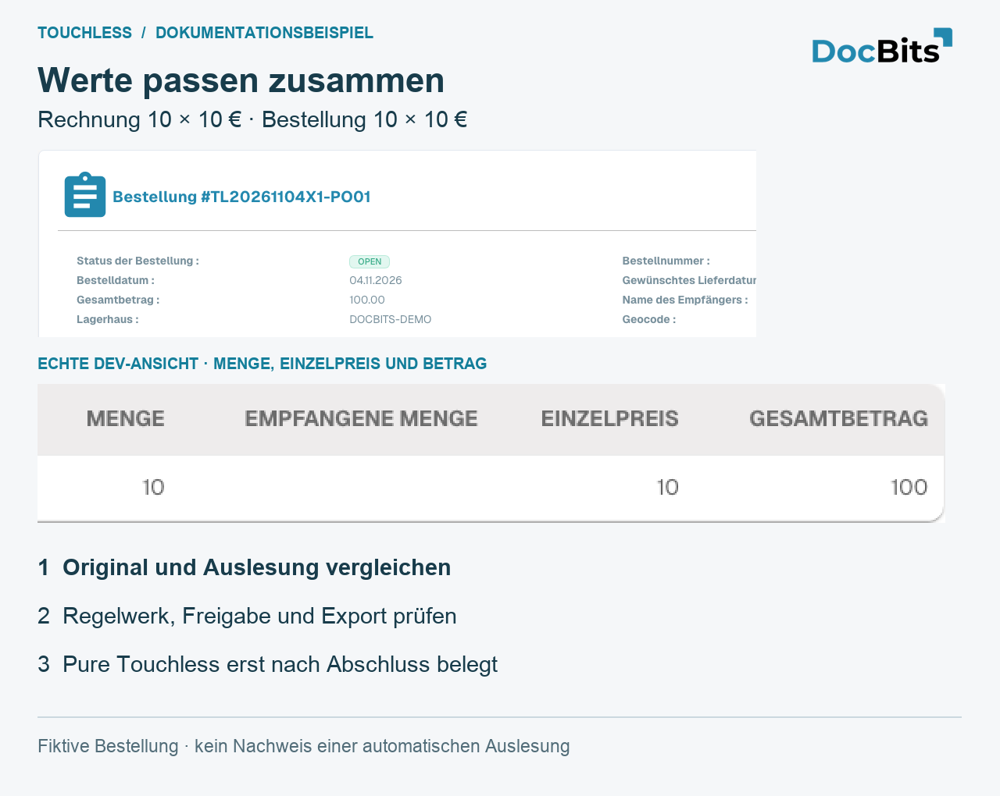
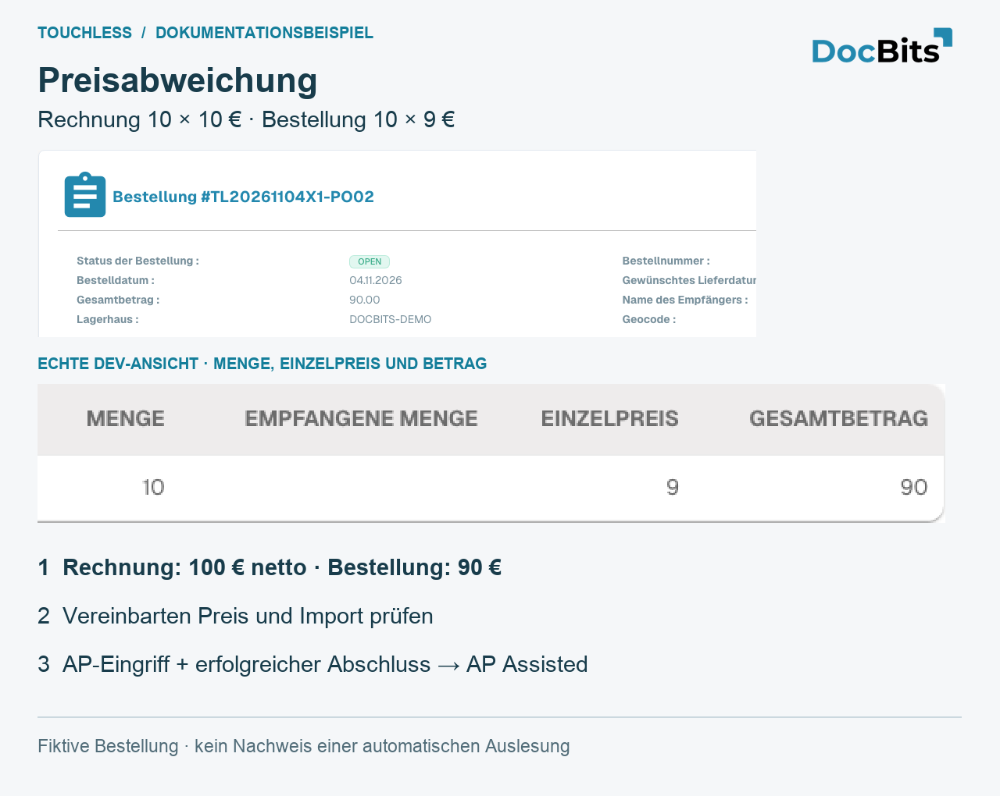
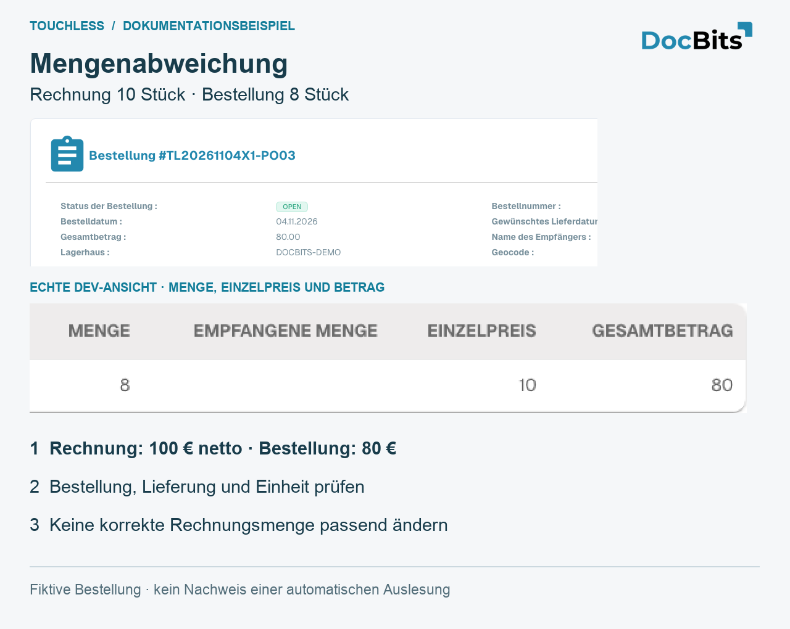
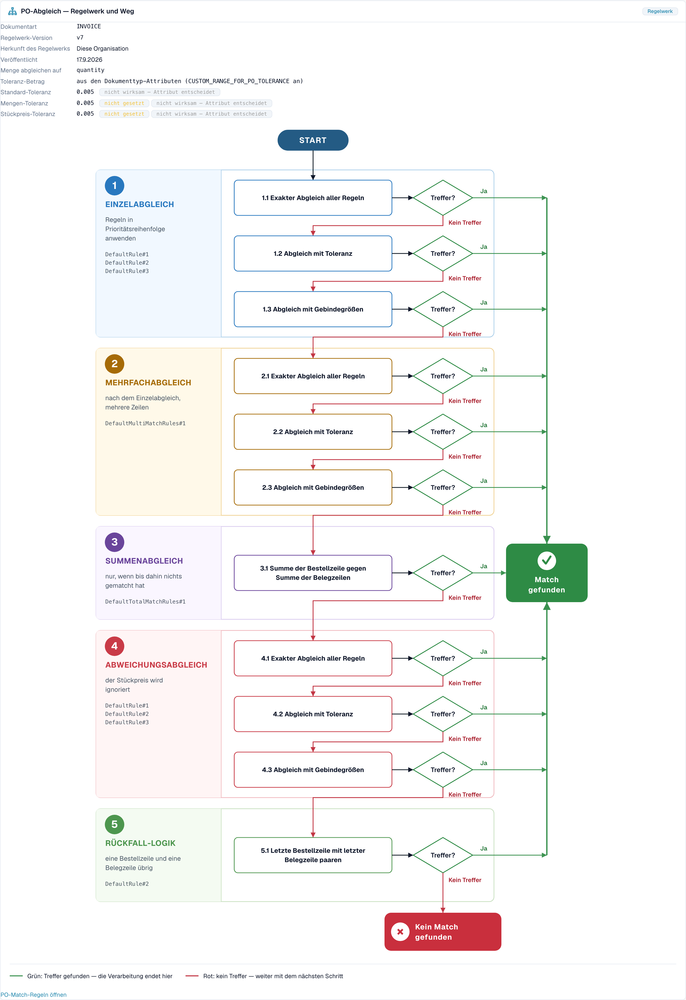

# Touchless Intelligence: Bestellabgleich-Diagnose

## Übersicht

Viele Rechnungen bleiben bei der Bestellung stehen. Die Rechnung sagt das eine, die Bestellung (PO) etwas anderes, und die konfigurierten Prüfungen können den Unterschied nicht automatisch auflösen. **Eine korrekte Auslesung kann bei abweichenden Quelldaten trotzdem zu einem blockierten Bestellabgleich führen.** Ein vorübergehender Stopp ist noch kein Endergebnis: Eine spätere automatische Verarbeitung kann erfolgreich sein; eine aufgezeichnete manuelle Korrektur oder ein Neustart verhindert bei erfolgreichem Abschluss die Touchless-Einordnung.

Touchless Intelligence zeigt Ihnen, **warum** ein Bestellabgleich gescheitert ist und **wie** DocBits abgleichen wollte. Diese Seite erklärt die beiden beteiligten Pipeline-Schritte, die Gründe, die Sie sehen werden, und den **Entscheidungsablauf des Bestellabgleichs**, ein Diagramm, das die Abgleichschritte nacheinander zeigt.

### Wo Sie den Bestellabgleich in Touchless Intelligence sehen

| Wo | Was Sie sehen |
| --- | --- |
| **Wo Touchless zuerst verloren geht** (Übersichts-Tab) | Ein Balken wie *Bestellpositionsabgleich: PO-Positionsabweichung*. Er zeigt, wie viele Dokumente dort stehen geblieben sind |
| **Lieferantenpotenziale** | Ein Lieferant mit der Grundursache **Bestellabgleich** |
| **Lieferantendiagnose**, Abschnitt **Wie diese Organisation abgleicht** und das **Fehlermuster** | Der Entscheidungsablauf mit dem Regelsatz Ihrer Organisation |
| **Dokumentverlauf** | Der Schritt **Bestellpositionsabgleich** mit dem Status **blockiert** und dem Grund |
| **Einstellungen → Dokumenttypen → Weitere Einstellungen → Bestellung** | Die Abgleichregeln selbst. Siehe [Purchase Order Matching Rules](settings/global-settings/document-types/more-settings/purchase-order/purchase-order-matching-rules.md) |

## Die zwei Bestellschritte

| Schritt | Frage | Stoppt mit |
| --- | --- | --- |
| **9 · Bestellsuche** | Gibt es eine Bestellung zu dieser Rechnung? | *Bestellung nicht gefunden* |
| **10 · Bestellpositionsabgleich** | Passt jede Rechnungsposition zu einer Bestellposition? | *PO-Positionsabweichung*, *PO-Positionskennung abweichend*, *Stückpreis außerhalb der Bestell-Toleranz*, *Menge außerhalb der Bestell-Toleranz* |

Ein Dokument, das bei Schritt 9 oder 10 stehen bleibt, erscheint in der Lieferanten-Warteschlange mit dem ersten Blocker **Bestellabgleich**.

## Gründe, warum ein Bestellabgleich scheitert

| Grund, den Sie sehen | Was er bedeutet | Typische Ursache | Was zu ändern ist |
| --- | --- | --- | --- |
| **Bestellung nicht gefunden** | DocBits hat zur Bestellnummer auf der Rechnung keine Bestellung gefunden | Die Bestellnummer wird falsch gelesen oder fehlt; die Bestellung wurde noch nicht importiert; die Bestellung gehört zu einem anderen Lieferanten | Prüfen Sie die Extraktion der Bestellnummer für diesen Lieferanten, den Import der Bestellstammdaten und die Verknüpfung mit dem Lieferanten |
| **PO-Positionsabweichung** | Die Rechnungspositionen passten nicht zu den Bestellpositionen | Der Lieferant verwendet eigene Artikelnummern; die Beschreibung weicht ab; Positionen wurden zusammengeführt oder aufgeteilt | Prüfen Sie die Zuordnung der Artikelnummern und die **Regelprioritäten** in den Abgleichregeln; fügen Sie eine Regel für die Art hinzu, wie der Lieferant Positionen kennzeichnet |
| **PO-Positionskennung abweichend** | Die Positionsnummer oder Kennung auf der Rechnung passt nicht zur Bestellung | Der Lieferant nummeriert Positionen neu | Gleichen Sie nach Artikel und Menge statt nach Positionsnummer ab |
| **Stückpreis außerhalb der Bestell-Toleranz** | Der Preis weicht stärker ab als die erlaubte Toleranz | Eine echte Preisänderung, eine Rundungsdifferenz oder eine andere Preiseinheit | Prüfen Sie die **Toleranz Stückpreis** (Unit price tolerance) im Regelsatz; korrigieren Sie die Bestellung oder fragen Sie den Lieferanten |
| **Menge außerhalb der Bestell-Toleranz** | Die Menge weicht stärker ab als die erlaubte Toleranz | Teillieferung, Überlieferung | Prüfen Sie **Menge abgleichen auf** (Match quantity on) und die **Toleranz Menge** (Quantity tolerance) |
| **Fehler im Bestellabgleich-Dienst** | Der Abgleichdienst konnte nicht antworten | Ein vorübergehendes technisches Problem | Starten Sie die Dokumente neu; wenden Sie sich an den Support, wenn es wieder auftritt |
| **Automatischer Bestellexport deaktiviert** | Die Einstellung **Auto export if PO matched 100%** ist aus, daher werden abgeglichene Dokumente nicht automatisch exportiert | Die Einstellung ist aus | Schalten Sie die Einstellung ein, wenn Sie den automatischen Export wünschen. Siehe [Automatischer Export bei vollständiger Bestellübereinstimmung](settings/document-processing/module/auto-export-if-po-matched-100.md) |


Nicht jeder Grund im Bestellabgleich lässt sich in DocBits beheben. Sendet der Lieferant eine falsche Bestellnummer, steht auf der Karte **Nur Lieferantenaktion**: Der Lieferant muss das Dokument korrigieren und erneut senden.


## Durchgängiges Beispiel: richtig ausgelesen, andere Infor-Daten

Der folgende Schulungsfall verbindet Original, Auslesung, Quelldaten und Endergebnis. Die Screenshots zeigen die zugehörigen Ansichten der Anwendung; sie sind kein aufgezeichneter Infor-Durchlauf dieser Beispielrechnung. Die Rechnung enthält **10 Stück zu je 10,00 €**, insgesamt **100,00 €**. DocBits liest alle drei Werte korrekt aus. Die importierte Infor-Bestellung enthält **10 Stück zu je 9,00 €**, insgesamt **90,00 €**. Angenommen, die konfigurierten Abgleichprüfungen blockieren diese Preisabweichung.

1. **Auslesung prüfen:** Vergleichen Sie Originalrechnung und ausgelesene Menge, Stückpreis und Positionsbetrag. Sie stimmen überein; für diese Werte ist kein Auslesefehler nachgewiesen.
2. **Quelle prüfen:** Vergleichen Sie die importierte Bestellung mit der aktuellen Infor-Bestellung, einschließlich Preiseinheit und Importzeitpunkt. Ein veralteter Import und eine falsche Infor-Bestellung brauchen unterschiedliche Behebungen.
3. **Fachlich richtigen Wert klären:** In diesem Beispiel bestätigt der Einkauf den vereinbarten Preis von 10,00 € und korrigiert die Infor-Bestellung. Wären 9,00 € vereinbart, müsste stattdessen die Lieferantenrechnung geklärt werden.
4. **Korrigierten Import nachweisen:** Prüfen Sie vor der erneuten Verarbeitung, ob die richtigen Bestellwerte tatsächlich in DocBits angekommen sind.
5. **AP-Aktion festhalten:** AP startet diese Rechnung manuell in DocBits neu; nach erfolgreichem Abschluss zählt sie als **AP mit Eingriff**. Korrekte Auslesung und ein Prozess mit Eingriff können gleichzeitig zutreffen.
6. **Folgerechnungen prüfen:** Kontrollieren Sie, ob Abgleich und Export jetzt ohne weitere Korrektur oder Neustart abschließen. Die bereits bearbeitete Rechnung bleibt bearbeitet; spätere Rechnungen liefern den Verbesserungsnachweis.


Ändern Sie korrekt ausgelesene 10,00 € nicht auf 9,00 €, nur damit eine falsche Bestellung passt. Erweitern Sie auch keine Toleranz allein zum Verdecken der Abweichung. Klären Sie den vereinbarten Wert und korrigieren Sie die verantwortlichen Daten oder die Konfiguration. Der Abgleichblocker zeigt, wo der Prozess stoppt, nicht wer die Ursache gesetzt hat.


Die getrennte Betrachtung der Auslesequalität und die AP-Touchless-Berechnung finden Sie unter [Touchless Intelligence](touchless-intelligence.md), die zu vergleichenden Nachweise unter [Dokumentverlauf](touchless-document-trace.md).

### Welche Nachweise zu diesem Fall gehören

| Station | Was Sie ansehen | Was Sie festhalten |
| --- | --- | --- |
| Original und Auslesung | Rechnung über **Dokument** im Dokumentverlauf öffnen, Felder und Positionen vergleichen | 10 × 10,00 € = 100,00 €, vor manueller Korrektur; [Prüfanleitung](touchless-document-trace.md) |
| Bestellabgleich | Entscheidungsablauf im folgenden Screenshot und dokumentbezogene Blocker lesen | Tatsächlich angewandter Regelsatz, Preiseinheit und relevante Toleranz; der Organisationsablauf allein belegt noch keine Dokumentwerte |
| Quelle und Import | Importierte Bestellung mit dem aktuellen Infor-Datensatz vergleichen | 10 × 9,00 € = 90,00 €, Importzeitpunkt und fachlich vereinbarter Preis |
| AP-Aktion | Laufhistorie nach der Quellenkorrektur prüfen | Wer manuell neu gestartet hat und welcher Lauf daraus entstand |
| Ergebnis und Messung | Nach Abschluss und aktualisiertem Datenstand das Dokumentergebnis prüfen | AP mit Eingriff; [Berechnung und Aktionsmatrix](touchless-intelligence.md) |

Fehlt ein Nachweis, bleibt genau dieser Teil offen. Insbesondere beweisen weder das Ablaufdiagramm noch ein grüner Verarbeitungsschritt die korrekte Auslesung sämtlicher Rechnungswerte.

## Drei eigene Demo-Bestellungen: passend, Preis und Menge

Die folgenden Bestellungen wurden eigens für die Dokumentation in **Dev** angelegt. Lieferant, Artikel und Belege sind fiktiv. Alle drei PDF-Rechnungen enthalten **10 Stück × 10,00 € = 100,00 € netto**. Die Bilder zeigen echte Bestellansichten und vergrößerte Ausschnitte daraus. Sie zeigen **keinen Live-Zugriff auf ein Infor-Kundensystem** und **keinen erfolgreich abgeschlossenen automatischen Rechnungslauf**.

<figure><figcaption>
Die selbst erstellte Originalrechnung für das Preisbeispiel: 10 Stück zu 10,00 €, netto 100,00 €. Dies ist das Rechnungsoriginal, kein Screenshot ausgelesener Werte. Die beiden anderen Demo-Rechnungen haben dieselben Positionswerte und verweisen jeweils auf PO01 beziehungsweise PO03.
</figcaption></figure>

| Fall | Rechnung | Importierte Bestellung | Was Sie daraus ableiten dürfen |
| --- | --- | --- | --- |
| PO01 / RE01: Werte stimmen überein | 10 × 10,00 € = 100,00 € | 10 × 10,00 € = 100,00 € | Die gezeigten Quellwerte passen; Pure Touchless ist erst nach belegter Auslesung und erfolgreichem Abschluss ohne Eingriff oder Freigabe nachgewiesen |
| PO02 / RE02: Preisabweichung | 10 × 10,00 € = 100,00 € | 10 × 9,00 € = 90,00 € | 10,00 € Unterschied im Positionsbetrag; bezogen auf den Bestellpreis beträgt die Preisabweichung rund 11,11 %. Ob sie blockiert, entscheidet das tatsächlich aktive Regelwerk |
| PO03 / RE03: Mengenabweichung | 10 × 10,00 € = 100,00 € | 8 × 10,00 € = 80,00 € | Rechnung enthält 2 Stück mehr, bezogen auf die bestellte Menge 25 %. Prüfen Sie außerdem offene oder gelieferte Menge und die gewählte Vergleichsmenge |

<figure><figcaption>
Passende Werte in der fiktiven Bestellung PO01. Der vergrößerte native Ausschnitt zeigt Menge, Einzelpreis und Betrag. Ein passender Bestellwert allein beweist weder korrekte Auslesung noch Pure Touchless.
</figcaption></figure>

<figure><figcaption>
Preisbeispiel PO02: Die importierte Bestellung zeigt tatsächlich 10 × 9 = 90, die Originalrechnung 10 × 10 = 100. Vereinbarten Preis, Preiseinheit und Import prüfen; anschließend die bestätigte Ursache beheben. Eine manuell bearbeitete Rechnung zählt nach erfolgreichem Abschluss als AP mit Eingriff.
</figcaption></figure>

<figure><figcaption>
Mengenbeispiel PO03: Die importierte Bestellung enthält 8 Stück, die Rechnung 10 Stück. Die Spalte Empfangene Menge ist im Test leer; aus ihr ist keine tatsächliche Lieferung belegt. Die Karten erklären den Vergleich und zeigen keinen nachgewiesenen erfolgreichen Abgleich.
</figcaption></figure>

### Bestellabweichungen mit MCP untersuchen

> Prüfe die Bestellnummer dieser Rechnung. Ist der Import verarbeitet? Welche Werte und welche tatsächlich aktive Regel entscheiden den Abgleich? Trenne korrekte Auslesung, veralteten Import, falsche Quelle und fehlende Konfiguration. Ändere noch nichts.

1. Lesen Sie Original, `get_extracted_fields` und `get_extracted_tables`, bevor Sie eine richtige Auslesung behaupten.
2. Prüfen Sie die konkrete Bestellnummer mit `get_po_sync_status`, zum Beispiel `po_number: "TL20261104X1-PO02"`, `language: "de"`. Im Dev-Test meldete der Aufruf einen verarbeiteten Import und eine vorhandene Bestellung. Das belegt die Ankunft des Imports, nicht dessen fachliche Richtigkeit und nicht den aktuellen Stand in Infor.
3. Lesen Sie `touchless_get_document_trace` und `touchless_explain_po_match` mit derselben `doc_id`. Prüfen Sie tatsächliche Engine, aktive Regelversion, Vergleichsspalten und wirksame Toleranz. Bei einem gelieferten Cluster verwenden Sie dessen echte `issue_signature` für `touchless_get_po_match_evidence`.
4. Stoppen Sie bei fehlender Evidenz: Für den neuen Test-Dokumenttyp lieferte die Erklärung `state: "none_published"` und `parse_error: "no published rule set"`. Zusammen mit den noch leeren Auslesefeldern war damit **kein nachgewiesener Preis- oder Mengenblocker** und kein erfolgreicher Abgleich vorhanden. Auch ein angezeigter allgemeiner Ablauf ersetzt diese fehlenden Nachweise nicht.
5. Korrigieren Sie die bestätigte Ursache und prüfen Sie neue Rechnungen. Wird die aktuelle Rechnung von AP manuell korrigiert oder neu gestartet, bleibt dieser Eingriff bei erfolgreichem Abschluss relevant. Bei einem endgültigen Fehler gilt die Prozessausnahme; laufende Dokumente gehören noch nicht in den Quotennenner.

## Der Entscheidungsablauf des Bestellabgleichs

Der Entscheidungsablauf zeigt, wie DocBits versucht, eine Rechnungsposition mit einer Bestellposition abzugleichen. Er hat **fünf Stufen**, und der erste Treffer gewinnt:

1. **Einzelabgleich-Validierung** (Single match validation): Die Regeln werden nach Priorität angewendet. Das ist der Normalfall, eine Rechnungsposition und eine Bestellposition
2. **Mehrfachabgleich-Validierung** (Multi match validation): nach einem Einzelabgleich, wenn auf einer Seite mehrere Positionen beteiligt sind
3. **Summenabgleich-Validierung** (Total match validation): nur, wenn gar nichts gepasst hat. Die Summe der Bestellposition wird mit der Summe ihrer Tabellenpositionen verglichen
4. **Einzelabweichungs-Validierung** (Single mismatch validation): Der Stückpreis wird ignoriert, sodass eine Position nach Artikel und Menge abgeglichen werden kann, auch wenn der Preis abweicht
5. **Fallback-Logik** (Fallback logic): Es bleiben eine Bestellposition und eine Tabellenposition übrig, also werden sie einander zugeordnet

Innerhalb der Stufen probiert DocBits in dieser Reihenfolge:

* **Exakter Abgleich für alle Regeln**: Jeder verglichene Wert ist identisch
* **Toleranzbasierter Abgleich**: Numerische Werte dürfen innerhalb der Toleranz abweichen
* **Verpackungskriterien**: der letzte Durchgang, basierend auf den verpackungsbezogenen Kriterien des Regelsatzes

Jeder Schritt fragt **Treffer gefunden?** Die Antwort **Ja** (grün) führt zu **Treffer gefunden**, und das Dokument läuft weiter. Die Antwort **Kein Treffer** (rot) führt zum nächsten Schritt, und nach dem letzten Schritt lautet das Ergebnis **Kein Treffer gefunden**: Das Dokument bleibt stehen und braucht eine Person.

<figure><figcaption>
Der Entscheidungsablauf des Bestellabgleichs, geöffnet über <strong>Wie diese Organisation abgleicht</strong> auf der Seite Lieferantendiagnose. Die Kopfzeile zeigt den Regelsatz (Version 7, im Besitz dieser Organisation) und die Toleranzen. Darunter laufen die fünf Stufen mit ihren Durchgängen von oben nach unten. Grün führt zu <strong>Match gefunden</strong>, rot führt zum nächsten Schritt und endet in <strong>Kein Match gefunden</strong>. Beispielorganisation mit Demodaten.
</figcaption></figure>

### Was die Kopfzeile des Diagramms Ihnen sagt

| Feld | Bedeutung |
| --- | --- |
| **Dokumenttyp** | Der Dokumenttyp, zu dem der Regelsatz gehört, zum Beispiel INVOICE |
| **Version des Regelsatzes** | Die Version der Abgleichregeln, zum Beispiel v3 |
| **Eigentümer des Regelsatzes** | **Diese Organisation** (Ihre eigenen Regeln) oder **Mitgelieferter Standard-Regelsatz** (die Standardregeln von DocBits) |
| **Veröffentlicht** | Wann die Version veröffentlicht wurde |
| **Menge abgleichen auf** | Welche Menge verglichen wird (bestellte Menge, offene Menge) |
| **Toleranzbetrag** | Ob die Toleranzen aus den Attributen des Dokumenttyps oder aus dem Regelsatz stammen |
| **Toleranz Stückpreis** / **Toleranz Menge** | Wie stark ein Preis oder eine Menge abweichen darf |
| **Standardtoleranz** | Die Toleranz für alle anderen numerischen Werte |

Im Beispiel oben zeigen die Toleranzen **nicht konfiguriert** und **nicht in Kraft: Attribut entscheidet**. Das heißt: Der Regelsatz selbst hat keine eigene Toleranz, und die Zeile **Toleranzbetrag** sagt, dass die Toleranzen aus den **Attributen des Dokumenttyps** kommen. Eine Toleranz entscheidet nur, wenn sie in Kraft ist. Lesen Sie diese Zeile zuerst, wenn eine Preis- oder Mengenabweichung Dokumente blockiert: Sie sagt Ihnen, **wo** Sie die Toleranz ändern müssen.

Der Zustand des Regelsatzes wird als Hinweis angezeigt: **Aktive Version** (diese Regeln entscheiden), **Genehmigt, nicht aktiv**, **Entwurf, noch nicht in Kraft** oder **Versionsstatus unbekannt**. Nur die aktive Version entscheidet.

Haben Transformationsregeln ein Dokument vor dem Abgleich verändert, sagt das Diagramm es, zum Beispiel *2 angewendet: (Namen)* oder *„(Regel)“ hat (Tabelle) neu aufgebaut: Hier ging der Bestellabgleich verloren*. Das ist eine häufige versteckte Ursache: Eine Regel, die eine Tabelle umformatiert, kann einen Abgleich zerstören, der vorher funktioniert hat.

## Beispiele

Die Zahlen in den Beispielen dienen der Veranschaulichung.

### Beispiel 1: Preis innerhalb der Toleranz

Eine Rechnungsposition hat einen Stückpreis von **10,40**. Die Bestellposition sagt **10,00**. Die Toleranz für den Stückpreis beträgt **5 %**.

* Der **exakte Abgleich** scheitert (10,40 ist nicht 10,00).
* Der **toleranzbasierte Abgleich** gelingt: Die Abweichung beträgt **4 %** und liegt damit innerhalb von 5 %.
* Die Position ist abgeglichen. **Treffer gefunden.**

Bei einer Toleranz von **3 %** scheitert auch der toleranzbasierte Abgleich. Nach allen Stufen bleibt das Dokument mit **Stückpreis außerhalb der Bestell-Toleranz** stehen. Das Diagramm zeigt genau diesen Weg, und die Lösung ist entweder die Toleranz (wenn 4 % für Ihr Geschäft akzeptabel sind) oder eine Korrektur beim Lieferanten.

### Beispiel 2: Die Artikelnummern des Lieferanten weichen von Ihren ab

Ein Lieferant stellt den Artikel **„A-4711-X“** in Rechnung, Ihre Bestellung sagt **„4711“**. Keine Regel vergleicht die beiden, also wird kein Treffer gefunden, und Touchless Intelligence fasst alle Rechnungen dieses Lieferanten in einem Cluster zusammen: **Bestellpositionsabgleich, PO-Positionsabweichung**, 27 Dokumente.

* Im Cluster lesen Sie *27 betroffen, 27 rückgewinnbar*, erwarteter Zuwachs zum Beispiel **+8,7 PP**.
* Die Lösung liegt auf Ihrer Seite: Fügen Sie eine Regel hinzu oder ändern Sie die Reihenfolge, sodass nach der Artikelnummer des Lieferanten oder nach der Beschreibung abgeglichen wird, oder pflegen Sie die Artikelnummern des Lieferanten in den Stammdaten.
* Nachdem Sie die Regel geändert haben, wenden Sie die Änderung mit einem [Änderungsvorschlag](touchless-change-proposals.md) an und lesen zwei Wochen später die **Änderungshistorie**: AP-Touchless-Quote vorher und nachher.

### Beispiel 3: Die Bestellung ist noch nicht da

Rechnungen treffen ein, bevor die Bestellung importiert wurde. Sie bleiben bei der **Bestellsuche** mit **Bestellung nicht gefunden** stehen. Das Cluster zeigt eine kurze Spitze. Die Lösung liegt in der Reihenfolge Ihrer Prozesse oder im Zeitplan des Bestellimports, nicht in den Abgleichregeln. Prüfen Sie **Wo Touchless zuerst verloren geht**: Ein Balken *Bestellsuche: Bestellung nicht gefunden*, der nach jeder Importlücke wächst, deutet auf diese Ursache hin.

### Beispiel 4: Eine Regel hat die Tabelle neu aufgebaut

Nachdem eine Transformationsregel für die Tabelle eines Lieferanten in Kraft getreten war, fiel die Abgleichquote dieses Lieferanten stark ab. Das Diagramm eines betroffenen Dokuments sagt *„(Regel)“ hat (Tabelle) neu aufgebaut: Hier ging der Bestellabgleich verloren*. Die Lösung ist, die Transformationsregel anzupassen oder rückgängig zu machen, nicht die Abgleichregeln.

## Eine Routine für Probleme beim Bestellabgleich

1. Öffnen Sie **Wo Touchless zuerst verloren geht**. Liegt ein Schritt des Bestellabgleichs unter den ersten drei?
2. Öffnen Sie die **Lieferantenpotenziale** und sortieren Sie nach **Erwartetem Zuwachs**. Nehmen Sie den Lieferanten mit der Grundursache **Bestellabgleich** und dem Status **RECOVERABLE**.
3. Öffnen Sie die **Lieferantendiagnose** und lesen Sie das Cluster: Grund, betroffene Dokumente, **Was zu ändern ist**, **Fehlende Evidenz**.
4. Öffnen Sie **Wie diese Organisation abgleicht** und prüfen Sie den Regelsatz: Version, Eigentümer und Toleranzen.
5. Öffnen Sie ein **Beispieldokument** und seinen [Dokumentverlauf](touchless-document-trace.md): Welcher Schritt, welcher Grund?
6. Beheben Sie **eine bestätigte Ursache**. Verwenden Sie bei einem unterstützten DocBits-Vorschlag die Vorschau. Bei einer Artikel- oder Bestellkorrektur in Infor prüfen Sie den Import und neue Rechnungen gesondert; erwarten Sie dafür nicht automatisch einen Eintrag der DocBits-Änderungshistorie.

## Weiterführende Seiten

* [Touchless Intelligence](touchless-intelligence.md)
* [Lieferantendiagnose und Fehlermuster](touchless-supplier-diagnosis.md)
* [Dokumentverlauf](touchless-document-trace.md)
* [Änderungsvorschläge und Berichte](touchless-change-proposals.md)
* [Purchase Order Matching Rules](settings/global-settings/document-types/more-settings/purchase-order/purchase-order-matching-rules.md)
* [PO-Matching-Karten – vollständiger Leitfaden](workflow/and/compare-with-purchase-order/po-matching-complete-guide.md)

<!-- Doku-Prüfung 04.11.2026: Auslesequalität getrennt von Prozessergebnissen; Kennzahlen und Endergebnisse gegen DocBits_API c51f350c728acb8ac964098d15f7b006bce273f4, module/automation_intelligence/kpi.py und bucket.py, geprüft. Bestehende deutsche Originalaufnahmen getrennt von den Schulungsbeispielen geprüft. -->

<!-- Completion review 2026-11-04: AP actions, original-value evidence, overlapping KPI labels, sequential blockers and screenshot proof limits checked. -->
