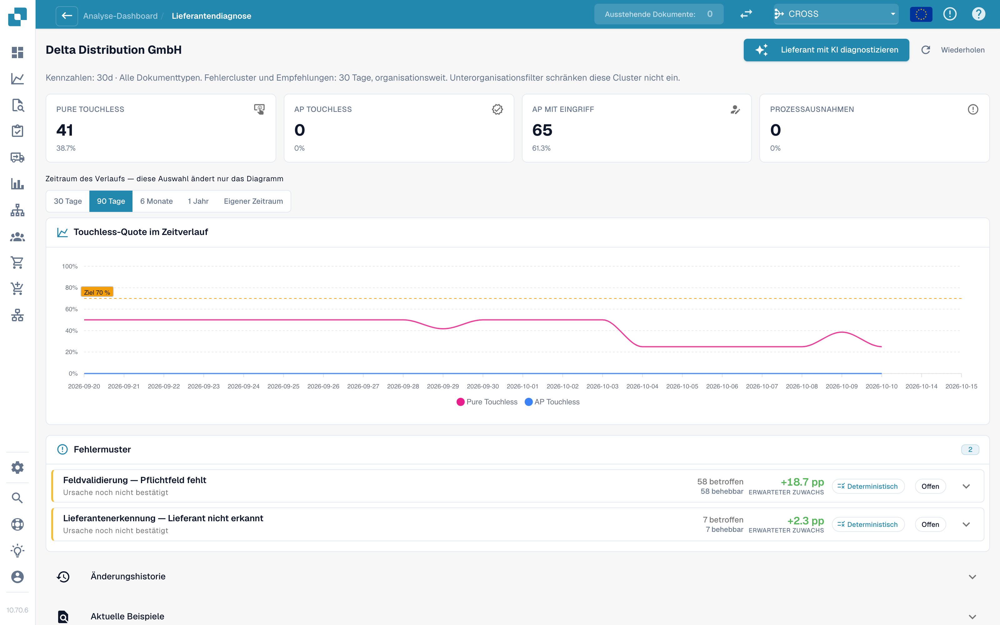
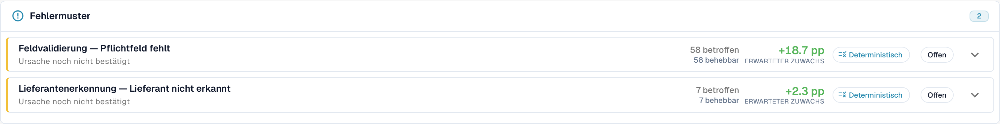

# Touchless Intelligence: Lieferantendiagnose und Fehlermuster

Klicken Sie in der Warteschlange auf einen Lieferanten, um dessen Diagnoseseite zu öffnen.

<figure><figcaption>
Die Seite Lieferantendiagnose: Ergebniskacheln, Trend mit Zeitraumauswahl und zwei Fehlermuster, nach erwartetem Zuwachs geordnet. Beispielorganisation mit Demodaten; die Lieferantennamen sind frei erfunden.
</figcaption></figure>

Die Ergebniskacheln und Diagrammsegmente zählen getrennte Dokumentergebnisse. AP Touchless bedeutet hier nur freigegebene Dokumente; die gemeinsame AP-Kennzahl auf der Übersicht enthält zusätzlich die Pure-Dokumente.

Die Seite zeigt:

* **Sechs Ergebniskacheln** (Pure Touchless, AP Touchless, AP mit Eingriff, Prozessausnahme, In Bearbeitung, Nicht berücksichtigt), jeweils mit Link zu den Dokumenten.
* **Den Trend** mit eigener Zeitraumauswahl: 30 Tage, 90 Tage, 6 Monate, 1 Jahr oder ein eigener Zeitraum (bis zu zwei Jahre). Das ändert nur das Diagramm.
* **Fehlermuster** (Issue clusters, siehe unten).
* **Änderungshistorie** (Change history): die Änderungen, die Sie für diesen Lieferanten angewendet haben, und was sie bewirkt haben.
* **Aktuelle Beispiele** (Recent examples): Beispieldokumente in zwei Tabs: **Brauchte Eingriff** und **Lief touchless**.
* **Lieferant mit KI diagnostizieren** (Diagnose supplier with AI): analysiert alle Cluster des Lieferanten (Administratoren).

Ein kurzer Hinweis erklärt eine leere Seite, zum Beispiel: *5 Dokumente dieses Lieferanten werden noch verarbeitet und haben noch kein Analyseergebnis.* oder *Alle 40 abgeschlossenen Dokumente dieses Lieferanten liefen touchless: Es gibt nichts zu diagnostizieren.*

### Fehlermuster

Ein **Cluster** fasst die Dokumente eines Lieferanten zusammen, die aus dem **gleichen ersten Grund** stehen geblieben sind. Statt 40 Einzelproblemen sehen Sie „3 Probleme“.

<figure><figcaption>
Zwei Fehlermuster: 58 Dokumente mit fehlendem Pflichtfeld und 7 ohne erkannten Lieferanten. <strong>Ursache noch nicht bestätigt</strong> trennt den beobachteten Blocker von der noch zu prüfenden Ursache. Die angezeigten +18,7 und +2,3 Prozentpunkte sind geschätzte Potenziale, keine bereits gemessenen Verbesserungen. Beispielorganisation mit Demodaten.
</figcaption></figure>

**Beispiel-Cluster (zur Veranschaulichung).**

* **Überschrift**: *Pflichtfeld fehlt* im Schritt *Feldvalidierung*
* **Betroffen**: 28 Dokumente. **Rückgewinnbar**: 28 Dokumente. **Erwarteter Zuwachs**: +2,8 PP
* **Vermutete Ursache**: Der Lieferant druckt die Bestellnummer unterhalb der Tabelle, wo die Extraktion nicht sucht
* **Nächster Prüfschritt**: Gedruckte Bestellnummer mit der Auslesung vergleichen und die Extraktionskonfiguration dieses Lieferanten prüfen, bevor Sie eine Änderung vorschlagen
* **Verantwortlich**: Consultant. **Konfidenz**: Mittel. **Quelle**: Hypothese

Was eine Cluster-Karte zeigt:

| Teil | Bedeutung |
| --- | --- |
| **Erster Blocker** (First blocker) und **Schritt** | Der Grund und der Pipeline-Schritt, an dem die Dokumente stehen bleiben. Es gibt mehr als 30 Gründe, zum Beispiel *Lieferant nicht erkannt*, *Bestellung nicht gefunden*, *Stückpreis außerhalb der Bestell-Toleranz*, *Vom ERP abgelehnt*, *E-Rechnungs-Validierung fehlgeschlagen* |
| **Betroffen / Rückgewinnbar / Erwarteter Zuwachs** | Wie viele Dokumente, wie viele davon zurückgewonnen werden können und wie viele Prozentpunkte das bringen würde |
| **Vermutete Ursache / Bestätigte Ursache** | Was DocBits für den Grund hält (oder was eine Person als Grund bestätigt hat) |
| **Nachweis** und **Fehlende Evidenz** | Worauf der Befund beruht und was DocBits **nicht** feststellen konnte. Lesen Sie **Fehlende Evidenz**, bevor Sie dem Rest vertrauen |
| **Was zu ändern ist** | Konkrete Schritte mit **Öffnen**-Links zu den Einstellungen. Ein Chip nennt die Art: *Konfigurationsänderung*, *Stammdatenänderung*, *Lieferanten-Template anpassen*, *Prozessänderung*, *Aktion des Lieferanten erforderlich*, *Nicht behebbar* |
| **Verantwortlich** | DocBits, Kunde, Consultant, Lieferant oder Nicht zugewiesen |
| **Beispieldokumente** | Echte Dokumente des Clusters zum Ansehen |

**In DocBits behebbar** und **Nur Lieferantenaktion** werden in zwei Gruppen angezeigt. Bei *Nur Lieferantenaktion* ändert nichts in DocBits das Ergebnis: Der Lieferant muss das Dokument korrigieren und erneut senden.

### Woher kommt eine Empfehlung

Jede Ursache zeigt ihre **Quelle**, damit Sie einen abgeleiteten Befund von einer Vermutung unterscheiden können:

| Quelle | Bedeutung |
| --- | --- |
| **Deterministisch** / **Regelbasiert** | Eine Regel hat sie aus der aufgezeichneten Pipeline-Evidenz abgeleitet. Es war kein Sprachmodell beteiligt |
| **Hypothese** | Ein Sprachmodell hat sie aus der Cluster-Evidenz vorgeschlagen. Betrachten Sie sie als Anhaltspunkt und prüfen Sie sie, bevor Sie handeln |
| **Bestätigt** | Eine Person hat die Evidenz geprüft und die Ursache bestätigt |

KI-Texte werden in der Sprache Ihrer Organisation verfasst. Wurde ein Cluster in einer anderen Sprache analysiert, verwenden Sie **In dieser Sprache analysieren**.

## Wer behebt eine Abweichung in den Quelldaten?

Setzen Sie **AP mit Eingriff** nicht mit einem Auslesefehler gleich. Trennen Sie für jedes Beispieldokument das Verarbeitungsergebnis von der bestätigten Ursache:

| Nachweis | Wo Sie prüfen oder beheben |
| --- | --- |
| Ein Wert steht auf der Rechnung anders, als DocBits ihn ausgelesen hat | Extraktionskonfiguration oder Lieferanten-Template |
| Auslesung und Rechnung stimmen überein; Preis, Menge oder Einheit in der Infor-Bestellung sind nachweislich falsch | Quelldaten; AP stimmt sich mit Einkauf oder Stammdatenverantwortlichen ab |
| Infor ist korrekt, DocBits hat aber eine alte oder unvollständige Kopie | Import oder ERP-Integration |
| Rechnung und Quelldaten weichen ab, der vereinbarte Wert ist noch unklar | Fachliche Klärung; Ursache noch nicht bestätigen |

Ein kleiner AP-Eingriff kann eine Rechnung abschließen, während das wiederkehrende Quelldatenproblem ungelöst bleibt. Halten Sie die Sofortaktion und die dauerhafte Behebung getrennt fest. Das Cluster allein beweist nicht den historischen Inhalt von Infor. Siehe [durchgängiges Infor-Beispiel](touchless-po-matching-diagnosis.md).

## Bestellabgleich-Cluster

Ist der erste Blocker eines Clusters ein Grund aus dem Bestellabgleich (zum Beispiel *PO-Positionsabweichung* oder *Bestellung nicht gefunden*), zeigt die Cluster-Karte, wie DocBits versucht, die Rechnung mit der Bestellung abzugleichen. Siehe [Bestellabgleich-Diagnose](touchless-po-matching-diagnosis.md).

## Weiterführende Seiten

* [Touchless Intelligence](touchless-intelligence.md)
* [Bestellabgleich-Diagnose](touchless-po-matching-diagnosis.md)
* [Dokumentverlauf](touchless-document-trace.md)
* [Änderungsvorschläge und Berichte](touchless-change-proposals.md)

<!-- Doku-Prüfung 04.11.2026: Auslesequalität getrennt von Prozessergebnissen; Kennzahlen und Endergebnisse gegen DocBits_API c51f350c728acb8ac964098d15f7b006bce273f4, module/automation_intelligence/kpi.py und bucket.py, geprüft. Bestehende deutsche Originalaufnahmen getrennt von den Schulungsbeispielen geprüft. -->
