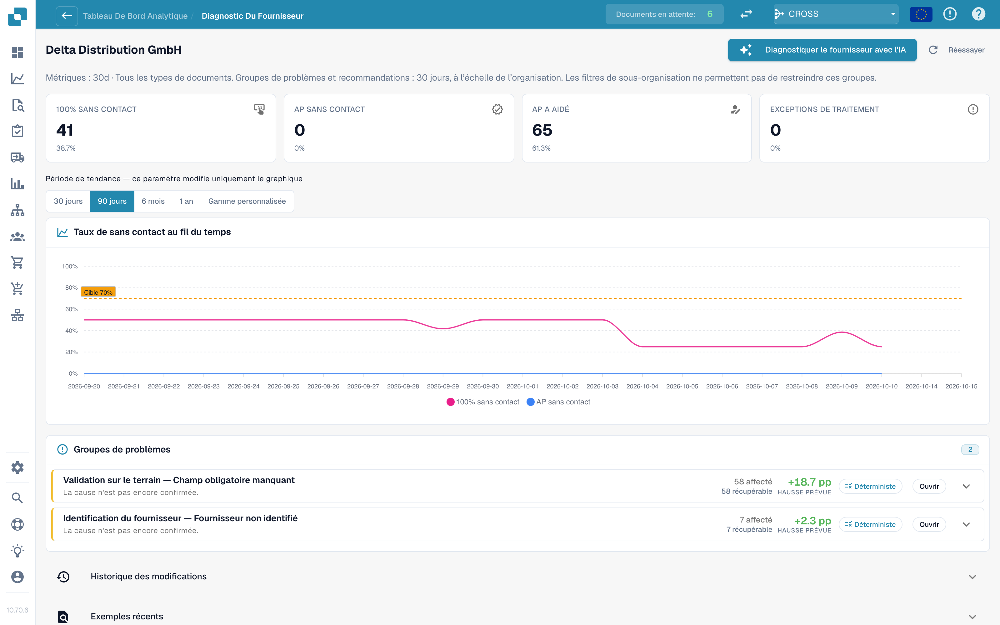
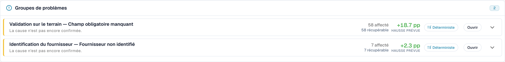

# Touchless Intelligence : Diagnostic fournisseur et clusters de problèmes

Cliquez sur un fournisseur dans la file d'attente pour ouvrir sa page de diagnostic.

<figure><figcaption>
La page Diagnostic fournisseur : tuiles de résultats, tendance avec sélecteur de période et deux clusters de problèmes classés par gain attendu. Organisation d'exemple avec des données de démonstration ; les noms de fournisseurs sont fictifs.
</figcaption></figure>

La page affiche :

* **Quatre tuiles de résultats finaux** : Pure Touchless, AP Touchless, AP Assisted et exception de processus ; chacune mène aux documents.
* **La tendance** avec son propre sélecteur de période : 30 jours, 90 jours, 6 mois, 1 an ou une plage personnalisée (jusqu'à deux ans). Cela ne modifie que le graphique.
* **Les clusters de problèmes** (voir ci-dessous).
* **Historique des modifications** (Change history) : les modifications que vous avez appliquées pour ce fournisseur et leur effet.
* **Exemples récents** (Recent examples) : des documents d'exemple, dans deux onglets : **Nécessitait une intervention** (Needed attention) et **Passé en touchless** (Went touchless).
* **Diagnostiquer le fournisseur avec l'IA** (Diagnose supplier with AI) : analyse tous les clusters du fournisseur (administrateurs).

Une courte note explique une page vide, par exemple : *5 documents de ce fournisseur sont encore en cours de traitement et n'ont pas encore de résultat d'analyse.* ou *Les 40 documents terminés de ce fournisseur sont passés en touchless : il n'y a rien à diagnostiquer.*

### Clusters de problèmes

Un **cluster** regroupe les documents d'un fournisseur qui se sont arrêtés pour le **même premier motif**. Au lieu de 40 problèmes isolés, vous voyez « 3 problèmes ».

<figure><figcaption>
Groupes de problèmes dans l’interface française : les documents partagent un premier blocage. Une cause non confirmée nécessite de vérifier les preuves ; le potentiel affiché n’est pas un gain déjà mesuré.
</figcaption></figure>

**Exemple de cluster (illustratif).**

* **Titre** : *Champ obligatoire manquant* à l'étape *Validation des champs*
* **Concernés** : 28 documents. **Récupérables** : 28 documents. **Gain attendu** : +2,8 pp
* **Cause présumée** : le fournisseur imprime le numéro de BC sous le tableau, là où l'extraction ne cherche pas
* **Prochaine vérification** : comparez le numéro de commande imprimé et extrait, puis contrôlez la configuration d’extraction avant de proposer une modification
* **Responsable** : Consultant. **Confiance** : Moyenne. **Source** : Hypothèse

Ce qu'une carte de cluster affiche :

| Partie | Signification |
| --- | --- |
| **Premier bloqueur** et **étape** | Le motif et l'étape du pipeline où les documents s'arrêtent. Il existe plus de 30 motifs, par exemple *Fournisseur non identifié*, *Bon de commande introuvable*, *Prix unitaire hors tolérance du BC*, *Rejeté par l'ERP*, *Échec de la validation de la facture électronique* |
| **Concernés / Récupérables / Gain attendu** | Combien de documents, combien peuvent être récupérés, combien de points de pourcentage cela donnerait |
| **Cause présumée / Cause confirmée** | Ce que DocBits pense (ou ce qu'une personne a confirmé) être la raison |
| **Preuves** et **Preuves manquantes** | Sur quoi repose le constat, et ce que DocBits n'a **pas** pu établir. Lisez **Preuves manquantes** avant de faire confiance au reste |
| **Que modifier** | Des étapes concrètes avec des liens **Ouvrir** vers les paramètres. Une pastille indique le type : *Modification de configuration*, *Modification des données de base*, *Modification du modèle fournisseur*, *Modification de processus*, *Action du fournisseur requise*, *Non corrigeable* |
| **Responsable** | DocBits, Client, Consultant, Fournisseur ou Non attribué |
| **Documents d'exemple** | De vrais documents du cluster à examiner |

**Corrigeable dans DocBits** et **Action du fournisseur uniquement** sont affichés dans deux groupes. Pour *Action du fournisseur uniquement*, rien dans DocBits ne change le résultat : le fournisseur doit corriger le document et le renvoyer.

### D'où vient une recommandation

Chaque cause affiche sa **source**, pour que vous puissiez distinguer un constat déduit d'une supposition :

| Source | Signification |
| --- | --- |
| **Déterministe** / **Basée sur des règles** | Une règle l'a déduite des preuves enregistrées dans le pipeline. Aucun modèle de langage n'est intervenu |
| **Hypothèse** | Un modèle de langage l'a proposée à partir des preuves du cluster. Considérez-la comme une piste et vérifiez-la avant d'agir |
| **Confirmée** | Une personne a examiné les preuves et confirmé la cause |

Les textes de l'IA sont rédigés dans la langue de votre organisation. Si un cluster a été analysé dans une autre langue, utilisez **Analyser dans cette langue**.

## Qui doit corriger les données ?

| Preuve | Où examiner ou corriger |
| --- | --- |
| L’original diffère de l’extraction | Extraction ou modèle fournisseur |
| Extraction correcte ; prix, quantité ou unité Infor confirmés incorrects | Données source ; AP coordonne avec les achats ou le responsable des données de référence |
| Infor correct ; copie importée ancienne ou incomplète | Import ou intégration ERP |
| Écart présent, mais conditions convenues encore inconnues | Clarification métier ; cause non confirmée |

Les tuiles et segments comptent des résultats distincts ; AP Touchless signifie ici approbation seule. Le taux AP en tête inclut également Pure. Une petite intervention peut terminer une facture tout en laissant sa cause récurrente. Consignez l’action immédiate et la correction durable. Voir [le cas Infor](touchless-po-matching-diagnosis.md).

## Clusters de rapprochement avec le BC

Si le premier bloqueur d'un cluster est un motif de rapprochement avec le BC (par exemple *Écart d'article du BC* ou *Bon de commande introuvable*), la carte du cluster montre comment DocBits essaie de rapprocher la facture du bon de commande. Voir [Diagnostic du rapprochement avec le BC](touchless-po-matching-diagnosis.md).

Les outils et la classification des actions humaines sont expliqués dans [Touchless avec MCP](touchless-mcp.md).

## Pages connexes

* [Touchless Intelligence](touchless-intelligence.md)
* [Diagnostic du rapprochement avec le BC](touchless-po-matching-diagnosis.md)
* [Trace du document](touchless-document-trace.md)
* [Propositions de modification et rapports](touchless-change-proposals.md)

<!-- Touchless documentation alignment 2026-11-04: extraction quality is distinct from process automation. KPI definition checked against DocBits_API c51f350c728acb8ac964098d15f7b006bce273f4; existing native screenshots and video sources preserved except unsafe historical list images. -->

<!-- Completion 2026-11-04: localized MCP examples, AP actions, original-value evidence and owned synthetic PO cards. -->
