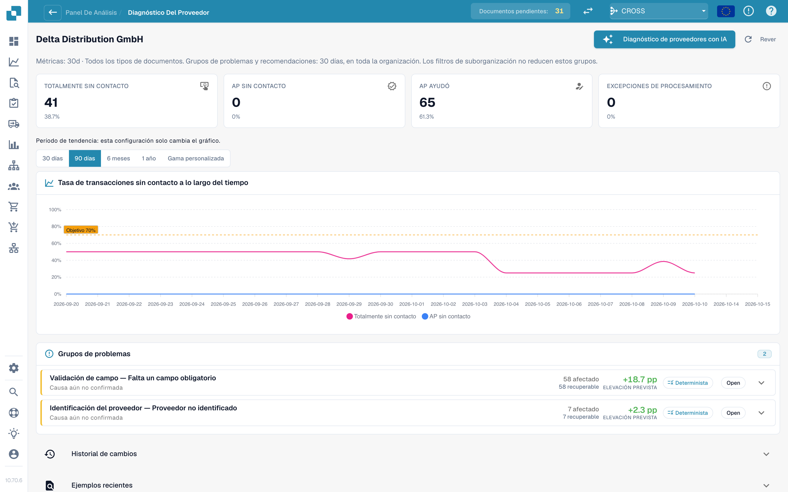
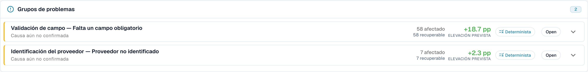

# Touchless Intelligence: Diagnóstico de proveedores y clústeres de problemas

<!-- touchless-admin-video-v2-20261104:start -->
**Capítulo del vídeo (versión de revisión):** [Investigar incidencias recurrentes](https://docbits-videos.fra1.cdn.digitaloceanspaces.com/settings-assistant/touchless-intelligence-preview-admin/v2/es.html#chapter=06).
<!-- touchless-admin-video-v2-20261104:end -->

Haga clic en un proveedor de la cola para abrir su página de diagnóstico.

<figure><figcaption>
La página Supplier Diagnosis: bloques de resultados, tendencia con selector de período y dos clústeres de problemas ordenados por mejora esperada. Organización de ejemplo con datos de demostración; los nombres de proveedores son ficticios.
</figcaption></figure>

La página muestra:

* **Cuatro tarjetas de resultados finales**: Pure Touchless, AP Touchless, AP Assisted y excepción de proceso; cada una enlaza sus documentos.
* **La tendencia** con su propio selector de período: 30 días, 90 días, 6 meses, 1 año o un intervalo personalizado (hasta dos años). Esto solo cambia el gráfico.
* **Issue clusters** (clústeres de problemas, véase más abajo).
* **Change history**: los cambios que aplicó para este proveedor y lo que lograron.
* **Recent examples**: documentos de muestra, en dos pestañas: **Needed attention** y **Went touchless**.
* **Diagnose supplier with AI**: analiza todos los clústeres del proveedor (administradores).

Una breve nota explica una página vacía, por ejemplo: *5 documents from this supplier are still being processed and have no analysis result yet.* (5 documentos de este proveedor aún se están procesando y todavía no tienen resultado de análisis) o *All 40 completed documents from this supplier ran touchless: there is nothing to diagnose.* (los 40 documentos completados de este proveedor se procesaron touchless: no hay nada que diagnosticar).

### Grupos de incidencias

Un **clúster** agrupa los documentos de un proveedor que se detuvieron por el **mismo primer motivo**. En lugar de 40 problemas individuales, ve "3 problemas".

<figure><figcaption>
Grupos de problemas en español: los documentos comparten un primer bloqueo. El mensaje de causa no confirmada exige revisar la evidencia; el potencial de mejora no es una mejora ya medida.
</figcaption></figure>

**Clúster de ejemplo (ilustrativo).**

* **Headline**: *Required field missing* en la etapa *Field Validation*
* **Afectados**: 28 documentos. **Recuperable**: 28 documentos. **Aumento esperado**: +2.8 pp
* **Suspected cause**: el proveedor imprime el número de OC debajo de la tabla, donde la extracción no busca
* **Siguiente comprobación**: compare el número de OC impreso y extraído y revise la configuración de extracción antes de proponer un cambio
* **Propietario**: Consultor. **Confianza**: Media. **Fuente**: Hipótesis

Qué muestra una tarjeta de clúster:

| Parte | Significado |
| --- | --- |
| **First blocker** y **stage** | El motivo y la etapa del pipeline en la que se detienen los documentos. Hay más de 30 motivos, por ejemplo *Supplier not identified*, *Purchase order not found*, *Unit price outside PO tolerance*, *Rejected by the ERP*, *E-invoice validation failed* |
| **Afectado/Recuperable/Aumento esperado** | Cuántos documentos, cuántos se pueden recuperar y cuántos puntos porcentuales supondría |
| **Causa sospechada / Causa confirmada** | Lo que DocBits cree que es el motivo (o lo que una persona confirmó) |
| **Evidence** y **Missing evidence** | En qué se basa el hallazgo y lo que DocBits **no** pudo establecer. Lea **Missing evidence** antes de fiarse del resto |
| **What to change** | Pasos concretos con enlaces **Open** a los ajustes. Una etiqueta indica el tipo: *Configuration change*, *Master data change*, *Supplier template change*, *Process change*, *Supplier action needed*, *Not fixable* |
| **Owner** | DocBits, Customer, Consultant, Supplier o Unassigned |
| **Sample documents** | Documentos reales del clúster para revisar |

**Fixable in DocBits** y **Supplier action only** se muestran en dos grupos. En *Supplier action only*, nada en DocBits cambia el resultado: el proveedor tiene que corregir el documento y volver a enviarlo.

### De dónde viene una recomendación

Cada causa muestra su **fuente**, de modo que pueda distinguir un hallazgo derivado de una suposición:

| Fuente | Significado |
| --- | --- |
| **Deterministic** / **Rule-based** | Una regla lo derivó de la evidencia registrada del pipeline. No intervino ningún modelo de lenguaje |
| **Hypothesis** | Un modelo de lenguaje lo propuso a partir de la evidencia del clúster. Trátelo como una pista y compruébelo antes de actuar |
| **Confirmed** | Una persona revisó la evidencia y confirmó la causa |

Los textos de IA se escriben en el idioma de su organización. Si un clúster se analizó en otro idioma, utilice **Analyse in this language**.

## ¿Quién debe corregir los datos?

| Evidencia | Dónde investigar o corregir |
| --- | --- |
| El original y la extracción difieren | Extracción o plantilla del proveedor |
| Extracción correcta; pedido de Infor con precio, cantidad o unidad incorrectos confirmados | Datos de origen; AP coordina con compras o el responsable de datos maestros |
| Infor correcto; copia importada antigua o incompleta | Importación o integración ERP |
| Los valores difieren, pero aún no se conoce lo acordado | Aclaración de negocio; causa no confirmada |

Las tarjetas y segmentos de resultados cuentan categorías separadas; AP Touchless significa aquí solo aprobación. La tasa AP de la cabecera también incluye Pure. Una pequeña intervención puede terminar la factura y dejar pendiente la causa recurrente. Registre la solución inmediata y la definitiva. Consulte [el caso de Infor](touchless-po-matching-diagnosis.md).

## Clústeres de coincidencia con la OC

Si el primer bloqueo de un clúster es un motivo de coincidencia con la OC (por ejemplo, *PO item mismatch* o *Purchase order not found*), la tarjeta del clúster muestra cómo intenta DocBits hacer coincidir la factura con la orden de compra. Véase [Diagnóstico de la coincidencia con la OC](touchless-po-matching-diagnosis.md).

Las herramientas y la clasificación de las acciones humanas se explican en [Touchless con MCP](touchless-mcp.md).

## Páginas relacionadas

* [Touchless Intelligence](touchless-intelligence.md)
* [Diagnóstico de la coincidencia con la OC](touchless-po-matching-diagnosis.md)
* [Seguimiento del documento](touchless-document-trace.md)
* [Propuestas de cambio e informes](touchless-change-proposals.md)

<!-- Touchless documentation alignment 2026-11-04: extraction quality is distinct from process automation. KPI definition checked against DocBits_API c51f350c728acb8ac964098d15f7b006bce273f4; existing native screenshots and video sources preserved except unsafe historical list images. -->

<!-- Completion 2026-11-04: localized MCP examples, AP actions, original-value evidence and owned synthetic PO cards. -->
