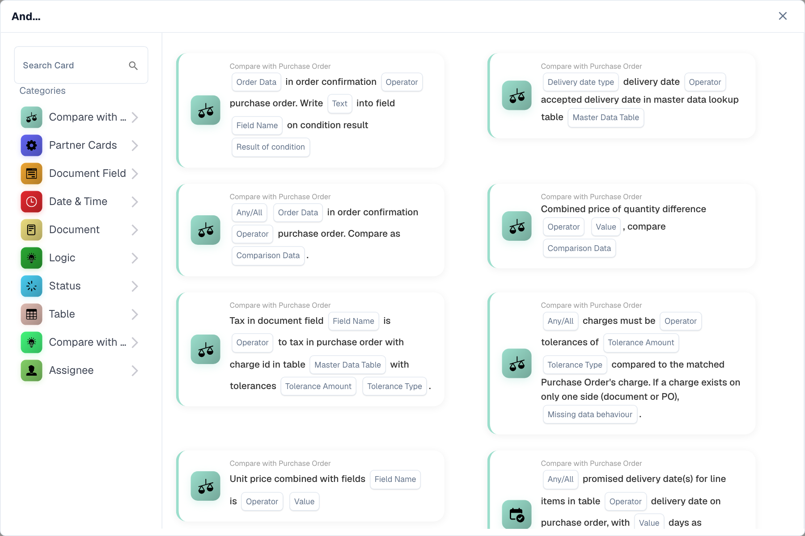
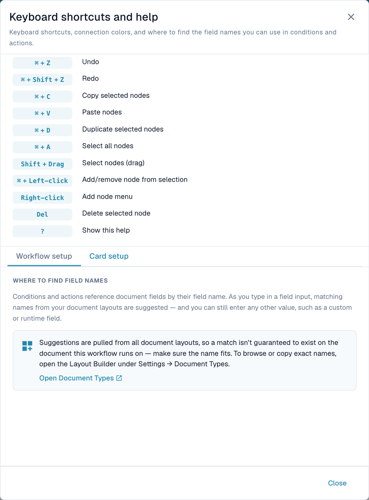
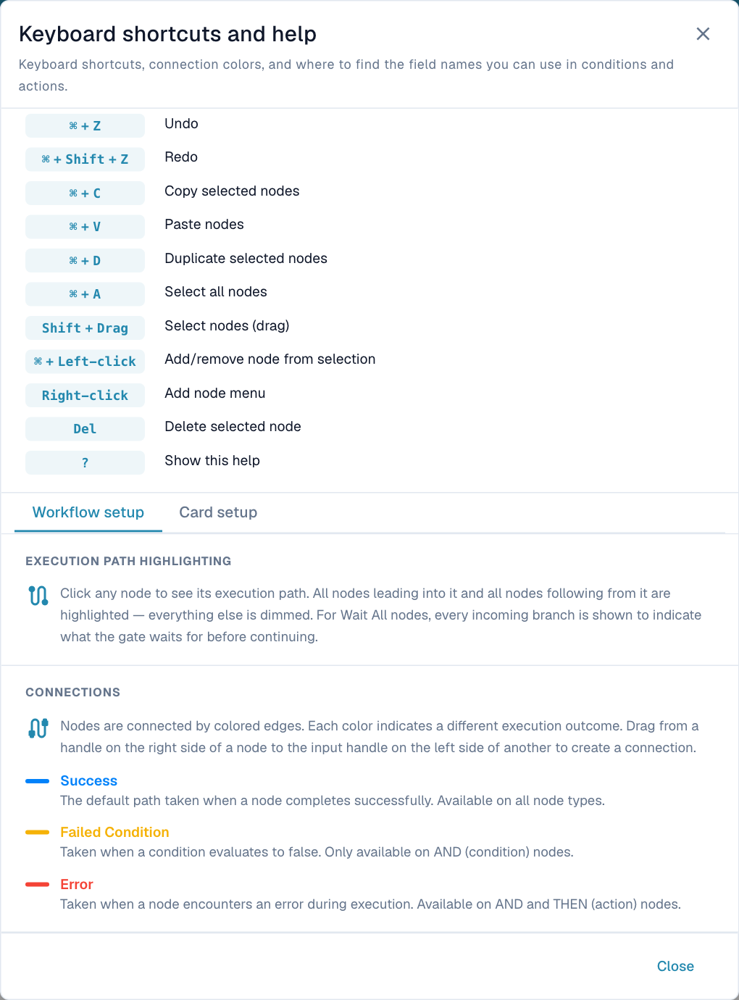

# Nodes

## Video: Nodes and routes



[Captions (WebVTT)](https://docbits-videos.fra1.cdn.digitaloceanspaces.com/settings-assistant/advanced_workflows_logic/v2/en.vtt) · 1:42

Transcript (English)

Start is the manual entry. When defines an event trigger. Neither accepts incoming connections. And checks a condition. Then performs an action. Both builders share the card catalog. Notes explain the design without executing.

Drag an output to the next input. Designer blue means success, orange means false condition, and red means error. And has three outcomes. Then has success and error. Execution views show success in green.

Check whether an invoice exceeds a threshold. Connect blue to approval, orange to normal processing, and red to error handling. A false condition can continue through its connected route. It does not stop every branch.

Wait ALL joins branches. Every source must have taken a route connected to the gate. Connect both required checks and the next action. An unselected route cannot provide a required result.

Wait ANY and OR join branches when at least one source took a connected route. OR requires two different source nodes. These gates neither create exclusive choices nor cancel other actions. Test the complete graph.

Keep processing nodes reachable from an entry. Avoid cycles and incoming connections to entry nodes. Include a Then action. Validate changed routes. Imported Delay nodes need a positive duration. The current Add menu does not offer Delay.

[Watch all five chapters](videos.md)

Nodes perform work; connections carry their results to the next node. Use **+ Add** or right-click the canvas. **When**, **And** and **Then** open the card picker. Choose a category or search, select a card, then configure its fields.

<figure><figcaption>
Choose a category or search for the operation you need. The card's highlighted fields are configuration inputs.
</figcaption></figure>

## Entry, condition and action nodes

| Node | Purpose | Connections |
| --- | --- | --- |
| **Start** | Manual entry point with a direct test control; added automatically. | Success output; no input. |
| **When** | Event trigger. Configure the trigger card, document type and other parameters. | Success output; no input. |
| **And** | Evaluate a condition against available data. | Input; success, failed-condition and error outputs. |
| **Then** | Perform an action such as setting a field, creating a task or calling an integration. | Input; success and error outputs. |
| **Note** | Explain a decision. Does not execute. | No execution connections. |

A manual Start test does not prove that the event-specific When path is selected during normal processing. Test the relevant trigger and its route.

### Card versions



**Video:** Changing the version of a card · 0:39 · [Captions (WebVTT)](https://docbits-videos.fra1.cdn.digitaloceanspaces.com/settings-assistant/workflow-card-version/v1/en.vtt)

Transcript

**The label shows the card's version** · [0:00](https://docbits-videos.fra1.cdn.digitaloceanspaces.com/settings-assistant/workflow-card-version/v1/en.mp4#t=0.25)

Cards can have several versions. The small label on a card, for example v1, shows which version it uses. A newer version can do more.

**Click to see the versions** · [0:11](https://docbits-videos.fra1.cdn.digitaloceanspaces.com/settings-assistant/workflow-card-version/v1/en.mp4#t=11.65)

Click the version label to see the versions of this card.

**Version 3: Status after export** · [0:16](https://docbits-videos.fra1.cdn.digitaloceanspaces.com/settings-assistant/workflow-card-version/v1/en.mp4#t=16.75)

Choose the newer version. This one can also set the document's status after the export.

**Set the values again** · [0:23](https://docbits-videos.fra1.cdn.digitaloceanspaces.com/settings-assistant/workflow-card-version/v1/en.mp4#t=23.916)

The values are not carried over. Set them again, here the export configuration and the status.

**Validate and test** · [0:31](https://docbits-videos.fra1.cdn.digitaloceanspaces.com/settings-assistant/workflow-card-version/v1/en.mp4#t=31.55)

Then validate and test the workflow, as after any change. Save it when it does what you expect.

The version pill on a card opens its available versions. A version change can change fields and behavior: review the configuration and repeat the affected tests. Prefer supported card versions with structured results. A missing-card warning means the saved card is unavailable in the current catalog, for example an unavailable partner card.

**Card version** and **Advanced Workflow type** describe different things. See the [card catalog](../cards-overview/README.md) for card-specific behavior.

### Document field names

Conditions and actions identify document fields by their **field names**. Input suggestions can include names from all document layouts. A suggested name is not proof that the selected document contains that field. Confirm the exact name in **Settings → Document Types → Layout Builder** and test with the relevant document type. Cards can also accept custom or runtime field names where supported.

Open **Help → Card setup** for this guidance and the link to Document Types. A display label and a field's technical name can differ.

<figure><figcaption>
Verify field names against the document's layout before relying on a suggested name.
</figcaption></figure>

## Result handles



**Video:** Success, failed condition and error in a workflow run · 1:28 · [Captions (WebVTT)](https://docbits-videos.fra1.cdn.digitaloceanspaces.com/settings-assistant/workflow-results/v1/en.vtt)

Transcript

**When, And, Then at runtime** · [0:00](https://docbits-videos.fra1.cdn.digitaloceanspaces.com/settings-assistant/workflow-results/v1/en.mp4#t=0.25)

When a workflow runs, the When card starts it. And cards check conditions, and Then cards act. What happens next depends on the result of each card.

**Success, failed condition or error** · [0:11](https://docbits-videos.fra1.cdn.digitaloceanspaces.com/settings-assistant/workflow-results/v1/en.mp4#t=11.583)

Every And card ends with one of three results. Success follows the blue success path, a failed condition the orange failed condition path, and an error the red error path.

**Missing data is an error** · [0:25](https://docbits-videos.fra1.cdn.digitaloceanspaces.com/settings-assistant/workflow-results/v1/en.mp4#t=25.316)

Missing data is not a failed condition. If a field the card needs is not in the document, a variable is missing, or there is no document, the card reports an error and takes the red error path.

**Failed condition, no orange path: the run stops** · [0:38](https://docbits-videos.fra1.cdn.digitaloceanspaces.com/settings-assistant/workflow-results/v1/en.mp4#t=38.65)

If a condition fails and its orange failed condition path is not connected, the workflow stops at that card. The run ends as failed condition.

**Connected: a failed condition is just a branch** · [0:50](https://docbits-videos.fra1.cdn.digitaloceanspaces.com/settings-assistant/workflow-results/v1/en.mp4#t=50.283)

If the orange failed condition path is connected, a failed condition is simply another branch. The workflow continues there and can still end as success.

**Red error path: catch errors with a fallback** · [1:03](https://docbits-videos.fra1.cdn.digitaloceanspaces.com/settings-assistant/workflow-results/v1/en.mp4#t=63.216)

Connect the red error path to a fallback, for example a task for a person, so that errors do not go unnoticed. The fallback runs, but the run is still marked as error.

**How a run ends** · [1:15](https://docbits-videos.fra1.cdn.digitaloceanspaces.com/settings-assistant/workflow-results/v1/en.mp4#t=75.916)

In short: any error makes the run an error. A failed condition without a connected orange path makes it a failed condition. Everything else ends as success.

Drag a source handle to the next node's **input**. And has two outcomes on the right and an error output below. Then has success on the right and error below.

| Designer connection | Meaning | Example |
| --- | --- | --- |
| **Blue — Success** | Operation succeeded or condition was true. | Amount above threshold → approval task. |
| **Orange — Failed Condition** | Condition evaluated normally but was false. Available on And. | Amount below threshold → normal processing. |
| **Red — Error** | Evaluation or action could not complete. Available on And and Then. | Required data unavailable → error handling. |

Success is **blue in the designer** and **green in execution results**. Card category colors are not execution results.

<figure><figcaption>
The built-in legend distinguishes an expected false result from an execution error.
</figcaption></figure>

If the taken result has no connection, that route has no next node. Other reachable routes can still execute. An error handler does not erase the original error from the overall result.

## Merge branches



**Video:** AND and OR: combining conditions · 2:28 · [Captions (WebVTT)](https://docbits-videos.fra1.cdn.digitaloceanspaces.com/settings-assistant/workflow-merge/v1/en.vtt)

Transcript

**AND and OR** · [0:00](https://docbits-videos.fra1.cdn.digitaloceanspaces.com/settings-assistant/workflow-merge/v1/en.mp4#t=0.25)

Conditions can be combined in two ways. Cards one after the other work like AND: all of them must be true. Cards side by side, connected into the same next card, work like OR: one true card is enough. Join cards show this on the canvas.

**AND: cards one after the other** · [0:19](https://docbits-videos.fra1.cdn.digitaloceanspaces.com/settings-assistant/workflow-merge/v1/en.mp4#t=19.016)

AND means one card after the other: every card on the path must be true before the next one runs. This invoice is ready for validation and not pending approval, so both cards are true and the action runs.

**OR: cards side by side** · [0:37](https://docbits-videos.fra1.cdn.digitaloceanspaces.com/settings-assistant/workflow-merge/v1/en.mp4#t=37.883)

OR means cards side by side. Connect the green output of both And cards straight into the input of the next card. Test it: the first card is false, the second one is true, and one true path is enough for the action to run. The test banner still reports a failed condition, because the false card's orange exit is not connected, but the action runs.

**The same with an OR card** · [1:01](https://docbits-videos.fra1.cdn.digitaloceanspaces.com/settings-assistant/workflow-merge/v1/en.mp4#t=61.25)

You can also join the paths with an OR card. It does the same, but makes the OR visible on the canvas. Right-click the canvas, choose Add, and then OR. Connect both And cards to it, and the OR card to the action.

**One true case is enough for OR** · [1:18](https://docbits-videos.fra1.cdn.digitaloceanspaces.com/settings-assistant/workflow-merge/v1/en.mp4#t=78.916)

The test gives the same result: one true case is enough for the OR card, so the action runs. Here too, the banner reports the false card's failed condition.

**AND with the Wait ALL card** · [1:34](https://docbits-videos.fra1.cdn.digitaloceanspaces.com/settings-assistant/workflow-merge/v1/en.mp4#t=94.316)

For AND with cards side by side, use Wait ALL. Right-click the canvas, choose Add, and then Wait ALL. Connect both And cards to it, and Wait ALL to the action. Test it: Wait ALL waits for both cards, both are true, so the action runs.

**Join cards: which paths were taken** · [2:02](https://docbits-videos.fra1.cdn.digitaloceanspaces.com/settings-assistant/workflow-merge/v1/en.mp4#t=122.883)

The join cards mostly make a workflow easier to read. OR and Wait ANY continue when at least one connected path was taken. Wait ALL waits until all previous cards have finished, and continues only when all connected paths were taken. Any exit of a card can be connected, not only the green one: if a card ends with a failed condition, its orange exit counts as taken.

Merge nodes combine incoming routes; they do not create branches. Connect the intended upstream **outcomes** to the gate's input, then its success output to the next action.

| Node | Inputs | Requirement to continue |
| --- | --- | --- |
| **Wait ALL** | At least two connections. Use distinct sources for independent requirements. | Every incoming source takes an outcome connected to this gate. |
| **Wait ANY** | At least two connections. | At least one source takes an outcome connected to this gate. |
| **OR** | At least two **different source nodes**. | At least one source takes an outcome connected to this gate. |

The connected handle matters. A false condition can satisfy an input when its **orange** handle is connected. A successful source does not satisfy a connection drawn from its failed-condition handle.

Several handles from one source are still one source. A matching handle can satisfy that source, but two lines do not represent independent approvals.

### Both checks are required

Connect two reachable checks to **Wait ALL**. Confirm that both sources can execute and take the connected outcomes. Joining mutually exclusive success paths can leave a required input unavailable.

### Either check is sufficient

Use **Wait ANY** or **OR** when one matching source is sufficient. Test only A matching, only B matching, neither matching and both matching. These gates are not exclusive switches and do not cancel other actions. They are not a promise that real-world approvals race and the first cancels another.

## Delay in an existing graph

The current Add menu does **not** offer Delay. An existing or imported graph can contain one. Its duration must be positive and no more than **86,400 seconds (24 hours)**. Test mode skips the actual wait; a short test runtime does not prove a production delay was ignored.

## Connection rules

- Keep processing nodes reachable from a Start or When entry.
- Include at least one Then action.
- Entry nodes cannot receive incoming connections.
- Do not connect a node to itself or create a cycle.
- Connect valid output handles to inputs.
- Meet each merge's input requirements.
- Reconnect or remove unused processing nodes; use Note for commentary.

Select a node to highlight its upstream and downstream paths, including all inputs to Wait ALL. Highlighting shows connectivity. [Tests](validation-and-testing.md) and [execution logs](../workflow-logs.md) show which paths actually ran.
