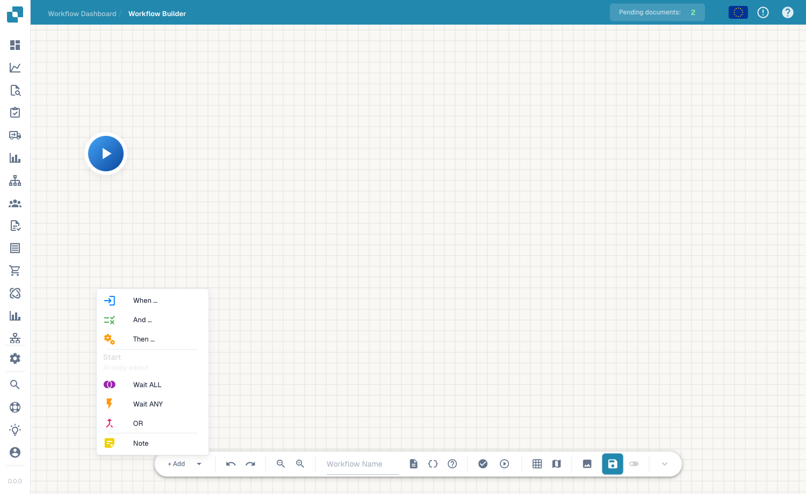

# 节点

## 视频: 节点与路径



[字幕文件（WebVTT）](https://docbits-videos.fra1.cdn.digitaloceanspaces.com/settings-assistant/advanced_workflows_logic/v2/zh.vtt) · 1:46

文字稿

**明确每个节点的作用**

Start 用于手动启动，When 定义事件触发器。两者都不接受传入连接。And 检查条件，Then 执行动作。标准和高级构建器共用卡片目录。备注用于说明设计，不参与执行。

**区分三种结果**

将输出拖到下一个输入。在设计器中，蓝色表示成功，橙色表示条件不成立，红色表示错误。And 有三种结果，Then 有成功和错误两种结果。执行视图用绿色表示成功。

**建立替代路径**

检查发票金额是否超过阈值。蓝色连接审批，橙色连接常规处理，红色连接错误处理。条件不成立时，可以沿已连接的路径继续，并不会停止所有分支。示例值只用于标记路径。

**使用 Wait ALL 合并**

Wait ALL 合并分支。每个源节点都必须选中一条连接到合并节点的路径。连接两个必要的检查和下一项动作。未选中的路径无法提供所需结果。

**使用 ANY 和 OR 合并**

Wait ANY 和 OR 在至少一个源节点选中已连接路径时合并分支。OR 需要两个不同的源节点。这些节点不会创建互斥选择，也不会取消其他动作。请测试完整流程图。

**确保流程图可以执行**

处理节点必须能从入口到达。避免环路，不要向 Start 或 When 添加传入连接。至少包含一个 Then 动作，并验证修改后的路径。导入的 Delay 节点需要正数时长；当前添加菜单不提供 Delay。

[查看全部五个章节](videos.md)

高级工作流是由边连接的**节点**构成的图。你可以从 **+ Add** 菜单中添加节点（也可以右键单击画布），并将它们连接起来以定义执行流程。

<figure><figcaption>
<strong>+ Add</strong> 节点菜单 — 可用的节点类型。
</figcaption></figure>

## 节点类型



**视频:** 更改卡片的版本 · 0:29 · [字幕 (WebVTT)](https://docbits-videos.fra1.cdn.digitaloceanspaces.com/settings-assistant/workflow-card-version/v1/zh.vtt)

文字稿

**标签显示卡片的版本** · [0:00](https://docbits-videos.fra1.cdn.digitaloceanspaces.com/settings-assistant/workflow-card-version/v1/zh.mp4#t=0.25)

卡片可以有多个版本。卡片上的小标签（例如 v1）显示它使用的版本。较新的版本功能更多。

**点击查看版本** · [0:08](https://docbits-videos.fra1.cdn.digitaloceanspaces.com/settings-assistant/workflow-card-version/v1/zh.mp4#t=8.683)

点击版本标签，查看此卡片的版本。

**版本 3：导出后状态** · [0:12](https://docbits-videos.fra1.cdn.digitaloceanspaces.com/settings-assistant/workflow-card-version/v1/zh.mp4#t=12.916)

选择较新的版本。它还能设置文档的导出后状态。

**重新设置值** · [0:18](https://docbits-videos.fra1.cdn.digitaloceanspaces.com/settings-assistant/workflow-card-version/v1/zh.mp4#t=18.816)

这些值不会保留。请重新设置，这里是导出配置和状态。

**验证并测试** · [0:24](https://docbits-videos.fra1.cdn.digitaloceanspaces.com/settings-assistant/workflow-card-version/v1/zh.mp4#t=24.383)

然后照常验证并测试 Workflow，符合预期再保存。

* **Start** — 工作流的入口点。自动添加；每个流程都从这里开始。
* **When** — 触发器卡片，与标准构建器中的相同。
* **And** — 条件卡片。其结果为 true 或 false，并可据此分支流程。
* **Then** — 执行动作的卡片（设置字段、创建任务、调用 API，……）。
* **Wait ALL** — 等待所有传入分支完成后再继续。
* **Wait ANY** — 任意一个传入分支完成后立即继续。
* **OR** — 将流程分支到不同的替代路径。
* **Note** — 画布上的自由文本注释；不会影响执行。

**When / And / Then** 节点使用的卡片与 [卡片](../cards-overview/) 部分所述的完全相同。

## 连接节点



**视频:** Workflow 运行中的成功、条件失败和错误 · 1:14 · [字幕 (WebVTT)](https://docbits-videos.fra1.cdn.digitaloceanspaces.com/settings-assistant/workflow-results/v1/zh.vtt)

文字稿

**运行时的“当”、“和”、“然后”** · [0:00](https://docbits-videos.fra1.cdn.digitaloceanspaces.com/settings-assistant/workflow-results/v1/zh.mp4#t=0.25)

Workflow 运行时，由“当”卡启动。和卡检查条件，然后卡执行操作。接下来发生什么取决于每张卡片的结果。

**成功、失败条件或错误** · [0:11](https://docbits-videos.fra1.cdn.digitaloceanspaces.com/settings-assistant/workflow-results/v1/zh.mp4#t=11.016)

每张和卡以三种结果之一结束。成功走蓝色的成功路径，失败条件走橙色路径，错误走红色的错误路径。

**缺少数据是错误** · [0:21](https://docbits-videos.fra1.cdn.digitaloceanspaces.com/settings-assistant/workflow-results/v1/zh.mp4#t=21.75)

缺少数据不是失败条件。如果卡片需要的字段不在文档中、缺少变量或没有文档，卡片会报告错误并走红色的错误路径。

**没有橙色路径：运行停止** · [0:33](https://docbits-videos.fra1.cdn.digitaloceanspaces.com/settings-assistant/workflow-results/v1/zh.mp4#t=33.716)

如果条件不满足且其橙色路径没有连接，Workflow 会在这张卡片处停止。这次运行以失败条件结束。

**已连接：只是另一个分支** · [0:43](https://docbits-videos.fra1.cdn.digitaloceanspaces.com/settings-assistant/workflow-results/v1/zh.mp4#t=43.35)

如果橙色路径已连接，失败条件只是另一个分支。Workflow 在那里继续，仍然可能以成功结束。

**红色错误路径：捕获错误** · [0:51](https://docbits-videos.fra1.cdn.digitaloceanspaces.com/settings-assistant/workflow-results/v1/zh.mp4#t=51.65)

把红色错误路径连接到一个备用方案，例如给某人的任务，这样错误就不会被忽视。备用方案会运行，但这次运行仍标记为错误。

**运行如何结束** · [1:03](https://docbits-videos.fra1.cdn.digitaloceanspaces.com/settings-assistant/workflow-results/v1/zh.mp4#t=63.45)

简而言之：任何错误都会使运行成为错误。没有连接橙色路径的失败条件会使其成为失败条件。其他情况都以成功结束。



**视频:** 且与或：组合条件 · 4:03 · [字幕 (WebVTT)](https://docbits-videos.fra1.cdn.digitaloceanspaces.com/settings-assistant/workflow-merge/v2/zh.vtt)

文字稿

**且与或** · [0:00](https://docbits-videos.fra1.cdn.digitaloceanspaces.com/settings-assistant/workflow-merge/v2/zh.mp4#t=0.25)

条件有两种组合方式。卡片一张接一张就像“且”：所有卡片都必须为真。卡片并排并连到同一张后续卡片就像“或”：一张为真就够了。连接节点会在画布上显示这一点。

**且：卡片一张接一张** · [0:14](https://docbits-videos.fra1.cdn.digitaloceanspaces.com/settings-assistant/workflow-merge/v2/zh.mp4#t=14.783)

一张接一张就是“且”：路径上的每张卡片都必须为真，下一张才会运行。这张发票已准备好验证，且不在待审批中，所以两张卡片都为真，动作会运行。

**或：卡片并排** · [0:31](https://docbits-videos.fra1.cdn.digitaloceanspaces.com/settings-assistant/workflow-merge/v2/zh.mp4#t=31.083)

“或”就是卡片并排。把两张和卡的绿色输出直接连到下一张卡的输入。测试一下：第一张卡为假，第二张为真，一条为真的路径就足以让动作运行。测试横幅仍会报告条件未满足，因为假卡的橙色出口没有连接，但动作照样运行。

**用“或”卡也一样** · [0:52](https://docbits-videos.fra1.cdn.digitaloceanspaces.com/settings-assistant/workflow-merge/v2/zh.mp4#t=52.116)

您也可以用“或”卡合并路径。效果相同，但会让“或”在画布上可见。右键点击画布，选择添加，然后选择或者。把两张和卡连到它，再把“或”卡连到动作。

**“或”只需一个为真** · [1:08](https://docbits-videos.fra1.cdn.digitaloceanspaces.com/settings-assistant/workflow-merge/v2/zh.mp4#t=68.983)

测试结果相同：对“或”卡来说，一个为真的情况就够了，所以动作会运行。这里横幅同样会报告假卡的条件未满足。

**等待任一：与“或”相同** · [1:22](https://docbits-videos.fra1.cdn.digitaloceanspaces.com/settings-assistant/workflow-merge/v2/zh.mp4#t=82.983)

等待任一与“或”完全相同：它会等待前面的每一张卡，只要至少走过一条路径就继续。两者可以互换，请选择在您的 Workflow 中更易读的名称。

**用等待全部实现“且”** · [1:44](https://docbits-videos.fra1.cdn.digitaloceanspaces.com/settings-assistant/workflow-merge/v2/zh.mp4#t=104.683)

对于并排卡片的“且”，请使用等待全部。右键点击画布，选择添加，然后选择等待全部。把两张和卡连到它，再把等待全部连到动作。测试一下：它会等待两张卡，两张都为真，所以动作会运行。

**顺序：按连接绘制的顺序** · [2:12](https://docbits-videos.fra1.cdn.digitaloceanspaces.com/settings-assistant/workflow-merge/v2/zh.mp4#t=132.15)

它按什么顺序运行？Workflow 按一个列表依次处理。一张卡后面的卡按连接绘制的顺序加入列表，所以上面的条件先运行，然后是下面的条件。“或”卡会等到两者都运行完，动作只运行一次，无论有多少条件为真。

**直接连到动作：不会等待** · [2:41](https://docbits-videos.fra1.cdn.digitaloceanspaces.com/settings-assistant/workflow-merge/v2/zh.mp4#t=161.316)

直接连到动作的卡不会等待。动作通过短路径到达，在长路径的最后一张卡被检查之前就已运行，所以那张卡不再改变任何结果。如果动作应等待所有检查，请在它前面放一张“或”、等待任一或等待全部卡。

**每个出口都可以通向别处** · [3:02](https://docbits-videos.fra1.cdn.digitaloceanspaces.com/settings-assistant/workflow-merge/v2/zh.mp4#t=182.616)

每张卡最多有三个出口：成功、条件未满足和错误。每个出口都可以通向各自的下一张卡。

**多个出口连一个输入：一个就够** · [3:13](https://docbits-videos.fra1.cdn.digitaloceanspaces.com/settings-assistant/workflow-merge/v2/zh.mp4#t=193.783)

您也可以把同一张卡的多个出口连到同一个输入。只有其中一个会被走到，因为一张卡只会以一个结果结束，所以下一张卡只等待那一个。这适用于任何输入，而不只是这些连接节点。测试一下：条件未满足，等待全部仍然继续。

**连接节点：走到了哪些路径** · [3:39](https://docbits-videos.fra1.cdn.digitaloceanspaces.com/settings-assistant/workflow-merge/v2/zh.mp4#t=219.583)

连接节点主要让 Workflow 更易读。或者和等待任一会在至少一条已连接路径被走到时继续。等待全部会等到之前所有卡片都完成，并且只有在所有已连接路径都被走到时才继续。卡片的任何出口都可以连接，不只是绿色的：如果一张卡以条件未满足结束，它的橙色出口就算被走到。

节点通过**彩色边**连接。从节点**右侧**的连接手柄拖动到另一个节点**左侧**的输入手柄，即可创建连接。每种颜色表示不同的执行结果：

* **Success**（蓝色）— 节点成功完成时采用的默认路径。所有节点类型均可使用。
* **Failed Condition**（橙色）— 条件结果为 false 时采用的路径。**And**（条件）节点可使用。
* **Error**（红色）— 节点执行过程中发生错误时采用的路径。**And** 和 **Then**（动作）节点可使用。

## 执行路径高亮显示

单击任意节点即可查看其执行路径。所有通向该节点的节点以及从该节点继续延伸的节点都会高亮显示，其余内容则会变暗。对于 **Wait ALL** 节点，所有传入分支都会显示出来，让你准确查看该节点在继续之前会等待哪些分支。

## 后续步骤

* 使用 [变量](variables.md) 在节点之间传递数据。
* 使用 [验证与测试](validation-and-testing.md) 检查并运行工作流。
