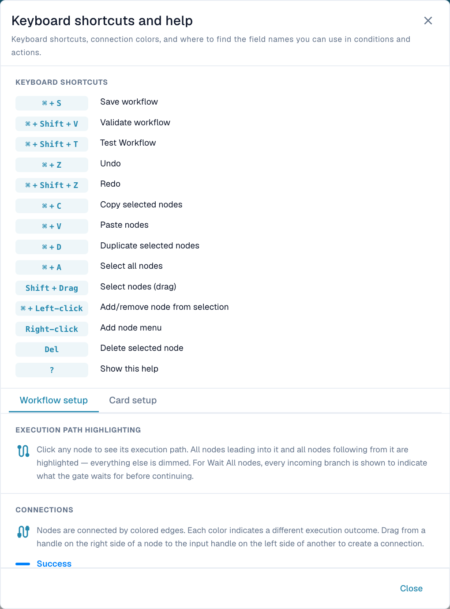

# Toolbar & Canvas

## Video: Builder and canvas

Mike introduces the example, then checks Workflow List and License and explains his real actions in the English DocBits designer. The demonstration remains unsaved; this account has no Advanced Workflow subscription.



[Open video](https://docbits-videos.fra1.cdn.digitaloceanspaces.com/settings-assistant/advanced_workflows_canvas-admin/v7/en.mp4) · [Captions (WebVTT)](https://docbits-videos.fra1.cdn.digitaloceanspaces.com/settings-assistant/advanced_workflows_canvas-admin/v7/en.vtt) · [Transcript (text)](https://docbits-videos.fra1.cdn.digitaloceanspaces.com/settings-assistant/advanced_workflows_canvas-admin/v7/en.txt) · 3:42

| In this film | Start |
| --- | --- |
| Meet the administrator | [0:00](https://docbits-videos.fra1.cdn.digitaloceanspaces.com/settings-assistant/advanced_workflows_canvas-admin/v7/en.mp4#t=0) |
| Check workflow access | [0:09](https://docbits-videos.fra1.cdn.digitaloceanspaces.com/settings-assistant/advanced_workflows_canvas-admin/v7/en.mp4#t=9) |
| Name the workflow | [0:37](https://docbits-videos.fra1.cdn.digitaloceanspaces.com/settings-assistant/advanced_workflows_canvas-admin/v7/en.mp4#t=37) |
| Configure the amount check | [0:52](https://docbits-videos.fra1.cdn.digitaloceanspaces.com/settings-assistant/advanced_workflows_canvas-admin/v7/en.mp4#t=52) |
| Add the Approval action | [1:16](https://docbits-videos.fra1.cdn.digitaloceanspaces.com/settings-assistant/advanced_workflows_canvas-admin/v7/en.mp4#t=76) |
| Add the Standard action | [1:37](https://docbits-videos.fra1.cdn.digitaloceanspaces.com/settings-assistant/advanced_workflows_canvas-admin/v7/en.mp4#t=97) |
| Arrange the canvas | [2:00](https://docbits-videos.fra1.cdn.digitaloceanspaces.com/settings-assistant/advanced_workflows_canvas-admin/v7/en.mp4#t=120) |
| Connect the routes | [2:17](https://docbits-videos.fra1.cdn.digitaloceanspaces.com/settings-assistant/advanced_workflows_canvas-admin/v7/en.mp4#t=137) |
| Prepare test cases | [2:44](https://docbits-videos.fra1.cdn.digitaloceanspaces.com/settings-assistant/advanced_workflows_canvas-admin/v7/en.mp4#t=164) |
| Validate, save and activate | [3:10](https://docbits-videos.fra1.cdn.digitaloceanspaces.com/settings-assistant/advanced_workflows_canvas-admin/v7/en.mp4#t=190) |

Transcript

**Meet the administrator**

I look after DocBits here. Let me show you how I build an invoice check and connect its two routes.

**Check workflow access**

I start on Workflow Dashboard and open Workflow List. Then I check License. Workflow and Advanced Workflow both need active access. With those enabled, New Workflow offers Advanced Workflow. This documentation account has no active workflow subscription, so this video continues with an unsaved designer preview.

**Name the workflow**

I'm working in the real DocBits designer. First, I give this draft a clear name. We'll check an invoice amount, then use two simple actions to show the possible routes. This demonstration stays unsaved.

**Configure the amount check**

I open Add and choose And. Under Document Field, I select the Docfield condition. I set the field to total amount. Then I choose Greater Than. And enter one thousand. Use your own document field key. Exactly one thousand does not pass this comparison.

**Add the Approval action**

Now I add a Then card from Document Field. The action sets a document field. I use the demonstration key approval route, and enter Approval. This labels the route. A real approval process needs its own business actions.

**Add the Standard action**

I add a second Then card using the same action. The action sets a document field. I use the demonstration key approval route, This time, the demonstration field gets the value Standard. Both cards are configured. They still need connections to define which action runs.

**Arrange the canvas**

I drag the cards into a readable layout. The two actions go on the right. The condition sits in the middle, with Start on the left. Moving cards changes their position. It does not create a connection.

**Connect the routes**

I drag from Start's output to the condition's input. The Success route goes to Approval, with a blue connection. The orange Failed Condition route goes to Standard. Red Error is a separate output for evaluation failures. Here it remains unconnected. In a production workflow, decide how you will handle those failures.

**Prepare test cases**

The toolbar Test button opens Select Test Document. I can select a demonstration document, or prepare complete Custom Data. Test amounts above, below, and exactly at one thousand. Check a missing amount too. This account has no Advanced Workflow subscription. I'm showing test preparation, not an executed result.

**Validate, save and activate**

I locate Validate to check connections and card settings. This account blocks validation because the subscription is unavailable. In an enabled account, I would save explicitly to the server. Then check activation separately. The switch is disabled before the first save. The automatic draft indicator refers to a local browser copy. It does not mean this workflow is saved or enabled.

[Watch all five chapters](videos.md)

Use the bottom toolbar to configure the workflow and the canvas to arrange nodes. Panning, zooming and card positions change the view or layout. Connections determine execution.

## Every toolbar control



**Video:** Advanced Workflow Designer: cards and paths · 2:19 · [Captions (WebVTT)](https://docbits-videos.fra1.cdn.digitaloceanspaces.com/settings-assistant/advanced-workflow-designer/v1/en.vtt)

Transcript

**Start a new workflow** · [0:00](https://docbits-videos.fra1.cdn.digitaloceanspaces.com/settings-assistant/advanced-workflow-designer/v1/en.mp4#t=0.25)

Open the Workflow Dashboard and select New Workflow.

**Choose Advanced Workflow** · [0:04](https://docbits-videos.fra1.cdn.digitaloceanspaces.com/settings-assistant/advanced-workflow-designer/v1/en.mp4#t=4.85)

Choose Advanced Workflow. The designer opens with a Start node, where every flow begins.

**When, And and Then** · [0:12](https://docbits-videos.fra1.cdn.digitaloceanspaces.com/settings-assistant/advanced-workflow-designer/v1/en.mp4#t=12.083)

Add cards with the Add menu or with a right-click on the canvas. The three card categories are When, And and Then.

**When: the trigger condition** · [0:25](https://docbits-videos.fra1.cdn.digitaloceanspaces.com/settings-assistant/advanced-workflow-designer/v1/en.mp4#t=25.383)

The When card is the trigger condition. It decides when the workflow starts, for example for a certain document type.

**And: an additional condition** · [0:38](https://docbits-videos.fra1.cdn.digitaloceanspaces.com/settings-assistant/advanced-workflow-designer/v1/en.mp4#t=38.883)

And cards add further conditions. They check the document, for example its status. The result is success, or a failed condition.

**Then: the action card** · [0:52](https://docbits-videos.fra1.cdn.digitaloceanspaces.com/settings-assistant/advanced-workflow-designer/v1/en.mp4#t=52.35)

Then cards are the action cards. They change the document, for example set a field or approve the document.

**Drag to connect** · [1:01](https://docbits-videos.fra1.cdn.digitaloceanspaces.com/settings-assistant/advanced-workflow-designer/v1/en.mp4#t=61.183)

To connect two cards, drag from a handle on the right of one card to the input on the left of the next card.

**Blue: Success** · [1:09](https://docbits-videos.fra1.cdn.digitaloceanspaces.com/settings-assistant/advanced-workflow-designer/v1/en.mp4#t=69.083)

Blue is the success path. Every card has it. The flow takes it when the card completes.

**Orange: Failed condition** · [1:17](https://docbits-videos.fra1.cdn.digitaloceanspaces.com/settings-assistant/advanced-workflow-designer/v1/en.mp4#t=77.05)

Orange is the failed condition path. Only And cards have it. The flow takes it when the condition is not met.

**Red: Error** · [1:27](https://docbits-videos.fra1.cdn.digitaloceanspaces.com/settings-assistant/advanced-workflow-designer/v1/en.mp4#t=87.35)

Red is the error path. And and Then cards have it. The flow takes it when a card fails with an error.

**If-else with error catch** · [1:36](https://docbits-videos.fra1.cdn.digitaloceanspaces.com/settings-assistant/advanced-workflow-designer/v1/en.mp4#t=96.45)

Together these paths form an if-else with an error catch. Success runs one action, a failed condition runs another, and an error runs a fallback, for example a task for a person.

**One path per status** · [1:50](https://docbits-videos.fra1.cdn.digitaloceanspaces.com/settings-assistant/advanced-workflow-designer/v1/en.mp4#t=110.983)

For several cases, link Document status cards through their failed condition paths. Each card checks one status, so every status gets its own path.

**See the path to and from a card** · [2:03](https://docbits-videos.fra1.cdn.digitaloceanspaces.com/settings-assistant/advanced-workflow-designer/v1/en.mp4#t=123.016)

Click a card to highlight its execution path: the cards a document passes to reach it, and the cards that can follow it. Everything else is dimmed. Here, the task is only reached from the When card, through the red error path of the Document status card.

Controls follow their left-to-right order.

| Control | Purpose and result |
| --- | --- |
| **+ Add** | When, And, Then, existing Start, Wait ALL, Wait ANY, OR and Note. See [Nodes](nodes.md). |
| **Undo / Redo** | Undo or repeat supported canvas edits. Does not roll back executed actions or independently saved organization variables. |
| **Zoom out / Zoom in** | Change the view scale. |
| **Workflow Name** | Name the workflow before saving. |
| **Edit description** | Explain the business purpose and exceptional routes. |
| **Automatic-save indicator** | Shows the last local draft save after changes; not a server-save confirmation. |
| **Variables — { }** | Open the organization-wide [variables](variables.md). |
| **Help — ?** | Shortcuts, path highlighting and connection legend. |
| **Validate — check-circle** | Report graph errors and warnings. |
| **Test — play-circle** | Choose test input for the current canvas. See [testing](validation-and-testing.md). |
| **Snap to grid** | Toggle alignment when moving nodes. |
| **Mini-map** | Show or hide an overview for large graphs. |
| **Export Image** | Download a diagram image. This is not an importable workflow configuration or execution recording. |
| **Save — disk** | Write the workflow to the server. Wait for confirmation. |
| **Activate / Deactivate — toggle** | Change the enabled state of a saved workflow. Unavailable before the first save; review any unsaved-change prompt. |
| **Hide toolbar — down arrow** | Hide it. Use the remaining up arrow to restore it. |

The current toolbar does not expose a separate Logs or Save as Template button. Open [Workflow Logs](../workflow-logs.md) from the document. Workflow List configuration import/export is separate from Export Image.

## Navigate and select

- Drag the blank background to pan; use wheel, pinch or zoom buttons to change scale.
- Drag a node to move it. Connections remain attached.
- Click a node to highlight incoming and outgoing paths; unrelated nodes dim.
- **Shift + drag** selects an area. **Cmd/Ctrl + click** adds/removes a node from the selection.
- Right-click the background for Add. The node context menu offers editing actions for the selection.

Connectivity highlighting is different from [execution evidence](../workflow-logs.md).

## Edit nodes and notes



**Video:** Workflow descriptions and notes · 0:57 · [Captions (WebVTT)](https://docbits-videos.fra1.cdn.digitaloceanspaces.com/settings-assistant/workflow-notes/v1/en.vtt)

Transcript

**Explain your workflow** · [0:00](https://docbits-videos.fra1.cdn.digitaloceanspaces.com/settings-assistant/workflow-notes/v1/en.mp4#t=0.25)

A workflow with several branches is easier to maintain when it explains itself. The designer has two tools for this: a description of the whole workflow, and notes on the canvas.

**Describe the whole workflow** · [0:13](https://docbits-videos.fra1.cdn.digitaloceanspaces.com/settings-assistant/workflow-notes/v1/en.mp4#t=13.583)

Select Edit description in the toolbar and say in a sentence or two what the workflow is for. The description is stored when you save the workflow.

**Add a note** · [0:23](https://docbits-videos.fra1.cdn.digitaloceanspaces.com/settings-assistant/workflow-notes/v1/en.mp4#t=23.783)

To explain a single step, right-click on the canvas, open the add menu and choose Note. The note appears where you clicked.

**Double-click to write** · [0:33](https://docbits-videos.fra1.cdn.digitaloceanspaces.com/settings-assistant/workflow-notes/v1/en.mp4#t=33.016)

Double-click the note to write in it, up to five hundred characters. Click next to it when you are done.

**Move and resize** · [0:41](https://docbits-videos.fra1.cdn.digitaloceanspaces.com/settings-assistant/workflow-notes/v1/en.mp4#t=41.45)

Drag the note next to the cards it explains, and pull its lower right corner to make it larger.

**Notes are never run** · [0:48](https://docbits-videos.fra1.cdn.digitaloceanspaces.com/settings-assistant/workflow-notes/v1/en.mp4#t=48.616)

Notes are only for people. They are not connected to any card and are never run, so they do not change what the workflow does.

Copy, paste or duplicate a selection to reuse a configured section, then check its fields and connections. Review the selection before deleting: removing a node also removes its connections and can disconnect a downstream path. Undo/redo corrects canvas edits.

Use **Note** to explain a decision, owner or configuration context. Edit its text and use the available color and size controls to keep it readable. Notes are annotations, not execution steps or logs.

## Keyboard shortcuts



**Video:** Keyboard shortcuts in the Advanced Workflow designer · 1:06 · [Captions (WebVTT)](https://docbits-videos.fra1.cdn.digitaloceanspaces.com/settings-assistant/workflow-shortcuts/v1/en.vtt)

Transcript

**Press ? for all shortcuts** · [0:00](https://docbits-videos.fra1.cdn.digitaloceanspaces.com/settings-assistant/workflow-shortcuts/v1/en.mp4#t=0.25)

The Advanced designer has keyboard shortcuts for most steps. Press the question mark to see all of them. On a Mac, use the Command key wherever the list says Control; on any keyboard, both keys work.

**Copy, paste, duplicate** · [0:15](https://docbits-videos.fra1.cdn.digitaloceanspaces.com/settings-assistant/workflow-shortcuts/v1/en.mp4#t=15.65)

Select a card and copy it, then paste it. Duplicate does both in one step.

**Delete, undo, redo** · [0:22](https://docbits-videos.fra1.cdn.digitaloceanspaces.com/settings-assistant/workflow-shortcuts/v1/en.mp4#t=22.983)

Delete removes the selected card. Undo brings it back, and redo removes it again. Delete the pasted copy as well.

**Select all** · [0:32](https://docbits-videos.fra1.cdn.digitaloceanspaces.com/settings-assistant/workflow-shortcuts/v1/en.mp4#t=32.616)

Select all cards at once, for example to move or copy the whole workflow. Click the empty canvas to clear the selection.

**Validate, test, save** · [0:42](https://docbits-videos.fra1.cdn.digitaloceanspaces.com/settings-assistant/workflow-shortcuts/v1/en.mp4#t=42.25)

Validate the workflow, or open the test. Saving is Control and S.

**Windows, Linux and Mac** · [0:49](https://docbits-videos.fra1.cdn.digitaloceanspaces.com/settings-assistant/workflow-shortcuts/v1/en.mp4#t=49.316)

On a Mac, Command replaces Control, and the delete key removes cards. With the mouse: hold Control or Command and click to add cards to the selection, hold Shift and drag to select an area, and right-click the canvas to add cards.

Use **Cmd** on macOS and **Ctrl** on Windows/Linux. Finish typing in an input before using canvas-editing shortcuts. **?** opens the application's current reference.

<figure><figcaption>
Built-in help provides the current editing shortcuts. Scroll to the connection legend or select Card setup for field-name guidance.
</figcaption></figure>

| Shortcut | Action |
| --- | --- |
| **Cmd/Ctrl + S** | Save to server. |
| **Cmd/Ctrl + Shift + V** | Validate. |
| **Cmd/Ctrl + Shift + T** | Open testing. |
| **Cmd/Ctrl + Z** | Undo. |
| **Cmd/Ctrl + Shift + Z** | Redo. |
| **Cmd/Ctrl + C / V / D** | Copy / paste / duplicate selected nodes. |
| **Cmd/Ctrl + A** | Select all nodes. |
| **Shift + drag** | Area selection. |
| **Cmd/Ctrl + left-click** | Add/remove one node from selection. |
| **Right-click** | Open context menu. |
| **Delete** | Delete selection. |
| **?** | Open help. |

Before leaving, [validate, test and save](validation-and-testing.md). A local draft and an exported image do not replace a saved workflow.
