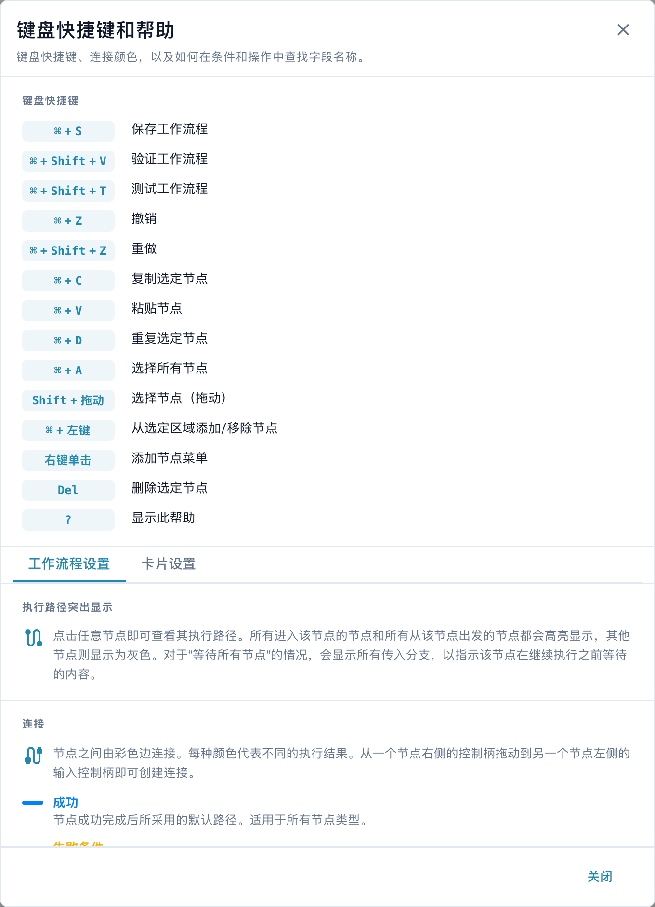

# 工具栏和画布

## 视频: 构建器与画布

认识陈伟，并在真实的中文 DocBits 界面中跟随他的讲解。他先检查工作流仪表板、工作流列表和许可证，然后打开未保存的设计器草稿。接下来，他逐步命名工作流、配置发票金额条件和两个操作、排列卡片，并连接两条处理路径，最后演示如何使用文档或自定义数据准备测试。演示账号没有 Advanced Workflow 订阅，因此验证被阻止；草稿保持未保存、未激活状态。



[打开视频](https://docbits-videos.fra1.cdn.digitaloceanspaces.com/settings-assistant/advanced_workflows_canvas-admin/v7/zh.mp4) · [字幕（WebVTT）](https://docbits-videos.fra1.cdn.digitaloceanspaces.com/settings-assistant/advanced_workflows_canvas-admin/v7/zh.vtt) · [文字稿（文本）](https://docbits-videos.fra1.cdn.digitaloceanspaces.com/settings-assistant/advanced_workflows_canvas-admin/v7/zh.txt) · 3:15

| 本视频内容 | 开始时间 |
| --- | --- |
| 认识管理员 | [0:00](https://docbits-videos.fra1.cdn.digitaloceanspaces.com/settings-assistant/advanced_workflows_canvas-admin/v7/zh.mp4#t=0) |
| 检查工作流权限 | [0:04](https://docbits-videos.fra1.cdn.digitaloceanspaces.com/settings-assistant/advanced_workflows_canvas-admin/v7/zh.mp4#t=4) |
| 命名工作流 | [0:29](https://docbits-videos.fra1.cdn.digitaloceanspaces.com/settings-assistant/advanced_workflows_canvas-admin/v7/zh.mp4#t=29) |
| 配置金额条件 | [0:42](https://docbits-videos.fra1.cdn.digitaloceanspaces.com/settings-assistant/advanced_workflows_canvas-admin/v7/zh.mp4#t=42) |
| 添加 Approval 操作 | [1:04](https://docbits-videos.fra1.cdn.digitaloceanspaces.com/settings-assistant/advanced_workflows_canvas-admin/v7/zh.mp4#t=64) |
| 添加 Standard 操作 | [1:25](https://docbits-videos.fra1.cdn.digitaloceanspaces.com/settings-assistant/advanced_workflows_canvas-admin/v7/zh.mp4#t=85) |
| 排列卡片 | [1:45](https://docbits-videos.fra1.cdn.digitaloceanspaces.com/settings-assistant/advanced_workflows_canvas-admin/v7/zh.mp4#t=105) |
| 连接处理路径 | [1:57](https://docbits-videos.fra1.cdn.digitaloceanspaces.com/settings-assistant/advanced_workflows_canvas-admin/v7/zh.mp4#t=117) |
| 准备测试用例 | [2:24](https://docbits-videos.fra1.cdn.digitaloceanspaces.com/settings-assistant/advanced_workflows_canvas-admin/v7/zh.mp4#t=144) |
| 验证、保存与启用 | [2:48](https://docbits-videos.fra1.cdn.digitaloceanspaces.com/settings-assistant/advanced_workflows_canvas-admin/v7/zh.mp4#t=168) |

文字稿

**认识管理员**

我来演示如何在 DocBits 中检查发票。

**检查工作流权限**

我先打开工作流仪表板，再进入工作流列表，然后检查许可证。 Workflow 和 Advanced Workflow 都需要有效的使用权限。 启用这两项权限后，新建工作流中才会提供 Advanced Workflow。 这个文档演示账号没有有效的工作流许可证，因此我会继续使用设计器中未保存的预览。

**命名工作流**

这里是真实的 DocBits 设计器。首先给草稿起一个清楚的名称。我们将检查发票金额，再用两个简单操作展示不同的处理路径。这个演示草稿不会保存。

**配置金额条件**

我打开添加菜单，选择条件卡片。 在文档字段类别中，选择 Docfield 条件。 字段名称填写 total_amount。 然后选择大于这个比较条件。 并输入一千。 请使用你自己的文档字段标识。金额正好等于一千时，不满足这个比较条件。

**添加 Approval 操作**

接下来，从文档字段类别中添加一张操作卡片。 这个操作会设置文档字段的值。 这里使用演示字段 approval_route。 并输入 Approval 作为字段值。 这个值只是用来标记路径。实际的审批流程需要配置相应的业务操作。

**添加 Standard 操作**

我再添加一张卡片，使用同样的操作。 这个操作会设置文档字段的值。 这里使用演示字段 approval_route。 这一次，演示字段的值设为 Standard。 两张卡片都已配置，但还需要连接，才能确定执行哪个操作。

**排列卡片**

我拖动卡片，让布局更加清楚。 把两个操作放在右侧。 条件放在中间，Start 放在左侧。 移动卡片只会改变位置，不会创建连接。

**连接处理路径**

我从 Start 的输出端拖动到条件的输入端。 成功路径通过蓝色连接，通向 Approval。 条件不满足的橙色路径通向 Standard。 红色错误输出是独立的，用于处理条件计算出错的情况。 这里暂时没有连接这个输出。正式使用工作流时，需要明确这类错误的处理方式。

**准备测试用例**

点击工具栏中的测试按钮，打开测试文档选择窗口。 可以选择演示文档，也可以准备完整的自定义数据。 请测试大于、小于和正好等于一千的金额，也要测试金额缺失的情况。 这个账号没有 Advanced Workflow 许可证，所以这里展示的是测试准备，而不是已经执行的测试结果。

**验证、保存与启用**

验证功能用于检查连接和卡片设置。这个账号缺少许可证，因此验证被阻止。 在具备权限的账号中，我会明确地把工作流保存到服务器。 然后单独检查启用状态。第一次保存之前，启用开关不可用。 自动草稿提示指的是浏览器中的本地副本，并不表示工作流已经保存到服务器或已启用。

[查看全部五个章节](videos.md)

高级工作流工具栏位于画布底部，提供构建、导航和管理流程所需的一切。

## 工具栏控件



**视频:** Advanced Workflow 设计器：卡片和路径 · 2:03 · [字幕 (WebVTT)](https://docbits-videos.fra1.cdn.digitaloceanspaces.com/settings-assistant/advanced-workflow-designer/v1/zh.vtt)

文字稿

**开始新的 Workflow** · [0:00](https://docbits-videos.fra1.cdn.digitaloceanspaces.com/settings-assistant/advanced-workflow-designer/v1/zh.mp4#t=0.25)

打开工作流仪表板，选择新工作流程。

**选择高级工作流程** · [0:04](https://docbits-videos.fra1.cdn.digitaloceanspaces.com/settings-assistant/advanced-workflow-designer/v1/zh.mp4#t=4.15)

选择高级工作流程。设计器打开时带有一个开始节点，每个 Workflow 都从这里开始。

**“当”、“和”、“然后”** · [0:11](https://docbits-videos.fra1.cdn.digitaloceanspaces.com/settings-assistant/advanced-workflow-designer/v1/zh.mp4#t=11.65)

通过添加菜单或在画布上右键单击来添加卡片。三类卡片是“当”、“和”、“然后”。

**“当”：触发条件** · [0:23](https://docbits-videos.fra1.cdn.digitaloceanspaces.com/settings-assistant/advanced-workflow-designer/v1/zh.mp4#t=23.583)

“当”卡是触发条件。它决定 Workflow 何时启动，例如针对某种文档类型。

**和：附加条件** · [0:36](https://docbits-videos.fra1.cdn.digitaloceanspaces.com/settings-assistant/advanced-workflow-designer/v1/zh.mp4#t=36.983)

和卡添加更多条件。它们检查文档，例如它的状态。结果是成功或失败条件。

**然后：操作卡** · [0:50](https://docbits-videos.fra1.cdn.digitaloceanspaces.com/settings-assistant/advanced-workflow-designer/v1/zh.mp4#t=50.316)

然后卡是操作卡。它们修改文档，例如设置字段或批准文档。

**拖动以连接** · [0:56](https://docbits-videos.fra1.cdn.digitaloceanspaces.com/settings-assistant/advanced-workflow-designer/v1/zh.mp4#t=56.716)

要连接两张卡片，从一张卡片右侧的连接点拖到下一张卡片左侧的输入点。

**蓝色：成功** · [1:03](https://docbits-videos.fra1.cdn.digitaloceanspaces.com/settings-assistant/advanced-workflow-designer/v1/zh.mp4#t=63.95)

蓝色是成功路径。每张卡片都有。卡片完成时，Workflow 走这条路径。

**橙色：失败条件** · [1:11](https://docbits-videos.fra1.cdn.digitaloceanspaces.com/settings-assistant/advanced-workflow-designer/v1/zh.mp4#t=71.116)

橙色是失败条件路径。只有和卡有。条件不满足时，Workflow 走这条路径。

**红色：错误** · [1:19](https://docbits-videos.fra1.cdn.digitaloceanspaces.com/settings-assistant/advanced-workflow-designer/v1/zh.mp4#t=79.116)

红色是错误路径。和卡和然后卡都有。卡片出错时，Workflow 走这条路径。

**带错误捕获的如果-否则** · [1:27](https://docbits-videos.fra1.cdn.digitaloceanspaces.com/settings-assistant/advanced-workflow-designer/v1/zh.mp4#t=87.116)

这些路径一起构成带错误捕获的如果-否则。成功执行一个操作，失败条件执行另一个，错误执行备用方案，例如给某人的任务。

**每种状态一条路径** · [1:38](https://docbits-videos.fra1.cdn.digitaloceanspaces.com/settings-assistant/advanced-workflow-designer/v1/zh.mp4#t=98.216)

对于多种情况，通过失败条件路径把文档状态卡串起来。每张卡检查一种状态，这样每种状态都有自己的路径。

**通往卡片及从卡片出发的路径** · [1:48](https://docbits-videos.fra1.cdn.digitaloceanspaces.com/settings-assistant/advanced-workflow-designer/v1/zh.mp4#t=108.35)

点击一张卡片即可突出显示它的执行路径：文档到达它所经过的卡片，以及之后可能执行的卡片。其他内容会变暗。这里只能从“当”卡经由状态卡的红色错误路径到达该任务。



**视频:** Workflow 描述和笔记 · 1:00 · [字幕 (WebVTT)](https://docbits-videos.fra1.cdn.digitaloceanspaces.com/settings-assistant/workflow-notes/v1/zh.vtt)

文字稿

**说明您的 Workflow** · [0:00](https://docbits-videos.fra1.cdn.digitaloceanspaces.com/settings-assistant/workflow-notes/v1/zh.mp4#t=0.25)

有多个分支的 Workflow 如果能自我说明，就更容易维护。设计器为此提供两种工具：整个 Workflow 的描述，以及画布上的笔记。

**描述整个 Workflow** · [0:11](https://docbits-videos.fra1.cdn.digitaloceanspaces.com/settings-assistant/workflow-notes/v1/zh.mp4#t=11.816)

在工具栏中选择编辑描述，用一两句话说明 Workflow 的用途。保存 Workflow 时会一并保存描述。

**添加笔记** · [0:20](https://docbits-videos.fra1.cdn.digitaloceanspaces.com/settings-assistant/workflow-notes/v1/zh.mp4#t=20.816)

要说明某个单独的步骤，在画布上右键单击，打开添加菜单并选择笔记。笔记会出现在您点击的位置。

**双击书写** · [0:30](https://docbits-videos.fra1.cdn.digitaloceanspaces.com/settings-assistant/workflow-notes/v1/zh.mp4#t=30.55)

双击笔记即可在其中书写，最多五百个字符。写完后点击旁边。

**移动和调整大小** · [0:37](https://docbits-videos.fra1.cdn.digitaloceanspaces.com/settings-assistant/workflow-notes/v1/zh.mp4#t=37.083)

把笔记拖到它所说明的卡片旁边，拉动右下角可以放大。

**为笔记设置颜色** · [0:43](https://docbits-videos.fra1.cdn.digitaloceanspaces.com/settings-assistant/workflow-notes/v1/zh.mp4#t=43.95)

右键单击笔记可以更改颜色。颜色有助于给笔记分组，例如蓝色用于说明，红色用于待解决的问题。

**笔记从不运行** · [0:53](https://docbits-videos.fra1.cdn.digitaloceanspaces.com/settings-assistant/workflow-notes/v1/zh.mp4#t=53.183)

笔记只给人看。它们不连接任何卡片，也从不运行，所以不会改变 Workflow 的行为。

- **+ Add** — 打开节点菜单以添加节点（参见[节点](nodes.md)）。
- **Undo / Redo** — 向后或向前逐步恢复或重做更改。
- **Zoom in / Zoom out** — 更改画布缩放级别。
- **Workflow name** — 在行内为工作流命名。
- **Edit description** — 为工作流添加描述。
- **Variables** — 打开[变量](variables.md)面板。
- **Help** — 打开键盘快捷键和帮助对话框。
- **Validate / Test** — 检查并运行流程（参见[验证和测试](validation-and-testing.md)）。
- **Snap to grid** — 切换节点是否吸附到网格，以便整齐布局。
- **Mini-map** — 切换小型概览地图，以便浏览大型图表。
- **保存** — 将工作流明确保存到服务器。自动草稿提示指浏览器本地副本，并不表示流程已保存到服务器或已启用。

## 键盘快捷键

在画布上随时按 <kbd>?</kbd> 打开快捷键和帮助对话框。

<figure><figcaption>
中文高级工作流快捷键窗口。Ctrl、Cmd 等按键名称保持原文；连接说明位于可滚动窗口的后续部分。
</figcaption></figure>

| 快捷键 | 操作 |
|---|---|
| <kbd>Cmd/Ctrl</kbd> + <kbd>S</kbd> | 保存工作流 |
| <kbd>Cmd/Ctrl</kbd> + <kbd>Shift</kbd> + <kbd>V</kbd> | 验证工作流 |
| <kbd>Cmd/Ctrl</kbd> + <kbd>Shift</kbd> + <kbd>T</kbd> | 测试工作流 |
| <kbd>Cmd/Ctrl</kbd> + <kbd>Z</kbd> / <kbd>Shift</kbd> + <kbd>Z</kbd> | 撤销 / 重做 |
| <kbd>Cmd/Ctrl</kbd> + <kbd>C</kbd> / <kbd>V</kbd> / <kbd>D</kbd> | 复制 / 粘贴 / 复制所选节点 |
| <kbd>Cmd/Ctrl</kbd> + <kbd>A</kbd> | 选择所有节点 |
| <kbd>Shift</kbd> + 拖动 | 选择节点（拖动） |
| <kbd>Cmd/Ctrl</kbd> + 单击鼠标左键 | 将节点添加到选择中或从中移除 |
| 单击鼠标右键 | 打开添加节点菜单 |
| <kbd>Del</kbd> | 删除所选节点 |
| <kbd>?</kbd> | 显示此帮助 |

## 后续步骤

- 使用[节点](nodes.md)和[变量](variables.md)构建流程。
