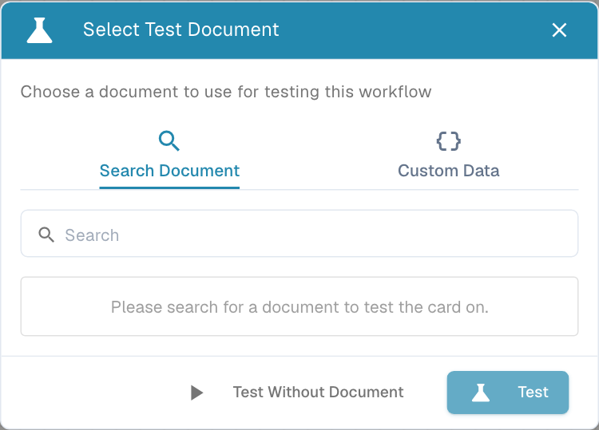
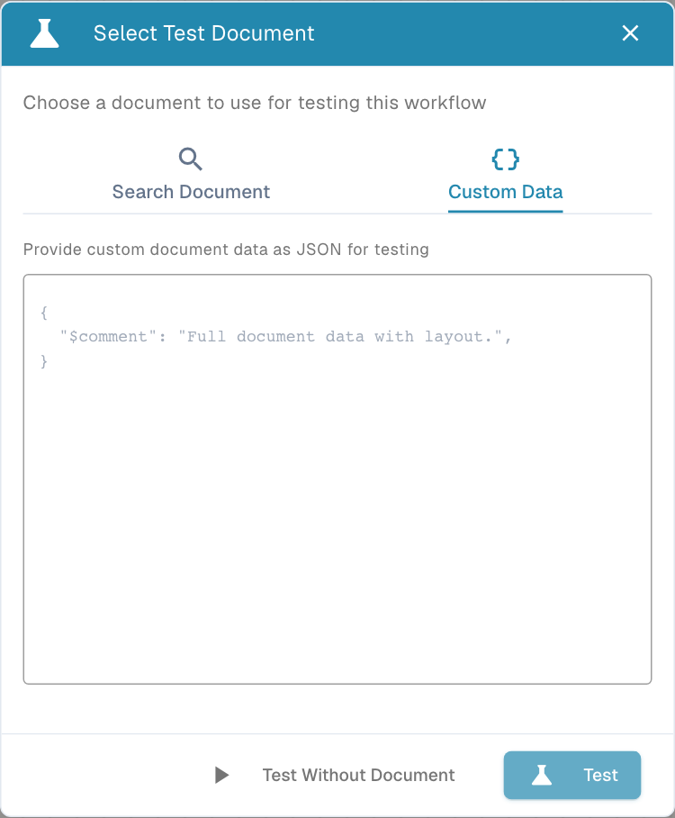

# 验证与测试

## 视频：变量、测试与激活



[打开视频](https://docbits-videos.fra1.cdn.digitaloceanspaces.com/settings-assistant/advanced_workflows_testing/v3/en.mp4) · [字幕（WebVTT）](https://docbits-videos.fra1.cdn.digitaloceanspaces.com/settings-assistant/advanced_workflows_testing/v3/en.vtt) · 1:53

转录文本（英文）

使用大括号图标打开 Variables。选择 Text、Number、Yes or No 或 Document。Search 会查找变量名称。Document 变量存储由专用 Workflow 操作设置的引用。此表单不接受文档值。

选择一个唯一的名称、类型和初始值。创建、编辑和删除变量会立即对组织持久生效。其他 Workflow 可以共享这些值。保存或丢弃画布都无法撤销变量更改。

选择 Validate。在画布上方查看错误和警告。点击一条消息以聚焦其节点。检查操作、入口连接、句柄、循环和汇合。结构验证并不能证明运行时数据是正确的。

工具栏的播放按钮会打开 Select Test Document。选择一个文档、Custom Data，或对独立卡片使用 Test Without Document。Start play 会直接运行。测试使用当前画布，包括未保存的编辑，并模拟破坏性操作。

准备高于、低于和正好等于一千的单独测试，以及缺失数据的情况。运行后，检查节点消息和时长：绿色为成功，橙色为假，红色为错误，灰色为跳过。修复后重新测试；对于可重复的场景，使用 Test Manager。

自动保存在更改后大约每三十秒保留一份浏览器本地草稿。请显式保存到服务器。首次保存之前，激活开关不可用。在期望自动执行之前，请在 Workflow List 中检查启用状态。

[观看全部五章](videos.md)

**Validate** 检查图结构。**Test** 使用特定输入评估当前的图。一张有效的图或一个绿色的测试并不能证明所有生产场景都被覆盖。

## 验证



**Video:** 验证一个 Workflow · 0:50 · [字幕（WebVTT）](https://docbits-videos.fra1.cdn.digitaloceanspaces.com/settings-assistant/workflow-validate/v1/en.vtt)

使用 **check-circle** 按钮或 **Cmd/Ctrl + Shift + V**。错误和警告显示在画布上方。点击带有节点引用的消息以聚焦该节点。

| 检查项 | 修正 |
| --- | --- |
| 入口 | 包含并连接 Start 或 When。入口节点不能作为目标。 |
| 操作 | 至少包含一个 Then。 |
| 连接 | 使用受支持的输出句柄和有效的目标输入。 |
| 循环 | 移除自连接和闭环。 |
| 汇合 | Wait ALL/ANY 至少需要两个输入；OR 需要两个不同的源。 |
| 未使用的节点 | 重新连接或移除孤立的处理节点。Notes 不需要连接。 |
| 现有 Delay | 正数时长，不超过 86,400 秒。 |
| 卡片 | 解决缺失卡片和版本兼容性警告。 |

警告可能标记出可疑的设计，例如来自同一个源的多个结果句柄指向同一个目标。请审视其含义；这并不等于测试成功。

验证无法可靠地确定每个版本专属卡片的字段都包含正确的运行时数据。请配置可见字段并测试真实输入。运行时测试可以发现结构检查无法检测到的缺失数据。

## 选择测试输入



**Video:** 测试一个 Workflow · 1:42 · [字幕（WebVTT）](https://docbits-videos.fra1.cdn.digitaloceanspaces.com/settings-assistant/workflow-testing/v1/en.vtt)

使用工具栏的 **play-circle** 或 **Cmd/Ctrl + Shift + T** 打开 **Select Test Document**。

<figure><figcaption>
选择你的卡片所需的输入。与文档无关的测试无法验证依赖文档的条件。
</figcaption></figure>

| 选项 | 方式 | 适用场景 |
| --- | --- | --- |
| **Search Document** | 输入至少两个字符，选择一个文档，然后选择 Test。 | 使用可用文档数据的、依赖文档的检查。 |
| **Custom Data** | 输入有效的 document-data JSON 并测试。这需要 document-data 结构，而不是任意的键值 JSON。 | 当你已知结构时，用于受控输入和边界情况。 |
| **Test Without Document** | 不选择文档直接运行。 | 与文档无关的卡片和控制流检查。 |

<figure><figcaption>
对受控场景使用完整的 document-data JSON。仅凭占位符注释并不能提供依赖文档的卡片所需的字段。
</figcaption></figure>

**Start play control**会直接测试，不打开选择器。节点上的 **Test from here** 从该点开始。必需的下游上下文仍必须存在。部分测试不会验证被省略的触发器和上游检查。

部分测试之后，请从完整的入口点重新运行该场景，尤其是当它包含汇合节点时。从图中途开始的测试，其已完成的前驱集合可能与真实的文档事件不同。

测试使用**当前画布**，包括未保存的编辑。测试模式模拟破坏性操作并跳过实际延迟。模拟的 Export、电子邮件或任务并不能证明生产集成已完成。

## 阅读结果

查看画布上的摘要和每个节点的结果指示器。打开结果详情以查看每个节点的消息和时长。结果对话框在可用时提供 **View in Designer**、**Re-test** 和 **Close**。

| 结果 | 含义 | 检查 |
| --- | --- | --- |
| **Green — Success** | 节点成功完成。 | 预期的操作和路由。 |
| **Orange — Failed Condition** | 评估的条件为假。 | 橙色替代路径和输入值。 |
| **Red — Error** | 评估或操作失败。 | 确切的节点消息和必需数据。 |
| **Gray — Skipped** | 节点未运行。 | 前置结果、入口和分支。 |

条件为假可能导致预期的替代路径，并使 Workflow 成功。成功的错误处理器可以与整体错误并存。请同时阅读单个节点和整体徽标。

整体测试时长可能包含设置和文档加载。每个节点的时长描述各个操作；这些测量值不必须精确相加。

## 可重复的测试

使用 [Test Manager](../test-manager.md) 保存回归场景。请覆盖：

- 真、假和错误结果。
- 精确的金额/日期/容差边界。
- 缺失数据和意外的文档类型。
- 所有汇合输入都匹配、只有一个匹配以及都不匹配。
- 每个相关的事件入口和预期的下游操作。

对修正和替代方案重新测试。然后 **Save**，在 Workflow List 中检查启用状态，并在 [Workflow Logs](../workflow-logs.md) 中查看新的真实运行。
