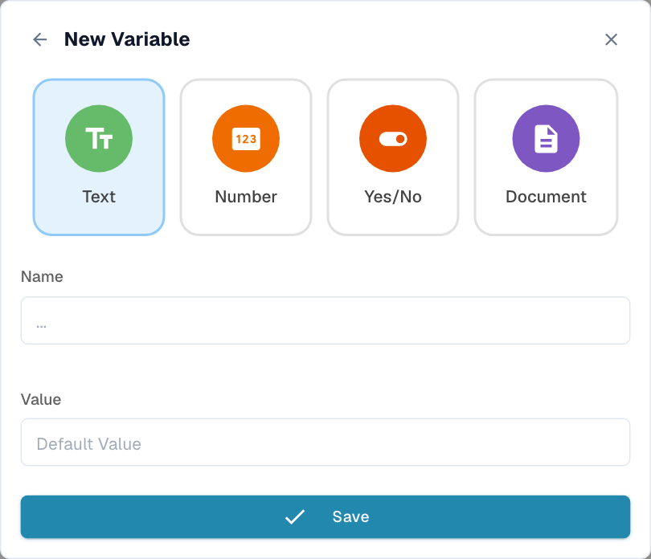

# 变量

## 视频：变量、测试与激活



[打开视频](https://docbits-videos.fra1.cdn.digitaloceanspaces.com/settings-assistant/advanced_workflows_testing/v3/en.mp4) · [字幕（WebVTT）](https://docbits-videos.fra1.cdn.digitaloceanspaces.com/settings-assistant/advanced_workflows_testing/v3/en.vtt) · 1:53

转录文本（英文）

使用花括号图标打开 Variables。选择 Text、Number、Yes or No 或 Document。Search 可以查找变量名称。Document 变量存储由专用 Workflow 操作设置的引用。此表单不接受文档值。

选择唯一的名称、类型和初始值。创建、编辑和删除变量会立即对组织生效。其他 Workflow 可以共享这些值。保存或放弃画布都无法撤销变量的更改。

选择 Validate。在画布上方查看错误和警告。点击一条消息即可聚焦其节点。检查操作、入口连接、连接点、循环和合并。结构校验并不能证明运行时数据是正确的。

工具栏中的播放按钮会打开 Select Test Document。可以选择一个文档、Custom Data，或为独立卡片选择 Test Without Document。开始播放会直接运行。测试使用当前画布，包括未保存的修改，并会模拟破坏性操作。

请分别针对高于、低于和恰好等于一千的情况准备测试，并补充数据缺失的情况。运行后，检查节点消息和耗时：绿色表示成功，橙色表示为假，红色表示错误，灰色表示已跳过。修复后重新测试；对于可重复的场景，请使用 Test Manager。

自动保存会在更改后大约每三十秒在浏览器中保留一份本地草稿。请显式保存到服务器。首次保存之前，激活开关不可用。在期望自动执行之前，请先在 Workflow List 中检查已启用状态。

[观看全部五个章节](videos.md)

使用工具栏中的 **{ }** 图标打开 **Variables**。兼容的卡片可以读取或更新命名值，例如阈值、标签、标志或文档引用。面板按类型对变量分组；Search 用于筛选名称。

## 全部四种类型

| 类型 | 存储内容 | 配置 |
| --- | --- | --- |
| **Text** | 一个字符串。 | 输入初始文本值，例如可复用的标签。 |
| **Number** | 一个数值。 | 输入数值，例如金额阈值，不要带货币符号。 |
| **Yes/No** | 一个布尔标志。 | 设置初始的 Yes/No 开关。 |
| **Document** | 一个文档引用。 | 由相应的 Workflow 操作分配。此表单不接受手动输入的文档默认值。 |

<figure><figcaption>
选择一个类型，输入唯一的名称，并在适用时设置初始值。
</figcaption></figure>

## 创建与使用

1. 打开 **Variables → New Variable**。
2. 选择类型。
3. 输入一个非空且尚未在该组织中使用的名称。
4. 在适用的情况下设置初始值。
5. 根据你的版本，选择 **Save** 或 **Create Variable**。
6. 在兼容的卡片字段中选择该变量。

卡片必须支持该变量类型。变量不能替代每一个卡片字段，组织变量与从文档字段中提取的值是不同的。

## 作用域与持久化


变量是**组织范围**的。创建、编辑或删除变量会立即保存到服务器，与是否保存画布无关。其他 Workflow 可以引用同一个变量。放弃 Workflow 或恢复本地草稿不会撤销变量的更改。


请谨慎使用共享值。如果每张发票需要不同的值，请选择卡片支持的文档字段或文档范围内的数据，而不要假定共享变量只属于某一次执行。

## 编辑与删除

**pencil**图标会打开变量的名称和值以供编辑。其类型保持不变；请在创建时就选择正确的类型。Save 会保存所做的更改。

**delete** 图标会打开确认对话框。确认之前，请检查哪些 Workflow 使用了该变量：删除引用可能导致卡片缺少其期望的值。更改共享值后，请重新测试受影响的 Workflow。

## 示例：共享的金额阈值

创建一个 Number 变量，例如 `approval_threshold`。在兼容的比较卡片中选择它，并将结果路由到审批或常规处理。更改之前，请先确定还有哪些 Workflow 使用了它。请分别针对低于、恰好等于和高于阈值的情况进行测试。比较运算符仍然很重要：更改变量的值并不会把 `>` 变成 `>=`。

接下来请继续阅读 [Validation & Testing](validation-and-testing.md) 和 [Workflow Logs](../workflow-logs.md)。
