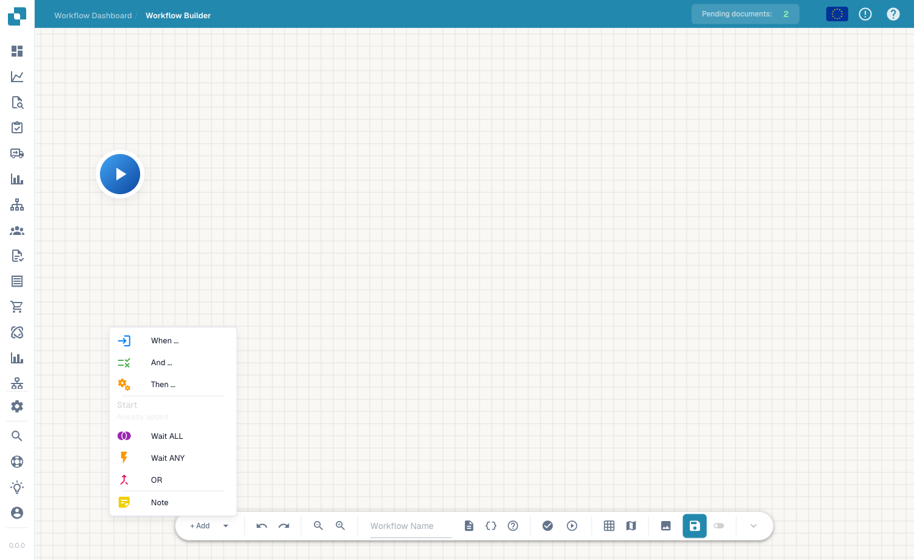

# Nœuds

## Vidéo: Nœuds et chemins



[Sous-titres (WebVTT)](https://docbits-videos.fra1.cdn.digitaloceanspaces.com/settings-assistant/advanced_workflows_logic/v2/fr.vtt) · 1:49

Transcription

**Le rôle de chaque nœud**

Start lance manuellement. When définit un événement. Aucun des deux ne reçoit de connexion entrante. And vérifie une condition. Then exécute une action. Les deux constructeurs partagent le catalogue de cartes. Les notes expliquent sans être exécutées.

**Trois résultats distincts**

Reliez une sortie à l’entrée suivante. Dans le concepteur, bleu signifie succès, orange condition fausse, rouge erreur. And possède trois résultats ; Then, succès et erreur. Les vues d’exécution affichent le succès en vert.

**Construisez une alternative**

Vérifiez si une facture dépasse le seuil. Reliez bleu à l’approbation, orange au traitement normal et rouge à la gestion des erreurs. Une condition fausse continue par son chemin connecté ; elle n’arrête pas toutes les branches.

**Joindre avec Wait ALL**

Wait ALL réunit des branches. Chaque nœud source doit avoir suivi un chemin relié à la jonction. Connectez les deux contrôles requis et l’action suivante. Un chemin non sélectionné ne fournit pas le résultat attendu.

**Alternatives avec ANY et OR**

Wait ANY et OR réunissent les branches si au moins une source suit un chemin connecté. OR exige deux nœuds sources distincts. Ces jonctions ne rendent pas les choix exclusifs et n’annulent pas d’autres actions. Testez le graphe entier.

**Gardez un graphe exécutable**

Rendez les nœuds accessibles depuis une entrée. Évitez les cycles et les connexions entrantes vers Start ou When. Incluez une action Then et validez les chemins. Les nœuds Delay importés exigent une durée positive ; Ajouter ne propose pas Delay.

[Voir les cinq chapitres](../advanced-workflow-videos.md)

Un Workflow Avancé est un graphe de **nœuds** reliés par des arêtes. Vous ajoutez des nœuds depuis le menu **+ Add** (ou par un clic droit sur le canevas) et vous les reliez pour définir le flux d'exécution.

<figure><figcaption>
Le menu de nœud <strong>+ Add</strong> — les types de nœuds disponibles.
</figcaption></figure>

## Types de nœuds



**Vidéo:** Changer la version d'une carte · 0:40 · [Sous-titres (WebVTT)](https://docbits-videos.fra1.cdn.digitaloceanspaces.com/settings-assistant/workflow-card-version/v1/fr.vtt)

Transcription

**L'étiquette montre la version de la carte** · [0:00](https://docbits-videos.fra1.cdn.digitaloceanspaces.com/settings-assistant/workflow-card-version/v1/fr.mp4#t=0.25)

Les cartes peuvent avoir plusieurs versions. La petite étiquette d'une carte, par exemple v1, indique la version utilisée. Une version plus récente en fait plus.

**Cliquer pour voir les versions** · [0:11](https://docbits-videos.fra1.cdn.digitaloceanspaces.com/settings-assistant/workflow-card-version/v1/fr.mp4#t=11.083)

Cliquez sur l'étiquette de version pour voir les versions de cette carte.

**Version 3 : Statut après exportation** · [0:15](https://docbits-videos.fra1.cdn.digitaloceanspaces.com/settings-assistant/workflow-card-version/v1/fr.mp4#t=15.816)

Choisissez la version plus récente. Celle-ci peut aussi définir le statut du document après exportation.

**Redéfinir les valeurs** · [0:23](https://docbits-videos.fra1.cdn.digitaloceanspaces.com/settings-assistant/workflow-card-version/v1/fr.mp4#t=23.55)

Les valeurs ne sont pas reprises. Définissez-les à nouveau, ici la configuration d'exportation et le statut.

**Valider et tester** · [0:31](https://docbits-videos.fra1.cdn.digitaloceanspaces.com/settings-assistant/workflow-card-version/v1/fr.mp4#t=31.916)

Puis validez et testez le Workflow, comme après tout changement. Enregistrez-le quand il fait ce que vous attendez.

- **Start** — le point d'entrée du workflow. Ajouté automatiquement ; tout flux commence ici.
- **When** — une carte de déclenchement, identique à celle du générateur Standard.
- **And** — une carte de condition. Elle est évaluée à vrai ou faux et peut ramifier le flux.
- **Then** — une carte d'action qui effectue un traitement (définir des champs, créer des tâches, appeler des API, …).
- **Wait ALL** — attend que *toutes* les branches entrantes soient terminées avant de continuer.
- **Wait ANY** — continue dès que *l'une* des branches entrantes est terminée.
- **OR** — ramifie le flux vers des chemins alternatifs.
- **Note** — une annotation en texte libre sur le canevas ; elle n'affecte pas l'exécution.

Les nœuds **When / And / Then** utilisent exactement les mêmes cartes que celles décrites dans la section [Cartes](../cards-overview.md).

## Relier les nœuds



**Vidéo:** Succès, condition échouée et erreur dans une exécution · 1:24 · [Sous-titres (WebVTT)](https://docbits-videos.fra1.cdn.digitaloceanspaces.com/settings-assistant/workflow-results/v1/fr.vtt)

Transcription

**Quand, Et, Dans ce cas à l'exécution** · [0:00](https://docbits-videos.fra1.cdn.digitaloceanspaces.com/settings-assistant/workflow-results/v1/fr.mp4#t=0.25)

Quand un Workflow s'exécute, la carte Quand le démarre. Les cartes Et vérifient des conditions et les cartes Dans ce cas agissent. La suite dépend du résultat de chaque carte.

**Succès, condition échouée ou erreur** · [0:12](https://docbits-videos.fra1.cdn.digitaloceanspaces.com/settings-assistant/workflow-results/v1/fr.mp4#t=12.85)

Chaque carte Et se termine par l'un de trois résultats. Un succès suit le chemin bleu, une condition échouée le chemin orange et une erreur le chemin rouge.

**Données manquantes : une erreur** · [0:24](https://docbits-videos.fra1.cdn.digitaloceanspaces.com/settings-assistant/workflow-results/v1/fr.mp4#t=24.783)

Des données manquantes ne sont pas une condition échouée. S'il manque un champ dont la carte a besoin, une variable ou le document, la carte signale une erreur et prend le chemin rouge.

**Pas de chemin orange : arrêt** · [0:36](https://docbits-videos.fra1.cdn.digitaloceanspaces.com/settings-assistant/workflow-results/v1/fr.mp4#t=36.816)

Si une condition échoue et que son chemin orange n'est pas relié, le Workflow s'arrête sur cette carte. L'exécution se termine en condition échouée.

**Relié : juste une autre branche** · [0:47](https://docbits-videos.fra1.cdn.digitaloceanspaces.com/settings-assistant/workflow-results/v1/fr.mp4#t=47.416)

Si le chemin orange est relié, une condition échouée est simplement une autre branche. Le Workflow continue par là et peut quand même finir en succès.

**Chemin rouge : rattraper les erreurs** · [0:57](https://docbits-videos.fra1.cdn.digitaloceanspaces.com/settings-assistant/workflow-results/v1/fr.mp4#t=57.716)

Reliez le chemin rouge à une solution de repli, par exemple une tâche pour une personne, pour que les erreurs ne passent pas inaperçues. Le repli s'exécute, mais l'exécution reste marquée en erreur.

**Comment une exécution se termine** · [1:11](https://docbits-videos.fra1.cdn.digitaloceanspaces.com/settings-assistant/workflow-results/v1/fr.mp4#t=71.283)

En bref : toute erreur fait de l'exécution une erreur. Une condition échouée sans chemin orange relié en fait une condition échouée. Tout le reste se termine en succès.



**Vidéo:** ET et OU : combiner des conditions · 4:20 · [Sous-titres (WebVTT)](https://docbits-videos.fra1.cdn.digitaloceanspaces.com/settings-assistant/workflow-merge/v2/fr.vtt)

Transcription

**ET et OU** · [0:00](https://docbits-videos.fra1.cdn.digitaloceanspaces.com/settings-assistant/workflow-merge/v2/fr.mp4#t=0.25)

Les conditions se combinent de deux façons. Des cartes l'une après l'autre agissent comme un ET : toutes doivent être vraies. Des cartes côte à côte, reliées à la même carte suivante, agissent comme un OU : une carte vraie suffit. Les nœuds de jonction le montrent sur le canevas.

**ET : cartes l'une après l'autre** · [0:19](https://docbits-videos.fra1.cdn.digitaloceanspaces.com/settings-assistant/workflow-merge/v2/fr.mp4#t=19.183)

Une carte après l'autre, c'est ET : chaque carte du chemin doit être vraie avant que la suivante s'exécute. Cette facture est prête pour la validation et pas en attente d'approbation : les deux cartes sont vraies et l'action s'exécute.

**OU : cartes côte à côte** · [0:35](https://docbits-videos.fra1.cdn.digitaloceanspaces.com/settings-assistant/workflow-merge/v2/fr.mp4#t=35.516)

OU, ce sont des cartes côte à côte. Reliez la sortie verte des deux cartes Et directement à l'entrée de la carte suivante. Testez : la première carte est fausse, la seconde vraie, et un chemin vrai suffit pour que l'action s'exécute. Le bandeau du test signale quand même une condition non remplie, car la sortie orange de la carte fausse n'est pas reliée, mais l'action s'exécute.

**La même chose avec une carte OU** · [0:57](https://docbits-videos.fra1.cdn.digitaloceanspaces.com/settings-assistant/workflow-merge/v2/fr.mp4#t=57.95)

Vous pouvez aussi réunir les chemins avec une carte OU. Elle fait la même chose, mais rend le OU visible sur le canevas. Clic droit sur le canevas, Ajouter, puis OU. Reliez les deux cartes Et à elle, et la carte OU à l'action.

**Un cas vrai suffit pour OU** · [1:15](https://docbits-videos.fra1.cdn.digitaloceanspaces.com/settings-assistant/workflow-merge/v2/fr.mp4#t=75.85)

Le test donne le même résultat : un cas vrai suffit à la carte OU, donc l'action s'exécute. Ici aussi, le bandeau signale la condition non remplie de la carte fausse.

**Attendre UN SEUL : comme OU** · [1:29](https://docbits-videos.fra1.cdn.digitaloceanspaces.com/settings-assistant/workflow-merge/v2/fr.mp4#t=89.85)

Attendre UN SEUL fonctionne exactement comme OU : la carte attend chaque carte placée avant elle et continue dès qu'au moins un chemin a été pris. Les deux sont interchangeables, prenez le nom qui se lit le mieux dans votre workflow.

**ET avec Attendre TOUS** · [1:51](https://docbits-videos.fra1.cdn.digitaloceanspaces.com/settings-assistant/workflow-merge/v2/fr.mp4#t=111.55)

Pour un ET avec des cartes côte à côte, utilisez Attendre TOUS. Clic droit sur le canevas, Ajouter, puis Attendre TOUS. Reliez les deux cartes Et à elle, et Attendre TOUS à l'action. Testez : elle attend les deux cartes, les deux sont vraies, donc l'action s'exécute.

**L'ordre : celui des connexions tracées** · [2:20](https://docbits-videos.fra1.cdn.digitaloceanspaces.com/settings-assistant/workflow-merge/v2/fr.mp4#t=140.383)

Dans quel ordre cela s'exécute-t-il ? Le workflow traite une liste. Les cartes derrière une carte y sont ajoutées dans l'ordre où leurs connexions ont été tracées, donc la condition du haut s'exécute d'abord, puis celle du bas. La carte OU attend que les deux aient été exécutées, et l'action s'exécute une fois, quel que soit le nombre de conditions vraies.

**Directement vers une action : pas d'attente** · [2:51](https://docbits-videos.fra1.cdn.digitaloceanspaces.com/settings-assistant/workflow-merge/v2/fr.mp4#t=171.85)

Les cartes reliées directement à une action n'attendent pas. L'action est atteinte par le chemin court et s'exécute avant que la dernière carte du chemin long soit vérifiée, donc cette carte ne change plus rien. Si l'action doit attendre chaque vérification, placez devant elle une carte OU, Attendre UN SEUL ou Attendre TOUS.

**Chaque sortie peut mener ailleurs** · [3:13](https://docbits-videos.fra1.cdn.digitaloceanspaces.com/settings-assistant/workflow-merge/v2/fr.mp4#t=193.916)

Chaque carte a jusqu'à trois sorties : succès, condition non remplie et erreur. Chaque sortie peut mener à sa propre carte suivante.

**Plusieurs sorties, une entrée : une suffit** · [3:25](https://docbits-videos.fra1.cdn.digitaloceanspaces.com/settings-assistant/workflow-merge/v2/fr.mp4#t=205.95)

Vous pouvez aussi relier plusieurs sorties d'une carte à la même entrée. Une seule peut être prise, car une carte se termine avec exactement un résultat : la carte suivante n'attend donc que celle-là. Cela vaut pour toute entrée, pas seulement pour ces nœuds de jonction. Testez : la condition échoue, et Attendre TOUS continue quand même.

**Nœuds de jonction : quels chemins ont été pris** · [3:54](https://docbits-videos.fra1.cdn.digitaloceanspaces.com/settings-assistant/workflow-merge/v2/fr.mp4#t=234.85)

Les nœuds de jonction rendent surtout un Workflow plus lisible. OU et Attendre UN SEUL continuent dès qu'au moins un chemin relié a été pris. Attendre TOUS attend que toutes les cartes précédentes soient terminées et ne continue que si tous les chemins reliés ont été pris. Toute sortie d'une carte peut être reliée, pas seulement la verte : si une carte se termine sur une condition non remplie, sa sortie orange compte comme prise.

Les nœuds sont reliés par des **arêtes colorées**. Faites glisser depuis une poignée située sur le côté **droit** d'un nœud vers la poignée d'entrée située sur le côté **gauche** d'un autre nœud pour créer une connexion. Chaque couleur indique un résultat d'exécution différent :

- **Success** (bleu) — le chemin par défaut emprunté lorsqu'un nœud se termine avec succès. Disponible sur tous les types de nœuds.
- **Failed Condition** (orange) — emprunté lorsqu'une condition est évaluée à faux. Disponible sur les nœuds **And** (condition).
- **Error** (rouge) — emprunté lorsqu'un nœud rencontre une erreur pendant l'exécution. Disponible sur les nœuds **And** et **Then** (action).

## Mise en évidence du chemin d'exécution

Cliquez sur un nœud pour voir son chemin d'exécution. Tous les nœuds qui y mènent et tous ceux qui en découlent sont mis en évidence — tout le reste est atténué. Pour les nœuds **Wait ALL**, chaque branche entrante est affichée afin que vous puissiez voir exactement ce que la barrière attend avant de continuer.

## Étapes suivantes

- Transmettez des données entre les nœuds avec les [Variables](variables.md).
- Vérifiez et exécutez votre flux avec la [Validation & Test](validation-and-testing.md).
