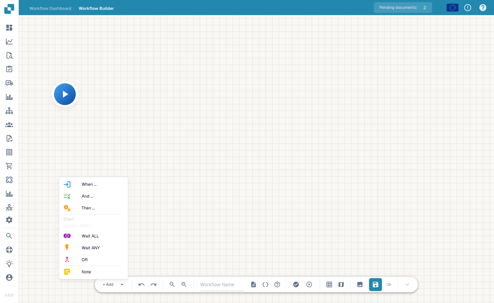

# Węzły

## Film: Węzły i ścieżki



[Napisy (WebVTT)](https://docbits-videos.fra1.cdn.digitaloceanspaces.com/settings-assistant/advanced_workflows_logic/v2/pl.vtt) · 1:44

Transkrypcja

**Rola każdego węzła**

Start uruchamia ręcznie. When definiuje zdarzenie. Oba nie przyjmują połączeń wejściowych. And sprawdza warunek. Then wykonuje akcję. Oba edytory korzystają z tego samego katalogu kart. Notatki wyjaśniają projekt i nie są wykonywane.

**Trzy różne wyniki**

Przeciągnij wyjście do następnego wejścia. W edytorze niebieski oznacza sukces, pomarańczowy fałszywy warunek, czerwony błąd. And ma trzy wyniki; Then sukces i błąd. Widok wykonania oznacza sukces kolorem zielonym.

**Utwórz alternatywną ścieżkę**

Sprawdź, czy kwota faktury przekracza próg. Połącz niebieski z akceptacją, pomarańczowy ze zwykłą obsługą, czerwony z obsługą błędów. Fałszywy warunek może kontynuować połączoną ścieżką; nie zatrzymuje wszystkich gałęzi.

**Łączenie przez Wait ALL**

Wait ALL łączy gałęzie. Każdy węzeł źródłowy musi wybrać ścieżkę połączoną z bramką. Połącz oba wymagane sprawdzenia i następną akcję. Niewybrana ścieżka nie dostarcza wymaganego wyniku.

**Alternatywy ANY i OR**

Wait ANY i OR łączą gałęzie, gdy co najmniej jedno źródło wybierze połączoną ścieżkę. OR wymaga dwóch różnych węzłów źródłowych. Bramki nie tworzą wykluczających się wyborów ani nie anulują innych akcji. Przetestuj cały graf.

**Graf gotowy do wykonania**

Węzły muszą być osiągalne od wejścia. Unikaj cykli i połączeń wejściowych do Start lub When. Dodaj akcję Then i sprawdź ścieżki. Importowane węzły Delay wymagają dodatniego czasu; menu dodawania nie oferuje Delay.

[Zobacz wszystkie pięć rozdziałów](../advanced-workflow-videos.md)

Zaawansowany Workflow to graf złożony z **węzłów** połączonych krawędziami. Węzły dodajesz z menu **+ Add** (lub klikając prawym przyciskiem myszy na kanwie) i łączysz je, aby zdefiniować przepływ wykonania.

<figure><figcaption>
Menu węzła <strong>+ Add</strong> — dostępne typy węzłów.
</figcaption></figure>

## Typy węzłów

- **Start** — punkt wejścia workflow. Dodawany automatycznie; każdy przepływ rozpoczyna się tutaj.
- **When** — karta wyzwalacza, taka sama jak w kreatorze standardowym.
- **And** — karta warunku. Przyjmuje wartość prawda lub fałsz i może rozgałęziać przepływ.
- **Then** — karta akcji, która wykonuje pracę (ustawia pola, tworzy zadania, wywołuje API, …).
- **Wait ALL** — czeka, aż *wszystkie* przychodzące gałęzie zostaną ukończone, zanim przejdzie dalej.
- **Wait ANY** — kontynuuje, gdy tylko *którakolwiek* przychodząca gałąź zostanie ukończona.
- **OR** — rozgałęzia przepływ na alternatywne ścieżki.
- **Note** — dowolna adnotacja tekstowa na kanwie; nie wpływa na wykonanie.

Węzły **When / And / Then** korzystają z dokładnie tych samych kart, które opisano w sekcji [Karty](../cards-overview.md).

## Łączenie węzłów



**Film:** Sukces, niespełniony warunek i błąd w działaniu Workflow · 1:58 · [Napisy (WebVTT)](https://docbits-videos.fra1.cdn.digitaloceanspaces.com/settings-assistant/workflow-results/v1/pl.vtt)

Transkrypcja

**Gdy, I, Następnie w działaniu** · [0:00](https://docbits-videos.fra1.cdn.digitaloceanspaces.com/settings-assistant/workflow-results/v1/pl.mp4#t=0.25)

Gdy Workflow działa, uruchamia go karta Gdy. Karty I sprawdzają warunki, a karty Następnie działają. Co dalej, zależy od wyniku każdej karty.

**Sukces, Niespełniony warunek lub Błąd** · [0:17](https://docbits-videos.fra1.cdn.digitaloceanspaces.com/settings-assistant/workflow-results/v1/pl.mp4#t=17.583)

Każda karta I kończy się jednym z trzech wyników. Sukces idzie niebieską ścieżką sukcesu, niespełniony warunek pomarańczową ścieżką, a błąd czerwoną ścieżką błędu.

**Brak danych to błąd** · [0:33](https://docbits-videos.fra1.cdn.digitaloceanspaces.com/settings-assistant/workflow-results/v1/pl.mp4#t=33.716)

Brak danych to nie jest niespełniony warunek. Jeśli w dokumencie brakuje pola potrzebnego karcie, brakuje zmiennej albo nie ma dokumentu, karta zgłasza błąd i idzie czerwoną ścieżką błędu.

**Niespełniony warunek bez pomarańczowej ścieżki: przebieg staje** · [0:52](https://docbits-videos.fra1.cdn.digitaloceanspaces.com/settings-assistant/workflow-results/v1/pl.mp4#t=52.316)

Jeśli warunek nie jest spełniony, a jego pomarańczowa ścieżka nie jest podłączona, Workflow zatrzymuje się na tej karcie. Przebieg kończy się jako niespełniony warunek.

**Podłączona: niespełniony warunek to tylko gałąź** · [1:07](https://docbits-videos.fra1.cdn.digitaloceanspaces.com/settings-assistant/workflow-results/v1/pl.mp4#t=67.65)

Jeśli pomarańczowa ścieżka jest podłączona, niespełniony warunek to po prostu kolejna gałąź. Workflow idzie tam dalej i nadal może zakończyć się sukcesem.

**Czerwona ścieżka błędu: wyjście awaryjne łapie błędy** · [1:22](https://docbits-videos.fra1.cdn.digitaloceanspaces.com/settings-assistant/workflow-results/v1/pl.mp4#t=82.65)

Podłącz czerwoną ścieżkę błędu do wyjścia awaryjnego, na przykład zadania dla osoby, aby błędy nie przeszły niezauważone. Wyjście awaryjne działa, ale przebieg i tak jest oznaczony jako błąd.

**Jak kończy się przebieg** · [1:42](https://docbits-videos.fra1.cdn.digitaloceanspaces.com/settings-assistant/workflow-results/v1/pl.mp4#t=102.783)

Krótko: każdy błąd czyni przebieg błędem. Niespełniony warunek bez podłączonej pomarańczowej ścieżki daje niespełniony warunek. Wszystko inne kończy się sukcesem.

Węzły są połączone **kolorowymi krawędziami**. Przeciągnij od uchwytu po **prawej** stronie węzła do uchwytu wejściowego po **lewej** stronie innego węzła, aby utworzyć połączenie. Każdy kolor oznacza inny wynik wykonania:

- **Success** (niebieski) — domyślna ścieżka wybierana, gdy węzeł zostanie pomyślnie ukończony. Dostępna dla wszystkich typów węzłów.
- **Failed Condition** (pomarańczowy) — wybierana, gdy warunek przyjmie wartość fałsz. Dostępna dla węzłów **And** (warunek).
- **Error** (czerwony) — wybierana, gdy węzeł napotka błąd podczas wykonania. Dostępna dla węzłów **And** oraz **Then** (akcja).

## Podświetlanie ścieżki wykonania

Kliknij dowolny węzeł, aby zobaczyć jego ścieżkę wykonania. Wszystkie węzły prowadzące do niego oraz wszystkie węzły następujące po nim zostają podświetlone — pozostałe są przyciemnione. W przypadku węzłów **Wait ALL** pokazywana jest każda przychodząca gałąź, dzięki czemu dokładnie widzisz, na co czeka bramka, zanim przejdzie dalej.

## Następne kroki

- Przekazuj dane między węzłami za pomocą [Zmiennych](variables.md).
- Sprawdź i uruchom przepływ w [Walidacji i Testowaniu](validation-and-testing.md).
