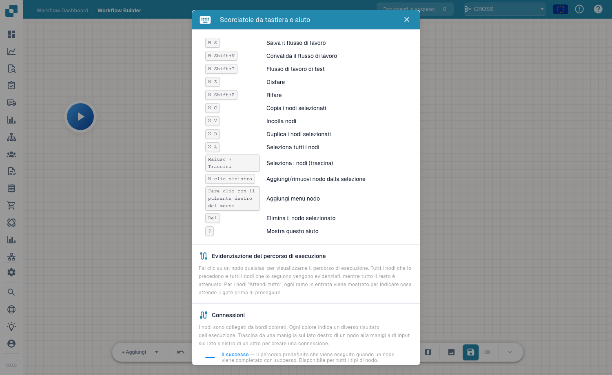

# Barre d'outils & Canevas

## Vidéo: Constructeur et canevas

Rencontrez Alain et suivez ses explications dans la véritable interface française de DocBits. Il vérifie le tableau de bord, la liste des workflows et la licence, puis ouvre un brouillon non enregistré dans le concepteur. Il nomme le workflow, configure le contrôle du montant et deux actions, dispose les cartes et relie les deux chemins, étape par étape. Il présente ensuite la préparation des tests avec un document ou des données personnalisées. Le compte de démonstration ne dispose pas d’abonnement Advanced Workflow et bloque la validation ; le brouillon reste non enregistré et inactif.



[Ouvrir la vidéo](https://docbits-videos.fra1.cdn.digitaloceanspaces.com/settings-assistant/advanced_workflows_canvas-admin/v7/fr.mp4) · [Sous-titres (WebVTT)](https://docbits-videos.fra1.cdn.digitaloceanspaces.com/settings-assistant/advanced_workflows_canvas-admin/v7/fr.vtt) · [Transcription (texte)](https://docbits-videos.fra1.cdn.digitaloceanspaces.com/settings-assistant/advanced_workflows_canvas-admin/v7/fr.txt) · 3:37

| Dans cette vidéo | Début |
| --- | --- |
| Présentation de l’administrateur | [0:00](https://docbits-videos.fra1.cdn.digitaloceanspaces.com/settings-assistant/advanced_workflows_canvas-admin/v7/fr.mp4#t=0) |
| Vérifier l’accès | [0:07](https://docbits-videos.fra1.cdn.digitaloceanspaces.com/settings-assistant/advanced_workflows_canvas-admin/v7/fr.mp4#t=7) |
| Nommer le workflow | [0:34](https://docbits-videos.fra1.cdn.digitaloceanspaces.com/settings-assistant/advanced_workflows_canvas-admin/v7/fr.mp4#t=34) |
| Configurer le contrôle du montant | [0:49](https://docbits-videos.fra1.cdn.digitaloceanspaces.com/settings-assistant/advanced_workflows_canvas-admin/v7/fr.mp4#t=49) |
| Ajouter l’action Approval | [1:14](https://docbits-videos.fra1.cdn.digitaloceanspaces.com/settings-assistant/advanced_workflows_canvas-admin/v7/fr.mp4#t=74) |
| Ajouter l’action Standard | [1:36](https://docbits-videos.fra1.cdn.digitaloceanspaces.com/settings-assistant/advanced_workflows_canvas-admin/v7/fr.mp4#t=96) |
| Organiser les cartes | [1:58](https://docbits-videos.fra1.cdn.digitaloceanspaces.com/settings-assistant/advanced_workflows_canvas-admin/v7/fr.mp4#t=118) |
| Relier les chemins | [2:13](https://docbits-videos.fra1.cdn.digitaloceanspaces.com/settings-assistant/advanced_workflows_canvas-admin/v7/fr.mp4#t=133) |
| Préparer les tests | [2:39](https://docbits-videos.fra1.cdn.digitaloceanspaces.com/settings-assistant/advanced_workflows_canvas-admin/v7/fr.mp4#t=159) |
| Valider, enregistrer et activer | [3:05](https://docbits-videos.fra1.cdn.digitaloceanspaces.com/settings-assistant/advanced_workflows_canvas-admin/v7/fr.mp4#t=185) |

Transcription

**Présentation de l’administrateur**

Je m’occupe de DocBits ici. Je vous montre comment créer un contrôle de facture avec deux chemins.

**Vérifier l’accès**

Je commence dans le tableau de bord des workflows et j’ouvre la liste. Ensuite, je vérifie la licence. Workflow et Advanced Workflow doivent tous les deux disposer d’un accès actif. Lorsque ces accès sont actifs, Nouveau workflow propose Advanced Workflow. Ce compte de documentation n’a pas de licence workflow active. Je continue donc avec un aperçu non enregistré dans le concepteur.

**Nommer le workflow**

Je travaille dans le véritable concepteur DocBits. Je donne d’abord un nom clair au brouillon. Nous vérifierons un montant de facture et utiliserons deux actions simples pour montrer les chemins possibles. Cette démonstration reste non enregistrée.

**Configurer le contrôle du montant**

J’ouvre le menu d’ajout et je choisis une carte de condition. Dans la catégorie Champ de document, je sélectionne la condition Docfield. Je renseigne le champ total_amount. Puis je choisis le comparateur supérieur à. Et je saisis mille. Utilisez votre propre identifiant de champ. Un montant égal à mille ne satisfait pas cette comparaison.

**Ajouter l’action Approval**

J’ajoute maintenant une carte d’action de la catégorie Champ de document. Cette action définit la valeur d’un champ du document. J’utilise la clé de démonstration approval_route. Et je saisis la valeur Approval. Cela identifie le chemin. Un véritable processus d’approbation nécessite ses propres actions métier.

**Ajouter l’action Standard**

J’ajoute une deuxième carte avec la même action. Cette action définit la valeur d’un champ du document. J’utilise la clé de démonstration approval_route. Cette fois, le champ de démonstration reçoit la valeur Standard. Les deux cartes sont configurées. Leurs connexions doivent encore déterminer quelle action sera exécutée.

**Organiser les cartes**

Je déplace les cartes pour obtenir une disposition lisible. Les deux actions vont à droite. La condition est au centre et Start à gauche. Déplacer une carte change sa position. Cela ne crée aucune connexion.

**Relier les chemins**

Je relie la sortie de Start à l’entrée de la condition. Le chemin de succès rejoint Approval par une connexion bleue. Le chemin orange de condition non satisfaite rejoint Standard. La sortie rouge d’erreur est distincte et traite les erreurs d’évaluation. Ici, elle reste sans connexion. Dans un workflow de production, définissez comment traiter ces erreurs.

**Préparer les tests**

Le bouton de test dans la barre d’outils ouvre la sélection d’un document de test. Je peux choisir un document de démonstration ou préparer des données personnalisées complètes. Testez des montants supérieurs, inférieurs et égaux à mille. Vérifiez aussi un montant absent. Ce compte n’a pas de licence Advanced Workflow. Je montre la préparation du test, pas un résultat exécuté.

**Valider, enregistrer et activer**

La validation vérifie les connexions et les paramètres des cartes. Ici, l’absence de licence bloque cette validation. Avec un compte autorisé, j’enregistrerais explicitement le workflow sur le serveur. Ensuite, je vérifierais séparément l’activation. L’interrupteur est désactivé avant le premier enregistrement. L’indicateur de brouillon automatique désigne une copie locale du navigateur. Il ne signifie pas que le workflow est enregistré ou activé.

[Voir les cinq chapitres](../advanced-workflow-videos.md)

La barre d'outils du Workflow Avancé s'étend en bas du canevas et vous donne tout le nécessaire pour construire, naviguer et gérer le flux.

## Commandes de la barre d'outils



**Vidéo:** Concepteur d'Advanced Workflow : cartes et chemins · 2:22 · [Sous-titres (WebVTT)](https://docbits-videos.fra1.cdn.digitaloceanspaces.com/settings-assistant/advanced-workflow-designer/v1/fr.vtt)

Transcription

**Commencer un nouveau Workflow** · [0:00](https://docbits-videos.fra1.cdn.digitaloceanspaces.com/settings-assistant/advanced-workflow-designer/v1/fr.mp4#t=0.25)

Ouvrez le Tableau de bord du flux de travail et choisissez Nouveau flux de travail.

**Choisir Flux de travail avancé** · [0:06](https://docbits-videos.fra1.cdn.digitaloceanspaces.com/settings-assistant/advanced-workflow-designer/v1/fr.mp4#t=6.45)

Choisissez Flux de travail avancé. Le concepteur s'ouvre avec un nœud de départ, où commence chaque Workflow.

**Quand, Et et Dans ce cas** · [0:14](https://docbits-videos.fra1.cdn.digitaloceanspaces.com/settings-assistant/advanced-workflow-designer/v1/fr.mp4#t=14.816)

Ajoutez des cartes avec le menu Ajouter ou par un clic droit sur le canevas. Les trois catégories de cartes sont Quand, Et et Dans ce cas.

**Quand : la condition de déclenchement** · [0:27](https://docbits-videos.fra1.cdn.digitaloceanspaces.com/settings-assistant/advanced-workflow-designer/v1/fr.mp4#t=27.25)

La carte Quand est la condition de déclenchement. Elle décide quand le Workflow démarre, par exemple pour un type de document donné.

**Et : une condition de plus** · [0:40](https://docbits-videos.fra1.cdn.digitaloceanspaces.com/settings-assistant/advanced-workflow-designer/v1/fr.mp4#t=40.716)

Les cartes Et ajoutent d'autres conditions. Elles vérifient le document, par exemple son statut. Le résultat est un succès ou une condition échouée.

**Dans ce cas : la carte d'action** · [0:54](https://docbits-videos.fra1.cdn.digitaloceanspaces.com/settings-assistant/advanced-workflow-designer/v1/fr.mp4#t=54.116)

Les cartes Dans ce cas sont les cartes d'action. Elles modifient le document, par exemple remplissent un champ ou approuvent le document.

**Glisser pour relier** · [1:03](https://docbits-videos.fra1.cdn.digitaloceanspaces.com/settings-assistant/advanced-workflow-designer/v1/fr.mp4#t=63.516)

Pour relier deux cartes, faites glisser depuis une poignée à droite d'une carte jusqu'à l'entrée à gauche de la carte suivante.

**Bleu : succès** · [1:11](https://docbits-videos.fra1.cdn.digitaloceanspaces.com/settings-assistant/advanced-workflow-designer/v1/fr.mp4#t=71.55)

Le bleu est le chemin du succès. Chaque carte l'a. Le Workflow le prend quand la carte se termine.

**Orange : condition échouée** · [1:19](https://docbits-videos.fra1.cdn.digitaloceanspaces.com/settings-assistant/advanced-workflow-designer/v1/fr.mp4#t=79.916)

L'orange est le chemin de la condition échouée. Seules les cartes Et l'ont. Le Workflow le prend quand la condition n'est pas remplie.

**Rouge : erreur** · [1:29](https://docbits-videos.fra1.cdn.digitaloceanspaces.com/settings-assistant/advanced-workflow-designer/v1/fr.mp4#t=89.716)

Le rouge est le chemin d'erreur. Les cartes Et et Dans ce cas l'ont. Le Workflow le prend quand une carte échoue avec une erreur.

**Si-sinon avec gestion d'erreur** · [1:39](https://docbits-videos.fra1.cdn.digitaloceanspaces.com/settings-assistant/advanced-workflow-designer/v1/fr.mp4#t=99.216)

Ensemble, ces chemins forment un si-sinon avec gestion d'erreur. Le succès lance une action, une condition échouée une autre, et une erreur une solution de repli, par exemple une tâche pour une personne.

**Un chemin par statut** · [1:53](https://docbits-videos.fra1.cdn.digitaloceanspaces.com/settings-assistant/advanced-workflow-designer/v1/fr.mp4#t=113.116)

Pour plusieurs cas, enchaînez des cartes Statut du document par leurs chemins de condition échouée. Chaque carte vérifie un statut, ainsi chaque statut a son propre chemin.

**Le chemin vers une carte et depuis elle** · [2:04](https://docbits-videos.fra1.cdn.digitaloceanspaces.com/settings-assistant/advanced-workflow-designer/v1/fr.mp4#t=124.516)

Cliquez sur une carte pour mettre en évidence son chemin d'exécution : les cartes qu'un document traverse pour l'atteindre, et celles qui peuvent suivre. Tout le reste s'estompe. Ici, la tâche n'est atteinte que depuis la carte Quand, par le chemin d'erreur rouge de la carte de statut.



**Vidéo:** Descriptions et notes de Workflow · 1:10 · [Sous-titres (WebVTT)](https://docbits-videos.fra1.cdn.digitaloceanspaces.com/settings-assistant/workflow-notes/v1/fr.vtt)

Transcription

**Expliquer votre Workflow** · [0:00](https://docbits-videos.fra1.cdn.digitaloceanspaces.com/settings-assistant/workflow-notes/v1/fr.mp4#t=0.25)

Un Workflow avec plusieurs branches est plus facile à maintenir quand il s'explique lui-même. Le concepteur a deux outils pour cela : une description du Workflow entier et des notes sur le canevas.

**Décrire le Workflow entier** · [0:13](https://docbits-videos.fra1.cdn.digitaloceanspaces.com/settings-assistant/workflow-notes/v1/fr.mp4#t=13.083)

Choisissez Modifier la description dans la barre d'outils et dites en une ou deux phrases à quoi sert le Workflow. La description est enregistrée quand vous enregistrez le Workflow.

**Ajouter une note** · [0:24](https://docbits-videos.fra1.cdn.digitaloceanspaces.com/settings-assistant/workflow-notes/v1/fr.mp4#t=24.716)

Pour expliquer une seule étape, faites un clic droit sur le canevas, ouvrez le menu d'ajout et choisissez Note. La note apparaît là où vous avez cliqué.

**Double-clic pour écrire** · [0:35](https://docbits-videos.fra1.cdn.digitaloceanspaces.com/settings-assistant/workflow-notes/v1/fr.mp4#t=35.316)

Double-cliquez sur la note pour y écrire, jusqu'à cinq cents caractères. Cliquez à côté quand vous avez fini.

**Déplacer et redimensionner** · [0:42](https://docbits-videos.fra1.cdn.digitaloceanspaces.com/settings-assistant/workflow-notes/v1/fr.mp4#t=42.65)

Faites glisser la note près des cartes qu'elle explique, et tirez son coin inférieur droit pour l'agrandir.

**Donner une couleur aux notes** · [0:49](https://docbits-videos.fra1.cdn.digitaloceanspaces.com/settings-assistant/workflow-notes/v1/fr.mp4#t=49.616)

Faites un clic droit sur une note pour changer sa couleur. Les couleurs aident à regrouper les notes, par exemple bleu pour les explications et rouge pour les questions ouvertes.

**Les notes ne s'exécutent jamais** · [1:00](https://docbits-videos.fra1.cdn.digitaloceanspaces.com/settings-assistant/workflow-notes/v1/fr.mp4#t=60.95)

Les notes sont seulement pour les personnes. Elles ne sont reliées à aucune carte et ne s'exécutent jamais : elles ne changent rien à ce que fait le Workflow.

- **+ Add** — ouvre le menu de nœud pour ajouter un nœud (voir [Nœuds](nodes.md)).
- **Undo / Redo** — recule ou avance dans vos modifications.
- **Zoom in / Zoom out** — modifie le niveau de zoom du canevas.
- **Workflow name** — nomme le workflow en ligne.
- **Edit description** — ajoute une description au workflow.
- **Variables** — ouvre le panneau [Variables](variables.md).
- **Help** — ouvre la boîte de dialogue des raccourcis clavier et de l'aide.
- **Validate / Test** — vérifie et exécute le flux (voir [Validation & Test](validation-and-testing.md)).
- **Snap to grid** — active ou désactive l'alignement des nœuds sur la grille pour des dispositions soignées.
- **Mini-map** — active ou désactive une petite carte de vue d'ensemble pour naviguer dans les grands graphes.
- **Save** — enregistre le workflow. Un indicateur **auto-save** indique la date du dernier enregistrement automatique du flux.

## Raccourcis clavier

Appuyez sur <kbd>?</kbd> sur le canevas pour ouvrir à tout moment la boîte de dialogue des raccourcis et de l'aide.

<figure><figcaption>
La boîte de dialogue des raccourcis clavier et de l'aide — raccourcis, mise en évidence du chemin d'exécution et couleurs des connexions.
</figcaption></figure>

| Raccourci | Action |
|---|---|
| <kbd>Cmd/Ctrl</kbd> + <kbd>S</kbd> | Enregistrer le workflow |
| <kbd>Cmd/Ctrl</kbd> + <kbd>Shift</kbd> + <kbd>V</kbd> | Valider le workflow |
| <kbd>Cmd/Ctrl</kbd> + <kbd>Shift</kbd> + <kbd>T</kbd> | Tester le workflow |
| <kbd>Cmd/Ctrl</kbd> + <kbd>Z</kbd> / <kbd>Shift</kbd> + <kbd>Z</kbd> | Annuler / Rétablir |
| <kbd>Cmd/Ctrl</kbd> + <kbd>C</kbd> / <kbd>V</kbd> / <kbd>D</kbd> | Copier / Coller / Dupliquer les nœuds sélectionnés |
| <kbd>Cmd/Ctrl</kbd> + <kbd>A</kbd> | Sélectionner tous les nœuds |
| <kbd>Shift</kbd> + Glisser | Sélectionner des nœuds (glisser) |
| <kbd>Cmd/Ctrl</kbd> + Clic gauche | Ajouter/retirer un nœud de la sélection |
| Clic droit | Menu d'ajout de nœud |
| <kbd>Del</kbd> | Supprimer le nœud sélectionné |
| <kbd>?</kbd> | Afficher cette aide |

## Étapes suivantes

- Construisez le flux avec les [Nœuds](nodes.md) et les [Variables](variables.md).
