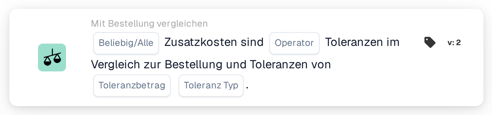
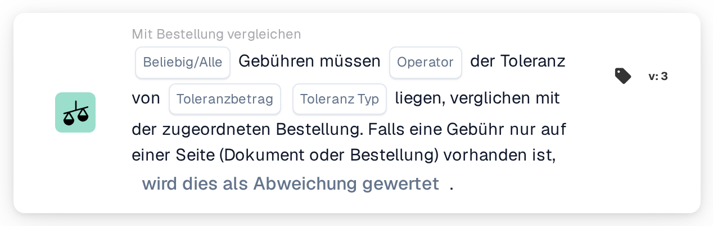
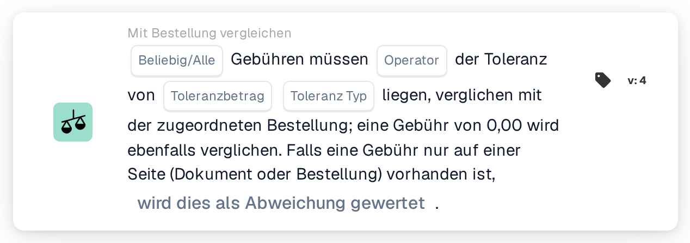

# Beliebige oder alle Gebühren

<figure><figcaption>
Version 2
</figcaption></figure>

<figure><figcaption>
Version 3
</figcaption></figure>

<figure><figcaption>
Version 4
</figcaption></figure>

## **Zweck:**

Diese Workflow-Karte vergleicht die Zusatzkosten eines Dokuments mit den Zusatzkosten der zugeordneten Bestellung, innerhalb einer festgelegten Toleranz. Sie beantwortet eine einzige Frage: Stimmen Dokument und Bestellung in den Zusatzkosten überein? Verglichen wird jede Gebühr, die der Bestellabgleich einander zugeordnet hat, weshalb auf der Karte kein Feldname angegeben werden muss.

Diese Karte unterscheidet sich von **Vergleichen Sie die Gesamtgebühren**, die ein einzelnes benanntes Dokumentfeld mit einer über eine Charge ID bestimmten Gebühr vergleicht. Verwenden Sie diese Karte, wenn alle zugeordneten Gebühren eines Dokuments gemeinsam geprüft werden sollen.

Der Bestellabgleich muss vor dieser Karte laufen. Hat das Dokument keine zugeordnete Bestellung, stoppt die Karte den Workflow und meldet fehlende Daten.

## **Bestandteile der Karte:**

1. **Beliebig/Alle:**
   * **Beschreibung**: Wie die einzelnen Gebührenvergleiche zum einen Ergebnis der Karte zusammengefasst werden.
   * **Optionen**:
     * **Irgendeine**: mindestens eine Gebühr muss den Vergleich erfüllen.
     * **Alle**: jede Gebühr muss den Vergleich erfüllen.
2. **Operator:**
   * **Beschreibung**: Wie der Gebührenbetrag des Dokuments mit dem Bestellbetrag derselben Gebühr verglichen wird.
   * **Optionen**:
     * **innerhalb**: die beiden Beträge müssen übereinstimmen, wobei die Toleranz zugelassen wird.
     * **Außerhalb**: die beiden Beträge müssen um mehr als die Toleranz voneinander abweichen.
3. **Toleranzbetrag:**
   * **Beschreibung**: Die zulässige Abweichung zwischen der Gebühr des Dokuments und der Gebühr der Bestellung.
4. **Toleranz Typ:**
   * **Beschreibung**: Wie der Toleranzbetrag ausgelegt wird.
   * **Optionen**:
     * **Prozentsatz**: ein Prozentsatz der Bestellgebühr.
     * **Wert**: ein fester Betrag.
5. **Verhalten bei fehlenden Daten (Versionen 3 und 4):**
   * **Beschreibung**: Was geschehen soll, wenn eine Gebühr nur auf einer Seite vorhanden ist, im Dokument oder in der Bestellung, sodass es kein Gegenstück zum Vergleich gibt. Die Option steht am Ende des Satzes.
   * **Optionen**:
     * **wird dies als Abweichung gewertet**: der Workflow stoppt. Das ist die Voreinstellung.
     * **Ignorieren Sie es und behandeln Sie es als Übereinstimmung.**: der Workflow läuft weiter, als hätte die Gebühr übereingestimmt.

## **Funktionalität:**

Die Karte durchläuft die folgenden Schritte.

1. **Sie setzt eine zugeordnete Bestellung voraus.** Ohne zugeordnete Bestellung stoppt die Karte sofort und meldet fehlende Daten.
2. **Sie liest die Toleranz** aus **Toleranzbetrag** und **Toleranz Typ** auf der Karte.
3. **Versionen 3 und 4 sortieren jede zugeordnete Bestellposition** in eine von vier Situationen ein: Gebühren auf beiden Seiten, keine Gebühren auf beiden Seiten, Gebühren nur im Dokument oder Gebühren nur in der Bestellung. Version 3 fragt nur, ob eine Seite eine Gebühr über 0,00 trägt. Version 4 betrachtet jedes Gebührenpaar und zählt 0,00 als Wert; nur eine Gebühr ganz ohne Betrag gilt als fehlend. Siehe **Unterschiede zwischen den Versionen** unten. Eine Position, die den Bestelldaten des Dokuments nicht zugeordnet werden kann, ist ein Datenfehler und die Karte stoppt.
4. **Eine Gebühr auf nur einer Seite entscheidet die gesamte Karte.** Sobald eine zugeordnete Position Gebühren auf einer Seite und keine auf der anderen trägt, entscheidet **Verhalten bei fehlenden Daten** das Ergebnis, und es wird überhaupt keine Gebühr verglichen, auch nicht die Gebühren korrekt zugeordneter Positionen. Operator und Toleranz werden nicht herangezogen.
5. **Trägt keine Position auf einer der beiden Seiten Gebühren**, stimmen beide Seiten darin überein, dass es keine Zusatzkosten gibt. Der Operator **Außerhalb** ist damit nicht erfüllt, weil nichts über die Toleranz hinaus abweicht, und der Workflow stoppt. Jeder andere Operator wertet die Übereinstimmung als erfüllt und der Workflow läuft weiter. **Verhalten bei fehlenden Daten** hat hier keine Wirkung.
6. **Andernfalls wird jede Gebühr verglichen**, Dokumentbetrag gegen Bestellbetrag, mit Operator und Toleranz. Ein Gebührenbetrag, der keine Zahl ist, stoppt die Karte mit fehlenden Daten.
7. **Die Vergleiche werden gesammelt und einmal zusammengefasst.** Jede Gebühr jeder zugeordneten Position trägt zu einer einzigen Ergebnismenge bei, die die Einstellung **Beliebig/Alle** auf das eine Ergebnis der Karte reduziert. Gesammelt wird dokumentweit, nicht je Position, sodass **Irgendeine** jede Gebühr an beliebiger Stelle des Dokuments bedeutet. Ist das zusammengefasste Ergebnis wahr, läuft der Workflow weiter, andernfalls stoppt er mit einer nicht erfüllten Bedingung.

Drei Folgen sind vor dem Konfigurieren der Karte wichtig zu wissen.

* **innerhalb mit einer Toleranz von 0 verlangt exakte Gleichheit.** Die beiden Beträge müssen auf den Cent übereinstimmen.
* **Eine Gebühr auf nur einer Seite überstimmt alles andere.** Da Schritt 4 vor jedem Vergleich läuft, überspringt **Ignorieren Sie es und behandeln Sie es als Übereinstimmung.** auch die Betragsprüfung jeder korrekt zugeordneten Gebühr im Dokument. Behalten Sie **wird dies als Abweichung gewertet**, wenn die Beträge geprüft werden müssen.
* **wird dies als Abweichung gewertet stoppt den Workflow als Fehler, nicht als nicht erfüllte Bedingung.** Trotz der Formulierung meldet die Karte fehlende Daten, was das Workflow-Protokoll und der Kartentest rot anzeigen und nicht orange wie eine nicht erfüllte Bedingung. Der Workflow stoppt in beiden Fällen.

## **Einrichtung und Konfiguration:**

Fügen Sie die Karte als And-Bedingung nach dem Bestellabgleich ein. Wählen Sie, ob jede oder irgendeine Gebühr den Vergleich erfüllen muss, wählen Sie den Operator **innerhalb** oder **Außerhalb** und geben Sie Toleranzbetrag und Toleranz Typ ein. Wählen Sie in den Versionen 3 und 4, was geschehen soll, wenn Gebühren nur auf einer Seite auftreten.

Um eine Konfiguration ohne Warten auf ein Dokument zu prüfen, öffnen Sie das Kartenmenü im Workflow Builder, wählen **Testkarte**, wählen ein Dokument und dann **Test auf Dokument**. Das Kartenprotokoll listet jede verglichene Gebühr mit beiden Beträgen, dem Operator und der verwendeten Toleranz auf und hält außerdem fest, welcher Wert von **Verhalten bei fehlenden Daten** das Ergebnis entschieden hat, wenn eine Gebühr nur auf einer Seite vorhanden war.

## **Beispiel-Szenario:**

Eine Auftragsbestätigung trägt eine Frachtgebühr von 100,00 und die zugeordnete Bestellposition trägt dieselbe Frachtgebühr von 100,00. Mit **Alle**, dem Operator **innerhalb** und einer Toleranz von 0 als Wert sind die Beträge gleich, die Karte ist erfüllt und der Workflow läuft weiter.

Mit 120,00 auf der Auftragsbestätigung gegen 100,00 in der Bestellung ist dieselbe Konfiguration nicht erfüllt und der Workflow stoppt mit einer nicht erfüllten Bedingung.

Trägt weder die Auftragsbestätigung noch die Bestellung eine Gebühr, wertet der Operator **innerhalb** das als Übereinstimmung und der Workflow läuft weiter, während **Außerhalb** ihn stoppt.

Trägt die Auftragsbestätigung eine Frachtgebühr und die Bestellung keine, gilt der Operator nicht mehr. Mit **wird dies als Abweichung gewertet** stoppt der Workflow, damit jemand prüfen kann, warum die Gebühr nur auf einer Seite steht.

Zeigt die Auftragsbestätigung die Frachtgebühr mit 0,00, während die Bestellung 204,00 trägt, vergleicht Version 4 die beiden Beträge und der Workflow stoppt mit einer nicht erfüllten Bedingung. Version 3 würde die 0,00 als "keine Gebühr im Dokument" lesen und das Ergebnis **Verhalten bei fehlenden Daten** überlassen.

## **Unterschiede zwischen den Versionen:**

Version 4 verwenden neue Karten. Versionen 2 und 3 werden in bestehenden Workflows weiter unterstützt.

### Version 4 im Vergleich zu Version 3

Beide Versionen haben dieselben Einstellungen und dieselben Schritte. Sie unterscheiden sich nur darin, wie eine Gebühr von 0,00 behandelt wird:

* **Version 3 wertet 0,00 als keine Gebühr.** Eine Dokumentgebühr von 0,00, der eine Bestellgebühr von 204,00 zugeordnet ist, zählt als "die Bestellung hat Gebühren, das Dokument keine", sodass **Verhalten bei fehlenden Daten** entscheidet und die Beträge nie verglichen werden. Mit **Ignorieren Sie es und behandeln Sie es als Übereinstimmung.** läuft der Workflow weiter, obwohl die Beträge abweichen.
* **Version 4 vergleicht 0,00 als Betrag.** Dasselbe Paar wird wie jedes andere verglichen: 0,00 gegen 204,00 liegt nicht innerhalb der Toleranz, sodass der Workflow mit einer nicht erfüllten Bedingung stoppt. Ein Paar mit 0,00 auf beiden Seiten wird ebenfalls verglichen und stimmt überein.
* **Eine Gebühr ohne Betrag fehlt auch in Version 4.** Hat eine Seite eines Paares überhaupt keinen Betrag, zum Beispiel eine Gebühr, die die Bestellung nicht trägt, entscheidet **Verhalten bei fehlenden Daten**, wie in Version 3.

Um dieses Verhalten in einem bestehenden Workflow zu erhalten, ersetzen Sie die Karte der Version 3 durch eine Karte der Version 4 und stellen dieselben Werte ein.

### Version 2

Auch Version 2 vergleicht je Gebühr und fasst die Ergebnisse dokumentweit mit der Einstellung **Beliebig/Alle** zusammen, hat aber keine Fallunterscheidung, was ändert, was geschieht, sobald Gebühren nicht auf beiden Seiten vorhanden sind:

* Version 2 hat keine Option **Verhalten bei fehlenden Daten**. Ihr Satz endet nach dem Toleranz Typ.
* Version 2 sortiert die zugeordneten Positionen nicht und erkennt daher keine Gebühr, die nur auf einer Seite vorhanden ist. Sie vergleicht den vorhandenen Betrag gegen die 0,00 der fehlenden Seite, und der Operator entscheidet: **innerhalb** ist nicht erfüllt und der Workflow stoppt, **Außerhalb** ist erfüllt und der Workflow läuft weiter. Das Kartenprotokoll zeigt den Vergleich gegen 0,00.
* Trägt keine der beiden Seiten Gebühren, hat Version 2 nichts zu vergleichen und meldet fehlende Daten, statt das Fehlen auf beiden Seiten als Übereinstimmung zu werten.

## **Fazit:**

Die Karte "Any / All Charges" automatisiert die Prüfung, dass die in Rechnung gestellten oder bestätigten Zusatzkosten den bestellten Zusatzkosten entsprechen. Da das Fehlen von Gebühren auf beiden Seiten in den Versionen 3 und 4 als Übereinstimmung gilt, laufen Dokumente ohne Zusatzkosten ohne manuellen Eingriff durch, während Gebühren, die nur auf einer Seite auftreten, zur Prüfung zurückgehalten werden, sofern das nicht ausdrücklich erlaubt wird.
