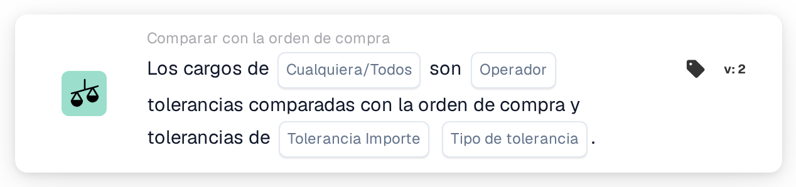
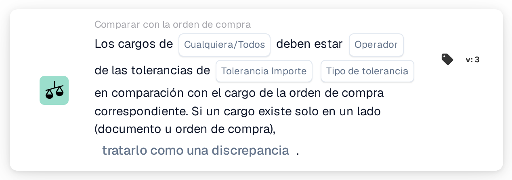
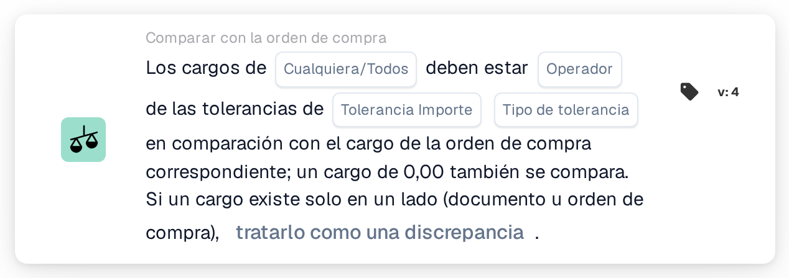

# Cualquier/Todos los cargos

<figure><figcaption>
Versión 2
</figcaption></figure>

<figure><figcaption>
Versión 3
</figcaption></figure>

<figure><figcaption>
Versión 4
</figcaption></figure>

## **Propósito:**

Esta tarjeta de Workflow compara los cargos adicionales de un documento con los cargos adicionales de la orden de compra correspondiente, dentro de una tolerancia definida. Responde a una sola pregunta: ¿coinciden el documento y la orden de compra en los cargos adicionales? Se compara cada cargo que la conciliación de la orden de compra haya emparejado, por lo que no hay que indicar ningún nombre de campo en la tarjeta.

Esta tarjeta se distingue de **Comparar cargos totales**, que compara un único campo del documento con un solo cargo identificado mediante un Charge ID. Utilice esta tarjeta cuando todos los cargos emparejados del documento deban comprobarse a la vez.

La conciliación de la orden de compra debe ejecutarse antes de esta tarjeta. Si el documento no tiene una orden de compra correspondiente, la tarjeta detiene el Workflow e informa de datos faltantes.

## **Componentes de la tarjeta:**

1. **Cualquiera/Todos:**
   * **Descripción**: Cómo se agrupan las comparaciones de cargos individuales en el único resultado de la tarjeta.
   * **Opciones**:
     * **Cualquier**: al menos un cargo debe cumplir la comparación.
     * **Todos**: cada cargo debe cumplir la comparación.
2. **Operador:**
   * **Descripción**: Cómo se compara el importe del cargo del documento con el importe de la orden de compra para el mismo cargo.
   * **Opciones**:
     * **dentro**: los dos importes deben coincidir, admitiendo la tolerancia.
     * **En el exterior**: los dos importes deben diferir en más que la tolerancia.
3. **Tolerancia Importe:**
   * **Descripción**: La desviación admitida entre el cargo del documento y el cargo de la orden de compra.
4. **Tipo de tolerancia:**
   * **Descripción**: Cómo se interpreta el importe de tolerancia.
   * **Opciones**:
     * **Por ciento**: un porcentaje del cargo de la orden de compra.
     * **Valor**: un importe fijo.
5. **Comportamiento de los datos faltantes (versiones 3 y 4):**
   * **Descripción**: Qué hacer cuando un cargo existe solo en un lado, en el documento o en la orden de compra, de modo que no hay contraparte con la que compararlo. La opción está al final de la frase.
   * **Opciones**:
     * **tratarlo como una discrepancia**: el Workflow se detiene. Es el valor predeterminado.
     * **ignorarlo y tratarlo como coincidente**: el Workflow continúa como si el cargo hubiera coincidido.

## **Funcionalidad:**

La tarjeta recorre los siguientes pasos.

1. **Requiere una orden de compra correspondiente.** Sin orden de compra correspondiente, la tarjeta se detiene de inmediato e informa de datos faltantes.
2. **Lee la tolerancia** de **Tolerancia Importe** y **Tipo de tolerancia** en la tarjeta.
3. **Las versiones 3 y 4 clasifican cada línea de orden de compra emparejada** en una de cuatro situaciones: cargos en ambos lados, ningún cargo en ninguno de los dos lados, cargos solo en el documento, o cargos solo en la orden de compra. La versión 3 pregunta únicamente si cada lado lleva un cargo superior a 0,00. La versión 4 examina cada par de cargos y cuenta 0,00 como un valor; solo un cargo sin ningún importe cuenta como faltante. Véase **Diferencias entre versiones** más abajo. Una línea que no puede asociarse a los datos de orden de compra del documento es un error de datos y la tarjeta se detiene.
4. **Un cargo presente en un solo lado decide toda la tarjeta.** En cuanto una línea emparejada lleva cargos en un lado y ninguno en el otro, **Comportamiento de los datos faltantes** decide el resultado y no se compara ningún cargo en absoluto, tampoco los cargos de las líneas correctamente emparejadas. El operador y la tolerancia no se consultan.
5. **Si ninguna línea lleva cargos en ninguno de los dos lados**, ambos lados coinciden en que no hay cargos adicionales. El operador **En el exterior** no queda cumplido por ello, porque nada difiere más allá de la tolerancia, y el Workflow se detiene. Cualquier otro operador considera la coincidencia cumplida y el Workflow continúa. **Comportamiento de los datos faltantes** no tiene efecto aquí.
6. **En caso contrario se compara cada cargo**, importe del documento contra importe de la orden de compra, con el operador y la tolerancia. Un importe de cargo que no sea un número detiene la tarjeta con datos faltantes.
7. **Las comparaciones se agrupan y se combinan una sola vez.** Cada cargo de cada línea emparejada contribuye a un único conjunto de resultados, que el ajuste **Cualquiera/Todos** reduce al único resultado de la tarjeta. La agrupación es a nivel de documento, no por línea, de modo que **Cualquier** significa cualquier cargo en cualquier punto del documento. Si el resultado combinado es verdadero, el Workflow continúa; si no, se detiene con una condición no cumplida.

Conviene conocer tres consecuencias antes de configurar la tarjeta.

* **dentro con una tolerancia de 0 exige igualdad exacta.** Los dos importes deben coincidir hasta el céntimo.
* **Un cargo presente en un solo lado prevalece sobre todo lo demás.** Como el paso 4 se ejecuta antes de cualquier comparación, **ignorarlo y tratarlo como coincidente** también omite la comprobación de importes de cada cargo correctamente emparejado del documento. Mantenga **tratarlo como una discrepancia** si los importes deben verificarse.
* **tratarlo como una discrepancia detiene el Workflow como error, no como condición no cumplida.** Pese a la formulación, la tarjeta informa de datos faltantes, lo que el registro del Workflow y la prueba de la tarjeta muestran en rojo y no en naranja como una condición no cumplida. El Workflow se detiene en ambos casos.

## **Configuración e instalación:**

Añada la tarjeta como condición And después de la conciliación de la orden de compra. Elija si cada cargo o cualquier cargo debe cumplir la comparación, elija el operador **dentro** o **En el exterior** e introduzca el importe y el tipo de tolerancia. En las versiones 3 y 4, elija qué debe ocurrir cuando los cargos aparecen en un solo lado.

Para probar una configuración sin esperar un documento, abra el menú de la tarjeta en el Workflow Builder, elija **Tarjeta de prueba**, elija un documento y después **Prueba con este documento**. El registro de la tarjeta enumera cada cargo comparado con ambos importes, el operador y la tolerancia utilizada, y también recoge qué valor de **Comportamiento de los datos faltantes** decidió el resultado cuando un cargo estaba presente en un solo lado.

## **Escenario de ejemplo:**

Una confirmación de pedido lleva un cargo de transporte de 100,00 y la línea de orden de compra correspondiente lleva el mismo cargo de transporte de 100,00. Con **Todos**, el operador **dentro** y una tolerancia de 0 como valor, los importes son iguales, la tarjeta se cumple y el Workflow continúa.

Con 120,00 en la confirmación de pedido frente a 100,00 en la orden de compra, la misma configuración no se cumple y el Workflow se detiene con una condición no cumplida.

Si ni la confirmación de pedido ni la orden de compra llevan cargo alguno, el operador **dentro** lo considera coincidencia y el Workflow continúa, mientras que **En el exterior** lo detiene.

Si la confirmación de pedido lleva un cargo de transporte y la orden de compra ninguno, el operador ya no se aplica. Con **tratarlo como una discrepancia** el Workflow se detiene para que alguien pueda comprobar por qué el cargo figura solo en un lado.

Si la confirmación de pedido muestra el cargo de transporte como 0,00 mientras que la orden de compra lleva 204,00, la versión 4 compara los dos importes y el Workflow se detiene con una condición no cumplida. La versión 3 interpretaría el 0,00 como "ningún cargo en el documento" y dejaría el resultado a **Comportamiento de los datos faltantes**.

## **Diferencias entre versiones:**

La versión 4 es la que usan las tarjetas nuevas. Las versiones 2 y 3 siguen siendo compatibles en los Workflows existentes.

### Versión 4 en comparación con la versión 3

Las dos versiones tienen los mismos ajustes y los mismos pasos. Solo se diferencian en cómo tratan un cargo de 0,00:

* **La versión 3 trata 0,00 como ningún cargo.** Un cargo de 0,00 en el documento emparejado con un cargo de 204,00 en la orden de compra cuenta como "la orden de compra tiene cargos, el documento no tiene ninguno", de modo que decide **Comportamiento de los datos faltantes** y los importes nunca se comparan. Con **ignorarlo y tratarlo como coincidente** el Workflow continúa, aunque los importes difieran.
* **La versión 4 compara 0,00 como un importe.** El mismo par se compara como cualquier otro: 0,00 frente a 204,00 no está dentro de la tolerancia, por lo que el Workflow se detiene con una condición no cumplida. Un par con 0,00 en ambos lados también se compara y coincide.
* **Un cargo sin importe sigue considerándose faltante en la versión 4.** Cuando un lado de un par no tiene ningún importe, por ejemplo un cargo que la orden de compra no lleva, decide **Comportamiento de los datos faltantes**, como en la versión 3.

Para obtener este comportamiento en un Workflow existente, sustituya la tarjeta de la versión 3 por una tarjeta de la versión 4 y configure los mismos valores.

### Versión 2

La versión 2 también compara cargo por cargo y combina los resultados a nivel de documento con el ajuste **Cualquiera/Todos**, pero no tiene clasificación por casos, lo que cambia lo que ocurre en cuanto los cargos no están presentes en ambos lados:

* La versión 2 no tiene la opción **Comportamiento de los datos faltantes**. Su frase termina después del tipo de tolerancia.
* La versión 2 no clasifica las líneas emparejadas y por tanto no reconoce un cargo que existe solo en un lado. Compara el importe presente contra el 0,00 retenido para el lado que falta, y el operador decide: **dentro** no se cumple y el Workflow se detiene, **En el exterior** se cumple y el Workflow continúa. El registro de la tarjeta muestra la comparación contra 0,00.
* Si ninguno de los dos lados lleva cargos, la versión 2 no tiene nada que comparar e informa de datos faltantes en lugar de considerar la ausencia en ambos lados como coincidencia.

## **Conclusión:**

La tarjeta "Any / All Charges" automatiza la comprobación de que los cargos adicionales facturados o confirmados se corresponden con los cargos adicionales pedidos. Como la ausencia de cargos en ambos lados cuenta como coincidencia en las versiones 3 y 4, los documentos sin cargos adicionales pasan sin intervención manual, mientras que los cargos que aparecen en un solo lado se retienen para su revisión, salvo que ello se permita deliberadamente.
