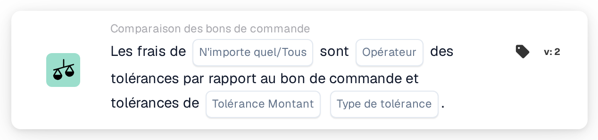
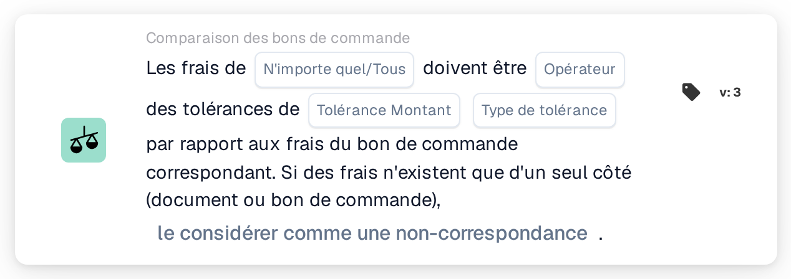
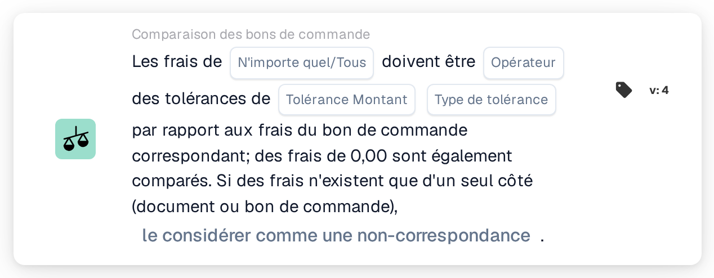

# Tous les frais

<figure><figcaption>
Version 2
</figcaption></figure>

<figure><figcaption>
Version 3
</figcaption></figure>

<figure><figcaption>
Version 4
</figcaption></figure>

## **Objectif :**

Cette carte de Workflow compare les frais annexes d'un document aux frais annexes du bon de commande correspondant, dans une tolérance définie. Elle répond à une seule question : le document et le bon de commande sont-ils d'accord sur les frais annexes ? Chaque frais que le rapprochement de bon de commande a apparié est comparé, si bien qu'aucun nom de champ n'a à être indiqué sur la carte.

Cette carte se distingue de **Comparer les frais totaux**, qui compare un seul champ de document nommé à un frais unique désigné par un Charge ID. Utilisez cette carte lorsque tous les frais appariés du document doivent être vérifiés en une fois.

Le rapprochement de bon de commande doit s'exécuter avant cette carte. Si le document n'a pas de bon de commande correspondant, la carte arrête le Workflow et signale des données manquantes.

## **Composants de la carte :**

1. **N'importe quel/Tous :**
   * **Descriptif** : Comment les comparaisons de frais individuelles sont regroupées en l'unique résultat de la carte.
   * **Possibilités** :
     * **N'importe quel** : au moins un frais doit satisfaire la comparaison.
     * **Tous** : chaque frais doit satisfaire la comparaison.
2. **Opérateur :**
   * **Descriptif** : Comment le montant du frais du document est comparé au montant du bon de commande pour le même frais.
   * **Possibilités** :
     * **dans** : les deux montants doivent concorder, la tolérance étant admise.
     * **A l'extérieur** : les deux montants doivent différer de plus que la tolérance.
3. **Tolérance Montant :**
   * **Descriptif** : L'écart admis entre le frais du document et le frais du bon de commande.
4. **Type de tolérance :**
   * **Descriptif** : Comment le montant de tolérance est interprété.
   * **Possibilités** :
     * **Pour cent** : un pourcentage du frais du bon de commande.
     * **Valeur** : un montant fixe.
5. **Comportement lié aux données manquantes (versions 3 et 4) :**
   * **Descriptif** : Ce qu'il faut faire lorsqu'un frais n'existe que d'un seul côté, sur le document ou sur le bon de commande, de sorte qu'il n'y a aucun homologue auquel le comparer. L'option se trouve à la fin de la phrase.
   * **Possibilités** :
     * **le considérer comme une non-correspondance** : le Workflow s'arrête. C'est la valeur par défaut.
     * **l'ignorer et le considérer comme correspondant** : le Workflow continue comme si le frais avait concordé.

## **Fonctionnalité :**

La carte déroule les étapes suivantes.

1. **Elle exige un bon de commande correspondant.** Sans bon de commande correspondant, la carte s'arrête immédiatement et signale des données manquantes.
2. **Elle lit la tolérance** depuis **Tolérance Montant** et **Type de tolérance** sur la carte.
3. **Les versions 3 et 4 trient chaque ligne de bon de commande appariée** dans l'une de quatre situations : frais des deux côtés, aucun frais d'aucun côté, frais uniquement sur le document, ou frais uniquement sur le bon de commande. La version 3 demande seulement si chaque côté porte un frais supérieur à 0,00. La version 4 examine chaque paire de frais et compte 0,00 comme une valeur ; seul un frais sans aucun montant compte comme manquant. Voir **Différences entre les versions** ci-dessous. Une ligne qui ne peut pas être rattachée aux données de bon de commande du document est une erreur de données et la carte s'arrête.
4. **Un frais présent d'un seul côté décide de toute la carte.** Dès qu'une ligne appariée porte des frais d'un côté et aucun de l'autre, **Comportement lié aux données manquantes** décide du résultat et aucun frais n'est comparé du tout, y compris les frais des lignes correctement appariées. L'opérateur et la tolérance ne sont pas consultés.
5. **Si aucune ligne ne porte de frais d'aucun des deux côtés**, les deux côtés s'accordent sur l'absence de frais annexes. L'opérateur **A l'extérieur** n'est donc pas satisfait, puisque rien ne diffère au-delà de la tolérance, et le Workflow s'arrête. Tout autre opérateur considère l'accord comme satisfait et le Workflow continue. **Comportement lié aux données manquantes** n'a aucun effet ici.
6. **Sinon chaque frais est comparé**, montant du document contre montant du bon de commande, avec l'opérateur et la tolérance. Un montant de frais qui n'est pas un nombre arrête la carte avec des données manquantes.
7. **Les comparaisons sont regroupées et fusionnées une seule fois.** Chaque frais de chaque ligne appariée contribue à un unique ensemble de résultats, que le réglage **N'importe quel/Tous** réduit à l'unique résultat de la carte. Le regroupement est à l'échelle du document, non par ligne, de sorte que **N'importe quel** signifie n'importe quel frais à n'importe quel endroit du document. Si le résultat fusionné est vrai, le Workflow continue, sinon il s'arrête sur une condition non satisfaite.

Trois conséquences méritent d'être connues avant de configurer la carte.

* **dans avec une tolérance de 0 exige une égalité exacte.** Les deux montants doivent concorder au centime.
* **Un frais présent d'un seul côté prime sur tout le reste.** Comme l'étape 4 s'exécute avant toute comparaison, **l'ignorer et le considérer comme correspondant** saute aussi la vérification des montants de chaque frais correctement apparié du document. Conservez **le considérer comme une non-correspondance** si les montants doivent être vérifiés.
* **le considérer comme une non-correspondance arrête le Workflow en erreur, non sur une condition non satisfaite.** Malgré la formulation, la carte signale des données manquantes, ce que le journal du Workflow et le test de carte affichent en rouge et non en orange comme une condition non satisfaite. Le Workflow s'arrête dans les deux cas.

## **Installation et configuration :**

Ajoutez la carte comme condition And après le rapprochement de bon de commande. Choisissez si chaque frais ou n'importe quel frais doit satisfaire la comparaison, choisissez l'opérateur **dans** ou **A l'extérieur**, puis saisissez le montant et le type de tolérance. En versions 3 et 4, choisissez ce qui doit se produire lorsque des frais n'apparaissent que d'un seul côté.

Pour essayer une configuration sans attendre un document, ouvrez le menu de la carte dans le Workflow Builder, choisissez **Tester la carte**, choisissez un document puis **Tester avec ce document**. Le journal de la carte énumère chaque frais comparé avec les deux montants, l'opérateur et la tolérance utilisée, et note aussi quelle valeur de **Comportement lié aux données manquantes** a décidé du résultat lorsqu'un frais n'était présent que d'un seul côté.

## **Exemple de scénario :**

Une confirmation de commande porte des frais de transport de 100,00 et la ligne de bon de commande correspondante porte les mêmes frais de transport de 100,00. Avec **Tous**, l'opérateur **dans** et une tolérance de 0 en valeur, les montants sont égaux, la carte est satisfaite et le Workflow continue.

Avec 120,00 sur la confirmation de commande contre 100,00 sur le bon de commande, la même configuration n'est pas satisfaite et le Workflow s'arrête sur une condition non satisfaite.

Si ni la confirmation de commande ni le bon de commande ne porte de frais, l'opérateur **dans** considère cela comme un accord et le Workflow continue, tandis que **A l'extérieur** l'arrête.

Si la confirmation de commande porte des frais de transport et le bon de commande aucun, l'opérateur ne s'applique plus. Avec **le considérer comme une non-correspondance**, le Workflow s'arrête afin que quelqu'un puisse vérifier pourquoi les frais ne figurent que d'un seul côté.

Si la confirmation de commande indique les frais de transport à 0,00 alors que le bon de commande porte 204,00, la version 4 compare les deux montants et le Workflow s'arrête sur une condition non satisfaite. La version 3 lirait le 0,00 comme « aucun frais sur le document » et laisserait **Comportement lié aux données manquantes** décider du résultat.

## **Différences entre les versions :**

La version 4 est celle des nouvelles cartes. Les versions 2 et 3 restent prises en charge dans les Workflows existants.

### Version 4 comparée à la version 3

Les deux versions ont les mêmes réglages et les mêmes étapes. Elles ne diffèrent que par le traitement d'un frais de 0,00 :

* **La version 3 traite 0,00 comme une absence de frais.** Un frais de document de 0,00 apparié à un frais de bon de commande de 204,00 compte comme « le bon de commande a des frais, le document n'en a pas », si bien que **Comportement lié aux données manquantes** décide et que les montants ne sont jamais comparés. Avec **l'ignorer et le considérer comme correspondant**, le Workflow continue, bien que les montants diffèrent.
* **La version 4 compare 0,00 comme un montant.** La même paire est comparée comme n'importe quelle autre : 0,00 contre 204,00 n'est pas dans la tolérance, donc le Workflow s'arrête sur une condition non satisfaite. Une paire avec 0,00 des deux côtés est comparée aussi et concorde.
* **Un frais sans montant reste manquant en version 4.** Lorsqu'un côté d'une paire n'a aucun montant, par exemple un frais que le bon de commande ne porte pas, **Comportement lié aux données manquantes** décide, comme en version 3.

Pour obtenir ce comportement dans un Workflow existant, remplacez la carte en version 3 par une carte en version 4 et saisissez les mêmes valeurs.

### Version 2

La version 2 compare elle aussi frais par frais et fusionne les résultats à l'échelle du document avec le réglage **N'importe quel/Tous**, mais elle n'a pas de classement par cas, ce qui change ce qui se produit dès que des frais ne sont pas présents des deux côtés :

* La version 2 n'a pas d'option **Comportement lié aux données manquantes**. Sa phrase se termine après le type de tolérance.
* La version 2 ne trie pas les lignes appariées et ne reconnaît donc pas un frais qui n'existe que d'un seul côté. Elle compare le montant présent au 0,00 retenu pour le côté manquant, et l'opérateur décide : **dans** n'est pas satisfait et le Workflow s'arrête, **A l'extérieur** est satisfait et le Workflow continue. Le journal de la carte montre la comparaison contre 0,00.
* Si aucun des deux côtés ne porte de frais, la version 2 n'a rien à comparer et signale des données manquantes au lieu de considérer l'absence des deux côtés comme un accord.

## **Conclusion :**

La carte « Any / All Charges » automatise la vérification que les frais annexes facturés ou confirmés correspondent aux frais annexes commandés. Comme l'absence de frais des deux côtés vaut accord en versions 3 et 4, les documents sans frais annexes passent sans intervention manuelle, tandis que les frais n'apparaissant que d'un seul côté sont retenus pour vérification, sauf si cela est délibérément autorisé.
