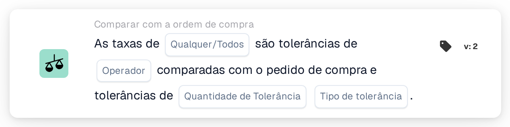
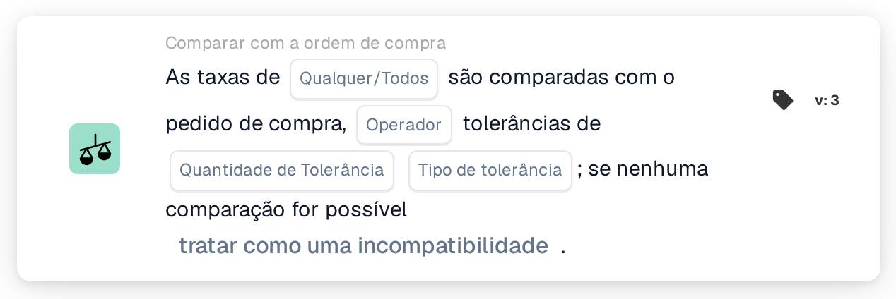
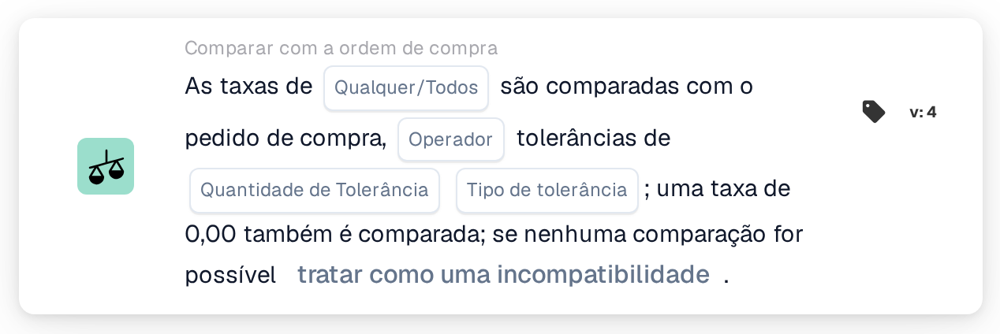

# Qualquer/todas as cobranças

<figure><figcaption>
Versão 2
</figcaption></figure>

<figure><figcaption>
Versão 3
</figcaption></figure>

<figure><figcaption>
Versão 4
</figcaption></figure>

## **Objetivo:**

Este cartão de Workflow compara os encargos adicionais de um documento com os encargos adicionais da ordem de compra correspondente, dentro de uma tolerância definida. Responde a uma única pergunta: o documento e a ordem de compra concordam quanto aos encargos adicionais? É comparado cada encargo que a correspondência da ordem de compra emparelhou, pelo que não é necessário indicar qualquer nome de campo no cartão.

Este cartão distingue-se de **Comparar cobranças totais**, que compara um único campo do documento com um só encargo identificado por um Charge ID. Utilize este cartão quando todos os encargos emparelhados do documento devam ser verificados de uma só vez.

A correspondência da ordem de compra tem de ser executada antes deste cartão. Se o documento não tiver uma ordem de compra correspondente, o cartão interrompe o Workflow e comunica dados ausentes.

## **Componentes do cartão:**

1. **Qualquer/Todos:**
   * **Descrição**: Como as comparações de encargos individuais são reunidas no único resultado do cartão.
   * **Opções**:
     * **Qualquer**: pelo menos um encargo tem de satisfazer a comparação.
     * **Todos**: cada encargo tem de satisfazer a comparação.
2. **Operador:**
   * **Descrição**: Como o montante do encargo do documento é comparado com o montante da ordem de compra para o mesmo encargo.
   * **Opções**:
     * **dentro de**: os dois montantes têm de concordar, admitindo a tolerância.
     * **Fora**: os dois montantes têm de diferir em mais do que a tolerância.
3. **Quantidade de Tolerância:**
   * **Descrição**: O desvio admitido entre o encargo do documento e o encargo da ordem de compra.
4. **Tipo de tolerância:**
   * **Descrição**: Como a quantidade de tolerância é interpretada.
   * **Opções**:
     * **Por cento**: uma percentagem do encargo da ordem de compra.
     * **Valor**: um montante fixo.
5. **Comportamento de dados ausentes (versões 3 e 4):**
   * **Descrição**: O que fazer quando um encargo existe apenas de um lado, no documento ou na ordem de compra, de modo que não há contraparte com que o comparar. A opção situa-se no fim da frase.
   * **Opções**:
     * **tratar como uma incompatibilidade**: o Workflow para. É a predefinição.
     * **ignore e trate como uma correspondência.**: o Workflow continua como se o encargo tivesse concordado.

## **Funcionalidade:**

O cartão percorre os passos seguintes.

1. **Exige uma ordem de compra correspondente.** Sem ordem de compra correspondente, o cartão para imediatamente e comunica dados ausentes.
2. **Lê a tolerância** de **Quantidade de Tolerância** e **Tipo de tolerância** no cartão.
3. **As versões 3 e 4 classificam cada linha de ordem de compra emparelhada** numa de quatro situações: encargos em ambos os lados, nenhum encargo em qualquer dos lados, encargos apenas no documento, ou encargos apenas na ordem de compra. A versão 3 pergunta apenas se cada lado tem um encargo superior a 0,00. A versão 4 analisa cada par de encargos e conta 0,00 como um valor; só um encargo sem qualquer montante conta como ausente. Consulte **Diferenças entre versões** abaixo. Uma linha que não possa ser associada aos dados da ordem de compra do documento é um erro de dados e o cartão para.
4. **Um encargo presente apenas de um lado decide todo o cartão.** Assim que uma linha emparelhada tem encargos de um lado e nenhum do outro, **Comportamento de dados ausentes** decide o resultado e nenhum encargo é comparado, nem mesmo os encargos das linhas corretamente emparelhadas. O operador e a tolerância não são consultados.
5. **Se nenhuma linha tiver encargos em qualquer dos dois lados**, ambos os lados concordam que não existem encargos adicionais. O operador **Fora** não fica assim satisfeito, porque nada difere além da tolerância, e o Workflow para. Qualquer outro operador considera a concordância satisfeita e o Workflow continua. **Comportamento de dados ausentes** não tem efeito aqui.
6. **Caso contrário cada encargo é comparado**, montante do documento contra montante da ordem de compra, com o operador e a tolerância. Um montante de encargo que não seja um número para o cartão com dados ausentes.
7. **As comparações são reunidas e combinadas uma só vez.** Cada encargo de cada linha emparelhada contribui para um único conjunto de resultados, que a definição **Qualquer/Todos** reduz ao único resultado do cartão. A reunião é à escala do documento, não por linha, pelo que **Qualquer** significa qualquer encargo em qualquer ponto do documento. Se o resultado combinado for verdadeiro o Workflow continua, caso contrário para com uma condição não satisfeita.

Vale a pena conhecer três consequências antes de configurar o cartão.

* **dentro de com uma tolerância de 0 exige igualdade exata.** Os dois montantes têm de concordar ao cêntimo.
* **Um encargo presente apenas de um lado prevalece sobre tudo o resto.** Como o passo 4 é executado antes de qualquer comparação, **ignore e trate como uma correspondência.** também salta a verificação de montantes de cada encargo corretamente emparelhado do documento. Mantenha **tratar como uma incompatibilidade** se os montantes tiverem de ser verificados.
* **tratar como uma incompatibilidade para o Workflow como erro, não como condição não satisfeita.** Apesar da formulação, o cartão comunica dados ausentes, o que o registo do Workflow e o teste do cartão mostram em vermelho e não em laranja como uma condição não satisfeita. O Workflow para em ambos os casos.

## **Instalação e configuração:**

Adicione o cartão como condição And após a correspondência da ordem de compra. Escolha se cada encargo ou qualquer encargo tem de satisfazer a comparação, escolha o operador **dentro de** ou **Fora** e introduza a quantidade e o tipo de tolerância. Nas versões 3 e 4, escolha o que deve acontecer quando os encargos surgem apenas de um lado.

Para experimentar uma configuração sem esperar por um documento, abra o menu do cartão no Workflow Builder, escolha **Cartão de teste**, escolha um documento e depois **Teste no documento**. O registo do cartão enumera cada encargo comparado com ambos os montantes, o operador e a tolerância utilizada, e registra também qual o valor de **Comportamento de dados ausentes** que decidiu o resultado quando um encargo estava presente apenas de um lado.

## **Cenário de exemplo:**

Uma confirmação de encomenda tem um encargo de transporte de 100,00 e a linha de ordem de compra correspondente tem o mesmo encargo de transporte de 100,00. Com **Todos**, o operador **dentro de** e uma tolerância de 0 como valor, os montantes são iguais, o cartão fica satisfeito e o Workflow continua.

Com 120,00 na confirmação de encomenda contra 100,00 na ordem de compra, a mesma configuração não fica satisfeita e o Workflow para com uma condição não satisfeita.

Se nem a confirmação de encomenda nem a ordem de compra tiverem qualquer encargo, o operador **dentro de** considera isso concordância e o Workflow continua, enquanto **Fora** o para.

Se a confirmação de encomenda tiver um encargo de transporte e a ordem de compra nenhum, o operador deixa de se aplicar. Com **tratar como uma incompatibilidade** o Workflow para, para que alguém possa verificar por que razão o encargo consta apenas de um lado.

Se a confirmação de encomenda apresentar o encargo de transporte como 0,00 enquanto a ordem de compra tem 204,00, a versão 4 compara os dois montantes e o Workflow para com uma condição não satisfeita. A versão 3 interpretaria o 0,00 como "nenhum encargo no documento" e deixaria o resultado a **Comportamento de dados ausentes**.

## **Diferenças entre versões:**

A versão 4 é a que os cartões novos usam. As versões 2 e 3 continuam suportadas nos Workflows existentes.

### Versão 4 comparada com a versão 3

As duas versões têm as mesmas definições e os mesmos passos. Diferem apenas na forma como um encargo de 0,00 é tratado:

* **A versão 3 trata 0,00 como nenhum encargo.** Um encargo do documento de 0,00 emparelhado com um encargo da ordem de compra de 204,00 conta como "a ordem de compra tem encargos, o documento não tem nenhum", pelo que **Comportamento de dados ausentes** decide e os montantes nunca são comparados. Com **ignore e trate como uma correspondência.** o Workflow continua, embora os montantes sejam diferentes.
* **A versão 4 compara 0,00 como um montante.** O mesmo par é comparado como qualquer outro: 0,00 contra 204,00 não está dentro da tolerância, pelo que o Workflow para com uma condição não satisfeita. Um par com 0,00 em ambos os lados também é comparado e concorda.
* **Um encargo sem montante continua ausente na versão 4.** Quando um lado de um par não tem qualquer montante, por exemplo um encargo que a ordem de compra não tem, **Comportamento de dados ausentes** decide, tal como na versão 3.

Para obter este comportamento num Workflow existente, substitua o cartão da versão 3 por um cartão da versão 4 e defina os mesmos valores.

### Versão 2

A versão 2 também compara encargo por encargo e combina os resultados à escala do documento com a definição **Qualquer/Todos**, mas não tem classificação por casos, o que altera o que acontece assim que os encargos não estão presentes em ambos os lados:

* A versão 2 não tem a opção **Comportamento de dados ausentes**. A sua frase termina após o tipo de tolerância.
* A versão 2 não classifica as linhas emparelhadas e por isso não reconhece um encargo que existe apenas de um lado. Compara o montante presente contra o 0,00 mantido para o lado ausente, e o operador decide: **dentro de** não fica satisfeito e o Workflow para, **Fora** fica satisfeito e o Workflow continua. O registo do cartão mostra a comparação contra 0,00.
* Se nenhum dos dois lados tiver encargos, a versão 2 não tem nada a comparar e comunica dados ausentes em vez de considerar a ausência em ambos os lados como concordância.

## **Conclusão:**

O cartão "Any / All Charges" automatiza a verificação de que os encargos adicionais faturados ou confirmados correspondem aos encargos adicionais encomendados. Como a ausência de encargos em ambos os lados conta como concordância nas versões 3 e 4, os documentos sem encargos adicionais passam sem intervenção manual, enquanto os encargos que surgem apenas de um lado são retidos para revisão, salvo se isso for deliberadamente permitido.
