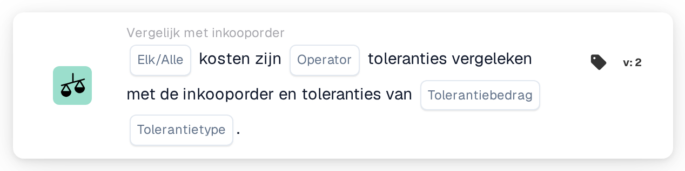
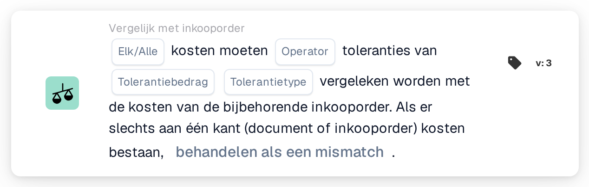
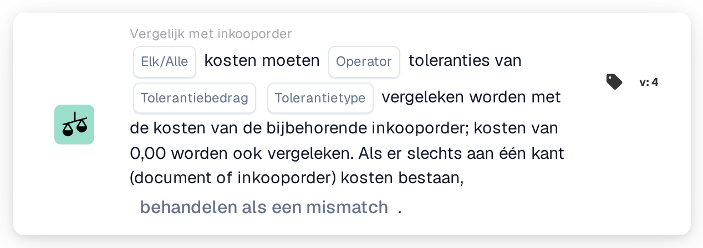

# Alle/alle kosten

<figure><figcaption>
Versie 2
</figcaption></figure>

<figure><figcaption>
Versie 3
</figcaption></figure>

<figure><figcaption>
Versie 4
</figcaption></figure>

## **Doel:**

Deze workflowkaart vergelijkt de bijkomende kosten op een document met de bijkomende kosten op de gekoppelde inkooporder, binnen een vastgestelde tolerantie. Ze beantwoordt één vraag: zijn document en inkooporder eens over de bijkomende kosten? Elke kost die de inkoopordermatching aan elkaar heeft gekoppeld wordt vergeleken, waardoor er geen veldnaam op de kaart hoeft te worden opgegeven.

Deze kaart verschilt van **Vergelijk totale kosten**, die één benoemd documentveld vergelijkt met één kost die via een Charge ID wordt aangewezen. Gebruik deze kaart wanneer alle gekoppelde kosten op het document in één keer gecontroleerd moeten worden.

De inkoopordermatching moet vóór deze kaart lopen. Heeft het document geen gekoppelde inkooporder, dan stopt de kaart de workflow en meldt ze ontbrekende gegevens.

## **Onderdelen van de kaart:**

1. **Elk/Alle:**
   * **Beschrijving**: Hoe de afzonderlijke kostenvergelijkingen worden samengevoegd tot het ene resultaat van de kaart.
   * **Opties**:
     * **Elk**: minstens één kost moet aan de vergelijking voldoen.
     * **Alle**: elke kost moet aan de vergelijking voldoen.
2. **Exploitant:**
   * **Beschrijving**: Hoe het kostenbedrag van het document wordt vergeleken met het bedrag van de inkooporder voor dezelfde kost.
   * **Opties**:
     * **binnenin**: de twee bedragen moeten overeenkomen, waarbij de tolerantie is toegestaan.
     * **Buiten**: de twee bedragen moeten meer dan de tolerantie van elkaar afwijken.
3. **Tolerantiebedrag:**
   * **Beschrijving**: De toegestane afwijking tussen de kost op het document en de kost op de inkooporder.
4. **Tolerantietype:**
   * **Beschrijving**: Hoe het tolerantiebedrag wordt uitgelegd.
   * **Opties**:
     * **Procent**: een percentage van de kost op de inkooporder.
     * **Waarde**: een vast bedrag.
5. **Gedrag bij ontbrekende gegevens (versies 3 en 4):**
   * **Beschrijving**: Wat er moet gebeuren wanneer een kost slechts aan één zijde bestaat, op het document of op de inkooporder, zodat er geen tegenhanger is om ermee te vergelijken. De optie staat aan het einde van de zin.
   * **Opties**:
     * **behandelen als een mismatch**: de workflow stopt. Dit is de standaardinstelling.
     * **negeer het en behandel het als een match**: de workflow loopt verder alsof de kost overeenkwam.

## **Functionaliteit:**

De kaart doorloopt de volgende stappen.

1. **Ze vereist een gekoppelde inkooporder.** Zonder gekoppelde inkooporder stopt de kaart onmiddellijk en meldt ze ontbrekende gegevens.
2. **Ze leest de tolerantie** uit **Tolerantiebedrag** en **Tolerantietype** op de kaart.
3. **Versies 3 en 4 sorteren elke gekoppelde inkooporderregel** in één van vier situaties: kosten aan beide zijden, geen kosten aan beide zijden, kosten alleen op het document, of kosten alleen op de inkooporder. Versie 3 vraagt alleen of een zijde een kost boven 0,00 draagt. Versie 4 bekijkt elk kostenpaar en telt 0,00 als waarde; alleen een kost zonder enig bedrag geldt als ontbrekend. Zie **Verschillen tussen de versies** hieronder. Een regel die niet aan de inkooporderdata van het document kan worden gekoppeld is een gegevensfout en de kaart stopt.
4. **Een kost aan slechts één zijde beslist de hele kaart.** Zodra één gekoppelde regel kosten aan de ene zijde draagt en geen aan de andere, beslist **Gedrag bij ontbrekende gegevens** het resultaat en wordt er helemaal geen kost vergeleken, ook niet de kosten van correct gekoppelde regels. Operator en tolerantie worden niet geraadpleegd.
5. **Draagt geen enkele regel aan één van beide zijden kosten**, dan zijn beide zijden het erover eens dat er geen bijkomende kosten zijn. De operator **Buiten** is daarmee niet voldaan, omdat er niets meer dan de tolerantie afwijkt, en de workflow stopt. Elke andere operator beschouwt de overeenstemming als voldaan en de workflow loopt verder. **Gedrag bij ontbrekende gegevens** heeft hier geen effect.
6. **Anders wordt elke kost vergeleken**, documentbedrag tegen inkooporderbedrag, met de operator en de tolerantie. Een kostenbedrag dat geen getal is stopt de kaart met ontbrekende gegevens.
7. **De vergelijkingen worden gebundeld en één keer samengevoegd.** Elke kost van elke gekoppelde regel draagt bij aan één resultatenverzameling, die de instelling **Elk/Alle** terugbrengt tot het ene resultaat van de kaart. Er wordt documentbreed gebundeld, niet per regel, zodat **Elk** elke kost op willekeurige plaats in het document betekent. Is het samengevoegde resultaat waar, dan loopt de workflow verder, anders stopt hij met een niet voldane voorwaarde.

Drie gevolgen zijn belangrijk om te weten vóór het configureren van de kaart.

* **binnenin met een tolerantie van 0 vereist exacte gelijkheid.** De twee bedragen moeten tot op de cent overeenkomen.
* **Een kost aan slechts één zijde overstemt al het andere.** Omdat stap 4 vóór elke vergelijking loopt, slaat **negeer het en behandel het als een match** ook de bedragcontrole van elke correct gekoppelde kost in het document over. Houd **behandelen als een mismatch** aan wanneer de bedragen gecontroleerd moeten worden.
* **behandelen als een mismatch stopt de workflow als fout, niet als niet voldane voorwaarde.** Ondanks de formulering meldt de kaart ontbrekende gegevens, wat het workflowlogboek en de kaarttest rood weergeven en niet oranje zoals een niet voldane voorwaarde. De workflow stopt in beide gevallen.

## **Instelling en configuratie:**

Voeg de kaart toe als And-voorwaarde na de inkoopordermatching. Kies of elke of één willekeurige kost aan de vergelijking moet voldoen, kies de operator **binnenin** of **Buiten** en voer tolerantiebedrag en tolerantietype in. Kies in versie 3 en 4 wat er moet gebeuren wanneer kosten aan slechts één zijde voorkomen.

Om een configuratie te proberen zonder op een document te wachten, opent u het kaartmenu in de Workflow Builder, kiest u **Testkaart**, kiest u een document en daarna **Test op document**. Het kaartlogboek somt elke vergeleken kost op met beide bedragen, de operator en de gebruikte tolerantie, en houdt ook bij welke waarde van **Gedrag bij ontbrekende gegevens** het resultaat heeft beslist toen een kost aan slechts één zijde aanwezig was.

## **Voorbeeldscenario:**

Een orderbevestiging draagt een vrachtkost van 100,00 en de gekoppelde inkooporderregel draagt dezelfde vrachtkost van 100,00. Met **Alle**, de operator **binnenin** en een tolerantie van 0 als waarde zijn de bedragen gelijk, de kaart is voldaan en de workflow loopt verder.

Met 120,00 op de orderbevestiging tegen 100,00 op de inkooporder is dezelfde configuratie niet voldaan en stopt de workflow met een niet voldane voorwaarde.

Draagt noch de orderbevestiging noch de inkooporder een kost, dan beschouwt de operator **binnenin** dat als overeenstemming en loopt de workflow verder, terwijl **Buiten** hem stopt.

Draagt de orderbevestiging een vrachtkost en de inkooporder geen, dan geldt de operator niet meer. Met **behandelen als een mismatch** stopt de workflow, zodat iemand kan nagaan waarom de kost slechts aan één zijde staat.

Toont de orderbevestiging de vrachtkost als 0,00 terwijl de inkooporder 204,00 draagt, dan vergelijkt versie 4 de twee bedragen en stopt de workflow met een niet voldane voorwaarde. Versie 3 zou de 0,00 lezen als "geen kost op het document" en het resultaat overlaten aan **Gedrag bij ontbrekende gegevens**.

## **Verschillen tussen de versies:**

Versie 4 gebruiken nieuwe kaarten. Versies 2 en 3 blijven in bestaande workflows ondersteund.

### Versie 4 vergeleken met versie 3

De twee versies hebben dezelfde instellingen en dezelfde stappen. Ze verschillen alleen in hoe een kost van 0,00 wordt behandeld:

* **Versie 3 behandelt 0,00 als geen kost.** Een documentkost van 0,00 gekoppeld aan een inkooporderkost van 204,00 telt als "de inkooporder heeft kosten, het document niet", dus beslist **Gedrag bij ontbrekende gegevens** en worden de bedragen nooit vergeleken. Met **negeer het en behandel het als een match** loopt de workflow verder, hoewel de bedragen verschillen.
* **Versie 4 vergelijkt 0,00 als bedrag.** Hetzelfde paar wordt vergeleken zoals elk ander: 0,00 tegen 204,00 valt niet binnen de tolerantie, dus stopt de workflow met een niet voldane voorwaarde. Een paar met 0,00 aan beide zijden wordt ook vergeleken en komt overeen.
* **Een kost zonder bedrag ontbreekt ook in versie 4.** Heeft één zijde van een paar helemaal geen bedrag, bijvoorbeeld een kost die de inkooporder niet draagt, dan beslist **Gedrag bij ontbrekende gegevens**, zoals in versie 3.

Om dit gedrag in een bestaande workflow te krijgen, vervangt u de kaart van versie 3 door een kaart van versie 4 en stelt u dezelfde waarden in.

### Versie 2

Ook versie 2 vergelijkt per kost en voegt de resultaten documentbreed samen met de instelling **Elk/Alle**, maar ze heeft geen gevalsindeling, wat verandert wat er gebeurt zodra kosten niet aan beide zijden aanwezig zijn:

* Versie 2 heeft geen optie **Gedrag bij ontbrekende gegevens**. Haar zin eindigt na het tolerantietype.
* Versie 2 sorteert de gekoppelde regels niet en herkent daardoor geen kost die slechts aan één zijde bestaat. Ze vergelijkt het aanwezige bedrag tegen de 0,00 van de ontbrekende zijde, en de operator beslist: **binnenin** is niet voldaan en de workflow stopt, **Buiten** is voldaan en de workflow loopt verder. Het kaartlogboek toont de vergelijking tegen 0,00.
* Draagt geen van beide zijden kosten, dan heeft versie 2 niets te vergelijken en meldt ze ontbrekende gegevens in plaats van het ontbreken aan beide zijden als overeenstemming te beschouwen.

## **Conclusie:**

De kaart "Any / All Charges" automatiseert de controle dat de gefactureerde of bevestigde bijkomende kosten overeenkomen met de bestelde bijkomende kosten. Omdat het ontbreken van kosten aan beide zijden in versie 3 en 4 als overeenstemming geldt, lopen documenten zonder bijkomende kosten zonder handmatig ingrijpen door, terwijl kosten die aan slechts één zijde voorkomen ter controle worden tegengehouden, tenzij dat uitdrukkelijk wordt toegestaan.
